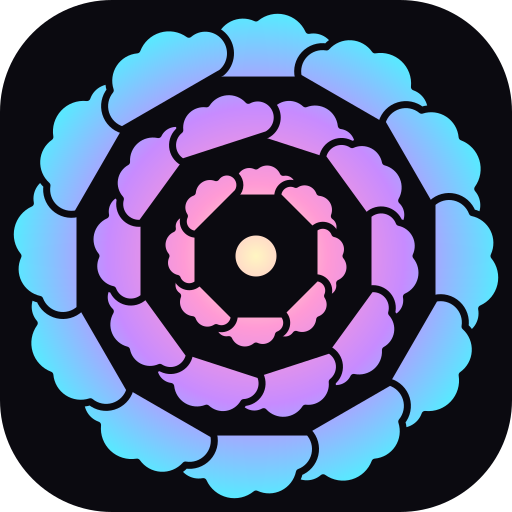
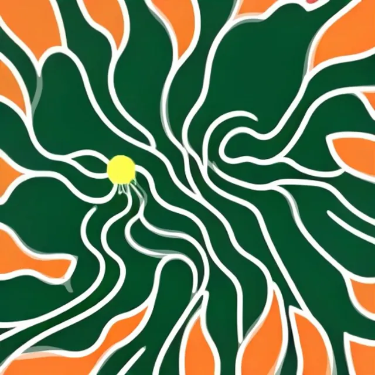
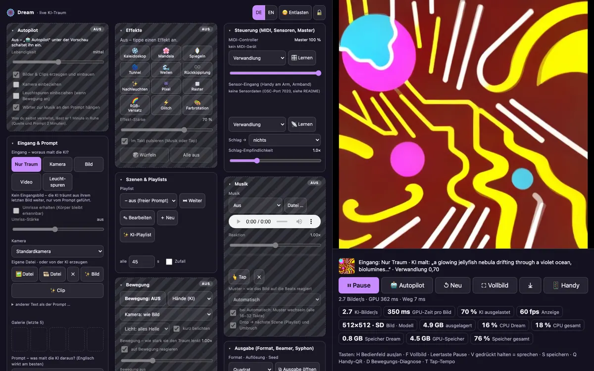
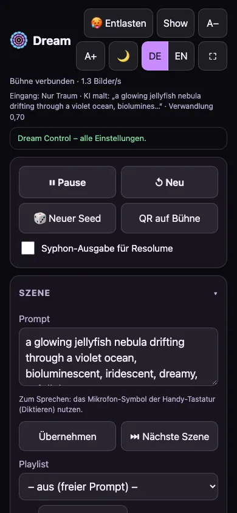
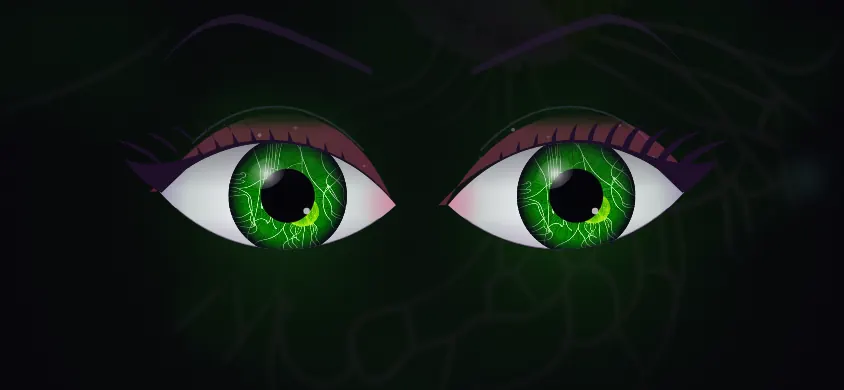
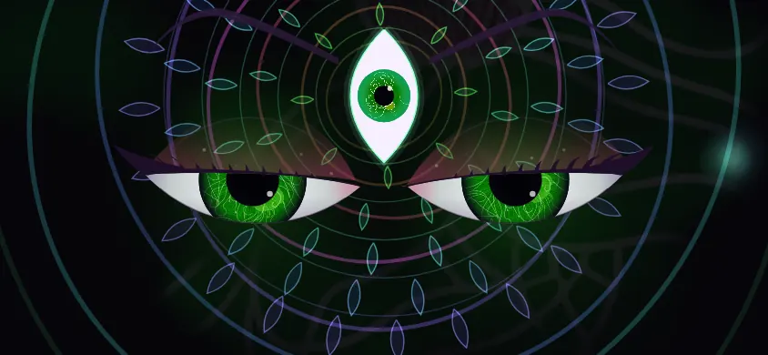
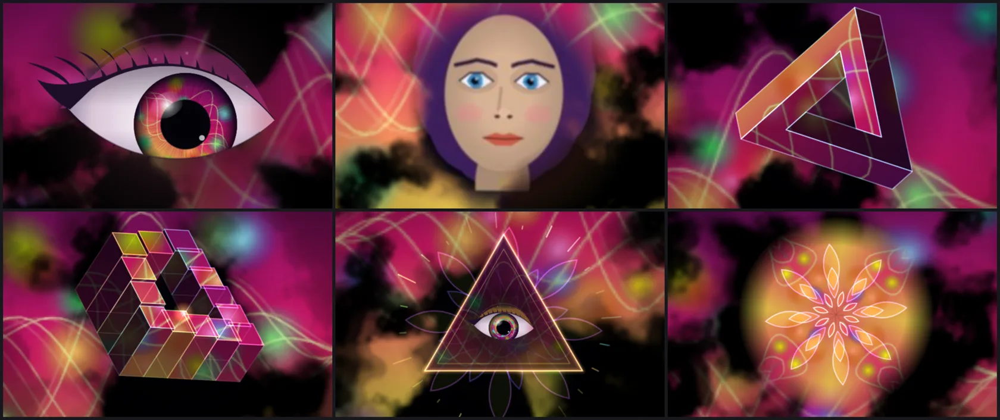

<p align="center"></p>

<h1 align="center">Dream</h1>

<p align="center"><b>Live-KI-Visuals für VJs, Künstler und Installationen</b><br>
<i>Deutsch · English: <a href="README.md">README.md</a></i></p>

<p align="center"><a href="#auf-einen-blick">Schnellstart</a> · <a href="#starten">Starten</a> · <a href="#bedienung">Bedienung</a> · <a href="#fernbedienung-per-handy">Handys</a> · <a href="#dreamy-eyes--ein-handy-als-träumende-augen-installation">Dreamy Eyes</a> · <a href="#bewegung">Bewegung</a> · <a href="#scaleway-gpu">Cloud-GPU</a> · <a href="#wenn-etwas-hakt">Hilfe</a> · <a href="#lizenzen">Lizenzen</a></p>

Dream ist ein endloser, sich ständig verwandelnder Bilderstrom: Ein schnelles Bildmodell (SD-Turbo bzw. SDXL-Turbo)
verwandelt jedes Bild ins nächste. Es läuft auf einem Mac mit Apple Silicon im Browser, nur unter
`127.0.0.1`. Gerechnet wird wahlweise **lokal** auf der Apple-GPU oder auf einer gemieteten **Cloud-GPU** (RunPod, Rechenzentren in Europa).

<p align="center"></p>

## Inhalt

**Loslegen**

- [Auf einen Blick](#auf-einen-blick)
- [Starten](#starten)
  - [Aktualisieren](#aktualisieren)
- [Ordner und eigene Einstellungen](#ordner-und-eigene-einstellungen)

**Spielen**

- [Bedienung](#bedienung)
  - [Autopilot](#autopilot)
  - [Bilder und Clips per Prompt](#bilder-und-clips-per-prompt)
- [Playlists und Autostart](#playlists-und-autostart)
- [Ausgabe auf Beamer oder zweitem Monitor (16:9)](#ausgabe-auf-beamer-oder-zweitem-monitor-169)
- [Als Quelle in Resolume (Syphon)](#als-quelle-in-resolume-syphon)

**Handys und Tablets**

- [Fernbedienung per Handy](#fernbedienung-per-handy)
  - [Dream Remote (Gäste) und Dream Control (du)](#dream-remote-gäste-und-dream-control-du)
  - [Dream Control über https und als App](#dream-control-über-https-und-als-app)
  - [Auf dem Tablet (Android, #141)](#auf-dem-tablet-android-141)
  - [Live-Kamera und Bewegung des Control-Geräts](#live-kamera-und-bewegung-des-control-geräts)
  - [Wenn das Handy nicht verbindet](#wenn-das-handy-nicht-verbindet)
- [Dreamy Eyes – ein Handy als träumende Augen (Installation)](#dreamy-eyes--ein-handy-als-träumende-augen-installation)
- [Traum-Fenster – alte Handys und Tablets als Fenster zum Traum](#traum-fenster--alte-handys-und-tablets-als-fenster-zum-traum)

**Bewegung und Controller**

- [Bewegung](#bewegung)
  - [Lichtspuren träumen (Quelle „Leuchtspuren“)](#lichtspuren-träumen-quelle-leuchtspuren)
  - [Umrisse erhalten (ControlNet, #113)](#umrisse-erhalten-controlnet-113)
  - [Pose formt die Figur (ControlNet)](#pose-formt-die-figur-controlnet)
- [Tanz](#tanz)
  - [Dream Dance: die Seite, die Kupplung, die Sets](#dream-dance-die-seite-die-kupplung-die-sets)
  - [Tanz-Labor](#tanz-labor)
- [MIDI-Controller](#midi-controller)
- [Sensor-Eingang (Bewegung im Dunkeln: Handy am Arm, später Armband)](#sensor-eingang-bewegung-im-dunkeln-handy-am-arm-später-armband)

**Cloud-GPU**

- [Cloud-GPU](#cloud-gpu)
  - [Benutzen](#benutzen)
- [RunPod-GPU](#runpod-gpu)
- [Scaleway-GPU (zurzeit nicht verfügbar)](#scaleway-gpu-zurzeit-nicht-verfügbar)

**Hilfe und mehr**

- [Wenn etwas hakt](#wenn-etwas-hakt)
- [Platz und Entfernen](#platz-und-entfernen)
- [Tests](#tests)
- [Lizenzen](#lizenzen)

---

## Auf einen Blick

| Was | Befehl / Adresse |
|---|---|
| Starten (nur dieser Mac) | `./dream.sh` |
| Starten mit Handy-Fernbedienung | `./dream.sh --lan` |
| Bedienfeld und Bühne | http://127.0.0.1:7860 (selbst öffnen, oder `./dream.sh --open`) |
| Bildausgabe für Beamer (rechnet nicht mit) | http://127.0.0.1:7860/output, Knopf „⧉ Ausgabe öffnen“ oder `dream.sh --beamer` |
| Nur Bühne, ohne Bedienelemente | http://127.0.0.1:7860/?stage=1 (oder `dream.sh --stage`), dann **F** |
| Handy verbinden | auf der Bühne **Q** → QR-Code scannen (siehe unten) |
| Alle Optionen | `./dream.sh --help` |
| Beenden | Strg+C im Terminal |
| Cloud-GPU prüfen | `./dream-cloud status` |

<sub>[↑ Inhalt](#inhalt)</sub>

## Starten

**Was du brauchst:**

| | Nötig | Wofür |
|---|---|---|
| Mac mit Apple Silicon (M1 oder neuer), 16 GB Arbeitsspeicher oder mehr | ja | lokal rechnen (SD-Turbo; SDXL-Turbo braucht mehr Speicher oder die Cloud) |
| [uv](https://docs.astral.sh/uv/) (`brew install uv`) | ja | `dream.sh` installiert die Python-Pakete selbst |
| etwa 3 GB freier Platz (SDXL-Turbo: etwa 7 GB mehr) | ja | die Modelle, beim ersten Gebrauch geladen |
| Chrome (oder ein anderer aktueller Browser) | ja | Bedienfeld und Bühne; Chrome für `--beamer` und die installierbaren Apps |
| [Ollama](https://ollama.com) mit `llama3.2:3b` | optional | Prompt-Ideen und erzeugte Playlists |
| `ffmpeg` (`brew install ffmpeg`) | optional | Clips als Video speichern |
| Ein [RunPod](https://www.runpod.io/)-Konto | optional | eine Cloud-GPU statt der des Macs |

Auf dem Mac:

```bash
./dream.sh
```

Dream öffnet **kein** Browserfenster von selbst; nach etwa 15 Sekunden steht im Terminal „Dream ist bereit“ mit den
Adressen. Dann http://127.0.0.1:7860 im Browser öffnen (oder gleich `./dream.sh --open`). **Gerechnet wird nur,
während Bedienfeld oder Bühne in einem Browser offen sind** – das Ausgabefenster allein rechnet nicht. Beenden mit Strg+C. Beim ersten lokalen Bild wird
SD-Turbo geladen (etwa 2,6 GB, einmalig) – die Bühne zeigt das mit einem Badge an, das Terminal den Fortschritt; das erste
Bild nach jedem Start dauert ein paar Sekunden.

Läuft Dream schon im Hintergrund (ohne Terminal), beendest du es mit `pkill -f "uvicorn server:app"`.

<sub>[↑ Inhalt](#inhalt)</sub>

### Aktualisieren

Nach neuen Funktionen (oder wenn etwas fehlt, das hier beschrieben ist):

```bash
cd <Dream-Ordner> && git switch main && git pull
```

Danach Dream mit Strg+C beenden und neu starten – ein laufendes Dream behält sonst den alten Stand. Neue
Python-Pakete installiert `dream.sh` beim Start von selbst.

Zum Ausprobieren eines Tickets vor der Abnahme: `git switch <branch>` (steht im Ticket), danach zurück mit
`git switch main`.

## Ordner und eigene Einstellungen

Alle Befehle hier laufen im **Dream-Ordner** (dort, wo dieses Repository liegt): `cd <Dream-Ordner>`, dann `./dream.sh`.
Die Bewegungserkennung ist in Dream eingebaut; das separate Programm flowtrack braucht Dream nicht mehr.

**Einstellungen auf diesem Mac** (Pfade, Ports, Kamera) gehören in `~/.config/dream/dream.env` – nicht ins Repository.
`dream.sh` liest die Datei bei jedem Start, eine Zeile pro Einstellung:

```bash
DREAM_PORT=7860
```

**Andere Ordner** (eine zweite Installation auf demselben Mac, ein Testlauf): drei Einstellungen verlegen Dreams eigene
Ordner – in `dream.env` oder in der Umgebung; ohne sie bleibt alles, wo es ist:

| Einstellung | Standard | Darin |
|---|---|---|
| `DREAM_STATE_DIR` | `~/.local/state/dream` | Einstellungen (`state.json`), die Schlüssel der Fernbedienung, die Zertifikate, Uploads, Stilbilder |
| `DREAM_CONFIG_DIR` | `~/.config/dream` | `dream.env` selbst, eigene Playlists, MIDI-, Sensor- und Bewegungs-Zuordnungen |
| `DREAM_SAVE_DIR` | `~/Pictures/Dream` | mit 💾 behaltene Bilder und Clips |

`dream.sh`, `dream-cloud` und `install-autostart.sh` nehmen dieselben Ordner; der Autostart liest auch `DREAM_PORT` aus
`dream.env`.

<sub>[↑ Inhalt](#inhalt)</sub>

---

## Bedienung

<p align="center"></p>

Das Bedienfeld ist eine breite Spalte links, die Vorschau steht rechts daneben (Taste H blendet das Bedienfeld aus,
dann füllt die Vorschau den Bildschirm). Die Breite lässt sich an der Kante ziehen und wird gemerkt. Die Bereiche
(Quelle & Prompt · Traum · Szenen & Playlists · Bewegung · Musik · Ausgabe · Rechnen)
stehen als offene Karten in Spalten nebeneinander. Die Aufteilung passt sich dem Bildschirm an, sodass
alles ohne Scrollen sichtbar ist: Die Karten werden in ihrer Reihenfolge möglichst gleichmäßig auf die Spalten verteilt,
die Schrift im Bedienfeld wird bei Bedarf etwas kleiner (bis 12 px), und reicht das nicht, wird das Bedienfeld etwas
breiter und die Vorschau kleiner (nur auf sehr kleinen Bildschirmen scrollt das Bedienfeld).

**Fester Aufbau (#121):** Die Karten werden nur verteilt, wenn sich die Form des Bedienfelds ändert – beim Start,
wenn sich die Fenstergröße ändert, beim Ziehen der Kante und beim Wechsel des Bildformats. Sonst bleibt jede Karte in ihrer Spalte:
Zuklappen, neue Texte, Diagnose oder Taste H verschieben nichts in eine andere Spalte (nur die Karten
darunter in derselben Spalte rücken nach), und die Schrift ändert sich nicht mehr von selbst. Wird eine Karte später
länger, scrollt der Kartenbereich statt umzubauen.
- **🔓/🔒 Aufbau sperren** (oben rechts im Bedienfeld, gemerkt pro Gerät) – für die Show: Eine zugeklappte Karte behält ihren Platz als
  gestrichelter Rahmen, sodass auch in ihrer Spalte nichts nachrückt, und Fenstergröße oder Bildformat passen nur noch
  die Vorschau an, die Karten bleiben stehen. Nur das Ziehen der Kante verteilt auch gesperrt neu.
  Entsperren holt nach, was sich in der Zwischenzeit geändert hat.

**Unter der Vorschau** stehen immer **Pause, Neu, Vollbild, Speichern**, die farbigen **Statusanzeigen** (Pause,
Cloud-GPU läuft, Bewegung ohne Kamera, Playlist, Musik, Syphon) und die **Auslastung**, jede Sekunde neu:
KI-Bilder pro Sekunde, GPU-Zeit pro Bild, wie viel Prozent der Zeit die KI rechnet, Anzeige-fps, Bildgröße und
Modell, CPU von Dream und dem ganzen Mac, Speicher von Dream, GPU-Speicher und Speicher gesamt (sowie
Bewegungs-Werte pro Sekunde, wenn die Bewegung an ist). Rot heißt: am Anschlag. Bleibt unter der Vorschau Platz (vor
allem bei 16:9), wandern Karten wie Rechnen und Ausgabe dorthin. Die Werte gibt es auch als JSON unter
http://127.0.0.1:7860/stats.

**📏 Messen** (unter der Auslastung, #180) läuft 60 s mit festen Einstellungen (fester Prompt und Seed, 512 px, 2 Schritte,
ohne Effekte, Umrisse, Pose oder Stil; danach ist alles wie vorher) und zeigt, wohin die Zeit eines Bildes geht: Warten,
Eingangsbild dekodieren, Warten auf die GPU, Prompt kodieren, UNet, Decoder, Kodieren, das Flussfeld (#205: es wird neben
dem nächsten Bild geschätzt, seine Zeit gehört also nicht zur Zeit des Bildes) und Senden – Mittel, Median und die
langsamsten 5 % in Millisekunden –, dazu, wie flüssig jede offene Seite währenddessen gezeichnet hat (Bühne, Dream Remote,
Dreamy Eyes: Bilder pro Sekunde, Frame-Zeit, Anteil langsamer Frames; für die Bühne auch, was das Bild zeichnet, #204:
die Grafikkarte mit WebGL 2 oder ohne sie Canvas 2D, und #205: für wie viele KI-Bilder ein Flussfeld kam und was eines
gekostet hat – diese Zeile sagt es auch für die Cloud-GPU, deren eigene Teile die Tabelle nicht zeigt). Die Tabelle steht auch im Terminal und als JSON in
`~/.local/state/dream/measure/`, um eine Änderung vorher und nachher zu vergleichen. Beim Messen werden die Teile zusammen
mit der GPU gestoppt, deshalb ist der Lauf selbst etwas langsamer als sonst. Starten können ihn nur Dream Control und der Mac.
- Die Schrift im Bedienfeld passt sich selbst an (#125: Show-Ansicht, A−/A+ und Nachtmodus gibt es dort nicht mehr).
- **DE | EN – Sprache (#132):** oben rechts im Bedienfeld und am Handy. Die ganze Oberfläche (Bühne, Handy, Ausgabe,
  Meldungen von Dream und der Cloud-GPU) gibt es auf Deutsch und Englisch; gemerkt pro Gerät, beim ersten Mal nach der
  Sprache des Browsers. Ein Wechsel lädt die Seite neu (kurz, die Einstellungen bleiben). Code, Doku und gespeicherte
  Namen sind Englisch (#133), die deutschen Texte liegen in `static/i18n/de.json` – auch die deutschen Namen der
  mitgelieferten Playlists und Musik-Muster („Fire“ heißt auf Deutsch „Feuer“). Terminal-Meldungen (`dream.sh`,
  `dream-cloud`, Autostart) folgen der Systemsprache bzw. `DREAM_LANG=de`. Was die Bühne ans Handy meldet
  (Autopilot-Zeile, „Jetzt läuft“), kommt in der Sprache der Bühne. Prüfen: `python3 scripts/i18n_check.py` meldet
  jeden Text ohne deutsche Fassung.
- Die Handy-Fernbedienung hat Show, A−/A+ und 🌙 weiterhin; ihre Abschnitte lassen sich durch Tippen auf die Überschrift zuklappen.

- **Rechnen auf:** „Lokal (Mac)“ oder „Cloud-GPU“. Umschalten geht jederzeit, ohne Neustart. Das **Abzeichen** oben
  in der Karte sagt, wer gerade rechnet – „Rechnet gerade: Mac“, „Rechnet gerade: Cloud ✓“, „Mac überbrückt – Cloud:
  …“ – siehe „[Wer gerade rechnet](#wer-gerade-rechnet)“.
- **Modell:** SD-Turbo (schnell) oder SDXL-Turbo (schöner, lokal sehr langsam, in der Cloud gut). Umschalten geht
  mitten in der Show: Das neue Modell lädt im Hintergrund (SD-Turbo Sekunden, SDXL-Turbo lokal etwa 20–60 s, beim
  allerersten Mal mit Download deutlich länger), das alte träumt so lange weiter, ein Chip zeigt „⏳ … wird geladen“.
  Das erste Bild des neuen Modells entsteht aus dem letzten des alten, Bühne und Beamer blenden 2,5 s weich über.
  Danach gibt Dream das alte Modell frei, der Speicher ist wieder da. Reicht der Speicher nicht für beide zugleich,
  gibt Dream erst das alte frei und hält solange das letzte Bild an (der Chip sagt das). Lädt das neue Modell nicht
  (z. B. nicht heruntergeladen, kein Netz), läuft das alte weiter und der Chip meldet es. „Umrisse erhalten“ und
  „Pose formt die Figur“ träumen währenddessen ebenfalls weiter; nur wer eins davon zum ersten Mal einschaltet, während
  ein Modell lädt, wartet auf dieses Laden.
- **Eingang & Prompt** (eine Karte, zwei Ebenen): Oben **„Eingang – woraus malt die KI?“** als Reiter: **Nur Traum**
  (kein Eingangsbild, die KI träumt aus ihrem letzten Bild weiter), **Kamera**, **Bild**, **Video**, **Leuchtspuren** (aus der Bewegungserkennung).
  Jeder Reiter zeigt, was zu ihm gehört: Im Reiter Bild bzw. Video wählst du eine eigene Datei oder lässt die KI ein
  Bild bzw. einen Clip erzeugen, dort liegt auch die Galerie. „✕ Entfernen“ nimmt Bild oder Video wieder heraus,
  dann träumt es aus dem aktuellen Bild weiter. **Kamera:** welche Kamera des Macs Dream nimmt
  (z. B. eine 60-fps-Webcam oder ein Handy per Continuity, Iriun oder DroidCam), auch am Handy wählbar. Darunter **„Prompt – was malt die KI daraus?“**: das eine Textfeld
  für den Traum (Verwandlung 0: „KI aus“, der Prompt ruht).
- **Weiche Wechsel (#211):** Ein neuer Eingang und ein neuer Prompt blenden in etwa 3 s über, statt zu springen;
  einzustellen ist nichts. **Eingang** (von Hand, Autopilot, Szene, MIDI oder Dream Control; auch ein anderes Bild
  oder Video): Das letzte Bild, das die KI aus dem alten Eingang bekam, liegt über dem neuen und geht in 3 s, gezählt
  ab dem ersten Bild der neuen Quelle. **Prompt** (Tippen, Sprache, Dream Control): Die KI bekommt den alten und den
  neuen Prompt gemischt, die Mischung wandert zum neuen; beim Tippen bleibt der alte, bis du innehältst.
  Playlist-Szenen behalten ihre eigene Überblendzeit, der Sprung des Autopiloten zurück in den Traum bei einem Drop
  bleibt ein harter Schnitt. Ein Wechsel während einer laufenden Überblendung geht vom Zwischenstand aus weiter: beim
  Eingang genau, beim Prompt behält der stärkere der beiden seinen Anteil und der schwächere macht dem neuen Prompt
  Platz (die KI mischt zwei Prompts, nicht drei). Es kostet die KI keine Zeit: Die Bilder mischt der Browser, die
  Prompts wie bei einem Szenenwechsel.
- **Die KI bekommt (#127):** Direkt unter dem Prompt steht, was die KI wirklich bekommt: dein Text, dahinter jeder
  Zusatz als farbiger Chip – lila **Prompt sanft variieren** (die zwei Varianten und wie weit es gerade von der einen
  zur anderen ist), grün **Inhalt reagiert auf Energie** (ruhig ⇄ wild, wie wild gerade), blau **Autopilot: Wörter zur
  Musik**, grau ein laufender **Prompt-Wechsel** (eine Szene oder ein Wechsel von Hand). Ein ✕ im Chip schaltet den Zusatz sofort ab (dasselbe wie der Haken
  an seinem Platz; für die Musik-Wörter neu in der Karte Autopilot: „Wörter zur Musik an den Prompt hängen“). Steht
  dort „genau den Prompt oben, nichts dazu“, mischt niemand etwas hinein. Stil-Modell und Referenzbild (#123)
  ändern den Prompt nie; „in Englisch umformulieren“ wirkt nur beim Sprechen – das Ergebnis steht dann schon im Textfeld.
- **Jetzt läuft:** Unter der Vorschau steht immer, woraus die KI gerade malt und womit – z. B. „Eingang: Bild aus der
  Galerie „lighthouse …“ · KI malt: „raining cats and dogs“ · Verwandlung 0,40“, mit „(Autopilot)“, wenn er die
  Quelle gewählt hat –, daneben ein kleines Bild des Eingangs (was in die KI hineingeht). Dieselbe Zeile steht am
  Handy unter dem Verbindungsstatus.
- **Sprechen:** Knopf gedrückt halten oder Taste V. Whisper schreibt lokal mit, ein kleines lokales Modell
  (Ollama, `llama3.2:3b`) formuliert daraus einen englischen Bild-Prompt. Das bleibt immer auf dem Mac.
- **Musik:** Mikrofon oder Musikdatei. Bass zieht den Zoom, Mitten verschieben die Farben, Höhen lassen Funken ins
  Bild streuen und drehen es. Beats geben kurze Impulse – welche, hängt vom **Muster** ab: Puls (Blitz und stärkere
  Verwandlung), Ruck (Dreh-Ruck), Sprung (neuer Seed jeden zweiten Beat), Fluss (weich, viel Farbe). Die Auswahl
  **„Muster“** in der Karte Musik (auch am Handy, oder als MIDI-Taste „Muster weiter“) legt es fest: **Automatisch**
  (mit „Muster wechseln“ alle 16–32 Takte und bei Drops ein anderes, auch Playlist-Szenen und Autopilot dürfen es
  setzen) oder ein festes Muster, das dann bleibt – nichts anderes ändert es. Leise Stellen reagieren ruhig und weich, laute wild und schnell. Nach einem
  **Break** (das Schlagzeug setzt aus) löst der **Drop** einen Umbruch aus: neuer Seed, Blitz, neues Muster und – mit „Drop →
  nächste Szene“ – der nächste Prompt der Playlist. Unter dem Pegel stehen Muster, Takt, ungefähres Tempo und Lautstärke.
  Beim Mikrofon schaltet Dream die Sprach-Filter des Browsers ab (Rauschunterdrückung, Echo-Unterdrückung,
  Lautstärkeautomatik – sie dämpfen die Kick-Drum) und prüft, ob der Browser das wirklich tut: Dort steht dann
  „Mikrofon ungefiltert“ oder ein Hinweis, falls der Browser trotzdem filtert (dann lieber Chrome nehmen).
- **Takterkennung (gemacht für Musik aus dem Raum):** Dream hört den Takt selbst heraus, auch übers Mikrofon in einem
  lauten Raum mit Hall und Gesprächen. Es sucht die Momente, in denen der Klang lauter wird (vor allem die Kick-Drum),
  findet das Tempo in den letzten 8 Sekunden (60–180 BPM; doppeltes, halbes oder Triolen-Tempo wird in 80–160 BPM
  gefaltet, ein Halftime-Teil behält also das Tempo) und **sagt die Schläge dann voraus**: Sie kommen pünktlich statt
  einen Moment zu spät und ticken durch einen kurzen Break weiter („Takt gehalten“, das Bild ruht so lange), bis das
  Schlagzeug wieder da ist. Es schätzt auch **die Eins** (erster Schlag im Takt: Kick, neue Basstöne, dagegen die
  Snare auf 2 und 4) und die **Phrasen** (4, 8 oder 16 Takte, aus Änderungen im Klang und einem Crash auf der Eins);
  ein **Drop** nach einem Break ist die Eins und beginnt eine Phrase. Unter dem Pegel zeigen die vier Punkte den Schlag
  im Takt (der große ist die Eins; blass: durch einen Break gehalten), daneben, wie sicher Dream ist: „Takt 90 %
  sicher · Eins 60 % · Phrase 8 Takte (80 %)“. Der Taktzähler und die Phrasen des Autopiloten folgen den gefundenen
  Takten.
- **Wechsel einrasten** (Karte Musik, auch für Dream Control am Handy): **Takt** (Voreinstellung) lässt einen
  Szenenwechsel („Nächste Szene“, die Szenen des Autopiloten), „Effekte neu würfeln“ und Ähnliches auf die nächste
  Eins warten; **Schlag** auf den nächsten Schlag, **Phrase** auf den Anfang der nächsten Phrase, **Aus** handelt
  sofort. Ein Druck kurz nach der Eins (bis zu einer Viertelsekunde) zählt noch für diese Eins; ohne Takt geht es
  sofort, und nichts wartet je länger als einen Takt oder eine Phrase. Ein Drop blitzt sofort und wechselt die Szene
  spätestens auf dem nächsten Schlag.
- **Tap-Tempo – Ersatz und Korrektur:** Wenn die Takterkennung schwächelt oder das falsche Tempo nimmt (Drum & Bass
  liest sie oft halb, 87 statt 174 BPM): **„👆 Tap“** in der Karte Musik (oder Taste **T**, am Handy unter Musik, oder
  als MIDI-Taste „Tap-Tempo“ lernen) im Takt drücken, **auf der Eins anfangen**. Ab 2 Tippern stehen Tempo und Schlag
  (Median der letzten bis zu 8 Abstände), und das erste Tippen der Reihe ist die Eins. Der Takt bleibt dann in diesem
  Tempo – auch ohne Musik –, und alles folgt ihm: Musik-Reaktion, Autopilot, Effekte, das Einrasten. Die Musik zieht
  nur sanft an der Lage der Schläge, verpasste Schläge stören nicht. Nachjustieren: einfach neu tippen (2 s Pause
  beginnen eine neue Reihe). **✕** beendet Tap-Tempo, dann zählen wieder nur die Beats der Musik.
- **Grenzen der Takterkennung:** Sie braucht einen Beat – Musik ohne Schlagzeug ergibt eine geringe Sicherheit (dann
  tippen). Eins und Phrasen sind Schätzungen: Bei durchgehender Kick ohne Basslinie bleibt die Eins unsicher (die
  Sicherheit sagt es), und Phrasen brauchen ein paar deutliche Wechsel in der Musik, bevor sie bekannt sind (vorher
  zählen sie ab der Eins). Drum & Bass und sehr schnelle oder langsame Musik können auf halbem oder doppeltem Tempo
  landen. Wechsel durch den Timer der Playlist, das Handy oder MIDI-„Nächste Szene“ rasten nicht ein (nur die aus dem
  Bedienfeld des Bühnen-Macs und seinem Autopiloten).
- **Was die Regler zeigen (#216):** Die Füllung eines Reglers zeigt, wie stark er das Bild gerade prägt – kühles
  Violett auf seinem Standard, über Orange zu Rot, je weiter er davon weg ist (gewichtet: Verwandlung, Zoom-Sog und
  Drehung zählen am meisten), und sie wird dabei dicker. Die drei stärksten schimmern sanft, und jede Karte trägt am
  linken Rand einen schmalen Streifen in denselben Farben, breiter, je stärker – auch eingeklappt. So zeigt ein Blick,
  woher eine Drehung oder ein unruhiges Bild kommt. Ein Regler, dessen Schalter aus ist (Effekt-Stärke ohne Effekt,
  Musik-Reaktion ohne Musik), bleibt kühl. Screenreader hören „stark verändert“.
  **Null in der Mitte:** Zoom-Sog und Drehung haben ihre Null innerhalb des Bereichs: Dort steht eine Marke, die
  Füllung beginnt an ihr, ein gezogener Knopf rastet leicht auf ihr ein, und ein kleiner **0**-Knopf neben dem Regler
  (sichtbar, solange er nicht auf 0 steht) stellt ihn auf null. **Doppelklick oder Doppeltipp** auf einen Regler: null
  bei diesen beiden, der Standard bei allen anderen. Genauso in Dream Control auf dem Handy.
- **Bewegte Zeichen und Bildcharakter (#217):** Neben dem Namen der wichtigsten Regler bewegt sich ein kleines Zeichen
  im echten Tempo dessen, was der Regler tut – ohne Text. **Drehung:** Eine Marke läuft um ihren Kreis, so schnell,
  wie sich das Bild dreht (rückwärts, wenn es andersherum dreht). **Zoom-Sog:** Ringe wachsen so schnell, wie das Bild
  hineingezogen wird (sie schrumpfen, wenn es wegrückt). **Farbdrift:** Ein Farbrad kreist mit den Farben.
  **Glätten:** Ein Punkt zieht einen Schweif, so lang wie das Nachleuchten. **Verwandlung:** Eine Form wächst in ihren
  Rahmen, so schnell, wie das Bild ein neues wird. **Musikreaktion:** Balken hüpfen im Takt, so hoch wie die Reaktion.
  Das Tempo folgt den KI-Bildern pro Sekunde der Bühne und dem Takt der Musik (solange beides unbekannt ist: 4 Bilder
  pro Sekunde, 120 BPM). Bei 0 – und solange der Schalter aus ist, z. B. Musikreaktion ohne Musik – steht ein Zeichen
  still und blass; je stärker die Einstellung, desto heller das Zeichen.
  **Die Form** – unter der Vorschau neben „Jetzt läuft“, in Dream Control neben der Live-Vorschau (auf dem Handy am
  Kopf der Regler-Karte) – zeigt den Bildcharakter auf vier Achsen: **Wandel** oben (Verwandlung, Drift), **Bewegung**
  rechts (Zoom-Sog, Drehung), **Farbe** unten (Farbdrift), **Musik** links (Musikreaktion, nur mit Musik). Jede Achse
  ist so lang wie ihr stärkster Regler und mit dessen Zeichen markiert, nicht mit einem Wort; die Form folgt den
  Reglern sofort. Ihre Ecken nehmen die Farbe ihres Reglers an (dasselbe Kühl → Orange → Rot), alles andere ist
  neutral. Zeichen, die nicht zu sehen sind, pausieren (Bedienfeld mit H verborgen, Karte eingeklappt, weggescrollt);
  mit „Bewegung reduzieren“ im System steht jedes Zeichen still und zeigt nur die Stärke. Die Zeichen kosten die KI
  nichts. Screenreader überspringen die Zeichen und hören die Form als „Bildcharakter: Wandel … %“.
- **↺ Zurücksetzen** (Titelleiste des Bedienfelds und von Dream Control, nicht für Gäste): ohne Bruch zurück zu einem
  ruhigen, schönen Traum. Alles, was das Bild formt, gleitet in etwa 4 Sekunden auf seinen Standard – Verwandlung
  0,45, Traum-Anteil 35 %, Zoom-Sog 0,008, Drehung 0,2°, Farbdrift 2°, Drift 50 %, Glätten 30 %, Bewegung zwischen den
  Bildern 100 %, Musik- und Bewegungs-Reaktion 1×, Direktheit, Umriss- und Pose-Stärke, Effekt-Stärke –, die Effekte
  blenden aus, und der Autopilot geht aus. Auch der **Stil** geht – kein Stil-Modell, kein Stil-Referenzbild, beide
  Stärken auf Standard –, und zwar in einem Schritt am Anfang statt gleitend, damit das Modell nur einmal umgebaut
  wird; und das **Muster** der Musik steht wieder auf „Automatisch“. Die **Master-Helligkeit** steht sofort wieder auf
  100 % (eine gedimmte oder schwarze Bühne leuchtet wieder). **Es bleiben:** Prompt, Modell, Qualität,
  Auflösung, Format, Eingang und Kameras, MIDI- und Sensor-Zuordnungen, Playlist, Ausgaben, Cloud,
  die Schlüssel und alle anderen Schalter (Berührungs-Optionen, im Takt pulsieren, Wechsel einrasten, Umrisse und Pose
  an oder aus …). 10 Sekunden lang steht auf dem Knopf **„Zurückgesetzt · ↶ Rückgängig“** (darunter läuft ein Balken
  ab): ein Tipp, und alles gleitet genau auf die Werte von vorher zurück (Stil und Muster kommen ebenfalls in einem
  Schritt wieder). Es gibt keine Sicherheitsabfrage. Ein Regler, den du während des Gleitens selbst bewegst, gehört
  sofort dir.
- **Regler:** Verwandlung, Traum-Anteil, Zoom-Sog, Drehung, Farbdrift, Qualität (1 bis 3 Schritte), Auflösung, Seed.
  **„wirkt …“ unter Verwandlung (#115):** zeigt, woraus die Verwandlung gerade besteht, z. B. „wirkt 0,52 = Regler 0,03 ·
  Musik +0,21 · Bewegung +0,13 · Mindestwert 0,15“ – so sieht man sofort, wer sie hochdreht (die KI braucht mindestens
  0,15, darunter macht sie keinen ganzen Schritt). Leer, solange der Regler allein wirkt.
  **Echte Stile (#123, Karte Traum, nur mit SDXL-Turbo):** Beides verändert den Look der KI, **nie den Prompt**.
  - **Stil-Modell:** Aquarell, Wachsmalstift, Pixel-Art, Scherenschnitt, Sticker oder Illustration, mit Stärke bis 200 %
    (über 100 % wird der Stil stärker gedrückt, als er gelernt wurde – Pixel-Art braucht etwa 200 %). Es sind kleine
    Zusatz-Modelle (LoRAs, je 10–320 MB, freie Lizenzen: Apache 2.0, MIT, CreativeML OpenRAIL-M), die beim ersten Wählen
    heruntergeladen und dann in das Modell eingerechnet werden: Ein Stilwechsel dauert 1–3 s (das Bild bleibt so lange
    stehen), die Stärke ändern etwa 1 s, Bilder pro Sekunde bleiben gleich.
  - **Stil-Referenzbild:** „🖼️ Bild …“ oder ein Bild auf die Zeile ziehen – die KI übernimmt dessen Farben, Striche und
    Texturen, nicht dessen Inhalt (IP-Adapter im Modus „nur Stil“). Stärke daneben, ✕ entfernt es. Die Technik dazu
    (etwa 3 GB) kommt beim ersten Referenzbild im Hintergrund – in der Cloud wie auf dem Mac (#131: der Cloud-Start bleibt
    schlank).
  - Je höher die Verwandlung, desto deutlicher der Stil (ab etwa 0,7 gut sichtbar). Mit SD-Turbo sind beide Zeilen
    ausgegraut: Für SD-Turbo gibt es solche Stil-Modelle kaum und keinen Referenzbild-Adapter.
  - In Szenen: `| style=crayon style_amt=1.5 style_ref=6dade65bd6cc style_ref_amt=0.8` (`off` für keinen; Stil-Namen:
    watercolour, crayon, pixel, papercut, sticker, illustration – die alten deutschen gehen weiter). Die
    Bild-Kennung zeigt das kleine Vorschaubild, wenn man mit der Maus darauf zeigt; die Bilder liegen in
    `~/.local/state/dream/refs`.
  **Verwandlung 0 = KI aus:** Das Eingangsbild (Kamera, Bild, Video, Leuchtspuren) geht unverändert und gestochen scharf
  durch, ohne Verzögerung, mit rund 30 Bildern pro Sekunde; die GPU hat frei. **Kamera pur** (#111): Dann wirkt auch
  nichts von Dreams eigenen Bild-Effekten – kein Traum-Anteil, kein Wirbel durch Bewegung oder Musik, keine Farbdrift
  oder Drehung, kein Malen, Anfassen oder Lichtkreis, kein Glätten, kein Musik-Puls. Nur die Effekte, die du in der
  Karte **Effekte** gewählt hast, liegen weiter darüber. Es geht wie gewohnt an Beamer, WLAN-Ausgabe und Syphon.
  Ab etwa 0,15 malt die KI wieder (darunter macht sie nicht einmal einen ganzen Rechenschritt).
- **Bewegung zwischen den Bildern** (Karte Traum, #194): Die KI macht ein paar Bilder pro Sekunde; dazwischen bewegt
  sich jedes Bild so weiter, wie der Traum sich bewegt – um denselben Punkt gezoomt und gedreht, wie es die nächste
  Eingabe wird –, mit voller Bildrate, und das nächste Bild übernimmt genau dort, wo die Bewegung gerade ist. Es ist
  eine durchgehende Bewegung (#215): Dream weiß zu jedem Bild, wie weit der Traum war, als seine Eingabe gebaut wurde,
  und zeigt es um das verschoben, was seitdem passiert ist – ein Bild, das spät kommt, oder eines von mehreren, die
  gleichzeitig unterwegs sind (Kamera, Video, Lichtspuren), reiht sich in die Bewegung ein, statt sie neu zu beginnen,
  und das geglättete Bild und das Bild davor bleiben an ihrem Platz, während das neue einblendet. Nichts auf der Bühne
  bewegt sich zurück, bei jeder Zahl von Bildern pro Sekunde, lokal wie mit der Cloud-GPU; bleiben die Bilder aus,
  läuft die Bewegung sanft aus, statt davonzulaufen. 100 % (Standard) = die volle Bewegung, 0 = aus (das Bild steht
  bis zum nächsten). Mit einem Eingang (Kamera, Bild, Video) bewegt sich nur der Traum-Anteil weiter; bei Verwandlung
  0 bewegt sich nichts. Das Ausgabefenster bewegt sich mit; Syphon bekommt die Bilder selbst (ohne diese
  Bewegung).
- **Formen wandern zwischen den Bildern** (Karte Traum, #205): Was die KI selbst von einem Bild zum nächsten verändert
  – ein Tentakel, der gewachsen ist, ein Gesicht, das sich gedreht hat –, wurde bisher übergeblendet: Für einen Moment
  war die Form doppelt da. Jetzt schätzt der Renderer zu jedem neuen Bild, wohin die Formen des vorigen gegangen sind
  (ein grobes Flussfeld: optischer Fluss auf einem Graubild mit 128 Pixeln Breite, in einem eigenen Prozess neben dem
  nächsten Bild, auf dem Mac oder auf der Cloud-GPU; es reist mit dem Bild als 48 × 27 kleine Vektoren, unter 3 kB).
  Die Bühne zieht das alte Bild auf diesem Weg vorwärts und das neue zurück und mischt beide, die Formen wandern also
  – innerhalb der einen durchgehenden Bewegung oben (das Feld zählt von dort, wo die Kamera die beiden Bilder zeigt:
  es fügt hinzu, was die KI verändert hat, und nichts bewegt sich zurück), mit voller Bildrate. Wo das Feld nichts erklärt (das alte Bild passt dort,
  verschoben, nicht zum neuen), schrumpfen seine Vektoren auf nichts, und dieser Teil blendet einfach über; ein Bild,
  das zu wenig mit dem vorigen zu tun hat (neuer Seed, neue Szene, Drop, anderes Modell, Neustart), bekommt gar kein
  Feld und blendet als Ganzes über. 100 % (Standard) = die Formen gehen den ganzen Weg, weniger = einen Teil davon,
  0 = aus (es wird nichts geschätzt, die Bilder blenden über). Ausgabefenster und WLAN-Ausgabe morphen genauso; die
  Syphon-Quelle morpht mit demselben Feld bei 30 Bildern pro Sekunde (ohne Bewegung und Effekte der Bühne, wie bisher).
  Es braucht das Zeichnen auf der Grafikkarte (WebGL 2); das Canvas-2D-Zeichnen blendet über. Die Überblendung selbst
  ist jetzt eine echte Mischung der beiden Bilder – sie wird in der Mitte nicht mehr dunkler. **📏 Messen** zeigt, was
  ein Feld kostet und für wie viele Bilder es eines gab. Grenzen: Der Morph beginnt, wenn das nächste Bild da ist (die
  Verzögerung von einem Bild bleibt); das Feld ist grob, feine Details blenden also weiter über, statt zu wandern;
  Formen, die zwischen zwei Bildern weiter als ein Viertel des Bildes wandern, werden nicht verfolgt.
- **Glätten – gegen Flackern** (Karte Traum, auch am Handy und als MIDI-Ziel): Die KI malt jedes Bild neu, feine
  Details springen deshalb von Bild zu Bild leicht – das wirkt wie Flackern. Glätten mischt jedes neue KI-Bild mit
  voller Bildrate weich in das Gezeigte (ein gleitender Mittelwert): kleine Sprünge verschwinden, große Änderungen
  kommen trotzdem, nur weicher. 0 = aus, 30 % (Standard) nimmt etwa die Hälfte des Flackerns, 60 % gut vier Fünftel,
  100 % fast alles (dann wird es träge). Beamer-Fenster und WLAN-Ausgabe glätten genauso, die Effekte setzen auf dem
  geglätteten Bild auf; die KI selbst bekommt weiter die echten Bilder, Syphon das ungeglättete Bild. Beim Zeichnen
  auf der Grafikkarte wird das geglättete Bild als Gleitkommazahlen gehalten (#205), auch die stärkste Glättung kommt
  so beim neuen Bild an – vorher konnte ein schwacher Schatten des alten für immer stehen bleiben (bei 100 % bis zu 48
  von 255 Helligkeitsstufen). Das Canvas-2D-Zeichnen mischt stattdessen in größeren, selteneren Schritten (höchstens 4
  Stufen bleiben).
- **Drift – Traum bleibt lebendig:** Ohne neuen Input (nur Prompt) friert die Bild-zu-Bild-Schleife sonst nach
  einer Weile ein. Drift lässt das Rauschen weich von Seed zu Seed wandern, bewegt das Bild leicht von selbst
  (Atmen, Pendeln, Wandern) und gibt einen Anstoß, wenn sich das Bild ein paar Sekunden kaum ändert. „Prompt sanft
  variieren“ überblendet den Prompt langsam zwischen Varianten (Licht, Farbe, Material). Regler 0 = aus wie früher,
  Standard 50 %. Auch am Handy.
- **Tasten:** H Bedienfeld aus/an, F Vollbild, Leertaste Pause, V gedrückt halten = sprechen, S Bild speichern, T Tap-Tempo,
  Q Handy-QR, D Bewegungs-Diagnose, E Trance von Dreamy Eyes.

Tempo lokal (M2 Max, 512 px): etwa 4 bis 5 Bilder pro Sekunde mit 1 Schritt, etwa 2 mit 2 Schritten.

**Tipps:**
- Traum friert ein oder wird statisch → Drift hochdrehen (30–60 %) oder Verwandlung auf 0,5–0,65 senken.
- Zu unruhig → Verwandlung senken, Traum-Anteil erhöhen, Drift senken.
- 🎲 gibt einen neuen Seed: der Traum springt woanders hin.
- Läuft gleichzeitig ein zweites Dream oder ein anderes GPU-Programm, wird alles deutlich langsamer.

<sub>[↑ Inhalt](#inhalt)</sub>

### Autopilot

Der Autopilot steuert Dream von selbst und abwechslungsreich, geführt von der Musik. Einschalten mit
**„🤖 Autopilot“** unter der Vorschau (oder am Handy in der Karte „Autopilot“). In der Karte „Autopilot“:
**Lebendigkeit** (ruhig … wild) – sie hat Vorrang: Sie legt fest, wie dynamisch das Bild ist (Regler-Ausschläge,
Tempo der Wechsel, Effekte, Tempo vor Qualität); die Musik-Erkennung kommt nur obendrauf. **Ruhig** heißt ruhig und
fließend: kein Flackern, keine Blitze, keine Rucke oder Sprünge (nur das weiche Muster „Fluss“), lange Überblendungen,
Regler gleiten langsam, Wechsel nur alle 16 Takte, höchstens sanfte Effekte (Wellen, Nachleuchten, Spiegel, Mandala).
**Wild** heißt Power: volle Regler-Ausschläge, alle Effekte in voller Stärke, kräftiger Puls und Blitz auf den Beat,
die harten Muster (Puls, Ruck, Sprung) im schnelleren Wechsel, Wechsel alle 4 Takte. **Bilder & Clips erzeugen**,
**Kamera einbeziehen**, **Leuchtspuren einbeziehen** (nur wenn die Bewegung an ist). Kamera und Leuchtspuren nimmt er nur
dazu, wenn das Häkchen gesetzt ist.

- **Musik führt:** Musik unter „Musik“ einschalten (Mikrofon oder Datei). Phrasen von 8 Takten sind seine Zeitpunkte
  für Wechsel; die Lautstärke (gemessen an der Musik selbst) bestimmt die Stimmung von ruhig bis wild; ein Break
  beruhigt, ein Drop gibt einen Umbruch (nächste Szene, bzw. zurück in den Traum). Ohne Musik hat er einen eigenen,
  ruhigen Takt (alle 12–26 s). Ruhige Phasen braucht er nicht: Bleibt die Musik durchgehend gleich laut, hält eine
  eigene langsame Welle die Stimmung in Bewegung, und Bilder/Clips kommen dann trotzdem (spätestens eine Minute
  nach ihrer Zeit). Auch sehr laute, dichte Musik erkennt die Beat-Erkennung zuverlässig.
- **Traum:** Verwandlung, Traum-Anteil, Zoom (auch mal heraus), Drehung (wechselt die Richtung), Farbdrift und Drift
  gleiten weich zur Stimmung – nie Sprünge.
- **Musik-Charakter:** Aus Tempo, Beat-Regelmäßigkeit, Dynamik und dem Verhältnis Bass zu Höhen erkennt er grob, wie
  die Musik wirkt: **ruhig/flächig** (kein Beat oder langsam), **treibend** (gleichmäßiger Beat ab ~112 BPM),
  **gebrochen** (Beat fällt oft aus dem Raster), **dunkel/bassig**, **hell/glitzernd**. Der Charakter wechselt erst,
  wenn er 6 s anhält, und steht im Chip. Er färbt die Regler, hängt passende Wörter an den Prompt, den die KI bekommt
  (der sichtbare Prompt bleibt, z. B. „psychedelic tunnel, kaleidoscope, fractal patterns, neon“ bei treibend), und
  wählt passende Playlists (treibend: Psychedelisch, Retro, Stadt …; ruhig: Ruhe, Wasser, Natur …).
- **Effekte:** Ab etwa einem Drittel Lebendigkeit legt er Effekte über das Bild, dazu Tunnel-Puls und Lichtblitz –
  auf die Beats der Musik, ohne Beat auf einen eigenen Puls (je wilder, desto schneller). Die Palette: Kaleidoskop,
  Mandala, Spiegel, Endlos-Tunnel, Wellen, Rückkopplung, Nachleuchten, Pixel, Raster (Punkte oder Linien),
  RGB-Versatz, Glitch-Streifen, Farbrotation und – selten und kurz, nur auf Drops – Invertieren. Er stellt daraus
  Sets zusammen (ruhig: 1 Effekt, wild: 3), passend zum Musik-Charakter (treibend z. B. Tunnel, Rückkopplung,
  Mandala; gebrochen Glitch, RGB-Versatz, Pixel; ruhig Wellen, Nachleuchten, Spiegel), wechselt sie auf Phrasen,
  Drops und bei neuem Charakter, blendet in ~1,5 s über und wiederholt die letzten Sets nicht. Welches Set gerade
  läuft, steht kurz im Chip. Die Stärke bestimmt die Lebendigkeit; ein Beat und treibende (oder gebrochene) Musik
  legen etwas drauf, ruhige Musik nimmt etwas weg. Kein Stroboskop, keine harten Schwarzbilder. Die Effekte laufen
  mit voller Bildrate (60 fps), egal wie schnell die KI rechnet (auf dem Mac mit Grafikchip gemessen: 60 fps mit
  drei Effekten), und erscheinen auch im Ausgabefenster (Beamer, WLAN-Ausgabe), nicht aber in Syphon.
- **Auf der Grafikkarte gezeichnet (#204, #210):** Bühne und Ausgabefenster zeichnen das Bild als eine Kette in
  WebGL 2 – die letzten zwei KI-Bilder mit ihrer Bewegung, ineinander gemorpht (#205) oder übergeblendet, die Glättung, die Effekte, die
  Berührungs-Ebenen (Lichtstriche, Rühren, Lichtkreis), Farbrotation, Helligkeit und Master. Auf einem Mac teilt sich
  diese Kette die Grafikkarte mit der KI, deshalb zeichnet sie sparsam: in der Auflösung, die das Bild wirklich hat
  (ein KI-Bild mit 512 px oder der Puffer der Effekte – nicht jeder Pixel eines Retina-Bildschirms; der Browser
  vergrößert es wie jedes Bild), nur wenn sich etwas bewegt (ein stehendes Bild wird nicht neu gezeichnet, die
  Glättung ruht, sobald sie das neueste Bild eingeholt hat), und die Vorschau neben dem Bedienfeld mit 30 statt 60
  Bildern pro Sekunde, solange ein Ausgabefenster offen ist. Die Seite fragt den Browser nicht in jedem Frame nach
  Größen und Stilen, und der Blick der Bewegungserkennung auf das gezeigte Bild (für „Projektion herausrechnen“)
  lässt die Grafikkarte nicht warten (#205). Gemessen auf einem Mac mit M2 Max (sd-turbo, 512 px,
  1 Schritt, Verwandlung 0,5; die Bühne allein und das Bedienfeld mit Ausgabefenster, jeweils auch in
  Retina-Auflösung) malt die KI damit so viele Bilder wie mit Canvas 2D: Der Unterschied liegt in der Streuung der
  Messung (etwa 2 %); wie man sie wiederholt, steht unter „Tests“. Einzustellen ist nichts: Ohne WebGL 2, oder wenn
  das Zeichnen auf der Grafikkarte im Betrieb ausfällt, zeichnen dieselben Seiten von selbst mit Canvas 2D (ein Chip
  unter der Vorschau sagt es; kommt die Grafikkarte zurück, übernimmt wieder WebGL 2). **📏 Messen** zeigt für die
  Bühne, was zeichnet: „Grafikkarte (WebGL 2)“ oder „Canvas 2D (kein WebGL 2)“. Zum Vergleichen, oder wenn ein
  Grafiktreiber Ärger macht, `?render=canvas` an die Adresse der Bühne oder des Ausgabefensters hängen
  (http://127.0.0.1:7860/?render=canvas). Syphon, die Vorschau von Dream Control und die Traum-Fenster bekommen die
  KI-Bilder selbst; Dreamy Eyes und die Traum-Fenster zeichnen für sich.
- **Effekte von Hand:** Dieselben Effekte gibt es ohne Autopilot in der Karte **Effekte** (unter Traum): zwölf Kacheln
  zum An- und Ausschalten (aus jeder Familie – Kaleidoskop/Mandala/Spiegel, Pixel/Raster, Rückkopplung/Nachleuchten –
  einer zur Zeit), **Effekt-Stärke** für alle, **Im Takt pulsieren** (nur auf echte Beats von Musik oder Tap; aus = die
  Effekte stehen ruhig), **🎲 Würfeln** (eine passende Mischung aus 2–3 Effekten) und **Alle aus**. Läuft der
  Autopilot, zeigt die Karte gestrichelt, was er gerade gewählt hat; tippst du selbst etwas an (auch Stärke oder Im
  Takt), übernimmst du genau das, und er lässt die Effekte 1 Minute in Ruhe. Die Auswahl bleibt nach einem Neustart.
- **Lebendigkeit wild** (ab ca. zwei Dritteln): Wechsel alle 4 statt 8 Takte, Regler folgen schneller, kurze
  Überblendungen und **Tempo vor Qualität**: 1 Schritt und 384 px (etwa doppelt so viele KI-Bilder pro Sekunde,
  gröber). Unter wild stellt er Qualität und Auflösung zurück. Hast du sie selbst verstellt, lässt er sie in Ruhe.
- **Treibende Musik** (gleichmäßiger Beat ab ~100 BPM) färbt zusätzlich: mehr Tunnel-Sog, schnellere Drehung und
  Farbdrift, psychedelische Wörter im Prompt, Playlists wie „Psychedelisch“. Ein Break schaltet den Charakter nicht
  gleich auf ruhig.
- **Szenen & Playlists:** nächste Szene alle 2–4 Phrasen (je wilder, desto öfter) und bei Drops; alle paar Minuten
  eine andere Playlist. Ist keine gewählt, wählt er eine.
- **Quelle:** meist der Prompt-Traum. Alle paar Minuten (eher in ruhigen Momenten) rechnet er ein Bild oder einen
  Clip aus der aktuellen Szene oder nimmt etwas aus der Galerie, lässt es ein, zwei Phrasen laufen und kehrt dann
  nahtlos in den Traum zurück (aus dem Bild heraus, ohne Neustart).
- **Deine Hand hat Vorrang:** Was du am Mac, am Handy oder per MIDI verstellst, lässt er 1 Minute in Ruhe; eine
  selbst gewählte Quelle, Playlist oder einen getippten Prompt 2 Minuten.
- **Was er steuert, ist eingefärbt:** Läuft der Autopilot, liegt hinter allem, was er verstellen darf, ein dezenter
  blauer Ton, und die Karte zeigt im Titel 🤖. Getönt sind die Traum-Regler
  (Verwandlung, Traum-Anteil, Zoom-Sog, Drehung, Farbdrift, Drift), Eingang, Prompt, Playlist, die Effekte und bei
  wild Qualität und Auflösung. Was du gerade selbst hältst, ist neutral, gestrichelt
  umrandet und mit ✋ markiert, solange es dir gehört. Lebendigkeit, Direktheit, Master, MIDI und Ausgabe fasst er nie an.
- **Direkte Interaktion mit Autopilot:** Er nutzt nur die Interaktionen, die in der Bewegungs-Tabelle an sind, und
  dosiert sie nach der Lebendigkeit: ruhig nur Malen und Licht, ab mittel auch Anfassen und Inhalt-reagiert, wild auch
  Impulse. Die Direktheit bleibt dein eigener Regler.
- **Was er gerade macht**, steht im grünen Chip unter der Vorschau, in der Karte und am Handy
  (z. B. „🤖 wild · ♪ folgt dem Beat · nächste Szene“).
- Der Schalter bleibt über einen Neustart erhalten (für Installationen). Pause hält auch den Autopilot an.

### Bilder und Clips per Prompt

Statt eigene Bilder vorzubereiten, lässt du Dream gezielt ein Bild oder einen kurzen Clip erzeugen (Karte
**„Eingang & Prompt“**, Reiter **Bild** bzw. **Video**; am Handy die Karte „Bild & Clip erzeugen“):

- Erzeugt wird aus dem **Prompt des Traums**. Soll das Bild etwas anderes zeigen, „… oder anderer Text“ aufklappen und
  dort eintippen (leer lassen = Prompt des Traums).
- **🖼 Bild:** Dasselbe Modell wie der Traum rechnet ein einzelnes Bild aus dem Text: 4 Schritte, danach ein
  Feinschliff in 1,5-facher Größe (Quadrat 768×768, 16:9 1344×768 bei 512 px). Das dauert lokal etwa 3–15 s
  (beim allerersten Mal länger, weil das Modell lädt). Das Bild wird sofort zum Eingang „Bild“, der Traum malt darauf
  weiter.
- **🎞 Clip:** Erst das Bild, daraus rechnet Dream 48 Bilder, in denen die Kamera langsam hineinzoomt und sich leicht
  dreht, während der Traum weitermalt (jedes Bild bleibt nah am Ausgangsbild, damit nichts verschwimmt). Vorwärts und
  rückwärts abgespielt ergibt das eine nahtlose Schleife von etwa 8 s, die als Quelle „Video“ läuft. Dauer lokal etwa
  20–30 s. Der Knopf 🎞 unter einem Bild in der Galerie macht aus genau diesem Bild einen Clip.
- **Galerie:** die letzten 5 Bilder und Clips. Antippen speist sie wieder ein; was gerade läuft, ist markiert („läuft“). **💾** speichert dauerhaft nach
  `~/Pictures/Dream/` (Dateiname mit Datum und Prompt), ✓ heißt: schon gespeichert. Die Galerie selbst ist
  vorübergehend: Sie ist nach einem Neustart von Dream leer.
- **🗑 Löschen** (Bühne, Handy, Tablet, #142) nimmt ein Bild oder einen Clip sofort aus der Galerie – auch was der
  Autopilot erzeugt hat; **„↶ Rückgängig“** holt es in den nächsten Sekunden zurück, danach ist die Datei weg.
  **🗑 Alle löschen** unter der Galerie fragt einmal nach. Läuft das Gelöschte gerade als Eingang, träumt Dream aus
  dem aktuellen Bild weiter. Mit 💾 gespeicherte Kopien in `~/Pictures/Dream/` bleiben.

Gut zu wissen:
- Gerechnet wird dort, wo auch der Traum rechnet (Mac oder Cloud-GPU). Der Traum ruckelt währenddessen etwas,
  weil sich beide die GPU teilen.
- Die Bühne bzw. das Bedienfeld muss offen sein, auch wenn du am Handy auf „Erzeugen“ tippst.
- Clips brauchen **ffmpeg** auf dem Mac (`brew install ffmpeg`); fehlt es, sagt Dream das in der Karte.
- Es ist kein echtes Videomodell: Die Bewegung ist eine Kamerafahrt durch den Traum. Clips mit echter, erfundener
  Bewegung (Stable Video Diffusion) stehen als eigenes Ticket im Backlog (#57), sinnvoll auf der Cloud-GPU.

## Playlists und Autostart

- **Playlists:** im Bedienfeld bzw. am Handy eine Playlist wählen – die Szenen wechseln automatisch (Intervall,
  optional Zufall), „Weiter“ springt sofort. Jeder Szenenwechsel blendet den Prompt weich vom alten zum neuen über.
  Mitgeliefert: Psychedelisch, Feuer, Wasser, Kosmos, Ruhe, Natur, Stadt, Mythen, Tiefsee, Kristall, Retro,
  Organisch, Figuren und Abstrakt (je 8 Szenen), **Mix** (28 Szenen quer durch alle Stimmungen) und drei
  **Traumreisen** (siehe unten). Ein Drop in der Musik springt mit „Drop → nächste Szene“ ebenfalls weiter.
- **✨ Überraschung:** eigene Playlist-Auswahl – nimmt bei jedem Wechsel eine zufällige Szene aus allen Playlists und
  hängt ein bis zwei zufällige Stile an (z. B. Aquarell, Tusche, Buntglas, Neon, Bauhaus).
- **Traumreisen** („Reise: Ozean“, „Reise: Feuer“, „Reise: Kosmos“): feste Reihenfolge als Bogen – ruhiger Anfang,
  Höhepunkt, ruhiger Ausklang – mit langen Übergängen (8–10 s). Jede Szene bringt eigene Einstellungen mit
  (Verwandlung, Drift, Farbdrift, Musik-Muster, Dauer); Zufall gilt für Reisen nicht.
- **Bearbeiten:** „✎ Bearbeiten“ (gewählte Playlist) bzw. „＋ Neu“ im Bedienfeld oder am Handy. Eine Szene pro Zeile,
  auf Englisch; optional nach „|“ Einstellungen, z. B.
  `glowing glass forest at night | strength=0.6 drift=0.4 hue=6 pattern=Flow secs=40`
  (erlaubt: strength, drift, hue, zoom, rot, mix, fx = Effekte wie `tunnel+waves` oder `off`, fx_amt = Effekt-Stärke
  0–1, pattern = Pulse/Jolt/Jump/Flow (Puls/Ruck/Sprung/Fluss), secs = Dauer der Szene). Effekt-Namen: kaleido, mandala, mirror, tunnel,
  waves, feedback, trails, pixel, raster, rgb, glitch, hue. Die deutschen Schlüsselwörter früherer Fassungen
  (`aus`, `Fluss`, `# Reise`) gehen weiter.
  Erste Zeile `# Journey` (optional `# Journey fade=10`) macht daraus eine Traumreise. Gespeichert wird in
  `~/.config/dream/playlists.json` (nie im Repository); eine mitgelieferte Playlist bekommt so deine eigene Fassung,
  „Löschen“ entfernt nur diese wieder.
- **✨ KI-Playlist:** Stichwort eintippen (oder am Mac mit 🎙 sprechen, am Handy mit dem Mikrofon der Tastatur),
  „Erzeugen“ – das lokale Sprachmodell (Ollama, `llama3.2:3b`) schreibt 8 Szenen, die Playlist „KI: …“ (gespeichert als „AI: …“) startet sofort.
  KI-Playlists sind **vorübergehend**: Sie liegen nur im Speicher, verschwinden beim Neustart von Dream, und es gibt
  höchstens 5 auf einmal (die älteste fliegt raus). **„📌 Behalten“** (oder im Editor „Speichern“) macht die gewählte
  zu deiner eigenen, dauerhaften Playlist. Läuft Ollama nicht, sagt Dream das (starten mit `ollama serve`, Modell einmal
  mit `ollama pull llama3.2:3b`). Bleibt alles auf dem Mac.
- **Autostart:** `./install-autostart.sh --lan --x 1920` startet Dream nach jeder Anmeldung,
  hält den Bildschirm wach und öffnet die Bühne im Vollbild in einem eigenen Chrome-Fenster auf dem Beamer
  (`--x` = linke Kante des Beamer-Bildschirms in macOS). Entfernen: `install-autostart.sh --remove`.
- Alle Einstellungen bleiben nach einem Neustart erhalten (`~/.local/state/dream/state.json`). Dream schreibt die Datei
  etwa eine Sekunde nach der letzten Änderung (beim langen Ziehen eines Reglers alle 5 Sekunden) und beim Beenden.

<sub>[↑ Inhalt](#inhalt)</sub>

## Ausgabe auf Beamer oder zweitem Monitor (16:9)

- **Format:** im Bedienfeld bzw. am Handy „Format“ → **16:9 (Beamer)** oder Quadrat. 16:9 rechnet z. B. 896×512
  (bei 512 px) bzw. 1344×768 (bei 768 px, Cloud). Alle Quellen, Zoom, Drift, Bewegung und Syphon nutzen das Format.
  16:9 hat etwa 1,75× so viele Pixel: lokal etwas weniger Bilder pro Sekunde, die Ausgabe blendet weich über.
- **Ausgabefenster:** Knopf **„⧉ Ausgabe öffnen“** im Bedienfeld (oder http://127.0.0.1:7860/output) – zeigt nur das
  Bild, ohne Bedienelemente und Mauszeiger, und rechnet **nicht** selbst: Es zeigt genau, was die Bühne am Mac zeigt.
  Fenster auf den Beamer ziehen, **F** (oder Klick) für Vollbild, Doppelklick beendet es. Das Bedienfeld am Mac muss
  dafür offen bleiben.
- **Ausgabe im WLAN (optional):** Statt eines HDMI-Kabels vom Mac kann ein **zweites Gerät am Beamer** das Bild zeigen
  (altes Notebook, Mini-PC, Raspberry Pi, Android-TV-Box oder Fire TV Stick mit Browser – Apple TV geht nicht, es hat
  keinen Browser). Dream mit `./dream.sh --lan` starten, im Bedienfeld unter „Ausgabe“ **„📶 Ausgabe im WLAN“**
  antippen: Der QR-Code öffnet sich groß, darunter steht der Link – scannen oder den Link am Gerät eingeben (er enthält
  den Zugangsschlüssel, wie der QR-Code fürs Handy; „⧉ Link kopieren“ legt ihn in die Zwischenablage). Am Gerät einmal ins Bild tippen bzw. F für Vollbild.
  Neben dem Knopf steht, wie viele Ausgaben gerade verbunden sind.
  - Datenmenge und Verzögerung sind unkritisch (etwa 1–2 MB/s, Bruchteil einer Sekunde; die Überblendung glättet).
  - Bei WLAN-Aussetzern bleibt das Bild kurz stehen, die Seite sagt „Verbindung zu Dream weg – verbinde neu …“ und
    macht von selbst weiter. Für Auftritte sicherer: LAN-Kabel oder ein eigener Router beim Beamer.
  - „Kein Zugriff“ heißt: Der Schlüssel stimmt nicht mehr (z. B. neuer Gast-Code) – QR-Code neu scannen.
  - Die Bühne (Bedienfeld) auf dem Mac muss weiter offen sein, der Mac darf nicht gesperrt sein oder schlafen.
  - Am Empfangsgerät Bildschirmschoner und Energiesparen ausschalten, sonst wird der Beamer irgendwann schwarz.
- **Automatisch beim Start:** `dream.sh --lan --beamer` öffnet das Ausgabefenster im Vollbild (Chrome-Kiosk) auf dem
  zweiten Bildschirm. Liegt der Beamer nicht rechts von einem 1920 px breiten Hauptbildschirm: `--beamer=X` mit X =
  linke Kante des Beamers in macOS (Systemeinstellungen → Displays → Anordnen). Ohne Google Chrome öffnet sich das
  Fenster normal, dann von Hand hinüberziehen. Kiosk beenden: Cmd+Q.
- **Alternative** ohne Bedienfeld am Mac: `dream.sh --stage` (oder `?stage=1`) auf dem Beamer und übers Handy steuern.
  Nicht beides gleichzeitig als Bühne öffnen – jede offene Bühne rechnet selbst, die GPU liefe doppelt.

<sub>[↑ Inhalt](#inhalt)</sub>

## Als Quelle in Resolume (Syphon)

Schalter „Syphon-Ausgabe „Dream“ für Resolume“ (Bühne oder Handy). Dann erscheint in Resolume unter
**Sources → Syphon** die Quelle **„Python – Dream“**. Dream schickt sie mit 30 Bildern pro Sekunde und blendet
weich zwischen den KI-Bildern über – mit „Formen wandern zwischen den Bildern“ (#205) morpht es sie entlang des
Flussfelds, wie die Bühne –, damit es auch bei 2–5 KI-Bildern pro Sekunde flüssig wirkt. Die Bühne muss
dafür offen sein (sie liefert die Bilder). Ohne Resolume einfach aus lassen.

<sub>[↑ Inhalt](#inhalt)</sub>

---

## Fernbedienung per Handy

<p align="center"></p>

```bash
./dream.sh --lan
```

Dann ist Dream zusätzlich im Heim-WLAN erreichbar – aber nur mit einem geheimen Link. Auf der Bühne **Q** drücken
(oder „📱 Handy“): ein QR-Code erscheint in einer Ecke der Bühne, mit dem Handy scannen, fertig. Das Handy merkt sich den Zugang.
Alles, was du am Handy änderst, passiert sofort auf der Bühne. Sprechen am Handy: Diktierfunktion der Tastatur.
Mehrere Handys gleichzeitig gehen auch.

**Die anderen QR-Codes öffnen sich in einer Lightbox:** groß auf weißem Grund – gut aus der Entfernung und mit alten
Handys zu scannen –, darunter ihre Erklärung. Das gilt für Dream Control, die Ausgabe im WLAN, das Zertifikat, Dreamy
Eyes und die Traum-Fenster, im Bedienfeld genauso wie in Dream Control. Schließen mit **Esc**, einem Klick daneben oder
„Schließen“; die Tasten der Bühne ruhen so lange. Ein Code wird nur geladen, solange seine Lightbox offen ist – sein
Schlüssel steht nie länger als nötig auf dem Bildschirm. Der Code der Gäste bleibt klein in der Ecke der Bühne (Q,
„📱 Handy“ oder „QR auf Bühne“ in Dream Control zeigen und verbergen ihn): Der Traum läuft dahinter weiter, und die
Tasten wirken wie gewohnt.

<sub>[↑ Inhalt](#inhalt)</sub>

### Dream Remote (Gäste) und Dream Control (du)

Es gibt zwei Schlüssel, damit das Publikum mitspielen kann, ohne dich Geld zu kosten oder etwas abzuschalten:
- **Dream Remote – der QR-Code auf der Bühne – ist für Gäste.** Ein Gast steuert den Traum: Prompt, nächste Szene,
  neuer Seed, Regler (Verwandlung, Zoom, Drift …), Stile, Effekte, Musikreaktion, Muster und Tap, Bilder und
  Clips machen, Bilder aus der Galerie einsetzen. Ein Gast kann nicht: Pause, „Neu“, den QR-Code auf der Bühne, Blackout
  oder Master-Helligkeit, den Autopiloten, die Kamera am Mac (Eingänge „Kamera“ und „Lichtspuren“), dein eingesetztes
  Bild oder Video entfernen, die Playlist (Auswahl, Intervall, Zufall), die ganze Bewegungskarte (der Bewegungs-Modus,
  die Stärke der Stimmung, die Quellen, Direktheit, Spiegeln, die Tabelle, was eine Bewegung bewirkt, Pose), den automatischen Musterwechsel und
  „Drop → nächste Szene“, Hochladen, MIDI, Syphon, Modell, Qualität, Größe, die Cloud-GPU, Playlists bearbeiten oder
  behalten, in der Galerie speichern oder löschen. Die Fernbedienung
  zeigt einem Gast nur, was er darf, und der Server lehnt den Rest ohnehin ab („Das darf nur Dream Control.“).
- **Dream Control ist deine eigene Fernbedienung mit allen Einstellungen.** Im Bedienfeld unter „Ausgabe“ zeigt
  **🎛 Dream Control** ihren QR-Code – mit dem eigenen Handy oder Tablet scannen, nie vor dem Publikum (der Code
  ist wieder weg, sobald du seine Lightbox schließt). Es ist immer nur ein Gerät Dream Control: Ein zweites startet als Gast mit
  dem Knopf **„Dream Control übernehmen“**; das erste steuert dann als Gast weiter und kann es auf dieselbe Weise
  zurückholen.
- **↻ Neuer Gast-Code** (Bedienfeld, unter „Ausgabe“) fragt einmal nach und erzeugt dann einen neuen Gast-Schlüssel:
  Alle Gast-Handys und jedes mit dem alten Schlüssel geöffnete Ausgabefenster verlieren sofort den Zugang, die Bühne
  zeigt den neuen QR-Code. Dream Control behält den Zugang. Praktisch nach einer Veranstaltung oder wenn ein Link weiter
  herumging als gedacht.

Die Schlüssel liegen in `~/.local/state/dream/remote-token` (Gäste) und `control-token` (Dream Control). Einen löschen
und Dream neu starten erzeugt einen neuen. Die Ausgabe auf einem zweiten Gerät im WLAN nutzt den Gast-Schlüssel.

**Sicherheitsnetze (#175):** Jede Zahl, die ein Gerät schickt, wird geprüft (endlich, im Bereich des Reglers – nichts kann
den gespeicherten Zustand kaputt machen, und ein kaputtes `state.json` heilt beim Start). Es zählen nur Dreams eigene
Seiten: Eine Webseite einer anderen Seite, die im Browser am Mac offen ist, kann weder die Cloud-GPU starten noch Dream
steuern (der Host muss dieser Mac sein, ein Origin muss dazu passen). Ein Gast darf nur abrufen, was Dream Remote und das
Ausgabefenster brauchen – alles andere braucht Dream Control –, und nicht schneller als etwa 20 Nachrichten pro Sekunde.
Der Schlüssel verschwindet gleich nach dem Öffnen aus der Adresszeile (er bleibt im Cookie), und das Log zeigt ihn nie
(auch nicht die ständigen Abfragen von `/stats`, `/cloud`, `/health`).

### Dream Control über https und als App

Mit `--lan` hört Dream zusätzlich mit **https** auf Port 7443 (`DREAM_HTTPS_PORT`; nicht 7861, das ist der Tunnel zur Cloud-GPU). Gäste bleiben
bei einfachem http – ihr QR-Code braucht keine Einrichtung. Dream Control nutzt https: Dann kann Chrome es als eigene App
installieren („Dream Control“, Wolken-Mandala als Symbol, Vollbild), der Bildschirm bleibt über die offizielle
Wake-Lock-Schnittstelle des Browsers an, und es geht auch auf Handys mit strengen Sicherheitseinstellungen („Immer
sichere Verbindungen verwenden“).

https braucht ein Zertifikat, dem das Gerät vertraut. Dream legt beim ersten Start mit `--lan` eine eigene kleine
Zertifizierungsstelle auf dem Mac an (in `~/.local/state/dream/tls/`, auf dem Mac ist nichts zu installieren, kein
Admin-Passwort). Sie darf nur für Adressen im Heimnetz bürgen (private IP-Bereiche und `*.local`) – selbst wenn ihr
Schlüssel je herauskäme, könnte sie sich für keine Website ausgeben. Der Schlüssel verlässt den Mac nie. Das
Server-Zertifikat erneuert sich selbst, wenn sich die Adresse des Macs ändert (beim nächsten Start) und bevor es abläuft.

**Einmal pro Gerät** (Android):
1. Bedienfeld → „Ausgabe“ → **🎛 Dream Control**. Code **1** lädt das Zertifikat `dream-ca.crt` – scannen.
2. **In den Einstellungen** installieren – seit Android 11 meldet das Antippen des Downloads nur „Installation von
   CA-Zertifikaten nicht möglich“ (o. ä.). Einstellungen → Suche nach **„CA-Zertifikat“**, oder:
   - die meisten Geräte: Einstellungen → Sicherheit (und Datenschutz) → Weitere Einstellungen → **Verschlüsselung &
     Anmeldedaten** → **Zertifikat installieren** → **CA-Zertifikat**
   - Samsung: Einstellungen → Sicherheit und Datenschutz → Weitere Sicherheitseinstellungen → **Vom Gerätespeicher
     installieren** → **CA-Zertifikat**

   Dann „Trotzdem installieren“, entsperren (eine Displaysperre ist nötig) und **Downloads → `dream-ca.crt`** wählen.
   Prüfen: Einstellungen-Suche „Vertrauenswürdige Anmeldedaten“ → Reiter **Nutzer** zeigt „Dream home network CA“.
3. **„Zertifikat ist installiert → weiter“** tippen – die Lightbox zeigt die Codes nacheinander und merkt sich diesen
   Schritt (beim nächsten Mal beginnt es mit Code 2; „← Zertifikat“ geht zurück). Code **2** (Dream Control) scannen. In
   Chrome: Menü ⋮ → **App installieren** (oder der Knopf „⤓ Als App installieren“ in der Fernbedienung). Danach startet es
   vom Startbildschirm wie eine App. Ein Tablet mit Geräteverwaltung (Firma, Schule) verbietet eigene Zertifikate unter
   Umständen ganz.

Firefox auf Android nutzt eigene Zertifikate: Einstellungen → Über Firefox → fünfmal aufs Logo tippen → zurück →
Geheime Einstellungen → „Zertifikate von Drittanbietern verwenden“ an. iPhone/iPad: den Code in Safari öffnen → das
Profil unter Einstellungen → Allgemein → VPN & Geräteverwaltung installieren, dann Einstellungen → Allgemein → Info →
Zertifikatsvertrauenseinstellungen → „Dream home network CA“ einschalten.

**Koppeln in der App (#170):** Ein Gerät ohne gültigen Schlüssel – auch eine installierte App – bekommt keine weiße
„Kein Zugriff“-Seite mehr, sondern **„Mit Dream koppeln“**: Sie schaut zuerst selbst noch einmal nach (das heilt auch einen
Schlüssel von vor dem 17.11.2026, dessen Cookie für eine vom Startbildschirm gestartete App zu streng war; ein Schlüssel,
der passt, wird auf jeder Seite erneuert), bietet dann **📷 QR-Code scannen** direkt in der Seite (Chrome auf Android liest
QR-Codes selbst; sonst steht dort, die Kamera-App zu nehmen) oder das Einfügen des Links und sagt, wo welcher Code zu
finden ist. Ein Gerät, das nur den Schlüssel der Augen hat und Dream Control öffnet, bekommt diese Seite ebenfalls (statt
nur „Das darf nur Dream Control.“). Aus dem Code wird nur der Schlüssel übernommen; die Seite bleibt bei diesem Dream.

Neu anfangen (neue Zertifizierungsstelle): `~/.local/state/dream/tls/` löschen und Dream neu starten; jedes Gerät braucht
dann das neue Zertifikat. Ohne `--lan` gibt es kein https und kein Zertifikat.

### Auf dem Tablet (Android, #141)

Die Fernbedienung ist auch fürs Tablet gemacht, hochkant und quer, am besten in **Chrome** (Firefox als Ausweg, siehe
unten):
- **Hochkant:** die Karten in zwei Spalten, oben eine **Show-Leiste**, die beim Scrollen stehen bleibt: kleine
  **Live-Vorschau**, **Pause**, **Weiter**, **Autopilot**, **Blackout** und große Regler für **Verwandlung** und
  **Master-Helligkeit**. **Quer:** drei Spalten, die Leiste als Spalte links. Die Karten behalten ihre Reihenfolge und
  werden nur beim Drehen neu verteilt – Zuklappen verschiebt nichts in eine andere Spalte.
- **Live-Vorschau:** was die Bühne zeigt, etwa 4 Bilder pro Sekunde, als kleines Bild (320 px, ein Bruchteil des WLANs,
  das die WLAN-Ausgabe braucht). Antippen schaltet sie aus und an (wird gemerkt), gedrückt halten zeigt sie groß –
  solange sie groß ist, bekommt die Fernbedienung das volle Bühnenbild.
- **⛶ Vollbild:** ein Tipp füllt den ganzen Bildschirm ohne Adress- und Statusleiste (am Handy ist der Knopf oben in
  der Kopfzeile). Kommst du aus einer anderen App zurück, fragt ein Knopf „⛶ Wieder Vollbild?“ – Browser erlauben
  Vollbild nur nach einem Tipp. Eine Verknüpfung auf dem Startbildschirm (Chrome-Menü → „Zum Startbildschirm
  hinzufügen“) öffnet sie mit einem Tipp, mit Dreams Icon (dem Wolken-Mandala) und dem Namen „Dream“. Das ist
  freiwillig – die Fernbedienung bleibt eine normale Webseite.
- **Der Bildschirm bleibt an,** solange die Fernbedienung offen ist (Wake Lock, wo der Browser es anbietet, sonst eine
  winzige stumme Video-Schleife).
- **Blackout** in der Leiste setzt Master auf 0 und zurück, wie die MIDI-Taste.

### Live-Kamera und Bewegung des Control-Geräts

Dream Control (über https, siehe oben) hat eine Karte **„Dieses Gerät“**:
- **📷 Live-Kamera** schickt, was die Kamera von Handy oder Tablet sieht, an die Bühne (Rück- oder Frontkamera), etwa 12
  Bilder pro Sekunde mit 640 px – flüssig im Heim-WLAN, etwa 0,5 MB/s. Die Bühne wechselt auf den Eingang „Kamera“ mit
  „📱 Live-Kamera eines Handys“ und zeigt den Hinweis „📱 Live-Kamera: Dream Control“ (orange, wenn 2 s kein Bild
  kam). Nichts wird gespeichert; die Bilder gehen nur vom Gerät zur Bühne. Ausschalten, die Seite schließen oder eine
  abgerissene Verbindung beendet sie, und die Bühne geht zurück zum Traum – nie von selbst auf die Kamera des Macs.
- **🧭 Bewegung** schickt die Sensoren des Geräts (Beschleunigung, Drehung, Neigung) wie einen Sensor am Arm (siehe
  „Sensor-Eingang“): wählen, was sie steuert, **📡 Lernen** tippen und das Gerät 2 Sekunden bewegen; **ein Schlag** (das
  Gerät kräftig schwingen) wird zum Impuls (Blitz, Dreh-Ruck, neues Motiv, nächste Szene, Blackout); der 🧭-Knopf
  ruckt kurz, wenn der Mac einen Schlag erkannt hat. Der Blitz ist ein Lichtpuls auf der Bühne, mit und ohne Musik. Die
  Bühne zeigt „📱 Bewegung: Dream Control“; die gelernten Zuordnungen stehen im Bedienfeld unter „Steuerung (MIDI,
  Sensoren, Master)“ wie die von OSC.
- **Immer nur ein Gerät:** Live-Kamera und Bewegung kommen nur von einem Gerät – dem, das Dream Control ist. Wer Dream
  Control auf einem anderen Gerät übernimmt, beendet beides auf dem ersten. Gäste können beides nicht senden.
- Über einfaches http erklärt die Karte, dass der Browser Kamera und Bewegung nur über https freigibt.
- Die Kamera-Quelle der Bühne heißt „📱 Live-Kamera eines Handys“ – die des Control-Geräts oder die der Dreamy Eyes.

### Wenn das Handy nicht verbindet

1. Dream mit `--lan` gestartet? (Ohne `--lan` ist Dream nur auf dem Mac erreichbar.)
2. Handy im **selben WLAN** wie der Mac – nicht im Gast-WLAN, nicht über mobile Daten. Die IP-Adresse des Handys
   (WLAN-Details) muss mit denselben ersten drei Zahlen beginnen wie die des Macs (`ipconfig getifaddr en0`).
3. **Android:** Chrome erreichte im Test keine Geräte im Heimnetz (nicht einmal die FRITZ!Box), **Firefox
   ging sofort**. Link deshalb in Firefox öffnen. In Chrome helfen eventuell: Einstellungen → Datenschutz und
   Sicherheit → „Immer sichere Verbindungen verwenden“ aus, „Sicheres DNS“ aus; kein Arbeitsprofil (Aktentasche).
4. **iPhone:** in Safari öffnen; Chrome braucht Einstellungen → Datenschutz & Sicherheit → Lokales Netzwerk → an.
5. VPN oder Werbeblocker am Handy aus.
6. Test ohne Link: `http://<IP des Macs>:7860/health` am Handy – antwortet etwas (auch „forbidden“), steht die
   Verbindung. Die IP des Macs: `ipconfig getifaddr en0`.

**Ein Handy mit schwacher Verbindung** (am Rand des WLANs) bremst niemanden sonst: Jedes Gerät hat seine eigene kleine
Warteschlange, Bühne, Beamer und die anderen Fernbedienungen laufen weiter. Von den Bildern bekommt es nur das
neueste; bewegt sich seine Leitung 10 Sekunden lang nicht, trennt Dream es, und seine Seite verbindet sich von selbst
neu („Verbindung weg – versuche erneut …“) und bekommt alle Einstellungen frisch.

Fotos und kurze Clips gehen auch über „Bild/Video hochladen“ → Kamera. Die Live-Kamera von Handy oder Tablet: siehe den
nächsten Abschnitt.

## Dreamy Eyes – ein Handy als träumende Augen (Installation)

<p align="center"> </p>

Ein eigenes Handy steht auf Augenhöhe, seine **Frontkamera** speist den Traum, und sein Bildschirm zeigt **zwei
träumende Augen**, die zum Herantreten und Mitspielen einladen:
- **In der Iris liegt der Traum**, wie ihn die Bühne gerade zeigt, gewölbt wie in einem Augapfel, mit sanftem Glanzlicht
  – und ganz schwach, wer gerade vor der Kamera steht.
- **Die Augen reagieren auf den Traum:** Die Pupillen weiten sich in dunklen, ruhigen Szenen und ziehen sich in hellen
  zusammen; viel Bewegung im Traum öffnet sie weit und macht sie lebhaft, ruhige Passagen lassen sie verträumt halb
  geschlossen. Ab und zu blinzeln sie (manchmal doppelt), schauen sich um, und ein Tipp auf den Bildschirm weckt sie ein
  wenig.
- **Sie schauen dich an:** Das Handy findet das Gesicht vor seiner Kamera (MediaPipe Face Landmarker, auf dem Handy selbst
  – davon wird nichts gesendet oder gespeichert), und die Augen folgen der Person; tritt jemand heran, öffnen sie sich,
  ganz nah werden sie groß vor Staunen, und Interesse weitet die Pupillen. Ohne jemanden davor träumen sie für sich
  herum.
- **Meist nur die Augen (#220):** Wie viel von einem Gesicht zu sehen ist, folgt einer einzigen Regel – für alles
  Gesichtsartige, das in den Dreamy Eyes und in den Traum-Fenstern gezeichnet wird (die von der KI gemalten Gesichter
  und „Du im Traum“ sind Bilder und bleiben ganz). Die meiste Zeit gibt es nur die Augen. Alle ein bis zwei
  Minuten kommen für etwa zehn Sekunden **Andeutungen**: die Brauen, das Stirnzeichen eines Gesichts aus Licht und – zurückhaltend, mit etwa halber
  Stärke – **der Umriss dieses Gesichts**. Etwa
  alle fünf bis zehn Minuten, innerhalb eines solchen Moments und nur, wenn die Augen ruhig sind, kommen **Mund, Nase und
  Haar** dazu, und der Umriss wird kräftiger – für diese wenigen Sekunden deutlich zu sehen (mit etwa vier Fünfteln der vollen Stärke, nie so fest
  wie die Augen) – und gehen wieder, bevor die Andeutungen gehen. Ein Grinsen gibt es nicht. **Immer nur ein Gesicht:**
  Wo ein Gesicht ein anderes ablöst, während es zu sehen ist (eine gehaltene Stufe wechselt ihr Gesicht, die Stilwelt
  wechselt, die Silhouette der Person hinter den Augen), blendet das alte erst ganz aus (etwa eine Sekunde), und erst
  dann blendet das nächste ein – nie ein harter Schnitt, nie zwei Gesichter übereinander; ein gemaltes Gesicht, das
  weichen muss, während es noch kommt, geht von dort, wo es gerade war. Zum Anschauen einer Stufe `?face=0`, `?face=1` oder `?face=2` an
  die Adresse der Dreamy Eyes oder eines Traum-Fensters hängen: Sie wird gehalten (0: nur die Augen, 1: mit
  Andeutungen und Umriss, 2: dazu Mund, Nase und Haar; das Gesicht wechselt alle 20 Sekunden).
- **Stilwelten (#221):** Wie das alles gezeichnet wird, ist eine *Stilwelt*. Die Dreamy Eyes und die Traum-Fenster
  bestimmen die Szene – was erscheint, wann und wo; eine Welt bestimmt das Material: das Auge, alles, was um die Augen
  lebt und durch die Fenster treibt, die Gesichter aus Licht, die großen Motive der Fenster. Die erste Welt,
  **Klassisch**, ist der bisherige Look von Dream (leuchtende Linien, weiches Licht), unverändert. Die Welt wählst du
  im Bedienfeld (unter „Trance: …“: das Weltenband, **Stilwelt**) oder in Dream Control (Karte „👀 Dreamy Eyes“) – tippe auf ihr kleines Bild, siehe „Das Weltenband“ weiter unten; eine MIDI-Taste kann
  zur nächsten weiterschalten („Taste: nächste Stilwelt“). Dream sagt es sofort jeder Dreamy-Eyes-Seite und jedem
  Traum-Fenster – sie hören es nur, mit ihren Codes lässt es sich nicht setzen. Feuer, Trance und „Du im Traum“ laufen
  in jeder Welt: Außer dem Auge, den Lebewesen, den Gesichtern und den Motiven zeichnet eine Welt auch die Nacht hinter
  den Augen, den Himmel eines Fensters, die Flammen, die Trance und das, was „Du im Traum“ umgibt (#222: die Rahmen,
  die Glühwürmchen und die Funken, die es hinterlässt, die Farben seines Leuchtens; das Bild der Person selbst und wie
  es geträumt wird – das Wabern, der Nebel am Rand mit seinem Farbsaum, die Klarheit im Höhepunkt, das Zerfallen – ist
  in jeder Welt gleich). In jeder Welt außer Klassisch gilt die Gesichts-Regel oben für alles
  Gezeichnete, und es gibt keine der heutigen Zeichen (Herzen, Sterne, „z“): Jede Welt hat dafür eine eigene Form.
  Eine Welt ist eine Datei (wie sie eingebaut wird, steht unter „Tests“). Die Welten:
  - **Klassisch** – der bisherige Look, unverändert.
  - **Biolumineszenz** (#222) – die Tiefsee: nirgends Konturen, nur Fäden aus Licht, dünne Häute und Lichtperlen, die
    an ihnen entlang pulsieren; Meeresschnee treibt durch alles. Das Auge ist eine dunkle Kammer, vom Rand her
    beleuchtet, mit einer Anemonenkrone um die Iris und Flimmerhärchen als Wimpern; die Braue ist eine Reihe kleiner
    Lichter. Um die Augen: Plankton, eine Anemone, die sich öffnet, eine Rippenqualle, ein wachsender Seefächer,
    kleine Medusen, die Lichterkette einer Staatsqualle. Die Gesichter aus Licht sind eine Meduse, ein Anglerfisch
    und eine Anemone (ein warmes Locklicht oder eine kleine Krone auf der Stirn und, zarter, die Lichter am Kiefer – der Umriss des Gesichts – mit den Andeutungen; Glocke, Arme,
    ein geschlossener Mund und die Nase – zwei feine Lichterreihen und ein Schimmer auf der Spitze – nur im seltenen Moment). Im Fenster leuchtet der Traum im Wasser um eine Meduse von oben –
    mit dem Auge oder dem gefalteten Traum in ihrer Glocke –, und die unmöglichen Figuren sind Scheiben des Traums
    mit Rändern aus Lichtfäden. Feuer ist ein glühender Schlot in der Tiefe (warme Fahnen steigen auf); wo Klassisch
    ein Herz zeigt, ist hier ein warmes Locklicht oder eine winzige warme Meduse, wo es Sterne zeigt, blitzt Plankton,
    und Schlaf sind langsame Blasen. Gemessen in einem Browser ohne Grafikkarte, der Prozessor vierfach gebremst:
    Dreamy Eyes etwa 19 Bilder pro Sekunde (Klassisch: 30), ein Traum-Fenster 6 (Klassisch: 8) bei voller Auflösung –
    beide Seiten senken ihre Auflösung wie bisher selbst, wenn ein Gerät nicht mitkommt.
  - **Tusche & Aquarell** (#223) – helle Pigmente auf schwarzem Papier. Flächen sind Lavierungen mit nassen Rändern und
    Körnung, Linien sind Pinselstriche, die anschwellen, dünner werden und trocken auslaufen; die Linien „kochen“ ein
    wenig, wie in handgezeichneter Animation. Das Auge ist eine beinfarbene Lavierung mit gepinseltem Irisring, blankem
    Papier als Glanzlicht und einem satten Lidstrich, der in einen Flügel ausläuft; die Braue ist ein Pinselstrich. Um
    die Augen: Blütenlavierungen, eine Pigmentblüte, die sich ausbreitet, ein Ensō, ein Tuschezweig, der Blatt für Blatt
    wächst, ein Vogel aus zwei Strichen, Tropfen im nassen Papier, der Zug eines breiten Pinsels. Die Lichtgesichter
    heißen *sumi*, *willow* und *plum* (ein kleines Zeichen auf der Stirn und, zarter, eine dünne Kieferlinie – der Umriss des Gesichts – mit den Andeutungen; Haarstriche und
    Lavierungen, geschlossene Lippen und die Nase – ein satter Strich an ihrer Seite, ein trockener Schwung unter der Spitze – nur im seltenen Moment). Im Fenster scheint der Traum
    durch Lavierungsflecken, um ein gepinseltes Ensō mit dem Auge oder dem gefalteten Traum darin; die unmöglichen
    Figuren sind lavierte Scheiben mit gepinselten Kanten. Feuer sind Lavierungen in Zinnober und Ocker mit
    aufsteigenden Flammenstrichen; wo Klassisch ein Herz zeigt, blüht ein Tropfen rotes Pigment, wo es Sterne zeigt, ist
    es ein Spritzer, und Schlaf sind langsame Ringe aus Lavierung. Gemessen wie oben (Prozessor vierfach gebremst):
    Dreamy Eyes etwa 20 Bilder pro Sekunde, ein Traum-Fenster 4 (Klassisch im selben Lauf: 36 und 8).
  - **Kupferstich** (#225) – eine alte Kupferplatte, die lebendig wird, mit den langen Linien des Jugendstils. Es gibt
    nur Linie – Striche, die an- und abschwellen, Schraffur, Punktierung – in knochenfarbener Tinte mit Grünspan,
    Altrosa und ein wenig Goldlicht, das hin und wieder eine Linie entlangläuft. Das Auge: Das Weiße sind feine Linien,
    die dem Augapfel folgen, das Lid eine schwellende Linie, die in einer Ranke endet, einzelne Wimpern; der Traum
    selbst ist in die Iris gestochen, die Striche so dick, wie er dort hell ist. Um die Augen und durch die Fenster: ein
    Farn, dessen Wedel sich entrollt, eine Ranke, die sich selbst zeichnet und hinter deren Spitze Blätter aufgehen,
    eine Pusteblume, deren Samen davonfliegen, eine Lilie, die sich öffnet, ein Nachtfalter wie aus einer
    Naturkundetafel mit schraffierten Flügeln, schraffierte Tautropfen, Flügelsamen, die ein Auge umkreisen, eine Wolke
    aus Punkten. Die Lichtgesichter heißen *lily* (ein Edelstein an feiner Kette auf der Stirn; selten Haar in Bündeln
    mit Locken am Ende, Lilien an den Schläfen, ein offener Heiligenschein mit Teilstrichen), *fern* (ein junger
    Farnwedel auf der Stirn; selten Ranken als Haar, ein Blätterkranz) und *moth* (ein ruhender
    Falter auf der Stirn; selten ein Schleier feiner Linien, ein Heiligenschein aus Punkten) – mit den Andeutungen auch, zarter, die Kieferlinie (der Umriss des Gesichts; beim Farn gepunktet); geschlossene,
    schraffierte Lippen und die Nase (eine Seite mit anschwellender Linie gestochen und im Schatten schraffiert, die
    andere nur gepunktet) nur im seltenen Moment. Im Fenster ist der Traum
    eine Rosette, in ein Medaillon mit Teilstrichen gestochen, um dessen Rahmen Ranken wachsen; das dritte Auge sitzt
    mitten in einer Pusteblume; die unmöglichen Figuren sind Fläche für Fläche schraffiert, und ein Samen steigt die
    Treppe hinauf; der Himmel ist punktiert, in den Farben des Traums. Feuer sind gestochene Flammen mit Gold darin.
    Statt eines Herzens gibt es eine Knospe, statt Sternen eine Pusteblume und treibende Samen, und Schlaf ist eine
    Mohnkapsel, die nickt und ein paar Samen fallen lässt. Keine Linie ist feiner als etwa 1,2 px, damit die Platte auch
    auf groben Ausgaben hält. Gemessen wie oben (Prozessor vierfach gebremst): Dreamy Eyes etwa 25 Bilder pro Sekunde,
    ein Traum-Fenster 6 (Klassisch im selben Lauf: 39 und 8).
  - **Aurora** (#226) – Vorhänge aus Nordlicht über einem Sternenfeld: langsam, leuchtend, kalte Grün- und Violetttöne
    mit warmem unterem Rand; die ruhigste Welt. Ein Vorhang ist eine Linie, auf der Strahlen stehen, deren Höhe und
    Helligkeit an ihr entlangwandern. Das Auge ist ein Stück Nachthimmel, auf dessen unterem Lid Licht steht, mit
    Strahlen als Wimpern, die vom oberen Lid aufsteigen, und einer dünnen Korona um die Iris; die Braue ist ein kleiner
    Bogen aus Strahlen. Um die Augen: ein kleiner treibender Vorhang, ein Halo mit Nebenmonden, eine kleine Korona,
    Lichtsäulen über Eisstaub, eine Sternschnuppe, Diamantstaub, ein stiller Bogen. Die Lichtgesichter heißen *veil*,
    *crown* und *pillars* (ein helleres Licht auf der Stirn und, zarter, ein niedriges Band am Kiefer – der Umriss des Gesichts – mit den Andeutungen; Schleier, wo Haar fiele,
    ein warmes Licht als Mund und die Nase – eine schlanke Lichtsäule mit einem Stern auf der Spitze –
    nur im seltenen Moment). Im Fenster sieht man den Traum in großen Vorhängen, um eine Polarlicht-Korona –
    Strahlen strömen aus einer dunklen Scheibe mit dem Auge oder dem gefalteten Traum darin; die unmöglichen Figuren
    haben Kanten aus Licht. Feuer ist ein rotes Polarlicht, das vom Horizont aufsteigt; wo Klassisch ein Herz zeigt,
    steht eine kleine warme Nebensonne, wo es Sterne zeigt, glitzert Eisstaub, und im Schlaf verlöschen Lichtsäulen
    nacheinander, während Schnee sinkt. Gemessen wie oben (Prozessor vierfach gebremst): Dreamy Eyes etwa 25 Bilder pro
    Sekunde, ein Traum-Fenster 3 bei voller Auflösung (Klassisch im selben Lauf: 35 und 8) – die Fenster dieser Welt
    sind bisher die teuersten und darauf angewiesen, dass die Seite auf einem schwachen Gerät ihre Auflösung senkt.
    **Auf einem schwachen Gerät zeichnet Aurora außerdem leichter** – nur dort; ein Gerät, das mitkommt, sieht genau
    das hier beschriebene Bild: Sobald eine Seite ihre Details gesenkt hat, weil das Gerät nicht mitkommt, stehen die Strahlen
    weiter auseinander, Lichtlinien verlieren ihren breiten, zarten Schein, die Korona eines Fensters wird klein und
    nur ein paar Mal pro Sekunde gemalt und als ein Stück aufgelegt, und auf der schwächsten Stufe stehen die Sterne
    still. Genauso gemessen, ein Fenster auf der Hälfte seiner Pixel gehalten (die schwächste Detailstufe): das dritte
    Auge 23 → 32 Bilder pro Sekunde und das Mandala 23 → 39 bei vierfach gebremstem Prozessor, 15 → 23 und 15 → 25
    bei sechsfach gebremstem (das Augenpaar 33 → 40 und 21 → 25, eine unmögliche Figur 36 → 45 und 23 → 28); Dreamy
    Eyes bleiben, wo sie waren (29 → 29 und 21 → 23) – dort kostet die Seite selbst, nicht die Welt.
- **Stilwelten überblenden (#224):** Zwei Stilwelten können gleichzeitig zu sehen sein, eine blendet in die andere über
  – dieselbe Szene wird in beiden gezeichnet und addiert, wie eine Doppelbelichtung: Augen, Lichtgesichter und das
  Motiv eines Fensters liegen genau übereinander. Die Überblendung hat eine erste Welt, eine zweite und wie weit das
  Bild auf dem Weg dazwischen ist (0 % ganz die erste, 100 % ganz die zweite; dazwischen bleiben beide gemischt,
  solange es dort gelassen wird). Die **Welten-Drift** bewegt sie von selbst, ein MIDI-Regler kann sie von Hand drehen (Regler-Ziel
  „Stilwelten: Überblendung“); die Taste „nächste Stilwelt“ schaltet zur Welt nach derjenigen, die gerade am meisten
  zu sehen ist, und zeigt sie ganz. Eine andere Welt zu wählen ist nie ein harter Schnitt: Sie kommt in einer kurzen
  Überblendung (etwa anderthalb Sekunden). **Ein Gesicht aus Licht wird nie gemischt:** Während zwei Welten gezeichnet
  werden, zeichnet eine von ihnen das Gesicht – die, die am meisten zu sehen ist; übernimmt die andere, blendet das
  Gesicht erst ganz aus, und erst dann blendet das Gesicht der anderen Welt ein (siehe „Meist nur die Augen“).
  - **Das Weltenband – so steuerst du das alles:** im Bedienfeld (unter „Trance: …“) und in Dream Control (Karte
    „👀 Dreamy Eyes“) dieselbe kleine Karte, **Stilwelt**:
    - **Eine Reihe kleiner Bilder, eines pro Welt** – jedes von der Welt selbst gezeichnet (ihr Auge), darunter ihr
      Name. Die Welt, die zu sehen ist, hat einen Ring, die, mit der gerade gemischt wird, einen gestrichelten.
      **Tippe auf ein Bild**, um zu dieser Welt überzublenden (die kurze Überblendung oben); das Wandern wartet dann
      drei Minuten. Mit der Tastatur: mit Tab in die Reihe, die Pfeiltasten gehen von Bild zu Bild, Leertaste oder
      Enter wählt.
    - **Ein Balken darunter, beschriftet „erste Welt → zweite Welt“:** wie weit die Überblendung ist – und ein
      Regler: **Zieh ihn** (Finger oder Maus; ein Tippen auf den Balken setzt die Mischung dorthin), um die beiden
      Welten von Hand zu mischen, live. Die Mischung bleibt, wo du sie lässt: Das Wandern wartet drei Minuten, wie nach
      dem Tippen auf ein Bild (ist es aus, bleibt sie dauerhaft). Mit der Tastatur: mit Tab auf den Balken, die
      Pfeiltasten bewegen ihn um 2 %, Bild auf und Bild ab um 10 %, Pos1 und Ende gehen ganz zu einer der beiden
      Welten; ein Screenreader hört ihn als „30 % Aurora“. Die Drift und der MIDI-Regler bewegen den Balken ebenfalls.
    - **Der Schalter „Von selbst durch die Welten wandern“** schaltet die Drift ein und aus, drei Knöpfe stellen ihr
      Tempo: **langsam**, **ruhig**, **lebhaft**. Aus sind die drei grau; wieder an hat die Drift das Tempo, das sie
      zuletzt hatte.
    - **Eine Zeile, die sagt, was gerade passiert:** „gerade: Klassisch → Biolumineszenz · 32 %“, während eine Welt in
      die nächste übergeht; „gerade: Klassisch · nächste Welt in 0:40“, während eine Welt allein bleibt (es zählt
      herunter); „Biolumineszenz gewählt · Wandern pausiert noch 2:40“ nach einem Tippen oder einer MIDI-Taste, „Mischung von
      Hand · Wandern pausiert noch 2:40“, nachdem du den Balken gezogen oder mit einem MIDI-Regler eine Mischung aus
      zwei Welten eingestellt hast; „Klassisch · Wandern aus“; und „Wandern ruht, solange keine Dreamy Eyes und kein Traum-Fenster an
      sind“ – die Drift läuft nur, solange jemand sie sehen kann.
    - Eine Welt, die Dream später bekommt, erscheint von selbst in der Reihe. Grenzen: Die Bilder werden einmal beim
      Öffnen der Seite gezeichnet (sie bewegen sich nicht und zeigen einen erfundenen Traum in der Iris); während du
      ziehst, hört Dream die Mischung etwa 15-mal pro Sekunde, und alte Handys – die immer nur eine Welt zeigen –
      wechseln, wenn der Balken seine Mitte überquert.
  - **Welten-Drift – in einem neuen Dream an:** Dream wandert von selbst von Welt zu Welt, durch alle in der
    Reihenfolge der Liste und wieder von vorn. Jede Welt bleibt eine Weile allein, dann kommt langsam die nächste:
    *langsam* (alle fünf Minuten eine Welt), *ruhig* (alle zwei Minuten – die Voreinstellung), *lebhaft* (alle 45
    Sekunden) oder *aus*. Der Balken der Überblendung bewegt sich sichtbar mit. Ein Griff an die Welten – ein Tippen auf
    eine Welt im Bedienfeld oder in Dream Control (auch auf die, die gerade zu sehen ist), ein Ziehen am Balken der Überblendung, ein MIDI-Regler oder eine
    MIDI-Taste – lässt die Drift drei Minuten warten; dann geht sie von dort weiter, wo die Mischung stehen blieb. Soll eine Welt oder eine
    Mischung dauerhaft bleiben, schalte das Wandern aus. Die Drift ruht, solange weder Dreamy Eyes noch ein
    Traum-Fenster verbunden sind. „Reset“ lässt all das, wie es ist (es gilt dem, was das KI-Bild formt).
  - **Alte Handys:** Zwei Welten in jedem Bild zu zeichnen kostet etwa die doppelte Zeit. Ein Gerät, das nicht
    mitkommt, zeigt deshalb nie eine Dauer-Mischung: Es zeigt die nähere der beiden Welten und wechselt mit einer
    kurzen Überblendung, sobald der Regler deutlich über die Mitte ist; die schwächsten Geräte (die schon mit den
    wenigsten Details zeichnen) gehen stattdessen durch Schwarz, zeichnen also nie zwei Bilder für eines. Das
    entscheidet jede Seite selbst an ihrer Bildrate (zwei Welten drei Sekunden lang unter etwa 33 Bildern pro Sekunde:
    ab dann eine Welt; nach anderthalb Minuten versucht sie das Mischen wieder und wartet jedes Mal länger, wenn es
    nicht hält). Dieselbe Überblendung kann also auf einem neuen und einem alten Gerät verschieden aussehen: hier ein
    langsames Ineinanderfließen, dort ein Wechsel der Welt. Um eine Art auf jedem Gerät anzusehen, häng
    `?blend=mix`, `?blend=fade` oder `?blend=dip` an die Adresse der Dreamy Eyes oder eines Traum-Fensters.
  - **Gemessen** (die echten Seiten in einem Chromium ohne Fenster, Prozessor vierfach gebremst, wie bei den Welten
    oben): Mit einer Welt zeichnen die Dreamy Eyes 34 Bilder pro Sekunde in Klassisch und 23 in Kupferstich oder
    Aurora, mit einer Dauer-Mischung zweier Welten 10–11; ein Traum-Fenster zeichnet bei voller Auflösung 8, 6 und 3
    mit einer Welt und 2–3,5 mit zweien. Eine Mischung kostet etwas mehr als beide Welten zusammen. Sich selbst
    überlassen (Prozessor sechsfach gebremst), gingen Augen und Fenster binnen weniger Sekunden zu einer Welt über.
    Auf einem echten alten Handy wurde nichts gemessen.
  - Die Augen und die Fenster hören nur von den Welten (die Welt, die zweite, wie weit die Überblendung ist); mit
    ihren Codes lässt sich nichts davon setzen, und ein Gast kann es auch nicht.
- **Weibliche Augen:** eine Mandelform mit leicht angehobenem äußerem Augenwinkel, ein zarter rosé-violetter Lidschatten
  mit etwas Schimmer, ein Lidstrich mit kleinem Flügel, volle Wimpern, die zum äußeren Winkel hin länger und geschwungener
  werden (unten ein paar feine). **Die Brauen kommen nur mit den Andeutungen** (siehe oben) und zeigen dann ein Gefühl: Staunen (jemand ganz
  nah, Aufwachen, ein Traum, der wild wird), Freude (jemand lächelt sie an), Traurigkeit (mit der Lichtträne), Zweifel (eine
  hoch, eine flach, beim Schielen), ein grimmiger Blick (selten, in einem dunklen, wilden Traum) oder Neugier – dann
  verblassen sie wieder. **Ihr Look wechselt
  sanft** etwa jede Minute: Rosé, Smoky (grau mit langem Flügel), Golden (mit Glitzer), Nymphe (türkis, lange Wimpern)
  oder Puppe (ohne Flügel, sehr lange Wimpern, runde Brauen).
- **Hinter den Augen scheint der Traum durch die Nacht** – durch treibende Wolken, eine riesige atmende Spirale aus
  weichen Lichtern oder eine kaleidoskopische Blume aus Ringen; die Masken wechseln alle ein, zwei Minuten (hochkant etwas ruhiger), der Traum
  dahinter zoomt und wandert langsam, etwas heller als auf der Bühne. Alle zwei bis vier Minuten öffnet sich für 6–10
  Sekunden ein **Traumfenster**: Die Nacht geht weit auf und der Traum ist deutlich hinter den Augen zu sehen, dann zieht er
  sich weich wieder hinter die Masken zurück. Direkt hinter den Augen bleibt es dunkler, damit sie
  klar bleiben.
- **Gesichter aus Licht, nur angedeutet:** Mit den Andeutungen erscheint um die Augen ein Gesicht aus Licht, jedes Mal
  ein anderes, und die Augen werden seine Augen – zuerst sein Zeichen und, zarter, sein Umriss: das Strahlendiadem der Göttin, die Ohren der
  Katze, die Schlangen über Medusas Stirn, die Muschelkrone der Meerjungfrau, die Blätterkrone des Waldgeists mit dem
  Blatt auf der Stirn und leuchtenden Sporen, die Sichel der Mondpriesterin. In den seltenen Momenten kommen Haar
  und ein geschlossener Mund deutlich dazu, und der Umriss wird kräftiger (wallendes Haar, zuckende Schnurrhaare, sich windende Schlangen, Haar
  wie Seetang, Ranken, ein Schleier und lange Ohrringe) – und die Nasenlinie der Göttin, das Näschen der Katze. Der
  Traum füllt die Linien. **Ein Gesicht ist nie gestaucht:** Es hat eine einzige Größe, die der Augen, hochkant wie
  quer; auf einem breiten, niedrigen Bildschirm laufen Kinn und Haarenden über den Rand, statt ins Bild gedrückt zu
  werden.
- **Du im Traum:** Wer davorsteht, spiegelt sich in der Iris – schwach die ganze Zeit, und alle zwei, drei Minuten für
  ein paar Sekunden ganz deutlich, wie in echten Augen: dann ist es die Person allein, vom Raum freigestellt (auf dem
  Handy) und am Rand weich auslaufend, das Gesicht so, wie die Kamera es sieht, und dahinter träumt die Iris weiter. Ab und zu (alle vier bis acht
  Minuten, nur solange jemand da ist) erscheint die Person als **Moment**: zuerst in den beiden Pupillen, wie durch sie
  hindurch gesehen, dann öffnen sich die Fenster und sie steht für 3–4 Sekunden in einer weichen Wolke in der
  Bildmitte, etwas kleiner und leichter als ein gemaltes Gesicht – **wie im Traum gesehen, nicht wie ein Foto** (#229):
  Das ganze Bild wabert leicht wie durch Wasser oder Hitzeflimmern (das Gesicht schwächer als das Drumherum), die
  Person hat keine Kontur, sondern **verläuft in Nebel**, mit einem zarten Farbsaum in den Farben des Traums, und sie
  kommt weich und verschwommen. **In der Mitte des Moments ist das Gesicht etwa eine Sekunde lang klar – das echte
  Kamerabild, man erkennt sich** –, dann verschwimmt es wieder. Drumherum ist der Traum: das Traumbild statt des
  Raums, ein weiches Leuchten, Glühwürmchen, und manchmal ein Kranz aus Blüten, ein Mandala hinter dem Kopf oder
  Nebelschleier. Danach blendet das Bild nicht einfach aus: In zwei, drei Sekunden **löst es sich von außen nach
  innen in den Traum auf** – seine Stücke ziehen sich zu treibenden Schlieren und hinterlassen Funken, das Gesicht
  zuletzt, die Glühwürmchen fliegen fort, und am Ende verweht der Nebel, der übrig ist –, während die Augen
  zurückkehren (insgesamt etwa 9 Sekunden). Auf einem schwachen Handy wird das Bild kleiner gezeichnet und wabert in
  gröberen Streifen; es bleibt flüssig. **Wer gerade kommt** (nachdem eine Weile niemand da war), wird sofort begrüßt – ganz deutlich in der
  Iris oder mit diesem Moment, im Wechsel.
  **Was mit dem Kamerabild passiert:** All das zeichnet das Handy selbst, aus der Live-Kamera und einer dort
  gefundenen Maske der Person (Selfie-Segmentierung, etwa 250 KB); dafür wird kein Bild und kein Wort darüber, wer
  davorsteht, gesendet, und nichts wird aufbewahrt. Auch der Traum-Look ist gezeichnet, nicht berechnet: einfaches
  Zeichnen auf dem Handy (Streifen, leicht versetzt; eine kleine Kopie, groß gezogen, für die Weichheit), kein Modell
  und keine KI. Die KI malt Menschen **nicht** um: Das Traum-Porträt, das der Mac
  früher aus dem Kamerabild der Augen gemalt hat, gibt es nicht mehr (und `DREAM_YOU_EVERY` auch nicht) – der Mac malt
  nur noch die Fantasie-Gesichter unten, aus Worten. Das Einzige, was das Handy verlässt, ist das, wofür Dreamy Eyes da
  sind: die Frontkamera, die du dem Traum leihst (unten, „Immer nur eine Kamera“), unverändert an die Bühne
  weitergereicht und nirgends aufbewahrt; Tests sichern beides ab.
- **Ab und zu spiegeln sie dich:** Für einige Sekunden, alle zwei, drei Minuten, wenn jemand davorsteht, ahmen die Augen
  dessen Ausdruck nach – Blinzeln oder Zwinkern (das passende Auge), Zusammenkneifen, weit aufgerissene Augen, gehobene
  oder gesenkte Brauen –, dann gehen sie wieder ihre eigenen Wege.
- **Deine Silhouette als Maske:** Ab und zu, nur wenn jemand da ist, scheint der Traum durch die Umrisse der Person
  davor (Selfie-Segmentierung auf dem Handy, etwa 250 KB, nichts wird gesendet oder gespeichert).
- **Dreamy liebt Feuer ❤️‍🔥 (#162, #218, #233):** Sieht die Kamera Flammen, sind die Augen verzaubert. Was als Flamme zählt, ist
  streng, damit ein warmes Zimmer kein Feuer ist: sehr helles, sattes Orange bis Gelb (nah an der Regel von #162) mit
  einem Kern, so hell, wie die Kamera es zeigen kann, das **flackert wie eine Flamme** – Größe und Form ändern sich
  beide ständig und unregelmäßig, bei einer größeren Flamme auch ihr Umriss (höher, breiter, geneigt) –, und das fast
  eine Sekunde lang (etwa 0,85 s), bevor die Augen es glauben. Erkannt auf
  dem Handy, etwa 15-mal pro Sekunde. Kein Feuer sind: eine ruhige orange Lampe, eine Lampe, während das Handy berührt
  oder getragen wird, eine Lampe, die gedimmt wird, warme Wände und ein schummriges warmes Zimmer in einer rauschenden
  Kamera, die Kamera, die ihre Belichtung sucht, warme LEDs, die mit dem Verschluss der Kamera pulsieren (sie werden
  gleichmäßig heller und dunkler und behalten ihre Form), ein Bildschirm mit warmen bewegten Bildern, ein Gesicht oder
  eine Hand in warmem Licht, auch wenn sie sich bewegt oder winkt (ihr Licht geht gleichmäßig auf und ab), ein warmes
  Licht, das mit der Musik pulsiert, und eine Lampe, die in einem Handy in der Hand leicht flackert (beide behalten ihren
  Umriss), und eine Wand in warmem Zimmerlicht, vor der sich jemand bewegt (der Kopf reißt ihr Licht auseinander und fügt
  es wieder zusammen, und eine Wand ist größer als jede Flamme: warmes Licht über mehr als ein Viertel des Bildes ist eine
  Wand). Eine Kerze, die vor so einer Wand gehalten wird, wird erkannt. Eine kleine Flamme zählt nur, wenn sie geschwungen wird (Poi); eine kleine Flamme, die weit
  weg steht, oder eine Flamme, die gar nicht flackert, ist nicht mehr als eine Lampe.
  **Sehen, was die Augen im eigenen Raum für Feuer halten:** Dreamy Eyes mit `?debug` am Ende der Adresse öffnen (nach
  einem vorhandenen `?…`: `&debug`). Eine Ecke zeigt dann die Kamera-Probe in Grau, warmes Licht in Gelb (sein heller
  Kern weiß) und das, was als Feuer zählt, in Rot, daneben die Zahlen: wie sicher sie sind (Feuer ab 0,70), die Stärke
  und für den lebhaftesten Fleck seine Größe, den Anteil seines Kerns und seine Sprünge (Feuer über 4,1).
  - **Sie folgen dem Feuer sofort.** Der Blick geht dorthin, wo die Flamme im Bild ist (innerhalb von etwa einer
    Zehntelsekunde), und bleibt an ihr, wenn sie sich bewegt. Alles folgt stufenlos seiner **Stärke**: wie weit sie sich
    öffnen, wie hoch die Flammen am unteren Bildrand stehen (am höchsten auf der Seite der Flamme), wie viel Glut
    aufsteigt, wie tief sie erröten. **Flammt es auf** (oder fängt es Feuer), weiten sich die Pupillen, ein Funkenregen
    fliegt aus der Richtung der Flamme herein und die Nacht glüht kurz auf. **Flaut es ab**, werden sie ruhig: Die Lider
    sinken, Flammen und Glut werden weniger; ist es weg (1,5 s lang keines), ein Moment der Sehnsucht – dann geht es
    weiter wie zuvor.
  - **Ihre Stimmung wechselt alle 10–20 s** bei viel Feuer oder einer tanzenden Flamme – eine einzelne Kerze nehmen sie
    sanfter (bis 20–40 s je Stimmung, nur wenige Funken) –, nie zweimal dieselbe hintereinander: **gebannt** (weit offen, eine
    hypnotische Pupille – siehe unten), **verspielt** (Sternpupillen, ein Zwinkern mal mit dem einen, mal mit dem
    anderen Auge, von dem Funken fliegen), **träumerisch** (halb geschlossen, Glut treibt in der Iris, der Blick gleitet
    der Flamme nach), **verliebt** (glühende Herz-Pupillen, die schlagen, kleine brennende Herzen, das tiefste Erröten)
    und ab und zu der **Feuergeist**: Solange das Feuer da ist, malt der Mac sie neu (höchstens einmal pro Minute, wie
    bisher), und sie kommt brennend durch die Pupillen; jedes andere gemalte Gesicht ist so lange von Flammen und Glut
    umgeben.
  - **Sie gewöhnen sich daran.** Ein Feuer, das nur weiterbrennt, wird nach etwa 30 s zum Hintergrund (über die letzten
    8 s ausklingend): niedrige Flammen, etwas Glut, Glut in der Iris – und die Augen schauen wieder umher, zu Menschen,
    haben ihre Launen und ihren Besuch. Aufflammen oder eine Flamme, die wandert (Poi), macht alles sofort wieder neu,
    mit der nächsten Stimmung, für 6 s, bevor es wieder ausklingt; ein Feuer, das sich immer bewegt, wird nie zum
    Hintergrund. Neben einem Feuer schläft niemand ein.
  - Nichts davon verlangt mehr vom Mac: Das Handy findet das Feuer selbst in einer 96 × 72 großen Probe seiner Kamera
    (etwa eine Millisekunde je Blick bei vierfach gebremstem Prozessor), und gezeichnet werden nur ein paar Punkte mehr.
- **Selten eine Trance – das dritte Auge 👁 (#172):** Wenn vieles zugleich intensiv ist – der Traum viel bewegter als
  sonst und jemand schaut die Augen eine Weile an oder war kürzlich zu sehen (oder Feuer, Spiegeln, das Traumfenster,
  Streicheln) – oder der Traum bleibt einfach etwa 8 s so bewegt (im Dunkeln sieht die Kamera vielleicht niemanden) – und höchstens etwa alle 12
  Minuten (ab und zu auch ohne Anlass): Die beiden Augen werden ruhig und schließen sich, über ihnen öffnet sich ein
  leuchtendes drittes Auge mit einer Iris aus dem Traum, ringsum drehen sich Mandala-Ringe gegeneinander, ein Tunnel aus
  Ringen fliegt darauf zu, dann wird alles spiralförmig in seine Pupille gesogen und der Traum zeigt sich groß und klar
  durch sie hindurch; es schließt sich zu einem leuchtenden Punkt, der verglimmt, und die beiden öffnen sich wieder
  (etwa 18 s, nur auf dem Handy gezeichnet). In Dream Control auf der Karte „👀 Dreamy Eyes“: **👁 Trance jetzt** und
  wie oft sie von selbst kommen darf (nur von Hand, selten ≈ 25 min, ab und zu ≈ 12 min, oft ≈ 5 min; gemerkt in
  `~/.local/state/dream/eyes.json`); am Mac dasselbe im Bedienfeld unter „Ausgabe“ (Knopf, Auswahl, Taste **E**). Schon
  vorher ist das dritte Auge zu erahnen: Beim Streicheln zeigt es sich ab etwa 4,5 s schwach und öffnet sich einen Spalt,
  immer mehr – und ab und zu schimmert es auch so für einen Moment durch.
- **Berühre den Bildschirm:** Sie schauen auf deinen Finger und folgen ihm; unter ihm leuchtet ein weiches Licht, wo er
  aufsetzt, öffnet sich ein Lichtring, und eine Funkenspur folgt ihm; tippst du
  ein Auge an, zuckt es zu (drei schnelle Stupser, und sie schauen grimmig und schielen); streichelst du über den
  Bildschirm (egal wo), schließen sie sich halb und zufrieden, mit Herz-Pupillen – streichelst du weiter, wird es immer stärker: Sie
  erröten, kleine Herzen steigen auf, ein rosiger Schimmer und ein Schnurren, nach Streichelzeit – Erröten nach etwa
  2 s, Herzen etwa 3 s, Schimmer etwa 5 s, Schnurren etwa 6 s – und nach etwa 10 s Streicheln öffnet sich das dritte Auge (die Trance, siehe unten); hörst du auf, ebbt es ab; tippst du in die Nacht, erblüht dort ein Licht, ein
  Doppeltipp lässt sie funkeln; langes Drücken verwandelt die Iris in eine andere Welt; zwei Finger auseinander oder
  zusammen weiten oder verengen die Pupillen.
- **Ein organischer Rhythmus:** Ein Temperament, das sich über Minuten langsam wandelt – mal ruhig und verträumt, mal
  verspielt –, bestimmt, wie oft Launen, Gefühle, Masken und Erscheinungen kommen; nichts folgt einem festen Takt.
- **Ab und zu nimmt ein von der KI gemaltes Gesicht den Platz der Augen ein:** Solange Dreamy Eyes zuschauen und der
  Mac selbst rechnet, malt er etwa alle 50 Sekunden ein Gesicht – 24 Traumgesichter in gemischter Runde, etwa ein
  Drittel davon Männer: Göttin, Katze, Medusa, Mondgöttin, Dryade, Sirene, Feuergeist, Eiskönigin, Sternenfrau,
  Blütenfee, Orakel, Uhrwerk-Dame, Eulenfrau, Dame mit Maske, Polarlicht, Rabenhexe, Nebel-Frau sowie Sonnengott, Grüner
  Mann, Meereskönig, Sternenweiser, Faun, Traum-Pharao und Mondritter – in der Stimmung des
  aktuellen Traum-Prompts (ein einziger schneller KI-Schritt, etwa 0,4 s, der erste einige Sekunden; die Bühne merkt
  kaum etwas). Alle vier bis acht Minuten kommt eines davon durch die Pupillen: Es taucht in ihnen wie durch Nebel auf (weich, blass, verschleiert, ohne Rand), als sähe man
  hindurch, die beiden Fenster wachsen mit leuchtendem Rand, drehen sich ein wenig und öffnen sich zu einer **Traumwolke** – das
  Gesicht in weichen Bällchen, die treiben und ihre Form ändern, ringsum ein Schimmer in der Traumfarbe, dahinter weiter der
  Traum –, bleibt dort einige Sekunden, atmend, sich wiegend und leicht treibend – und schrumpft zurück in die Pupillen,
  und die Augen sind wieder da. **Das Gesicht lebt** (wie in den Traum-Fenstern, siehe „Lebendige Gesichter“ unten):
  Es blinzelt, zwinkert ab und zu, schaut deutlich zur Seite (die Lider gehen mit), hebt oder runzelt die Brauen,
  lächelt breit mit Mund und Wangen, dreht den Kopf und nickt – alle paar Sekunden ein neuer Ausdruck – und lächelt
  mit, solange die Augen gestreichelt werden. Dafür findet die Bühne auf dem Mac (Dream oder Dream Control
  dort offen) einmal pro gemaltem Gesicht, wo Augen, Brauen, Mund und Umriss sind, und Dream gibt diese Punkte an die
  Dreamy Eyes weiter; das Handy bewegt sie nur – es lädt dafür kein Modell, und der Mac malt nichts zusätzlich. Mit
  den Punkten liegen die Augen des gemalten Gesichts beim Aufgehen genau auf den Pupillen (in den Pupillen schaut es
  gerade heraus), und es bleibt fünf bis sieben Sekunden statt drei bis fünf. Ohne Punkte – keine Bühne auf dem Mac
  offen oder ein Bild, in dem kein Gesicht gefunden wird (eine Katze, eine Maske) – ist das Gesicht das Standbild von
  früher. Ein Handy, dem die Luft ausgeht, bewegt ein kleineres Bild des Gesichts seltener, und die schwächsten
  lassen den Kopf still. Die Bilder bleiben nur im Speicher und kommen nie in die Galerie; nur die Augen
  (und Dream Control) dürfen sie abholen. `DREAM_AIMASK_EVERY=…` in `~/.config/dream/dream.env` ändert, wie oft eines
  gemalt wird (Sekunden); `DREAM_AIMASK=0` schaltet die gemalten Gesichter ganz ab (auch kein Feuergeist:
  die Dreamy Eyes lassen den Mac dann nie ein Modell laden). Mit der Cloud-GPU gibt es keine gemalten Gesichter.
- **Die Pupillen verwandeln sich:** ein Katzenschlitz, solange das Katzengesicht aus Licht zu sehen ist, Herzen, wenn jemand weiter lächelt,
  Sterne, wenn sie staunen, eine drehende Spirale, wenn sie hypnotisieren (oder von einem Feuer gebannt sind). Etwa
  jedes vierte Mal (#218) ist es statt der Spirale ein weicher Schimmer, nie zweimal derselbe hintereinander: Lichter,
  die sich wie ein Mandala drehen, Lichter, die wie Schnee sinken, Ringe, die in die Tiefe sinken, oder ein langsamer
  Strudel – halb durchsichtig, in den Farben des Traums (am Feuer wie Glut), atmend im Takt der Musik (ohne Musik: mit
  dem Traum).
- **Die Iris ist eine Welt, die wechselt**, alle ein, zwei Minuten: der Traum selbst, der Traum als Kaleidoskop gefaltet,
  ein Wirbel aus dem Traum mit gegeneinander drehenden Ringen oder eine Spiralgalaxie in den Farben des Traums.
- **Launen ab und zu:** Sie zwinkern, schielen, rollen die Augen, hypnotisieren, weinen eine Träne aus Licht, die zu
  Sternen zerplatzt, oder funkeln. Lange niemand da und ein ruhiger Traum: Sie schlafen langsam ein, kleine z's steigen
  auf – wer kommt, weckt sie mit einem Schreck (Sternpupillen, Funkeln). Lebhafter Traum: öfter.
- **Um die Augen** entstehen Wölkchen, aufblühende Lichtspiralen, Mandalas, wachsende Fraktal-Bäume aus Licht,
  flatternde Licht-Motten, schillernde Blasen, Polarlicht-Bänder und kleine Monde, die ein Auge umkreisen – alles in den
  Farben des Traums, öfter, wenn der Traum lebhaft ist. Wird das Handy knapp, fallen sie zuerst weg (nie die Kamera);
  reicht das nicht, zeichnen die Augen mit weniger Pixeln (etwas weicher), bis es wieder mitkommt – schont Akku und Wärme.
- Das Gesichtsmodell (etwa 4 MB) holt der Mac einmal mit den anderen Bewegungsdateien und legt es in
  `~/.cache/dream/mediapipe` ab.
- **Einrichten:** Dream Control → Karte **„👀 Dreamy Eyes“** → „Code fürs Augen-Handy zeigen“ (oder am Mac: Bedienfeld →
  „Ausgabe“ → **👀 Dreamy Eyes**) → mit dem Augen-Handy scannen. Einmal auf diesem Handy: Dreams Zertifikat installieren (siehe „Dream Control über https und als App“) – der
  Browser gibt die Kamera nur über https heraus. **„Augen öffnen“** tippen (Vollbild, der Bildschirm bleibt an; mit `?debug` in der Adresse bleibt die Seite ein Fenster). Damit es
  dort bleibt: Android „Bildschirmfixierung“ (Einstellungen → Sicherheit → App anpinnen, dann den Browser über die
  App-Übersicht anpinnen), das Handy am Strom, in einer Halterung auf Augenhöhe.
- **Sein Code darf nur die Frontkamera leihen** und den Traum sehen – keine Einstellungen, keine Befehle, nichts, was Geld
  kostet; es erfährt nicht einmal den Prompt. Neben dem kleinen Bild des Traums bekommt es zwei Zahlen gesagt: die
  Master-Helligkeit und (#218) den Takt der Musik, einen Puls zwischen 0 und 1 – nie das, was die Bühne ihren
  Ausgabefenstern sagt (Effekte, Überblendungen, Prompts); die Vorschau eines Gasts hört keinen Takt. Von den gemalten Gesichtern bekommt es
  die Bilder und (#230), wo jedes Augen, Brauen, Mund und Umriss hat – sonst nichts. Der Schlüssel ist ein eigener (`~/.local/state/dream/eyes-token`), mit
  eigenem Cookie – die Augen auf dem eigenen Handy auszuprobieren, ersetzt also nie Dream Control.
- **Immer nur eine Kamera:** Die Bühne zeigt „👀 Live-Kamera: Dreamy Eyes“. In Dream Control sagt die Karte „Dieses Gerät“,
  wer die Kamera leiht, **■ Beenden** stoppt sie (die Augen sagen es und warten auf einen Tipp), und die eigene
  Live-Kamera zu starten, übernimmt. Die Bühne geht dann zurück zum Traum, nie von selbst auf die Kamera des Macs.

<sub>[↑ Inhalt](#inhalt)</sub>

---

## Traum-Fenster – alte Handys und Tablets als Fenster zum Traum

<p align="center"></p>

Beliebig viele alte Handys und Tablets im Raum werden zu Fenstern in den Traum. Nichts zuzuordnen, keine Rollen: Jedes
Fenster zeigt **ein großes, lebendiges Motiv**, der Traum umwabert es als Wolken, und ab und zu wandert ein Motiv von
einem Gerät zum anderen.

- **Ein großes Motiv pro Fenster:**
  - ein **großes Auge** – genau das Auge der Dreamy Eyes: Iris-Fasern, Lider, Wimpern und eine Braue nur mit den
    Andeutungen (#220: alle ein, zwei Minuten, nach Dreams Uhr – beide Augen eines Paars heben ihre gemeinsam). Es schaut umher, blinzelt, seine Pupille weitet sich im dunklen Traum und mit dem Takt, und seine Iris ist
    der Traum – pur, zum Kaleidoskop gefaltet, als Tunnel oder als Galaxie; selten (etwa jedes zehnte Mal, alle 47 s) hypnotisiert seine
    Pupille für ein paar Sekunden (#218: die Spirale oder einer der weichen Schimmer reihum, atmend im Takt – in beiden
    Fenstern eines Paars dieselbe);
  - ein **Augenpaar über zwei Geräte**: je ein Auge, die gemeinsam schauen und blinzeln;
  - ein **Traumgesicht**: ein von der KI gemaltes Gesicht, lebendig (siehe unten);
  - **Impossible Shapes**: das Penrose-Dreieck, die endlose Treppe (ein Licht steigt sie hinauf und kommt nie an), die
    Teufelsgabel und der unmögliche Würfel – langsam drehend, jede Fläche mit einem anderen Stück des Traums gefüllt;
  - das **dritte Auge** in seinem Dreieck aus Licht und ein **Mandala**: der Traum zwölffach gefaltet unter sich
    drehenden Blütenblättern.
- **Der Traum als Wolke:** Der Traum ist kein Bild im Rahmen. Er scheint durch weiche Wolkenfelder, die treiben, sich
  drehen und aufreißen, mit Dunkel dazwischen – kein Rechteck, kein harter Rand. Die Wolken schwellen mit einem Atem,
  den alle Fenster teilen, und leuchten im Takt auf. Kleine Lichtwesen (Motten, Seifenblasen, Nordlicht, Wölkchen)
  treiben hindurch und weiter ins nächste Fenster.
- **Wandern:** Alle ein bis drei Minuten löst sich ein Motiv in Wolken auf und erscheint ein paar Sekunden später auf
  einem anderen Gerät; das Gerät, das es verlassen hat, bekommt ein neues. Dream verteilt die Motive von selbst, und
  nie zeigen zwei Fenster gleichzeitig dasselbe – außer dem Augenpaar, das sich ab und zu in zwei benachbarten
  Fenstern öffnet (in der Reihenfolge, in der sie sich verbunden haben) und später weiterzieht oder sich schließt.
  Nur bei mehr Fenstern als Motiven (ab neun) ist eines doppelt zu sehen. Ein einzelnes Fenster wechselt sein Motiv
  genauso. `DREAM_WANDER_EVERY=…` in `~/.config/dream/dream.env` setzt die kürzeste Pause in Sekunden (Standard 60;
  die längste ist das Dreifache) – z. B. 10, um beim Aufbauen zuzuschauen.
- **Lebendige Gesichter:** Wo ein gemaltes Gesicht Augen, Brauen, Mund und Umriss hat, wird **einmal pro gemaltem
  Gesicht auf dem Mac** bestimmt – von der Bühne, in einem Hintergrund-Worker, mit dem Gesichtsmodell, das Dream
  ohnehin hat (deutlich unter einer Sekunde pro Gesicht; das Zeichnen der Bühne wartet nie darauf) – nie von einem
  Fenster und nicht noch einmal für ein weiteres Fenster. Die 82 Punkte reisen mit dem Gesicht (unter 1 kB). Jedes
  Fenster bewegt sie selbst über ein Dreiecksnetz: Es blinzelt, lässt den Blick wandern, lächelt, hebt oder runzelt die
  Brauen, atmet und neigt und dreht den Kopf – gut zu sehen, aber natürlich, wie ein Gemälde, das lebt (dieselben
  Ausdrücke wie in den Dreamy Eyes, #230). Ein Bild, in dem kein Gesicht
  gefunden wird (eine Katze, eine Maske), oder eines, das gemalt wurde, während keine Bühne offen war, bleibt still
  sichtbar.
- **Ein Organismus:** Alle Fenster atmen gemeinsam und pulsieren im Takt, und ab und zu läuft eine Lichtwelle der
  Reihe nach durch sie. Gehen die Dreamy Eyes in Trance, öffnet sich auch in jedem Fenster das dritte Auge (und die
  gemalten Gesichter schließen die Augen); werden die Augen gestreichelt, läuft ein rosa Schimmer durch die Fenster
  und die Gesichter lächeln. Mit dem Master-Regler der Bühne werden sie dunkler.
- **Leicht für den Mac:** Dream sagt nur, welches Motiv ein Fenster zeigt (seine Art und eine Zufallszahl, etwa
  hundert Bytes pro Wechsel); jedes Fenster zeichnet selbst. Die Arbeit des Macs wächst nicht mit der Zahl der
  Fenster: Die Punkte eines Gesichts werden einmal bestimmt, egal wie viele zuschauen.
- **Alte Geräte:** Kommt ein Fenster nicht mit, zeichnet es mit weniger Pixeln (in vier Stufen, bis etwa ein Drittel),
  mit gröberen Wolken (kleineres Feld, keine feinen Schlieren, jedes zweite Bild), bewegt ein Gesicht seltener und
  faltet das Mandala achtfach – und geht wieder hoch, sobald es geht. Alles ist mit der einfachen 2D-Zeichenfläche
  gezeichnet; es braucht kein WebGL und kein Zertifikat (einfaches http im WLAN zu Hause) und hält den Bildschirm an.
- **Einrichten:** Bedienfeld → „Ausgabe“ → **🪟 Traum-Fenster** (oder Dream Control → Karte **„🪟 Traum-Fenster“**) →
  den Code mit jedem Gerät scannen und für Vollbild auf den Bildschirm tippen. Die Ausgabe-Zeile im Bedienfeld zählt
  die verbundenen Fenster.
- **Sie schauen nur zu:** Der Schlüssel der Fenster (`~/.local/state/dream/window-token`, ein eigenes Cookie) öffnet
  die Fensterseite, die Bilder des Traums und die gemalten Gesichter – keine Einstellungen, keine Befehle, keine
  Kamera, nichts, was Geld kostet. Wo ein Gesicht seine Augen hat, darf nur die Bühne auf dem Mac sagen, nie ein
  Fenster.

<sub>[↑ Inhalt](#inhalt)</sub>

---

## Bewegung

Die Bewegungserkennung ist **in Dream eingebaut** (seit #85): Die Bühne erkennt Bewegung selbst auf dem Kamerabild,
ohne zweites Programm, ohne Bildstrom und ohne OSC. Das spart viel Leistung: Das frühere flowtrack-Programm brauchte
allein mehr als einen CPU-Kern (gemessen 115–135 %), die eingebaute Erkennung im Browser etwa 7–10 % zusätzlich,
den Rest erledigt die Grafikkarte. Das flowtrack-Projekt bleibt als eigenes Werkzeug (z. B. für Resolume) bestehen.

**Eine Engine, immer nur ein Modus.** Alles, was den Traum bewegt, läuft durch eine Bewegungs-Engine: Jede Quelle
speist einen Strom von Merkmalen (Energie, Tempo, Öffnung … – siehe [Tanz](#tanz)), und eine Tabelle sagt, was eine
Bewegung bewirkt. Ein **Modus** ist nichts als eine Voreinstellung dieser Tabelle – auf welche Quellen er hört, welche
Ziele er bewegt, mit welchen Schwellen. Gewählt wird er in der Karte Bewegung (auch in Dream Control); die Modi
schließen sich aus.

**Die Karte „Bewegung“** – eine Karte für alles (sie ersetzt die früheren Karten „Bewegung“, „Tanz“ und „Direkte
Interaktion“):
- **Aus · Stimmung · Flowtrack · Dream Dance** – vier Knöpfe, immer nur ein Modus (mit den Pfeiltasten geht man
  durch). Der Teil der Karte darunter wechselt mit dem Modus und behält seine Höhe:
  - **Stimmung:** der Regler **Stärke** (0 = nichts … 3×), der **Energie**-Balken des Raums (er folgt sofort; eine
    kleine Marke hält den letzten Höchstwert einen Moment; daneben ein Wort: still, ruhig, bewegt, lebhaft, wild –
    oder „keine Quelle“) und „**auch die Mac-Kamera nutzen**“. Stimmung ein- und ausschalten ist ein Klick auf
    **Stimmung** bzw. **Aus**.
  - **Flowtrack:** was Dream gerade erkennt – die Art, Werte pro Sekunde, ob jemand da ist.
  - **Dream Dance:** die erkannte Geste mit Dreams Sicherheit und dein Tempo, die **Kupplung** und das
    **Bewegungs-Set** (siehe [Dream Dance](#dream-dance-die-seite-die-kupplung-die-sets)).
- **Seite ↗** öffnet die Seite des Modus in einem eigenen Fenster, für einen zweiten Bildschirm, bei den Modi, die
  eine haben (Dream Dance).
- **Quellen** – ein Chip je Art, siehe unten.
- Darunter eingeklappt: **Kamera und Erkennung** (Art der Erkennung, Kamera, Licht- und Marker-Farben, Finger,
  ⚡ Schnell, Kalibrieren, Projektion abziehen, Diagnose, Pose) und **Was eine Bewegung bewirkt** (was Dream sieht, die
  Tabelle des gewählten Modus, das Tanz-Labor, die Direktheit der Hände und „Spiegeln“).
- **Dream Control** hat nur die vier Modus-Knöpfe und die Stärke der Stimmung („Stimmung – Stärke“). Die Art der
  Erkennung, die Kamera für Bewegung, ⚡ Schnell, die Direktheit, „Spiegeln“ und die Pose stellst du im Bedienfeld am
  Mac ein (es ist die Hauptsteuerung), und die Seiten gehören dem Mac. Was Dream Control an Bewegung anbietet, bietet
  auch das Bedienfeld (ein Test prüft das).


| Modus | Wofür | Hört auf | Mac-Kamera |
|---|---|---|---|
| **Aus** | Bewegung bewirkt nichts, keine Kamera, keine Arbeit | – | aus |
| **Stimmung** | die Energie im Raum bewegt den Traum – keine Gesten | Dreamy Eyes, ein Handy oder Armband, das seine Bewegung schickt; die Mac-Kamera nur mit „Stimmung: auch die Mac-Kamera“ | nur mit Haken |
| **Flowtrack** | eine Person mit Feuer, LEDs oder Händen: die Effekte sitzen an der Person | Mac-Kamera, Armband oder Handy am Arm | an |
| **Dream Dance** | dein Tanz steuert den Traum: Merkmale und Gesten | Mac-Kamera, Armband oder Handy am Arm | an |

Ein Wechsel des Modus blendet über: Die Wirkung des alten Modus geht aus, während die des neuen kommt (eine gute halbe
Sekunde), nie ein Ruck. Die Mac-Kamera wird nur für einen Modus geöffnet, der sie braucht, und geschlossen, wenn
keiner sie braucht. Dream merkt sich den Modus auch über einen Neustart, wie den Autopilot; eine Startoption braucht
es nicht (das frühere `--flow` gibt es nicht mehr).

**Quellen.** Die Karte zeigt als Chips, was Bewegung schicken kann, einen je Art: Sein Licht ist an, solange Werte
kommen (mit der Zahl pro Sekunde; wie sicher sie sind, steht im Tooltip), ein Tipp schaltet diese Art ab oder wieder
ein, und eine Art, auf die der gewählte Modus nicht hört, steht blass da:
- **Mac-Kamera** – Hände, Pose und Finger, Feuer und LEDs, Leucht-Marker (die Art wählst du neben dem Modus).
- **Dreamy Eyes** – jedes Handy rechnet selbst aus, wie viel sich vor seiner Frontkamera bewegt, und schickt nur
  diese Zahl (etwa fünfmal pro Sekunde); dafür wird kein Bild geschickt oder gespeichert. Mehrere Augen zählen als
  mehrere Quellen.
- **Handy (Dream Control)** – das Handy, das seine Bewegung leiht ([Live-Kamera und Bewegung](#live-kamera-und-bewegung-des-control-geräts)).
- **Armband/Handschuh (OSC)** – was Sensorwerte an Port 7020 schickt ([Sensor-Eingang](#sensor-eingang-bewegung-im-dunkeln-handy-am-arm-später-armband)).

Traumfenster sind keine Quelle. Die **Energie im Raum** ist der Mittelwert aller Quellen, auf die der Modus hört,
gewichtet danach, wie sicher jede ist – ein einzelnes lebhaftes Handy bestimmt keinen ruhigen Raum.

**Stimmung** kurz: Energie wirkt sofort auf den Puls des Bildes, das Nachleuchten und das Tempo der Effekte, sanft
(über ein, zwei Sekunden) auf die Verwandlung und auf den Prompt zwischen seinen ruhigen und seinen wilden Worten; ein
stiller Raum beruhigt den Traum. **Stärke** in der Karte bestimmt, wie viel davon (0 = nichts … 3×; ein
MIDI-Controller kann sie drehen: Ziel „Stimmung: Stärke“). Sie braucht keine Kamera am Mac: Dreamy Eyes oder ein
Handy reichen.

**Niemand da, jemand kommt** – das gehört allein den Dreamy Eyes, und nur in der Stimmung (dem Modus, der auf sie
hört): Hat sich etwa 12 Sekunden lang vor keinem Augenpaar etwas bewegt, wird der Traum ruhig (langsamer, weicher),
und kommt jemand, wacht er mit einem leichten Impuls auf. Dream liest das aus der Energie, die die Augen ohnehin
schicken – eine Zahl, sonst nichts von der Person. Die Mac-Kamera macht das nie: Tritt ein Performer aus ihrem Bild,
wird der Traum nicht ruhig, und tritt er hinein, gibt es keinen Impuls. Ohne Dreamy Eyes (oder wenn die Augen als
Quelle ausgeschaltet sind) gibt es beides nicht.

**Einstellungen früherer Versionen** werden beim ersten Start übertragen: Der Schalter „Bewegung: AN“ wird zum Modus
(Feuer/LED → Flowtrack; Hände oder Marker → Dream Dance, oder Flowtrack, wenn „Tanz steuert die Effekte“ aus war),
und was in „Direkte Interaktion“ und bei „auf Bewegung reagieren“ angehakt war, bleibt als Zeilen der Tabelle an.

Neben dem Modus die Art der Erkennung für die Mac-Kamera:
- **Hände (KI):** Ein Körpermodell (MediaPipe Pose, läuft auf der Grafikkarte) findet beide Hände, auch im Halbdunkel.
  Beim allerersten Einschalten lädt Dream das Modell einmal herunter (ca. 15 MB, nach `~/.cache/dream/mediapipe`),
  danach geht alles offline. Der Punkt folgt einer Hand: Verliert das Modell sie kurz, springt er nicht zur anderen
  Hand, und ein Punkt, der für ein einziges Bild weit weg auftaucht, zählt nicht. Das Modell braucht den Oberkörper im Bild;
  springen die Hände trotzdem, mit **D** (Diagnose) ansehen, was die Kamera sieht – ein Bildschirm oder die Projektion im
  Bild kann Figuren zeigen, die es für eine Person hält.
- **Feuer/LED/Lichtspuren:** helle Punkte im Bild, bis zu vier. Die Schwelle richtet sich nach der Raumhelligkeit:
  Im Dunkeln reicht eine Fackel, in einer hellen Halle zählen nur wirklich helle Lichter.
- **Leucht-Marker (2 Farben):** ein leuchtender Marker an jeder Hand, an seiner Farbe verfolgt, ganz ohne KI-Modell –
  siehe [Tanz](#tanz).

**Kalibrieren (Kamera ↔ Beamer):** Steht die Kamera schräg oder seitlich, landen Effekte, Malen und Licht ohne
Abgleich etwas neben der Person. **📐 Kalibrieren** in der Karte Bewegung unter „Kamera und Erkennung“ (Bewegung muss an sein, Kamera und Beamer
fest): Bühne und Ausgabefenster werden schwarz und zeigen nacheinander vier weiße Punkte; Dream findet jeden Punkt
selbst im Kamerabild (es vergleicht das Bild mit und ohne Punkt) und misst dabei die Verzögerung Beamer → Kamera.
Sieht die Kamera den Beamer nicht (Infrarot-Kamera), halte eine Lampe an den Punkt oder klicke ihn im Kamerabild der
Diagnose an (öffnet sich dafür von selbst). Danach liegen alle Bewegungswerte – Punkte, Hände, Skelett, Leuchtspuren –
im Beamer-Bild. Die Kalibrierung bleibt gespeichert, **Zurücksetzen** löscht sie, **✕ Abbrechen** beendet den Ablauf.
Nach dem Verschieben von Kamera oder Beamer neu kalibrieren.

**Projektion herausrechnen** (Haken unter Kalibrieren, braucht die Kalibrierung): Eine normale Kamera sieht auch das
Bild des Beamers – helle Stellen der Projektion hielte die Licht-Erkennung für Feuer, wechselnde Bilder für Bewegung.
Mit dem Haken zieht Dream sein eigenes Bild ab: Es kennt genau, was es zeigt, rechnet es mit der Kalibrierung ins
Kamerabild um, nimmt das Bild von vor der gemessenen Verzögerung (±40 ms Spielraum), gleicht die Helligkeit selbst ab
und zieht es von der Licht-Erkennung und der Bewegungs-Verfolgung ab. Die Hände-KI bekommt das unveränderte Bild
(sie lässt sich von der Projektion kaum stören). Die Diagnose (D) zeigt, wie viel abgezogen wird. Im Test mit
simulierter Projektion sank die Fehlerkennung von über 80 % der Bilder auf 0 %, ein Lichtpunkt wurde weiter immer
erkannt. Eine Infrarot-Kamera braucht das nicht (sie sieht den Beamer gar nicht).

**Kamera für Bewegung** (neben dem Schalter, im Bedienfeld): „wie Bild“ oder eine eigene, z. B. eine Infrarot-Kamera
mit IR-Strahler, die im Dunkeln sieht und die Projektion nicht bemerkt, während die normale Kamera das Bild liefert.
Dream merkt sich die Kameras nach Namen, auch über einen Neustart. Ist eine gewählte Kamera nicht angeschlossen,
steht sie mit „(nicht angeschlossen)“ in der Liste, Dream nimmt so lange die Standardkamera und sagt es; wird sie
eingesteckt, wechselt Dream von selbst. Die Namen erscheinen, sobald der Browser einmal eine Kamera nutzen durfte.

**Licht zuverlässiger (#117):** Im Modus Feuer/LED sucht Dream jetzt in 320×180 statt 160×90 (kleine, entfernte LEDs
werden gefunden). **Licht-Farbe:** „alles Helle“ (Feuer, jede LED) oder ein **LED-Token** in Grün, Magenta, Blau oder
Rot – dann zählt nur diese Farbe, Lampen, Fenster und weiße Wände stören nicht mehr (im Test mit hellem Raum und Fenster:
„alles Helle“ hing zu 86 % am Fenster, das grüne Token wurde in 100 % der Bilder gefunden). Am besten eine Farbe, die in
den Visuals selten vorkommt. **Kurz belichten:** Wo die Kamera es dem Browser erlaubt, stellt Dream im Licht-Modus eine
kurze, feste Belichtung ein – der Raum wird fast schwarz, nur Lichter bleiben, kaum Bewegungsunschärfe; für die Hände
wieder automatisch. Die Diagnose sagt „kurz belichtet“ bzw. „Kamera erlaubt keine feste Belichtung“ (manche Kameras,
z. B. das iPhone, lassen es nicht zu).

**Schnelle Bewegungen:** Die Kamera läuft mit bis zu 60 Bildern pro Sekunde, jedes Bild wird ausgewertet. Das
KI-Modell rechnet höchstens etwa 30-mal pro Sekunde (auf langsamer Grafik seltener); dazwischen und wenn eine schnelle
Hand nur noch ein verwischter Streifen ist, folgt Dream den bewegten Pixeln (Bildunterschied) in der Nähe der
Hand – Tempo und Richtung bleiben erhalten. Eine Vorhersage gleicht die Verzögerung aus: ohne Kalibrierung 80 ms,
mit Kalibrierung genau die gemessene Verzögerung Beamer → Kamera plus die Rechenzeit (höchstens 150 ms, damit ein
Ruck nicht überschießt).

**Verzögerung (Latenz) – wo sie entsteht und was hilft:** Die Diagnose (D) zeigt in der letzten Zeile, wie alt das
Kamerabild ist, wie lange die Erkennung rechnet, die gemessene Verzögerung Beamer → Kamera (nach dem Kalibrieren) und
die Vorhersage.
- **⚡ Schnell (Tanz/Flow)** in der Karte Bewegung unter „Kamera und Erkennung“ (nur im Bedienfeld): Die Bewegungswerte folgen sofort statt ruhig
  geglättet, Glätten aus, 1 Schritt und 384 px (mehr KI-Bilder pro Sekunde), wenig Traum-Anteil. Nochmal drücken
  stellt die vorherigen Werte wieder her; der Schalter bleibt über einen Neustart.
- **Sofort sichtbar** sind die Effekte, Anfassen und Licht (60 Bilder/s, an das Ausgabefenster jetzt 60-mal pro
  Sekunde). Alles, was die KI neu malt (Malen, Inhalt, Pose), hat immer die Zeit eines KI-Bildes Verzögerung.
- **Glätten** zieht das Bild nach (bei 45 % rund eine halbe Sekunde) – für Tanz auf 0. **Verwandlung 0** zeigt das
  Kamerabild ohne KI mit voller Bildrate; schon 0,02 schickt jedes Bild durch die KI.
- **Kamera per USB** statt iPhone/Continuity (spart oft über 100 ms), am besten mit 60–120 fps (#89). **Beamer** im
  Spielmodus („Game Mode“), wenn er einen hat; die Bühne direkt auf dem Beamer spart die Übertragung ins
  Ausgabefenster.

**Schlechtes Licht:** Für die Erkennung hellt Dream das Kamerabild automatisch auf (bis ×4) und hebt den Kontrast;
die Schwellen für Hände sind niedrig, eine Glättung (One-Euro-Filter) verhindert Zittern. Am Bild auf dem Beamer
ändert das nichts.

**Aus heißt wirklich aus:** Kamera zu, keine Erkennung, Bewegung, Diagnose, Pose und Direkte Interaktion haben
keine Wirkung und kosten nichts.
Gibt es keine Kamera oder kein Modell, zeigt die Bühne oben eine rote Warnung. **Taste D** zeigt unter der Vorschau,
was die Erkennung sieht: das Kamerabild schwach im Hintergrund, die Punkte mit Spur, Tempo, Werte pro Sekunde,
Licht (wie stark aufgehellt), „schnell (verwischt)“, wenn gerade die Bildunterschied-Verfolgung hilft, und die
Rechenzeit des Modells.

**Direkte Interaktion** (Modi Flowtrack und Dream Dance): Die Hände wirken genau dort, wo sie sind – sofort und
passend zum Inhalt. Jeder der folgenden Punkte ist ein **Ziel der Tabelle** („Was eine Bewegung bewirkt“ in der Karte
Bewegung: Zeilen „Jemand ist da → Malen …“, je mit Schalter und Stärke); die Voreinstellung eines Modus bestimmt
also, was die Hände tun. „Direktheit der Hände“ und „Spiegeln“ stehen unter der Tabelle.
- **Malen:** Die Hände ziehen leuchtende Spuren in den Farben des Bildes unter der Hand (schneller = breiter und
  heller). Die Spuren erscheinen sofort und gehen ins nächste KI-Bild – die KI träumt sie passend zum Prompt weiter:
  bei Feuer zu Flammenzungen, bei Ozean zu Wellen, bei Kosmos zu Sternenschweifen. Nach etwa einer Sekunde verblassen sie.
- **Anfassen:** Die Hände schieben und verwirbeln das Bild wie eine Flüssigkeit, mit voller Bildrate; die KI malt das
  Verwirbelte weiter. Lässt du los, gleitet es zurück.
- **Inhalt reagiert auf Energie:** Zu jedem Prompt schreibt das lokale Sprachmodell einen ruhigen und einen wilden
  Zusatz, passend zur Szene (Ozean: „moonlit waves, soft mist“ ↔ „raging tempest, crashing waves, foam“; im Bedienfeld
  zu sehen). Je schneller die Hände, desto mehr wird der Inhalt wild – nicht nur „mehr Effekt“. Ohne Ollama gelten
  allgemeine Zusätze.
- **Impulse:** Ein schneller Schlag oder ein abrupter Stopp löst genau an der Hand eine Welle mit hellem Kern aus, in
  den Farben des Bildes; die KI träumt sie mit.
- **Licht in der Dunkelheit** (standardmäßig aus): Hell und lebendig ist der Traum nur um die Hände, der Rest liegt im
  Dunkeln – je schneller, desto größer der Lichtkreis. Passt zu Feuer und Poi.
- **Direktheit** regelt alles (0 = aus), **Spiegeln** dreht links/rechts, falls die Kamera seitenverkehrt sieht.
- **Bewegung formt die Effekte** (je direkter, desto mehr; 0 = wie ohne Bewegung): Tunnel, Kaleidoskop, Mandala,
  Wellen und Rückkopplung haben ihr Zentrum an der Hand und wandern mit, schnelle Hände machen die Effekte stärker und
  schneller, ruhige lassen sie abklingen. Die Wischrichtung gibt die Drehrichtung von Kaleidoskop und Mandala und die
  Richtung des RGB-Versatzes vor. Ein Schlag oder abrupter Stopp ist ein Beat aus der Bewegung (Effekt-Stoß und kurzer
  Lichtblitz). Ist kein Effekt gewählt, bringt Bewegung ab etwa halber Direktheit einen leichten eigenen Effekt
  (RGB-Versatz und Nachleuchten), der im Stillstand verschwindet. Beamer und WLAN-Ausgabe zeigen das mit.
  Am deutlichsten mit „An: Hände per KI“ und etwas weniger Drift.

**Diagnose:** Taste **D** (oder „Diagnose unter der Vorschau“ im Bedienfeld) zeigt unter der Vorschau, was die
Erkennung sieht: eine kleine Karte (das Kamerabild schwach dahinter) im Bildformat mit dem verfolgten Punkt und seiner Spur, allen Punkten und dem
Kreuz, um das sich der Traum dreht, daneben speed, spread, Werte pro Sekunde, Licht und ob jemand da ist. Das Bild selbst
bleibt frei; die Anzeige geht nicht in die Ausgabe, nicht in Syphon und nicht an die KI. Ausgeschaltet zeichnet sie
nichts und gibt ihren Speicher frei. Bei ausgeblendetem Bedienfeld (H) ist auch die Diagnose nicht zu sehen.

Solange die Mac-Kamera läuft, gelten die Regeln unten (wer da ist – „niemand da beruhigt den Traum, jemand kommt gibt
einen Impuls“ – ist nicht Sache der Mac-Kamera, sondern der Dreamy Eyes, siehe [Bewegung](#bewegung)). Die
**Effekte** folgen der Bewegung sofort über die Tabelle (siehe
[Tanz](#tanz)). Die langsamen KI-Regler folgen nur, wenn die Zeile „**Jemand ist da → Bewegung schiebt die
KI-Regler**“ an ist (standardmäßig aus; der Regler der Zeile bestimmt, wie stark): Dann
erzeugt die Bewegung einen eigenen Sog um den verfolgten Punkt – auch im Kamera- und Video-Modus und wenn Zoom und Drehung auf 0
stehen; beim Bewegen fließt mehr vom vorigen Traumbild mit. Die Werte sind geglättet, eine ruhige Hand gibt einen
ruhigen Traum:
- **x/y** des verfolgten Punkts wird zum Zentrum von Zoom-Sog und Drehung – der Traum wirbelt um Feuer, Poi oder Hand.
- **speed** → stärkere Verwandlung, schnellere Drehung und Farbdrift.
- **spread** (Abstand der Props/Hände) → mehr Zoom.
- **Regeln** lösen auf Wunsch Szenenwechsel aus: „Feuer an“ (jemand/etwas da, 0,3 s), „Feuer aus“ (2 s nichts),
  „Schnell“ (Tempo über 1 für 0,5 s, höchstens alle 4 s; englisch „Fire on“, „Fire off“, „Fast“ gehen auch), in
  `~/.config/dream/motion.json`:

```json
{"rules": {"Fast": "next", "Fire on": {"playlist": "Fire"}, "Fire off": {"playlist": "Calm"}}}
```

(Playlists stehen dort mit ihren gespeicherten, englischen Namen – „Feuer“ ist „Fire“, „Ruhe“ ist „Calm“; die
deutschen Namen aus früheren Dateien gehen weiter.)

<sub>[↑ Inhalt](#inhalt)</sub>

### Lichtspuren träumen (Quelle „Leuchtspuren“)

Bewegung einschalten (am besten Feuer/LED) und die Quelle **„Leuchtspuren“** wählen: Dream zeichnet die Leuchtspuren
selbst (orange, glühend, verblassen nach etwa einer Sekunde), und die KI träumt auf den echten Feuer-,
Poi- oder Körperspuren weiter – Drachen, Nebel, Ranken, je nach Prompt. Tipps: Verwandlung 0,65–0,8
(die Spuren sind hell auf Schwarz, die KI braucht etwas Freiheit), Traum-Anteil 0,3–0,5 für fließende
Übergänge.

### Umrisse erhalten (ControlNet, #113)

In der Karte „Eingang & Prompt“ (bei Kamera, Bild, Video, Leuchtspuren): **Umrisse erhalten (Körper bleibt erkennbar)**.
Dream zieht aus dem Eingangsbild die Umrisse (dünne Kantenlinien) und gibt sie der KI als Führung mit: Körper, Arme,
Möbel, Bühne bleiben auch bei kräftiger Verwandlung erkennbar, nur Oberfläche und Inhalt werden geträumt – der
direkteste Bezug zwischen deiner Bewegung und dem Bild. **Umriss-Stärke** 0,6–1,0 ist ein guter Bereich (mehr = näher
am Kamerabild, weniger Freiheit für den Traum). Lässt sich mit „Pose formt die Figur“ kombinieren.

Nachteile: Beim ersten Einschalten lädt Dream ein Zusatzmodell (SD-Turbo ~0,7 GB, SDXL-Turbo in der Cloud ~2,5 GB);
jedes Bild braucht etwas mehr Rechenzeit (auf dem Mac gemessen 275 → 296–318 ms) und Speicher; die Umrisse kommen
aus dem ganzen Bild, also auch aus Raum und Möbeln, nicht nur vom Körper; im Dunkeln (verrauschte Kamera) werden sie
unruhiger. Am besten mit Cloud-GPU.

### Pose formt die Figur (ControlNet)

Mit der Bewegungsart „Hände (KI)“ kennt Dream das ganze Skelett der Person und zeichnet es im OpenPose-Stil. „Pose formt
die Figur“ einschalten: Ein ControlNet sorgt dafür, dass im Traum eine Figur
in genau dieser Haltung entsteht – sie tanzt mit. Der Prompt bestimmt, *was* für eine Figur (z. B. „dancer made of
glowing fire ribbons“). „Pose-Stärke“ regelt, wie streng die Haltung eingehalten wird (0,8–1,2 gut).

- Lokal mit SD-Turbo: ControlNet `thibaud/controlnet-sd21-openpose-diffusers` (~0,7 GB, einmaliger Download),
  etwa 0,5 s pro Bild auf dem M2 Max – ruckelig, aber deutlich sichtbar.
- In der Cloud mit SDXL-Turbo: `xinsir/controlnet-openpose-sdxl-1.0` (~2,5 GB, Apache 2.0) – flüssiger und
  schöner (noch ungetestet, kommt mit dem Cloud-Test).
- Pose hebt die Verwandlung nicht mehr an (#115): Die Figur kommt allein über die Pose-Stärke. Bei kräftiger
  Verwandlung zieht die Bühne das Ausgangsbild etwas Richtung Grau, damit die Figur gegen den bunten Traum ankommt;
  bei sanfter bleibt das Bild, wie es ist. Für eine deutliche Figur: Verwandlung 0,6+ und Pose-Stärke 0,8–1,2.

## Tanz

**Tanz steuert die Effekte** – sofort, mit voller Bildrate, ohne auf die KI zu warten. Bei eingeschalteter
Bewegungserkennung (oder mit einem Bewegungssensor am Arm) macht Dream aus dem, was es sieht, einen **Strom von
Merkmalen**, etwa so oft, wie die Kamera Bilder liefert, gemessen am eigenen Körper – wo du im Bild stehst und wie nah,
spielt keine Rolle:

| Merkmal | Was es sagt |
|---|---|
| Energie | wie viel und wie heftig du dich bewegst |
| Tempo, Phase, eigener Schlag | das Tempo deiner eigenen Wiederholung und die Stelle darin – eine **Bewegungsuhr** neben der Schlaguhr der Musik |
| Öffnung | wie weit die Hände auseinander sind |
| Drehung | eine Hand läuft im Kreis, und wie herum |
| Höhe | Hände unten … oben |
| Ruhe | du stehst still |

Obendrauf erkennt Dream **Gesten** – wiederholte, rhythmische Bewegungen: **Hochwerfen** (beide Hände oder eine),
**Ziehharmonika** (Hände auseinander und zusammen), **Schieben** (beide Hände zur Seite und zurück), **Kreisen** und
**Schlängeln** (eine Hand hoch, während die andere runtergeht). Eine Geste zählt nach zwei bis drei sauberen
Wiederholungen und endet mit etwas Nachlauf, wenn du aufhörst (Hysterese) – Gehen, jemandem Winken, Gestikulieren beim
Reden, einmal nach etwas Greifen oder Schunkeln lösen nichts aus. Ihre Größe wird zur Stärke des Effekts, ihr Tempo
zum Schlag, der die Effekte anstößt.

**„Was eine Bewegung bewirkt“** in der Karte Bewegung:
- Sie zeigt und ändert **die Tabelle des gewählten Modus** (Stimmung, Flowtrack oder Dream Dance; bei Bewegung aus:
  die Tabelle von Dream Dance). Der Modus ist der Schalter für alles.
- **Was Dream sieht:** die Merkmale als Balken (blasser = unsicherer, mit der Quelle, aus der jedes kommt: Kamera,
  Marker, Licht, Sensor, Hand-KI), die erkannte Geste mit ihrer Sicherheit, dein Tempo pro Minute und ein Punkt, der
  mitschlägt.
- **Was eine Bewegung bewirkt** – die Tabelle: Jede Zeile ist „eine Bewegung → was sie steuert“, mit Schalter und
  Stärke; das grüne Licht zeigt eine Zeile bei der Arbeit. **+ Zeile** fügt eine hinzu, **✕** entfernt eine,
  **Eingebaute Tabelle** holt die ursprüngliche zurück. Eingebaut: Energie → Nachleuchten und Öffnung → Kaleidoskop
  (beide immer aktiv, jede abschaltbar), Hochwerfen → Rückkopplung, Ziehharmonika → Tunnel, Schieben → RGB-Versatz,
  Kreisen → Mandala, Schlängeln → Wellen, dein eigener Schlag → der Stoß auf den Schlag, Drehung → die Drehung der
  Effekte. Ziel kann jeder Effekt sein, alle Effekte zusammen, der Stoß auf den Schlag, die Drehung – oder einer der
  langsamen **KI-Regler** (Verwandlung, Traum-Anteil, Zoom-Sog, Drehung, Farbdrift; sie folgen frühestens in einer
  halben Sekunde und kommen auf den Regler obendrauf).
  Weitere Ziele: das Tempo der Bewegung im Bild, den Traum beruhigen, die direkte Interaktion (Malen, Anfassen,
  Impulse, Licht im Dunkeln, Bewegung formt die Effekte), der Inhalt nach Energie und der Schub auf die KI-Regler.
  Die Tabellen – eine je Modus – liegen in `~/.config/dream/dance.json`; nur dieser Mac und Dream Control können sie
  ändern.

**Die langsamen KI-Regler bleiben ruhig:** Früher schob Bewegung Verwandlung, Zoom, Drehung und Farbdrift an – die KI
braucht ein bis zwei Bilder, bis man das sieht, zu spät zum Tanzen. Das ist jetzt aus; die Zeile „**Bewegung schiebt
die KI-Regler**“ der Tabelle holt es zurück (ihr Regler bestimmt, wie stark).

**Dream Dance hat seine eigene Erkennung:** Was die Kamera des Macs erkennt, wird je Modus gewählt. Dream Dance erkennt
mit „Tanz: Hände (KI)“ (Standard) oder „Tanz: Leucht-Marker (2 Farben)“; Flowtrack und die Stimmung behalten ihre
eigene Wahl (Hände, Feuer/LED oder Marker). Wer für Flowtrack Feuer/LED wählt und dann zu Dream Dance wechselt, tanzt
wieder mit den Händen – der Tanz läuft nie auf bloßem Licht, bei dem eine Lampe oder ein helles Fenster für die Hände
stünde. Die Karte „Bewegung“ zeigt die Wahl des Modus, der gerade läuft.

**Quellen – Kamera, Marker, Sensor, einzeln oder zusammen:**
- **Hände (KI):** die Handgelenke des Körpermodells; der Körper gibt das Maß. Eine sichtbare Hand genügt für
  Hochwerfen und Kreisen.
- **Leucht-Marker (2 Farben)** – eine eigene Art der Bewegungserkennung, ganz ohne KI-Modell: ein leuchtender Marker
  an jeder Hand (LED-Armband, Handy-Display) in zwei festen Farben – **Cyan, Magenta, Grün oder Blau**, voreingestellt
  links Cyan und rechts Magenta; nie Rot, Orange oder Gelb, das ist Feuer. Dream verfolgt den hellsten Fleck jeder
  Farbe in jedem Kamerabild, auch im Dunkeln; Lampen, Fenster und Feuer werden übergangen. Eine schnelle Hand
  verschmiert ihren Marker zu einem Streifen: Seine Länge zählt als Tempo. Kamera-Tipps: 60 Bilder pro Sekunde und
  eine kurze, feste Belichtung (das Häkchen „kurze Belichtung“, wo die Kamera es erlaubt); Farben, die in der
  Projektion nicht vorkommen, falls die Kamera sie sieht. Ohne Skelett schätzt Dream die Größe daran, wie weit die
  Hände in den letzten Sekunden gereicht haben, und ein ganzer Körper, der seitlich schunkelt, sieht aus wie Schieben.
- **Leucht-Marker zusätzlich zur Hand-KI** (Häkchen, bei „Hände (KI)“): beides zugleich – wo sie übereinstimmen,
  bestätigen sie sich; im Dunkeln und bei schnellen Bewegungen hat der Marker Vorrang.
- **Feuer/LED:** die zwei größten Lichter zählen als zwei Hände (Energie, Tempo, Hochwerfen, Kreisen – z. B. Poi).
- **Bewegungssensor** (das Dream-Control-Handy in der Hand mit „🧭 Bewegung“, eine Handy-App, die OSC schickt, später
  ein Armband – siehe „Sensor-Eingang“): schnell und unabhängig vom Licht. Allein liefert er Energie, Ruhe, Tempo und
  Schlag, und seine Schläge sind die Quelle „Schlag (Sensor)“; Lage, Öffnung und die Gesten brauchen die Kamera.
  Zusammen: Ein Sensor, der im Tempo schwingt, das die Kamera sieht, bestätigt eine Geste (eine kleine Bewegung zählt
  dann eher), ein ruhender Arm bezweifelt sie, und fällt eine Quelle aus, macht die andere weiter.
- **Finger (Hand-KI, 21 Punkte je Hand)** (Häkchen, bei „Hände (KI)“; ein zweites Modell, einmal heruntergeladen,
  etwa 8 MB, es kostet etwas Grafikchip): je Hand **Faust ↔ offene Hand**, **Finger gespreizt**, **Greifen** (Daumen
  an Zeigefinger, gehalten, bis sie klar auseinander sind) und **Schnippen** (die Hand schnellt auf). Sie sind Quellen
  der Tabelle wie alle anderen, z. B. „Rechte Hand: Faust ↔ offene Hand → Kaleidoskop“. Rechne mit Grenzen bei
  Abstand, Dunkelheit und schnellen Bewegungen – die Anzeige zeigt, wann eine Hand verloren geht.

Von der Kamera wird dafür nichts gespeichert oder irgendwohin geschickt: Die Merkmale sind Zahlen, die die Bühne
selbst rechnet.

### Dream Dance: die Seite, die Kupplung, die Sets

**Die Seite.** Im Modus Dream Dance öffnet **Seite ↗** in der Karte Bewegung (oder Taste **L** auf der Bühne) die
Seite von Dream Dance in einem eigenen Fenster – für einen zweiten Bildschirm. Sie gehört nur diesem Mac (kein Handy
oder Tablet erreicht sie) und ist eine Zusatzansicht: Alles, was den Auftritt steuert, gibt es auch im Bedienfeld.
Die Seite liest die Bühne in dem Fenster, das sie geöffnet hat; sie hat keine eigene Verbindung und keine eigene
Kamera – öffne sie also aus dem Bedienfeld, nicht über ihre Adresse. Wird die Bühne neu geladen, findet die Seite sie
selbst wieder. Blockiert der Browser das Fenster, erlaube Pop-ups für Dream. Auf der Seite: die Kupplung, die
Bewegungs-Sets, die beiden Uhren und darunter das Tanz-Labor.

**Die Kupplung** entscheidet, ob dein Tanz wirkt. Was Regler, Bedienfeld und ein MIDI-Controller einstellen, ist die
**Grundlage**; der Tanz wirkt **obendrauf** – ein Effekt mit 30 % von Hand und 40 % vom Tanz zeigt sich mit 70 %, und
ein Fader, den du beim Tanzen bewegst, verschiebt die Grundlage, während der Tanz obendrauf bleibt. **Gelöst** bleibt
nur die Grundlage. Einlegen und Lösen blendet den Anteil des Tanzes in etwa einer Drittelsekunde ein und aus, nie mit
einem Ruck – so wechselst du nahtlos zwischen Tanzen und Bedienen. Vier Wege, alle derselbe Schalter:
- der große Knopf auf der Seite und **Kupplung: eingelegt / gelöst** in der Karte Bewegung,
- Taste **K** auf der Bühne oder auf der Seite (im Modus Dream Dance),
- ein MIDI-Knopf: „**Taste: Kupplung ein/aus**“ anlernen (siehe [MIDI-Controller](#midi-controller)),
- der Knopf in Dream Control (Karte „Dream Dance“) – das Handy in der Tasche.

Der Balken unter dem Knopf auf der Seite zeigt, wie weit der Tanz drin ist. **Nach jedem Start ist die Kupplung
gelöst**: Dein Tanz bewirkt nichts, bis du sie bewusst einlegst – eine eingelegte Kupplung merkt sich Dream nicht
über einen Neustart hinweg (den Modus und das Bewegungs-Set schon). Gelöst ist deutlich zu sehen: Der Knopf ist leer
mit gestricheltem rotem Rand und zeigt „Kupplung: gelöst“, und die Zeile darunter sagt, dass dein Tanz noch nichts
bewirkt – in der Karte Bewegung, auf der Seite und in Dream Control gleich. Die Taste eines Armbands bleibt vorerst das „gut/schlecht“ des Labors.

**Bewegungs-Sets** sind benannte Tabellen dessen, was deine Bewegungen bewirken – eines je Stück oder Stimmung eines
Auftritts. Eingebaut: **Standard** (die eingebaute Tabelle), **Wellen** (Energie → Wellen, Öffnung → Tunnel, Armwelle →
Nachleuchten, Kreisen → Mandala, Ziehharmonika → Spiegel) und **Feuer** (Energie → Feedback, Hände oben → RGB-Versatz,
Hochwerfen → Nachleuchten, Schieben → Wellen, Kreisen → Kaleidoskop). Ein gewähltes Set macht seine Zeilen zur
benutzten Tabelle; die Tabelle danach abzustimmen ändert das Set nie. Wählen kannst du
- in der Karte Bewegung (Modus Dream Dance) oder auf der Seite,
- mit einem MIDI-Knopf: „**Taste: nächstes Bewegungs-Set**“ geht sie der Reihe nach durch,
- in Dream Control,
- in einer Playlist-Szene: `"settings": {"dance_set": "waves"}` in einer Szene einer Playlist-Datei.

Auf der Seite behält **Als Set behalten** die Tabelle, wie sie jetzt ist, unter einem eigenen Namen (Buchstaben,
Ziffern, Leerzeichen und `. + -`, höchstens 24 Zeichen, bis zu 24 Sets); **Dieses Set entfernen** entfernt ein
eigenes. Deine Sets liegen mit den Tabellen in `~/.config/dream/dance.json`.

**Uhren.** Die Seite zeigt die eigene Uhr des Tanzes (das Tempo deiner Wiederholung) und die Schlaguhr der Musik
nebeneinander, je mit einem Punkt, der mitschlägt, und sagt, wer den Schlag gibt: deine Bewegung, die Musik, beide
zusammen (auch im halben oder doppelten Tempo) oder zwei verschiedene Schläge. Effekte auf dem Schlag stoßen beide
an – die Zeile „Eigener Schlag → Schub auf den Schlag“ der Tabelle für deine Bewegung, der Schlag der Musik wie immer.

### Tanz-Labor

Das **🧪 Tanz-Labor** ist der untere Teil der Seite von Dream Dance. Es zeigt live, was Dream aus deinem Tanz macht,
damit sich die Tanzsteuerung
beim Tanzen abstimmen lässt:

- **Kamera, Skelett und Marker:** das Kamerabild mit dem erkannten Skelett, den Händen und den Leucht-Markern;
  **Handbahnen** zeichnen den Weg jeder Hand als verblassende Linie in ihrer Markerfarbe, **Mehrfachbelichtung** legt
  mehrere Posen der letzten zwei Sekunden blass übereinander, so dass eine Abfolge auf einen Blick zu sehen ist;
  **Kamerabild** aus lässt nur die Figur auf Schwarz.
- **Ausgabe mit Effekten** daneben: was das Publikum sieht.
- **Finger (Hand-KI):** die 21 Punkte jeder Hand vergrößert als Hand-Skelett (wenn „Finger“ in der Karte Bewegung an
  ist), mit feinen Spuren der Fingerkuppen und – bei Mehrfachbelichtung – den letzten Handposen blass dahinter (ein
  Schnippen wird zur sichtbaren Folge); darunter Faust ↔ offene Hand, Spreizung, Greifen und Schnippen mit der
  Sicherheit der Hand-KI, oder „verloren“.
- **Merkmal-Strom:** Energie, Tempo, Phase, Öffnung, Drehung, Höhe und Ruhe als laufende Kurven über die letzten
  12 Sekunden, die erkannte Geste als Band darüber und – sobald eine Hand gesehen wurde – die Fingerwerte je Hand. Wo
  ein Wert nicht bekannt ist (Hand verloren, kein Rhythmus), hat die Kurve eine **Lücke**, markiert mit einer
  gestrichelten roten Linie: Dort zeigen sich die Grenzen bei Abstand, Licht und Tempo.
- **Eine Zeile abstimmen:** eine Zeile der Tabelle wählen und ihr Ziel, ihre Kurve (gerade, früh, spät, S), den
  Eingang von … bis (das untere Ende ist die Schwelle), den Ausgang von … bis und die Glättung ändern. Ein kleines
  Bild zeigt die Kurve mit dem Live-Wert als Punkt. Jede Änderung **wirkt sofort**, Dream speichert sie, und
  **↶ Rückgängig** nimmt sie Schritt für Schritt zurück (bis zu 30 Schritte).
- **Feedback ohne Hände – „gut“ / „schlecht“:** Jedes speichert die **letzten Sekunden** (Regler, 1–15 s,
  standardmäßig 4) als Feedback-Moment: die Merkmale, die erkannte Geste, den Stand jedes Ziels und die benutzte
  Tabelle. Eine Notiz oben auf der Bühne bestätigt es. Wege, es zu sagen: die Knöpfe **👍 Gut / 👎 Schlecht** oder die
  Tasten **G / B**; **per Sprache** – **🎙** halten (oder Taste V bei offenem Labor) und „gut“ oder „schlecht“ sagen;
  die Karte **„Dream Dance“** in Dream Control; eine **MIDI**-Taste oder ein Fußpedal (Ziele „Taste: Tanz-Labor –
  gut / schlecht“); die **Taste eines Armbands** per OSC (eine Adresse mit `btn` oder `button` darin, Wert 1 solange
  gedrückt): einmal drücken ist „gut“, zweimal innerhalb einer halben Sekunde „schlecht“. Feedback zählt, solange das
  Labor im Live-Tanz offen ist oder eine Aufnahme läuft.
- **Eine Session aufnehmen** (**● Aufnehmen**, Taste **R** oder aus Dream Control; höchstens 5 Minuten): dieselben
  Zahlen Bild für Bild, 30-mal pro Sekunde, mit deinem Feedback als Marken. Eine Aufnahme läuft weiter, wenn du das
  Labor schließt.
- **Sessions und Feedback:** die Liste von allem Gespeicherten, das Neueste zuerst. **▶** spielt eine Session ab:
  **Ihre Merkmale steuern statt des Live-Tanzes**, so lässt sich eine Einstellung ausprobieren, ohne noch einmal zu
  tanzen – Strichmännchen, Hände und Kurven laufen mit. Die Zeitleiste zeigt die erkannten Gesten und die
  Feedback-Marken; Abspielen/Pause, **1× · ½× · ¼×**, ein Regler für die Stelle (ein Klick auf das Band springt
  dorthin), **[ ab hier** / **bis hier ]** spielen einen Ausschnitt in Schleife (die Mehrfachbelichtung zeigt dann die
  Posen dieses Ausschnitts), **↩ Live** beendet es. **Feedback-Momente dieser Session** listet jede Marke mit dem, was
  erkannt wurde und was die Bewegung gesteuert hat; ein Klick springt dorthin und spielt ihre Sekunden in Schleife.
  **⬇** schreibt eine Session als **Testdatei** für die Erkennung nach `~/.local/state/dream/dance/exports/` auf dem Mac (echte Bewegung: privat halten, nie ins öffentliche Repository – siehe „Tests“), **🗑** löscht sie (fragt auf dem
  Knopf noch einmal nach).

**Was gespeichert wird und wo:** nur Zahlen – Merkmale, Sicherheiten, die Punkte von Skelett und Händen (normierte
2D-Koordinaten), was Sensoren und Marker gemeldet haben, die Marken und die Tabelle. **Nie ein Kamerabild**; Dream
prüft jede Session, bevor es sie schreibt, und lehnt alles ab, was nicht Zahlen und kurze Namen sind. Die Dateien
liegen in `~/.local/state/dream/dance/`, nur für dich lesbar, und verlassen den Mac nie; nur dieser Mac und Dream
Control können sie auflisten, lesen, hinzufügen oder löschen – Gäste, Dreamy Eyes und Traum-Fenster nicht. Die Seite
kostet etwas Bildrate, solange sie offen ist (sie zeichnet Kamera und Kurven): Schließe ihr Fenster, wenn du sie nicht
brauchst.

**Aus Dream Control** (Karte „Dream Dance“): die **Kupplung**, das **Bewegungs-Set**, **👍 Gut**, **👎 Schlecht**,
**● Aufnehmen** und **Seite am Mac** (öffnet die Seite am Mac – der Browser dort fragt womöglich, ob er das Fenster
erlauben soll). Die Karte sagt, was das Labor gerade tut, und bestätigt, was gespeichert wurde; alles andere – die
Ansichten, das Abstimmen, die Wiedergabe – ist am Mac.

<sub>[↑ Inhalt](#inhalt)</sub>

## MIDI-Controller

Ein MIDI-Controller mit Schiebe- und Drehreglern (z. B. ein älterer USB-Controller mit 8 Fadern, Master-Fader,
24 Potis und Transport-Tasten) steuert Dream live. Dream liest ihn direkt am Mac – egal welcher Browser, auch bei
Ausgabe auf dem Beamer. USB-Controller, die macOS ohne Treiber erkennt („class compliant“), gehen sofort; prüfen
unter Audio-MIDI-Setup → Fenster → MIDI-Studio einblenden. Geräte mit runden 5-pol-Buchsen brauchen ein
USB-MIDI-Interface. Ein- und Ausstecken im Betrieb geht; Dream sucht alle 3 s nach Geräten.

**Zuordnen (MIDI-Learn):** Im Bedienfeld unter „MIDI-Controller“ (oder am Handy unter „MIDI · Master“) ein Ziel
wählen, **🎛 Lernen** klicken, dann am Controller den Regler drehen bzw. die Taste drücken – fertig. Die Liste darunter
zeigt alle Zuordnungen, ✕ löscht eine. Gespeichert wird in `~/.config/dream/midi.json` (nicht im Repository), sie
gelten also auch nach einem Neustart. Welche Nummern der Controller sendet, hängt von seinem Preset ab – einfach
ein Preset wählen und dabei bleiben.

- **Regler-Ziele:** Verwandlung, Traum-Anteil, Zoom-Sog, Drehung, Farbdrift, Drift, Musik-Reaktion, Bewegung,
  Pose-Stärke, **Master-Helligkeit** (0 = schwarz; wirkt auf Bühne, Ausgabefenster und Syphon), Effekt-Stärke und
  die Überblendung zwischen zwei Stilwelten (#224).
- **Tasten-Ziele:** Pause/Start, nächste Szene, Neu, neuer Seed, **Blackout an/aus** (Master auf 0 und zurück),
  Tap-Tempo, Muster weiter, nächste Stilwelt (#221; #224: die nach der Welt, die am meisten zu sehen ist), jeder der zwölf Effekte an/aus, Effekte neu würfeln, Effekte aus,
  „gut“ und „schlecht“ des Tanz-Labors, die **Kupplung** von Dream Dance ein/aus und das nächste Bewegungs-Set (#251).
- Regler gleiten weich zum neuen Wert (keine Sprünge) und bewegen sich im Bedienfeld und am Handy mit.
  Endlos-Drehregler (die nur „mehr/weniger“ senden) erkennt Dream nach wenigen Rasten selbst.
- Vorschlag für 8 Fader + Master: Verwandlung, Traum-Anteil, Zoom-Sog, Drehung, Farbdrift, Drift, Musik-Reaktion,
  Bewegung; Master-Fader = Master-Helligkeit; Tasten ▶ Pause/Start, ▶▶ nächste Szene, ◀◀ Neu, ■ Blackout.

<sub>[↑ Inhalt](#inhalt)</sub>

## Sensor-Eingang (Bewegung im Dunkeln: Handy am Arm, später Armband)

Bewegungssensoren am Körper funktionieren auch im Dunkeln und bei sehr schnellen Bewegungen. Dream nimmt alles, was
per OSC Zahlen schickt (UDP, Port **7020**, anderer Port: `DREAM_SENSOR_PORT=…` in `~/.config/dream/dream.env`) –
nur von Geräten im Heimnetz. Ohne Extra-App: Das Dream-Control-Gerät selbst schickt seine Bewegung („🧭 Bewegung“, siehe
„Live-Kamera und Bewegung des Control-Geräts“); seine Kanäle heißen `/device/…`.

**Mit dem Handy am Unterarm** (Android, z. B. App *Sensors2OSC*; iPhone z. B. *ZIG SIM*):
1. Dream mit `./dream.sh --lan` starten (sonst nimmt es nur Daten vom Mac selbst an).
2. In der App als Ziel die IP des Macs (`ipconfig getifaddr en0`) und Port 7020 eintragen; Beschleunigung,
   Gyroskop und Orientierung (bzw. Rotation) einschalten, Senden starten.
3. Im Bedienfeld unter **Sensor-Eingang** erscheint „… Werte/s von …“ und darunter die Messwerte als Balken.

**Zuordnen:** Ziel wählen (z. B. Zoom-Sog), **📡 Lernen** klicken und 2 Sekunden lang genau die Bewegung machen, die
es steuern soll (z. B. Arm hoch/runter oder das Handy neigen). Dream nimmt den Messwert, der sich jetzt deutlich mehr
bewegt als im Moment davor – ein Gerät, das kurz vorher geschwungen oder gedreht wurde, lernt genauso. Ein gleichmäßiges
Drehen oder Neigen (Ausrichtung) gewinnt vor einem Schütteln, ein Winkel vor dem Beschleunigungssensor, den jeder Schlag
durchrüttelt; Drehrate und Beschleunigung ohne Schwerkraft nimmt Dream nur, wenn sich sonst nichts bewegt hat, denn sie
springen um null. Die gezeigte Bewegung ist der ganze Bereich des Reglers (mindestens etwa 10° Neigung, damit bei einer
winzigen Lernbewegung nicht das Rauschen des Sensors steuert), und eine kleine tote Zone hält den Regler still, solange
das Gerät ruht – auf den Tisch gelegt, bleibt er stehen. Ein Ziel neu lernen ersetzt seinen Messwert (ein Messwert je Ziel). ⇅ kehrt die Richtung um, ✕ löscht.
Gespeichert in `~/.config/dream/sensors.json` (nicht im Repository); mit einer früheren Version gelernte Zuordnungen
behalten den alten, selbst angepassten Bereich (jetzt nie enger als das Rauschen des Sensors) – für das ruhigste
Ergebnis neu lernen.

**Bewegungs-Modi:** Solange ein Modus darauf hört (und diese Art von Quelle nicht abgeschaltet ist), geht das Gyroskop (eine Adresse mit `gyro` oder `rotation_rate`
darin) zusätzlich unverändert an die Tanz-Erkennung – Energie, Tempo und Schlag ohne Kamera und eine zweite Meinung
mit Kamera (siehe [Tanz](#tanz)). Zuordnen muss man dafür nichts. Das geht auch, wenn Port 7020 von einem anderen
Programm belegt ist: Die Bewegung des Dream-Control-Geräts kommt über dessen Verbindung.

**Die Taste eines Armbands:** Eine Adresse mit `btn` oder `button` darin (Wert 1 solange gedrückt, z. B.
`/band/1/btn`) ist eine Taste – Dream gibt jeden Druck einmal an die Bühne weiter, egal wie lange sie gehalten wird.
Heute gibt sie Feedback im [Tanz-Labor](#tanz-labor) (einmal „gut“, zweimal „schlecht“).

**Schlag (Peitschenschlag):** Eine kräftige, ruckartige Bewegung ist ein Impuls (höchstens alle 0,25 s). Unter
„Schlag →“ festlegen, was er auslöst: Blitz, Dreh-Ruck, neues Motiv, nächste Szene oder Blackout;
„Schlag-Empfindlichkeit“ regelt, wie kräftig er sein muss – auch ganz oben muss ein Schlag deutlich über dem eigenen
Zittern des Geräts liegen, ein Handy auf dem Tisch löst also nichts aus. Das Bedienfeld zählt die Schläge neben den
Werten/s („· Schläge 3“): blitzt die Bühne ohne Schlag, zeigt die Zahl, ob es vom Sensor kam. **Schwung** (wie schnell sich das Handgelenk dreht)
steht im Bedienfeld. Die Werte laufen über dasselbe weiche Gleiten wie beim MIDI-Controller.

Ideen: Armhöhe → Zoom-Sog oder Master-Helligkeit, Handgelenk drehen (Rollen) → Drehung, Kippen → Farbdrift,
Schlag → Blitz. Das geplante Armband und der Finger-Handschuh (Tickets #38, #39) senden in dasselbe Format.

<sub>[↑ Inhalt](#inhalt)</sub>

---

## Cloud-GPU

Eine gemietete GPU rechnet viel schneller als der Mac, vor allem SDXL-Turbo und die Stil-Modelle. Dream mietet sie bei
**RunPod** (Rechenzentren in Europa, Abrechnung in $ pro Sekunde): Unter „Rechnen“ → **Cloud-GPU** stehen in der Liste
die GPUs von RunPod, die RTX 4090 ist vorgewählt. Einrichten: siehe „[RunPod-GPU](#runpod-gpu)“. **Scaleway** (Paris,
in €) ist zurzeit nicht verfügbar – Scaleway nimmt vorübergehend keine neuen GPU-Instanzen an – und steht nicht in der
Liste; auf der Kommandozeile geht es weiter, siehe
„[Scaleway-GPU (zurzeit nicht verfügbar)](#scaleway-gpu-zurzeit-nicht-verfügbar)“.

<sub>[↑ Inhalt](#inhalt)</sub>

### Benutzen

In der App „Cloud-GPU“ wählen, GPU-Typ aussuchen, **Starten**, die Kostenabfrage bestätigen. Nach jedem Neustart
von Dream rechnet es zunächst wieder lokal auf dem Mac – die Cloud wird nicht gemerkt, damit sie nie versehentlich
gewählt ist. Nach einigen
Minuten (Maschine anlegen, Python und Modell laden) rechnet Dream in der Cloud. **Löschen** beendet sofort.

#### Wer gerade rechnet

Eine Cloud-GPU kostet ab dem Start, malt aber erst Minuten später. Das **Abzeichen** oben in der Karte Rechnen, dasselbe in Dream Control, sagt, was in diesem Moment gilt:

| Abzeichen | Bedeutung |
|---|---|
| **Rechnet gerade: Mac** | „Lokal“ ist gewählt. Läuft daneben eine Cloud-GPU, steht darunter, bei welchem Schritt sie ist und dass sie kostet. |
| **Mac überbrückt – Cloud: … · noch ca. X Min. (kostet schon)** | „Cloud-GPU“ ist gewählt, die Cloud liefert aber noch keine Bilder: Solange malt der Mac. |
| **Cloud bereitet vor: … · bis dahin keine Bilder** | Dasselbe mit ausgeschaltetem Überbrücken: Das Bild steht. |
| **Rechnet gerade: Cloud ✓** | Die Cloud-GPU malt. |
| **Rechnet gerade: Cloud · unoptimiert (etwas langsamer)** | Die Cloud-GPU malt, aber diese Art Bild wurde bei ihrem Start nicht vorbereitet (siehe unten): gleicher Look, keine Pause, etwas weniger Bilder pro Sekunde. |
| **Cloud nicht erreichbar – Mac rechnet** | Eine Maschine ist da (und kostet), antwortet aber nicht. „Starten“ verbindet neu, „Löschen“ beendet die Kosten. |
| **Keine Cloud-GPU gestartet – Mac rechnet** | „Cloud-GPU“ ist gewählt, es läuft keine. |

- **Die Schritte eines Starts**, der aktuelle markiert: *GPU startet → Modell wird heruntergeladen (mit Prozent) →
  Modell lädt → Wird optimiert → Bereit*, dazu eine grobe Restzeit, bis Bilder kommen. Eine frische Maschine lädt das
  Modell bei jedem Start neu herunter (SD-Turbo etwa 2,6 GB, SDXL-Turbo etwa 7 GB). Eine Log-Zeile wird nirgends
  gezeigt; was `dream-cloud` zuletzt gemeldet hat, steht im Tooltip der Zeile unter den Tasten, solange es arbeitet.
- **„Wird optimiert“ gibt es nur beim Start, nie auf der Bühne.** Vor ihrem ersten Bild übersetzt die Cloud-GPU das
  Modell für die üblichen Bilder (512 und 384 px, je quadratisch und 16:9 – 896×512 und 704×384; mit der Technik fürs Referenzbild, wenn beim Start ein
  Referenzbild gewählt war) – dabei kann sie nicht malen, das ist also ein Schritt des Starts, und der Mac überbrückt
  ihn. Danach wird nichts mehr übersetzt: Kommt etwas, wofür das Modell nicht vorbereitet wurde – eine andere Größe,
  das Format 16:9, Pose oder Konturen, das erste Referenzbild, ein auf der Bühne gewechseltes Modell –, **malt die
  Cloud unübersetzt weiter**: keine Pause, gleicher Look, etwas langsamer, und der Mac springt **nicht** ein. Das
  Abzeichen sagt dann „Cloud · unoptimiert (etwas langsamer)“. Es kann das auch bei einer Größe sagen, die in
  Wahrheit noch übersetzt läuft (PyTorch entscheidet das Bild für Bild und verrät es nicht). **Grenze:** Eine nicht
  vorbereitete Art Bild bleibt unoptimiert, bis die Maschine gelöscht wird; sie zu optimieren, während die Cloud
  malt, geht auf einer Maschine nicht (gemessen auf einer RTX 4090: dabei nur 0,2–0,4 Bilder/s und kaputte Bilder).
- **Automatisch lokal überbrücken** (Schalter in der Karte und in Dream Control, an, solange du ihn nicht ausschaltest):
  Solange die gewählte Cloud-GPU nicht malen kann – sie startet, lädt herunter, lädt, optimiert vor ihrem ersten Bild
  oder antwortet nicht –, malt der Mac (nie, während die Cloud malt, ob optimiert oder nicht), und
  die Cloud übernimmt von selbst, sobald sie Bilder liefert. Beachte: Der Mac ist **langsamer** (SDXL-Turbo sehr viel
  langsamer), und er **lädt dafür sein eigenes Modell** (Sekunden bis eine Minute; beim allerersten Mal ein Download) –
  es bleibt danach geladen, das nächste Überbrücken beginnt sofort. Der Look kann zwischen beiden etwas abweichen. Mit
  ausgeschaltetem Schalter wird nichts gemalt, bis die Cloud bereit ist.
- **Der Wechsel auf „Lokal“ stoppt die Cloud-GPU nicht:** Sie bereitet weiter vor (und kostet weiter) – nur „Löschen“
  oder das automatische Löschen beendet sie. Die bisherigen Kosten bleiben sichtbar, auch während der Mac rechnet: in
  der Zeile unter den Tasten und als roter Chip unter der Vorschau.
- **Wenn die Cloud-GPU bereit ist**, meldet Dream das dreifach: als Chip und in der Statuszeile im Bedienfeld, als
  **Mac-Benachrichtigung** mit dem Titel „Dream“ (sie kommt vom „Skripteditor“; dessen Mitteilungen einmal in den
  Systemeinstellungen erlauben – abschalten mit `DREAM_NOTIFY=0` in `dream.env`) und in Dream Control mit der Taste
  **„☁ Cloud bereit – wechseln?“** (auch im Bedienfeld), solange noch der Mac rechnet. Ist „Cloud-GPU“ gewählt,
  wechselt es von selbst.
- Eine Maschine, die mit einer früheren Dream-Version gestartet wurde, kennt diese Meldungen nicht: Sie zeigt „GPU
  startet“, bis ihr Modell geladen ist, dann „Bereit“.

- Empfohlen: RTX 4090 (etwa 0,70 $ pro Stunde; für Dream so schnell wie teurere Karten). Die Preise stehen in der
  Liste und in der Frage vor dem Start.
- **Turbo (#100, #131):** Auf der Cloud-GPU wird das Modell vor dem ersten Bild für die Karte übersetzt
  (torch.compile, TF32), schlank in einer Variante. Den übersetzten Code bringt `dream-cloud` als **Cache** auf den Mac
  (`~/.cache/dream/compile`, je GPU-Typ, PyTorch-Version und Modell) und beim nächsten Start wieder mit: Der **erste**
  Start auf einem GPU-Typ dauert etwa 7 Minuten bis zum ersten Bild, jeder weitere etwa 1,5 (gemessen RTX 4090,
  2026-11-24, SDXL-Turbo, quadratisch und 16:9 mit 512 und 384 px: „Wird optimiert“ dauerte ohne Cache etwa 5 Minuten,
  mit Cache eine halbe; der erste Start nach dieser Änderung übersetzt neu, der frühere Cache enthält die 16:9-Bilder
  nicht). Die Karte
  Rechnen zeigt, was gerade läuft. **Stil-Referenzbild in der Cloud:** Die Technik dafür kommt erst mit dem ersten
  Referenzbild; danach malt die Cloud unübersetzt weiter (gemessen etwa 4,5 statt 5 Bilder/s) – ist beim nächsten Start ein
  Referenzbild gewählt, wird gleich mit ihr übersetzt. (Malen, während im Hintergrund übersetzt wird, war ausprobiert
  und taugt nicht: 0,2–0,4 Bilder/s.) Scheitert das
  Kompilieren, läuft das Modell einfach normal weiter (abschalten: `DREAM_COMPILE=0`). Bei Live-Quellen (Kamera,
  Video, Leuchtspuren) sind zwei bis drei Bilder gleichzeitig unterwegs, damit die GPU nicht auf den Weg übers
  Internet wartet; bei „Nur Traum“ und „Bild“ baut jedes Bild auf dem vorigen auf, dort bleibt es eins. Unter der
  Vorschau steht „… Bilder/s · GPU … ms · Weg … ms · überlappend“: GPU = Rechenzeit pro Bild, Weg = Übertragung.
  Lokal auf dem Mac bringt das Überlappen kaum etwas (die Mac-GPU ist schon voll ausgelastet, der Weg nur ~5 ms);
  bei 150 ms Weg (simuliert) hielt es die Bildrate von 4,9 statt 2,9 Bildern/s.
- Die Maschine wird **spätestens nach 2 Stunden automatisch gelöscht** (lokaler Zeitgeber auf dem Mac;
  zusätzlich schaltet sie sich selbst ab). Ist der Mac in der Zeit ausgeschaltet, bitte selbst
  prüfen: `./dream-cloud status`.
- Bedienfeld und Dream Control zeigen den Zustand der GPU, ohne ständig nachzufragen (#176): Dream schaut selbst nach –
  alle paar Sekunden, solange eine GPU startet, stoppt oder in Gebrauch ist, sonst alle halbe Minute, ohne eingerichteten
  Anbieter nur selten – und sagt es ihnen. Gäste sehen von der Cloud nichts.
- Kamera-, Bild- und Videobilder und der Prompt gehen dann an die eigene Maschine beim Anbieter. Sprache
  und Musik-Analyse bleiben auf dem Mac.

Auch im Terminal:

```bash
./dream-cloud status
./dream-cloud start --type runpod:RTX-4090 --model sdxl-turbo
./dream-cloud stop
```

`stop` löscht Maschine, Festplatte und IP. Danach kostet nichts mehr.

## RunPod-GPU

**RunPod** vermietet GPUs (RTX 4090, RTX 5090, H100) pro Sekunde – empfohlen RTX 4090 (für Dream so schnell wie teurere Karten, siehe unten), Dream nimmt
Rechenzentren in **Europa** (kurzer Weg). Unter „Rechnen“ → **Cloud-GPU** stehen in der Liste „RunPod (Europa,
eigene Rechenzentren)“ und die günstigere „RunPod Community“ (private Rechner), beide in $. Der Pod löscht sich zusätzlich selbst, falls der Mac aus ist.

**Einmal einrichten:**
1. Konto auf runpod.io, unter **Billing** Guthaben aufladen (ab 10 $ für viele Stunden). Ohne Guthaben startet nichts.
2. Unter **Settings → API Keys** einen Schlüssel anlegen: REST API → **Pods lesen und schreiben** (optional Billing
   lesen), sonst nichts. Auf dem Mac in den Schlüsselbund (fragt nach dem Schlüssel; nie in Dateien oder Chat):
   ```bash
   security add-generic-password -a dream -s runpod-api-key -w
   ```
3. Ein SSH-Schlüssel auf dem Mac (`~/.ssh/id_ed25519.pub` oder `id_rsa.pub`) genügt – Dream gibt ihn dem Pod mit,
   bei RunPod muss nichts hinterlegt werden. In der RunPod-Oberfläche selbst nichts anlegen („Deploy“ kostet sofort).

**Ausweichen (#110, #135):** „Starten“ öffnet eine Frage mit Preis und drei Knöpfen (Bühne und Handy): **„Starten –
falls nicht frei: RTX 5090 …“** (weicht auf die andere RTX aus, 4090 ↔ 5090, jeweils in derselben Art Secure bzw.
Community), **„Nur RTX 4090 versuchen“** und **„Abbrechen“** – Abbrechen (oder Esc) startet nichts. Die Statuszeile
sagt, welche GPU es geworden ist. Eine laufende GPU wird nie gewechselt, die H100
hat kein Ausweichen. Abgerechnet wird sekundengenau, eine gestartete GPU gehört dir bis „Löschen“ (keine Spot-Rechner).

Fehlermeldungen in der Karte: kein Guthaben, gerade keine passende GPU in Europa frei (andere GPU wählen oder später),
Schlüssel ohne Rechte. Dreams PyTorch braucht CUDA 13 – Dream fragt nur Rechner mit passendem Treiber an.
Im Terminal: `./dream-cloud start --type runpod:RTX-5090`, `./dream-cloud status`, `./dream-cloud stop`.

**Gemessen (RTX 4090 in Rumänien, 2026-11-16):** Start bis „bereit“ etwa 20 Minuten beim ersten Mal (Pod, Python,
PyTorch, Modell, Vorkompilieren). Die GPU rechnet ein Bild (512 px, 1 Schritt) in **26 ms** – siebenmal schneller als
der Mac (≈ 190 ms). Die Bildrate lag trotzdem nur bei **3,6 Bildern/s** (eins nach dem anderen) bzw. **5,2** (überlappend):
Engpass ist die Leitung, nicht die GPU – jedes Bild muss als JPEG hoch (≈ 80 KB) und zurück, der Weg zum Rechenzentrum
kostet ~35 ms. Was hilft: schnellerer Upload (Kabel statt WLAN, Glasfaser), **384 px** statt 512 (Bilder halb so
groß), Dream schickt in die Cloud inzwischen etwas stärker komprimiert. Unter der Vorschau zeigt „Weg … ms“, wie viel
die Leitung kostet.

**Leitung sparen (#108, automatisch nur mit Cloud-GPU):** Bilder gehen in beide Richtungen als WebP statt JPEG, Live-Quellen
(Kamera, Video, Leuchtspuren) gehen auf 5/8 der Größe hoch, die Cloud rechnet sie vor dem Träumen wieder auf volle
Größe; zurück kommt das Bild in voller Größe, der Beamer bleibt scharf. „Nur Traum“ und „Bild“ bleiben in voller Größe
(sie bauen auf dem letzten Bild auf und würden sonst von Runde zu Runde weicher). Mit einem Kamerabild sank der Upload
von etwa 57 auf 25 KB pro Bild, der Download von 79 auf 46 KB. Unter der Vorschau steht „↑ … KB ↓ … KB“.

<sub>[↑ Inhalt](#inhalt)</sub>

## Scaleway-GPU (zurzeit nicht verfügbar)

Scaleway nimmt vorübergehend keine neuen GPU-Instanzen an; deshalb bieten Bedienfeld und Dream Control seine GPUs
zurzeit nicht an. Der Weg bleibt in `dream-cloud` und geht weiter auf der Kommandozeile:
`./dream-cloud start --type L4-1-24G` (auch `L40S-1-48G`, `H100-1-80G`); Status, `stop`, Kostenanzeige und das
automatische Löschen funktionieren wie bei RunPod. Ohne `--type` nimmt `dream-cloud start` die RTX 4090 von RunPod.
Preise: L4 (24 GB) etwa 0,79 € pro Stunde, L40S (48 GB) etwa 1,47 €, H100 (80 GB) etwa 2,87 €; jeder Typ braucht bei
Scaleway ein eigenes GPU-Kontingent.

**Einmal einrichten:**

```bash
brew install scw
scw init
```

`scw init` fragt Access Key und Secret Key ab (sie bleiben in `~/.config/scw/config.yaml` auf dem Mac),
Standard-Zone **fr-par-2** wählen, Telemetrie **no**, den lokalen SSH-Schlüssel **hinzufügen**. `dream-cloud`
legt Instanzen nur im Standard-Projekt dieser Konfiguration an (`scw config get default-project-id`).

**SSH-Schlüssel:** Scaleway-Konsole → IAM → SSH-Schlüssel – dort muss der Schlüssel aus `~/.ssh/id_rsa.pub` stehen,
sonst kommt Dream nicht auf die Instanz (sie kostet dann trotzdem, bis `dream-cloud stop`).

**GPU-Kontingent (Quota):** Neue Konten dürfen oft keine GPU anlegen („quota exceeded … 0/0“). Prüfen unter
Scaleway-Konsole → Organisation → Organization Dashboard → Reiter **Quotas**, Produkt „Instances“, Suche „L4“:
steht bei L4-1-24G mindestens 1, geht es. Sonst freischalten lassen: oben **„Verify ID“** (Ausweis) oder
**„Contact support“** mit „Instances, L4-1-24G, fr-par-2, Quota 1“.

---

## Wenn etwas hakt

- **Das Bild dreht, rast oder flackert, und du weißt nicht, warum:** Such die orangen und roten Regler und
  Kartenstreifen (siehe „Was die Regler zeigen“), oder tipp auf **↺ Zurücksetzen** – es gleitet auf die Standardwerte
  zurück und lässt sich 10 s lang rückgängig machen.
- **🔮 Entlasten** (Titelleiste des Bedienfelds und von Dream Control, nicht für Gäste): wenn Dream langsam wird und du
  nicht nach der Ursache suchen willst. Das Gesicht auf dem Knopf ist die Auslastung gerade – 😌 viel Luft, 🔮 träumt
  flüssig, 😬 wird eng, 🥵 überlastet, 🤯 stark überlastet, 😴 pausiert (flüssig heißt etwa 3 KI-Bilder pro Sekunde auf
  dem Mac, 4 in der Cloud). Ein Tipp nimmt Schritt für Schritt zurück, was am meisten kostet: Diagnose → Stil-Modell und
  Stil-Referenzbild (nur bei SDXL, erst ausgeblendet – der Stil geht früh) → Qualität „Flüssig“ → Umrisse und Pose (die
  Stärke gleitet erst auf null, dann gehen sie aus) → Auflösung 512 px. Das
  Modell wechselt es nie und die Bewegungserkennung ändert es nie – das bleibt deine Wahl. Nach jedem Schritt wartet es ein paar Sekunden und misst;
  sobald Dream flüssig läuft, hört es auf, der Rest bleibt, wie er war. Während es arbeitet, atmet das Gesicht aus (😮‍💨),
  und der Knopf zählt die Schritte mit einem Balken darunter. Der Hinweis „🐢 entlastet: …“ sagt, was zurückgenommen
  wurde; **↶** stellt alles wieder her. **Auch der Autopilot drückt ihn**, wenn Dream 15 Sekunden lang überlastet ist
  (🥵/🤯), höchstens alle zwei Minuten („🤖 Autopilot hat entlastet: …“).
- **„⚠ Speicher knapp“ (roter Chip, rote Kachel „lagert aus“):** Der Mac schiebt Arbeitsspeicher auf die Platte, alles
  wird zäh. Häufigster Grund: ein großes Sprachmodell in Ollama, das noch geladen ist (z. B. von einem anderen
  Programm). `ollama ps` zeigt es, `ollama stop <name>` gibt es frei (es lädt beim nächsten Gebrauch neu). Außerdem
  hilft: nicht gebrauchte Programme und Browser-Tabs schließen, SD-Turbo statt SDXL-Turbo, 512 px statt mehr.

- **Bühne bleibt schwarz oder dunkel:** Dream neu starten und aktualisieren (siehe oben). Im Prompt-Modus hilft
  Drift; ein ganz schwarzes Bild nach einem Update heißt meist, dass noch der alte Stand läuft.
- **Das Bild auf der Bühne oder im Ausgabefenster sieht falsch aus (Streifen, schwarz, falsche Farben), ruckelt,
  oder die KI malt deutlich weniger Bilder als sonst:** Das Bild zeichnet die Grafikkarte (WebGL 2), und sie teilt
  ihre Zeit mit der KI. Die Seite mit `?render=canvas` am Ende der Adresse öffnen
  (http://127.0.0.1:7860/?render=canvas, http://127.0.0.1:7860/output?render=canvas): Dann zeichnet sie mit
  Canvas 2D. Hilft das, bitte mit Browser und Mac melden. In den ersten Sekunden nach einem Start ist die KI so oder
  so langsamer (das Modell läuft warm) – erst danach vergleichen. Der Chip „Das Zeichnen auf der Grafikkarte
  (WebGL 2) ist ausgefallen …“ heißt, dass der Browser seinen Grafik-Kontext verloren hat; Dream macht mit Canvas 2D
  weiter und kehrt von selbst zurück.
- **Bedienung extrem langsam:** Läuft ein zweites Dream, eine zweite Bühne oder ein anderes GPU-Programm? Nur
  eine Bühne offen lassen.
- **„site can't be reached“ am Handy:** siehe „Wenn das Handy nicht verbindet“. Die macOS-Firewall war es im
  Test nicht; Firefox statt Chrome auf Android half.
- **„Nicht genug Speicher für dieses Bild“** (#177): Der Grafikspeicher des Macs ist voll – kleinere Größe oder
  SD-Turbo wählen oder andere Programme und KI-Modelle schließen (z. B. Ollama). Dream protokolliert jedes misslungene Bild
  und träumt mit dem nächsten weiter.
- **„Seit einer Weile keine Antwort von der KI – verbinde neu …“** (#177): Die Bühne bekam 10 s keine Antwort (beim
  ersten Bild einer Verbindung 3 Minuten) und baut die Leitung selbst neu auf; ein einzelnes kaputtes Bild hält sie nie an.
- **Spracheingabe zeigt einen Fehler:** Dream neu starten; Taste V wirklich gedrückt halten (zu kurz → „Zu kurz“).
- **Scaleway „quota exceeded“** (zurzeit nur Kommandozeile): GPU-Kontingent fehlt, siehe „Scaleway-GPU (zurzeit nicht
  verfügbar)“. Dream sagt das in
  der Karte Rechnen („Start fehlgeschlagen: kein GPU-Kontingent für … – … Quotas“) und schaltet von selbst auf
  „Lokal“ zurück; es entstehen keine Kosten. Die Freigabe der Ausweis-Prüfung allein reicht nicht – das Kontingent
  muss zusätzlich beim Support angefragt werden.
- **Anzeige „☁ …“ unter der Vorschau:** rot heißt, eine GPU läuft oder startet (kostet Geld); neutral
  „nicht gestartet“ heißt, die Cloud ist nur als Rechner gewählt. „Löschen“ ist nur aktiv, wenn etwas läuft, und
  zeigt „Wird gelöscht …“ und „Gelöscht ✓“.
- **Bewegungs-Warnung oben rot:** Keine Kamera (Zugriff im Browser erlauben, Kamera anschließen) oder das KI-Modell
  ließ sich nicht laden (beim allerersten Einschalten von „Hände (KI)“ ist Internet nötig). Taste D zeigt, was die
  Erkennung sieht.

**Hängt es weiter, oder ein Fehler?** Ein Issue auf GitHub öffnen (das Formular fragt, was hilft; Schlüssel, QR-Codes
und eigene Pfade bitte weglassen). Eine Sicherheitslücke bitte privat melden – siehe `SECURITY.md`. Pull Requests sind
willkommen, siehe `CONTRIBUTING.md`; wer einen schickt, unterschreibt einmal die Contributor License Agreement
(`CLA.md`) mit einem Kommentar, um den der CLA-Bot bittet.

<sub>[↑ Inhalt](#inhalt)</sub>

## Platz und Entfernen

Lokal: Python-Umgebung `.venv` im Dream-Ordner (etwa 1,2 GB) und die Modelle im Hugging-Face-Cache (SD-Turbo etwa 2,6 GB,
SDXL-Turbo etwa 7 GB, falls lokal benutzt). Gespeicherte Bilder und Clips liegen in `~/Pictures/Dream/`. Entfernen:

```bash
rm -rf <Dream-Ordner> ~/.cache/huggingface/hub/models--stabilityai--sd-turbo ~/.cache/huggingface/hub/models--stabilityai--sdxl-turbo ~/.cache/huggingface/hub/models--madebyollin--taesd*
```

Lizenzen: SD-Turbo und SDXL-Turbo stehen unter der Stability AI Community License (private Nutzung frei).

<sub>[↑ Inhalt](#inhalt)</sub>

## Tests

`uv run pytest` startet die automatischen Tests (wenige Sekunden; kein Modell, keine GPU, kein Netz – sie nehmen einen
Ersatz für torch und einen temporären Home-Ordner, deine Einstellungen, Schlüssel und Bilder bleiben unberührt). Sie
prüfen, wer was darf (jede Route des Servers für diesen Mac, Dream Control, Gäste, Dreamy Eyes und Geräte ohne
Schlüssel), die Herkunftsprüfung, die Grenzen jeder Einstellung, die Ordner, die Zertifikate fürs Heimnetz, die
MIDI-, Sensor- und Playlist-Helfer, die Traum-Fenster (jedes Fenster sein eigenes Motiv, das Wandern, die Punkte eines
gemalten Gesichts nur einmal erfragt), die Übersetzungen und was Dream flüssig hält (der Prompt wird einmal je Prompt
kodiert, niemand wartet auf ein ladendes Modell oder ein langsames Gerät, der Zustand wird erst geschrieben, wenn die
Hände ruhen, die kleine Vorschau). `node --test tests/js/morph.test.mjs` (#215) spielt die Bewegung zwischen den Bildern als reine
Zahlen durch (`static/morph.js`) – 1 bis 8 Bilder pro Sekunde, ungleichmäßige und verspätete, mehrere Anfragen
gleichzeitig, eine Pause – und prüft, dass sich auf der Bühne nie etwas zurückbewegt.
`node --test tests/js/beat.test.mjs` prüft die Takterkennung
(#195) an synthetischer Musik (House mit Raumgeräusch, punktierte Kick bei 100 BPM, ein Halftime-Teil, ein Break über
4 Takte mit Drop, Drum & Bass mit Tippen, Musik ohne Schlagzeug, ein 120-Hz-Bildschirm) und das Taktraster.
`node --test tests/js/soft.test.mjs` (#211) prüft die Anteile der weichen Wechsel (altes Eingangsbild, alter und
neuer Prompt, ein Wechsel während einer laufenden Überblendung). `node --test tests/js/gl-stage.test.mjs` (#204) öffnet `tests/js/gl-stage.html` in einem Chrome oder Chromium ohne
Fenster (findet ihn selbst, oder `CHROME_BIN` nennt ihn; ein WebGL in Software genügt) und vergleicht Bild für Bild,
was die WebGL-2-Kette und das Canvas-2D-Zeichnen aus jedem Effekt und jedem Schritt der Kette machen (Überblendung,
Bewegung, Glättung, Berührungs-Ebenen, Farben, Master; #215: dass das geglättete Bild an seinem Platz bleibt, wenn
ein neues Bild übernimmt), dazu den Rückfall, wenn der Grafik-Kontext verloren geht,
dass die Kette sparsam zeichnet (#210: nichts, solange sich nichts bewegt, die Zeichenfläche nicht feiner als das
Bild), und #205: dass der Morph entlang eines Flussfelds auf halbem Weg ein verschobenes Bild zeigt, wo die
Überblendung es doppelt zeigt – auch innerhalb der Bewegung der Kamera –, und dass die stärkste Glättung beim neuen
Bild ankommt; mit `KEEP=1` bleibt die Seite offen und zeigt beide Bilder nebeneinander. `node --test tests/js/window.test.mjs` (#214)
öffnet vier Traum-Fenster verschiedener Größe im selben Browser und ist selbst ihr Dream (es spricht ihren Bilderstrom):
je ein großes Motiv, der Traum als Wolken mit Dunkel dazwischen, das Augenpaar, das gemeinsam schaut, ein gemaltes
Gesicht, das sich über seine Punkte bewegt, und eines ohne Punkte, das still bleibt, ein Motiv, das von einem Fenster ins
andere wandert, Welle, Streicheln und Trance, und ein schwaches Gerät, das weniger Pixel zeichnet; mit `KEEP=1` bleiben
die Fenster offen. `node --test tests/js/vis.test.mjs` (#220) prüft die Regel selbst als reine Zahlen (`static/dreamvis.js`): mehr als vier Fünftel der Zeit nur die Augen, Andeutungen im Abstand von 60–120 s (der Umriss mit ihnen, mit halber Stärke), Mund, Nase und Haar im Abstand von 4–11 min, dann deutlich zu sehen und nie über vier Fünftel, kein Sprung von einem Bild zum nächsten, immer nur ein Gesicht (die Uhr läuft durch Gesichtswechsel: das gezeigte blendet ganz aus, bevor das nächste einblendet, kein Bild mit einem Sprung, nie zwei zugleich), dasselbe für beide Fenster eines Paars, eine Nase nur auf der seltenen Stufe – und dass die Seiten jede Linie eines Gesichts durch die Regel zeichnen (kein Grinsen; eine Nase nur in den Gesichtern aus Licht und nur nach der Regel; kein Gesicht wird an die Bildschirmhöhe angepasst; kein Vollbild mit `?debug`). `node --test tests/js/style.test.mjs` (#221) prüft die Stil-Schicht: die Registrierung in Node (eine Welt über ihren Namen, der heutige Look bei unbekanntem Namen, ein Teil, den eine Welt nicht selbst zeichnet, kommt aus der ersten Welt; jede Welt aus `settings.WORLDS` ist eine Datei `static/world-<name>.js`, die sich selbst anmeldet, und Bedienfeld und Dream Control bieten sie an), und im selben Browser ohne Fenster zeichnet `tests/js/style.html` den heutigen Look durch die Schicht, mit festem Zufall und stehender Uhr – Augen mit jedem Look, jeder Iris-Welt und Pupille, alles Lebendige, die sechs Gesichter aus Licht mit Andeutungen und im seltenen Moment, die sechs Fenster-Motive – und vergleicht kleine Kopien mit den Bildern in `tests/js/style-ref.json` (`STYLE_REF=write` behält die jetzt gezeichneten, nur wenn sich der Look ändern soll). Er zeichnet auch, was mit #222 hinter die Schicht gewandert ist (die Nacht hinter den Augen, den Himmel eines Fensters, Flammen, Trance, das Drumherum von „Du im Traum“). `node --test tests/js/worlds.test.mjs` (#222) prüft jede andere Welt (`tests/js/worlds.html`, dieselben Szenen aus `tests/js/style-scenes.js`): Jede Szene wird ohne Fehler gezeichnet und sieht nicht aus wie Klassisch; die Welt zeichnet jeden Teil und jedes Fenster-Motiv selbst; ihre Gesichter zeigen nichts, solange nur die Augen zu sehen sind, lassen den Platz der Nase bei den Andeutungen leer, zeigen im seltenen Moment eine Nase und fragen die Gesichts-Regel nur nach Teilen, die sie kennt; wo Klassisch ein Herz, einen Stern oder einen Buchstaben zeichnet, zeichnet die Welt eine eigene Form (nichts von Klassisch geliehen, kein Text); Aurora (#226) zeichnet weniger, je schwächer das Gerät gemeldet wird – weniger Zeichenschritte für dieselben Szenen, das Motiv eines Fensters aus einem aufbewahrten Bild –, und jede Szene ist wieder dasselbe Bild, sobald das Gerät mitkommt; und keine Welt-Datei spricht mit dem Netz oder gibt ein Bild heraus. `you.test.mjs` prüft das Gesicht in jeder Welt. **Eine neue Welt:** `static/world-<name>.js` schreiben (Muster: `world-deepsea.js`; jeden Teil registrieren), den Namen in `settings.WORLDS`, ihren Namen, Kurznamen und ein paar Worte über sie in `static/worldband.js` (`NAMES`, `SHORT`, `ABOUT` – das Weltenband im Bedienfeld und in Dream Control; ihr Bild dort zeichnet die Welt selbst) mit dem Deutschen in `static/i18n/de.json`, das Skript in `eyes.html`, `window.html` und die drei Testseiten – die Tests nennen, was fehlt. `node --test tests/js/brush.test.mjs` prüft die gemeinsamen Pinsel als Zahlen (`static/dreambrush.js`: Zufall und Rauschen aus einem Startwert, eine Rausch-Kachel, die sich wiederholt, glatte Linien und anschwellende Bänder, die Helligkeit des Traums, die Lider, das Skelett eines Gesichts – eine einzige Größe, die der Augen, nie an einen Bildschirm angepasst; zwischen Augen und Mund liegt seine Nase und sonst nichts, und die Nase gehört zur seltenen Stufe). **Eine neue Stilwelt** ist eine Datei `static/world-<name>.js`, die `DreamStyle.register('<name>', { eye, life, face, motif })` mit den Teilen aufruft, die sie zeichnet (der Rest kommt aus Klassisch), ein Name in `settings.WORLDS`, ein Script-Tag in `eyes.html` und `window.html` und ihr Name in `static/worldband.js` mit dem Deutschen (#224: Bedienfeld und Dream Control bekommen die Liste der Welten von Dream und zeigen jede mit einem Bild, das sie selbst zeichnet). `node --test tests/js/eyes-face.test.mjs` (#230) öffnet die Dreamy Eyes im selben Browser und ist auch ihr Dream: Ein gemaltes Gesicht mit seinen Punkten kommt durch die Pupillen und bewegt sich (Blinzeln, Lächeln, Brauen, leichtes Kopfdrehen), seine eigenen Augen liegen auf den Pupillen, ein Handy, dem die Luft ausgeht, bekommt ein kleineres Netz und kein Kopfdrehen, und ein Gesicht ohne Punkte bleibt still. `node --test tests/js/worldband.test.mjs` (#224) prüft das Weltenband: als reine Werte in Node, was die Einstellungen bedeuten, was ein Tippen verlangt, Schalter und Tempo und jeden Text der Statuszeile auf Deutsch; und im selben Browser ohne Fenster (`tests/js/worldband.html`) ein Bild pro Welt mit Namen, die Markierung der Welt, die zu sehen ist, und der, mit der gemischt wird, Tippen und Tastatur, die Überblendung als Regler (ein Ziehen schickt die Mischung höchstens etwa 15-mal pro Sekunde und endet, wo die Hand loslässt, ein spätes Echo zieht sie nicht zurück, ein Tippen auf den Balken, die Tasten, die Zeile „Mischung von Hand“), den Schalter und die drei Tempi, die Statuszeile, dass jede Welt ein eigenes Bild zeichnet, dass es in eine breite und eine schmale Spalte passt und dass nur transform und opacity animiert sind. `node --test tests/js/blend.test.mjs` (#224) prüft die Überblendung: den Plan eines Bildes als reine Zahlen (`static/dreamstyle.js`: eine Welt oder zwei, deren Gewichte zusammen 1 ergeben; einer Hand am Regler wird weich gefolgt; eine andere Welt kommt in einer kurzen Überblendung; ein Gerät, das nicht mitkommt, zeigt immer nur eine Welt und pendelt nicht, das schwächste geht durch Schwarz) und die echten Seiten – Dreamy Eyes und ein Traum-Fenster, je in einem Rahmen von `tests/js/blend.html` mit einer Uhr, die der Test weiterstellt (`tests/js/still.js`) – im selben Browser: Was Dream sagt, kommt in der Stil-Schicht an, halb und halb ist das Mittel der Bilder beider Welten, jedes Paar von Welten zeichnet mit Feuer, Trance und Gesicht, ein schwaches Gerät zeichnet nie zwei Bilder für eines, und ein Gesicht aus Licht, das im Bild gehalten wird, wechselt immer einzeln (nach 20 Sekunden ein anderes Gesicht, beim Weltwechsel das Gesicht der anderen Welt: Bild für Bild kein Sprung, und das nächste Gesicht erst, wenn das vorige weg ist – von zwei zugleich gezeichneten Welten zeichnet nur eine das Gesicht). `node --test tests/js/you.test.mjs` (#219, #229) zeichnet „Du im Traum“ für eine erfundene Person im selben Browser: Die Person läuft weich aus, statt in einer Linie zu enden, in der Mitte des Moments ist das Gesicht genau das Kamerabild und nichts liegt darüber, davor und danach ist es weich und wabert, der Raum ist nie zu sehen, und das Bild geht, indem es sich in Schlieren auflöst, das Gesicht zuletzt, bis nichts mehr übrig ist; und der Code der Zeichnung benutzt kein Netz, kein Modell, keinen Weichzeichner-Filter und keine Schleife über ein großes Bild. `node --test tests/js/sliders.test.mjs` (#216) prüft die Regler: die Regeln (Wirkung, Füllung, Einrasten, Farben) in
Node und `tests/js/sliders.html` im selben Browser ohne Fenster (Null-Marke und -Knopf, Doppeltipp, Schimmern,
Kartenstreifen, der Zurücksetzen-Knopf). `node --test tests/js/signs.test.mjs` (#217) prüft die bewegten Zeichen und
die Form: Regler → Zeichen (Art, Stärke, Richtung, das echte Tempo, Stillstand bei 0) und Regler → Achsen in Node, und
`tests/js/signs.html` im Browser (Zeichen neben den Namen, Pause im Verborgenen, die Form). `node --test tests/js/fire.test.mjs`
(#218) prüft, wie die Dreamy Eyes Feuer finden (`static/dreamfire.js`), an gemalten Kamerabildern
(`tests/js/fire-frames.mjs`; keine echten Bilder): Flammen vom Lagerfeuer bis zum Feuerzeug und zum geschwungenen Poi
zählen; je eine Minute lang still bleiben Lampen (ruhig, klein in einer rauschenden Kamera, eine Lichterkette, gedimmt,
bei berührtem oder getragenem Handy), ein schummriges warmes Zimmer und warme Wände in einer rauschenden Kamera, die
pumpende Belichtung der Kamera, pulsierende warme LEDs (langsam, schnell, mit durchlaufenden Streifen, als Kette), ein
Bildschirm mit warmen bewegten Bildern, eine orange Jacke und Haut von hell bis dunkel in warmem Licht; dazu die
Stärke, Aufflammen, Abflauen, der Blick, der binnen zwei Proben folgt, der Wechsel der Stimmungen und die Gewöhnung an
ein ruhiges Feuer. `node --test tests/js/eye.test.mjs`
prüft, wie oft welche hypnotische Pupille kommt. `node --test tests/js/dance.test.mjs` (#235) prüft die Tanz-Erkennung
(`static/dance.js`) an einem simulierten Tänzer (`tests/js/dance-sim.mjs`): jede Geste in 144 Varianten von Größe,
Tempo, Ort und Größe des Körpers, Zittern und Bildrate (er gibt die Trefferquote aus und wie schnell eine Geste erkannt
wird), die Fehlalarme bei Stehen, Gehen, Winken, Gestikulieren, einmal Greifen, Jubeln und Schunkeln (keine), die
Bewegungsuhr an bekannten Tempi, Marker allein, eine Hand allein, den Sensor allein und mit der Kamera, Leucht-Marker
in gemalten Bildern (Lampen und Feuer sind keine) und die Fingerwerte an gemalten Händen jeder Größe und Drehung.
`node --test tests/js/dancemap.test.mjs` prüft die Zuordnungstabelle (`static/dancemap.js`: Kurve, Bereiche, Glättung,
Loslassen, wenn eine Quelle nicht bekannt ist) und was die Anzeige der Tabelle aus einer Hand an einer Zeile macht.
`node --test tests/js/movepage.test.mjs` (#251) prüft, was die Seiten der Modi teilen (`static/movepage.js`): Die
Seite findet die Bühne, die sie geöffnet hat, und merkt, wenn sie neu geladen wird; wer den Schlag gibt, wenn die Uhr
des Tanzes und die der Musik verglichen werden; und dass die Seite von Dream Dance keine eigene Verbindung und keine
eigene Kamera hat. `tests/js/movement.test.mjs` spielt auch die Kupplung (aus und ein in einer Drittelsekunde, ohne
Sprung) und den Tanz auf der Grundlage. `tests/test_dance.py` prüft die Bewegungs-Sets (eingebaut, eigene, in der
Datei, wer sie ändern darf).
`node --test tests/js/movecard.test.mjs` (#250) prüft die Karte Bewegung (`static/movecard.js`): dieselben Modi in
beiden Seiten, die Energie als Wort, die Chips der Quellen, die Zeile, die sagt, was Dream erkennt, und dass ihre
Stile nur transform und opacity bewegen; `tests/test_movecard.py`, dass die eine Karte alles enthält, was die drei
Karten hatten, und dass Dream Control an Bewegung nichts anbietet, was dem Bedienfeld fehlt.
`node --test tests/js/movement.test.mjs` (#249) prüft die Bewegungs-Engine (`static/movement.js`): welcher Modus die
Mac-Kamera öffnet, die Energie im Raum als nach Sicherheit gewichteter Mittelwert, Dreamy Eyes allein oder mit der
Kamera in einem Strom, ein Modus als nichts als seine Tabelle, der Moduswechsel ohne Sprung von einem Bild zum
nächsten und die Energie, die Dreamy Eyes aus zwei kleinen Bildern rechnen (Rauschen ist keine Bewegung, heraus
kommen nur zwei Zahlen). `tests/test_movement.py` prüft Dreams Teil: das Quellen-Register, dass Dreamy Eyes eine Zahl
melden können und sonst nichts, dass „niemand da / jemand kommt“ nur von den Dreamy Eyes gelesen wird und nie von der
Mac-Kamera, und dass die Einstellungen früherer Versionen einmal übertragen werden.
`node --test tests/js/dancerec.test.mjs` (#243) prüft die Sessions des Tanz-Labors (`static/dancerec.js`): Ein
aufgenommener simulierter Tanz gibt beim Abspielen genau die Merkmale wieder, aus denen er gemacht wurde, und enthält
nichts als Zahlen; seine Eingaben, einem frischen Erkenner gefüttert, ergeben dieselben Gesten; ein Feedback behält
genau seine Sekunden; die Wiedergabe (Pause, Zeitlupe, Sprünge, Schleife), die Liste der Feedback-Momente und die
Testdateien: Jede Datei in `tests/js/dance-sessions/` läuft durch die Erkennung und muss tun, was sie erwartet.
In diesem Ordner liegen **nur synthetische Sessions** (vom simulierten Tänzer gemacht, mit Namen `synthetic….json`;
der Test und `.gitignore` weisen alles andere ab). **Eine Testdatei aus deinem eigenen Tanz:** Im Labor schreibt **⬇**
an einer Session `~/.local/state/dream/dance/exports/dance-<id>.json` auf dem Mac, auf dem Dream läuft (das Labor zeigt
den Pfad; nichts wird heruntergeladen, und Dream schreibt sie nie in seinen Code-Ordner oder sonst wohin) – was der
Erkenner bekommen hat, und je Feedback-Marke, was erwartet wird: nach einem „gut“ die Geste, die dort erkannt wurde
(oder `none`), nach einem „schlecht“ `"want": null` mit dem Erkannten in `was` – trag in `want` die Geste ein, die es
hätte sein sollen (oder `"none"`). Die Datei enthält die echten Bahnen deiner Hände und deines Körpers (kein Bild):
**Sie gehört nie ins öffentliche Repository.** Leg sie an einen privaten Ort – bei diesem Projekt ins private
Board-Repository, Ordner `testdaten/dance-sessions/` – und lass denselben Test über diesen Ordner laufen, indem du ihn
nennst: `DREAM_DANCE_SESSIONS=/pfad/zu/dream-board/testdaten/dance-sessions node --test tests/js/dancerec.test.mjs`
(ohne die Variable wird dieser Test übersprungen; eine Datei, in der noch kein `want` steht, wird genannt, nicht als
Fehler gezählt). Die Augen mit Feuer sehen, ohne eines anzuzünden:
`node scripts/fire_video.mjs fire.y4m` schreibt einen 70-s-Film desselben gemalten Feuers (etwa 90 MB), und ein Chrome
oder Chromium, gestartet mit `--use-fake-device-for-media-stream --use-fake-ui-for-media-stream
--use-file-for-fake-video-capture=fire.y4m`, zeigt ihn den Dreamy Eyes als Kamera (ein nur dafür gestartetes Dream:
mit `DREAM_AIMASK=0`, sonst lassen die Augen es für ihre gemalten Gesichter das Bildmodell laden). GitHub lässt die Tests alle auf Linux
und macOS bei jedem Pull-Request auf `main` und nach jedem Merge laufen (`.github/workflows/tests.yml`); ein
Pull-Request lässt sich erst mergen, wenn beide grün sind. Die echte KI auf einer Grafikkarte und die 📏-Messungen
gehören nicht dazu – die laufen auf dem eigenen Mac, wie unten.

Was das Zeichnen die KI kostet, wird von Hand gemessen (#210), mit dem echten Modell: ein zweites Dream in einem
Sandbox-HOME auf einem eigenen Port starten (nie das eigene Dream – das Skript verstellt die Effekte), es so
einstellen, wie verglichen werden soll (z. B. sd-turbo, 1 Schritt, Verwandlung 0,5), dann
`PORT=7885 node scripts/measure_stage.cjs <playwright>` (der Ordner eines installierten Playwright). Es öffnet die
Bühne in einem Chromium ohne Fenster auf der echten Grafikkarte und zählt die KI-Bilder, die zurückkommen, in
Fenstern von 20 s nach 8 s Warmlaufen – gezeichnet mit Canvas 2D und mit WebGL 2, für die Bühne allein und das
Bedienfeld mit Ausgabefenster, bei Geräte-Skalierung 1 und 2, abwechselnd und je dreimal – und gibt Mittelwert,
Streuung und den Unterschied aus, dazu, wie viele Durchgänge und Megapixel pro Sekunde die WebGL-Kette gezeichnet
hat. `SECONDS`, `WARMUP`, `RUNS`, `SCENES`, `SCALES`, `FX` (Effekte an) und `HEADED=1` (echte Fenster) ändern den
Lauf. Das Modell erst warmlaufen lassen: Die ersten Sekunden nach einem Start sind langsamer, egal was zeichnet.

Wo der Code liegt, falls du etwas ändern willst: `server.py` ist das, was `./dream.sh` startet, und setzt nur die Teile
zusammen – je eine Datei für das Malen (`render.py`, `render_api.py`, `flow.py` für das Flussfeld zwischen zwei Bildern), die Rechte (`rights.py`: die Rollen und was jede
darf), die Einstellungen (`settings.py`: eine Tabelle mit jeder Einstellung, ihrem Bereich und ob ein Gast sie ändern
darf), den gemeinsamen Zustand (`hub.py`), die Steuerleitung (`ctl.py`), Playlists (`scenes.py`), MIDI und Sensoren
(`inputs.py`), die Tanz-Zuordnungstabelle (`dance.py`; die Erkennung selbst ist `static/dance.js`, die Zuordnung
`static/dancemap.js`, die Karte `static/dancepanel.js`), das Tanz-Labor (`dancelab.py` hält die Sessions;
`static/dancerec.js` ist ihr Format, Aufnahme und Wiedergabe, `static/dancelab.js` das Labor), die Ausgaben (`output.py`), Dreamy Eyes (`eyes.py`), Traum-Fenster (`windows.py`), die Cloud-GPU
(`cloud.py`), das Messen (`measure.py`), Uploads und die Galerie (`media.py`), Sprache (`voice.py`) und die Seiten mit
ihren Links (`pages.py`, `net.py`). Die Seiten liegen in `static/`; was sie teilen, steht in `static/common.js`. Die Regler des
Bedienfelds und von Dream Control zeichnet `static/sliders.js` (aus der Einstellungstabelle: Standard, Bereich und
`weight` einer Einstellung), ihre bewegten Zeichen und die Form des Bildcharakters `static/signs.js`.

<sub>[↑ Inhalt](#inhalt)</sub>

## Lizenzen

**Dreams eigener Code** ist freie Software unter der **GNU Affero General Public License v3.0 oder später** (`LICENSE`).
Du darfst ihn nutzen, ändern und weitergeben; wer eine veränderte Fassung weitergibt oder andere sie über ein Netzwerk
nutzen lässt (Dream Remote zählt dazu), muss ihnen den Quelltext unter derselben Lizenz anbieten. Die Fernbedienung zeigt
dafür einen Link „Quelltext“ (`DREAM_SOURCE_URL=…` in `~/.config/dream/dream.env` lässt ihn auf die eigene Kopie zeigen).

Die Lizenz gilt nur für den Code. **Die KI-Modelle liegen nicht in diesem Repository** – Dream lädt sie beim ersten
Gebrauch herunter, und jedes hat seine eigene Lizenz:

| Modell | Wofür | Lizenz | Gewerbliche Nutzung |
|---|---|---|---|
| [SD-Turbo](https://huggingface.co/stabilityai/sd-turbo), [SDXL-Turbo](https://huggingface.co/stabilityai/sdxl-turbo) | der Traum | [Stability AI Community License](https://stability.ai/community-license-agreement) | frei unter 1 Mio. US-Dollar Jahresumsatz, nach [Registrierung](https://stability.ai/community-license); darüber eine Enterprise-Lizenz von Stability AI |
| [TAESD](https://huggingface.co/madebyollin/taesd), [TAESDXL](https://huggingface.co/madebyollin/taesdxl) | schneller Decoder | MIT | ja |
| [ControlNet SD 2.1 openpose/canny](https://huggingface.co/thibaud/controlnet-sd21-openpose-diffusers) (lokal) | Pose, Umrisse | „other“ – die Karte verweist auf die Lizenzen der Vorverarbeitung (OpenPose: nicht gewerblich) | selbst prüfen; für Gewerbliches die SDXL-Varianten |
| [ControlNet SDXL openpose/canny](https://huggingface.co/xinsir/controlnet-openpose-sdxl-1.0) (Cloud) | Pose, Umrisse | Apache 2.0 | ja |
| [IP-Adapter](https://huggingface.co/h94/IP-Adapter) | Stil-Referenzbild | Apache 2.0 | ja |
| Stil-LoRAs: Aquarell, Wachsmalstift ([ostris](https://huggingface.co/ostris)), Illustration | Stile | Apache 2.0 | ja |
| Stil-LoRAs: Pixel-Art, Scherenschnitt | Stile | CreativeML OpenRAIL-M | ja, mit deren Nutzungsbeschränkungen |
| Stil-LoRA: Sticker | Stil | MIT | ja |
| [Whisper large-v3-turbo](https://huggingface.co/openai/whisper-large-v3-turbo) (MLX) | Sprache | MIT | ja |
| [Llama 3.2 3B](https://www.llama.com/llama3_2/license/) über Ollama (optional) | Prompt-Ideen, Playlists | Llama 3.2 Community License | ja (unter 700 Mio. Nutzern im Monat; „Built with Llama“) |
| [MediaPipe](https://ai.google.dev/edge/mediapipe)-Modelle (Pose, Hände, Gesicht, Freistellen) | Bewegung, Dreamy Eyes | Apache 2.0 | ja |

Die Python-Bibliotheken (PyTorch, diffusers, transformers, FastAPI, uvicorn, Pillow, NumPy, cryptography, qrcode,
python-osc, mido, python-rtmidi, syphon-python, mlx-whisper, psutil, …) stehen unter freizügigen Lizenzen (BSD, MIT,
Apache 2.0, MIT-CMU, Unlicense). Diese Liste ist eine Orientierung, keine Rechtsberatung; maßgeblich sind die Modellkarten.

<sub>[↑ Inhalt](#inhalt)</sub>
