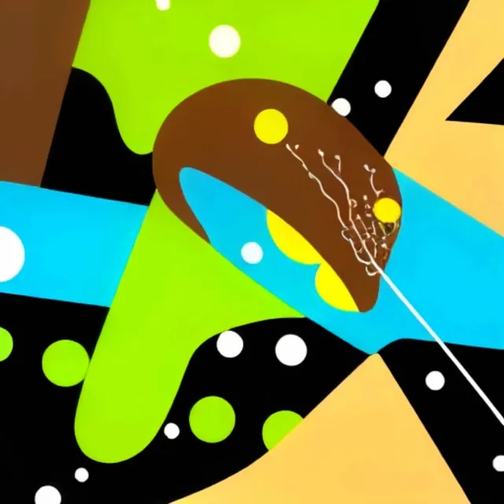
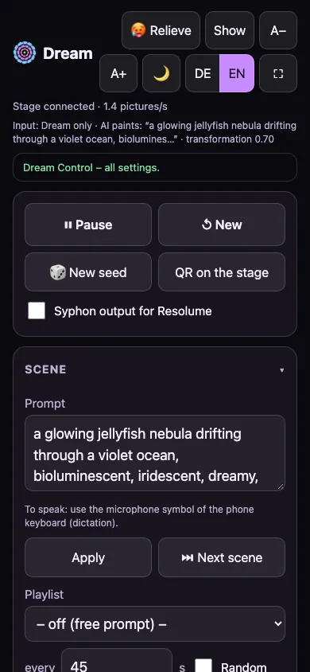
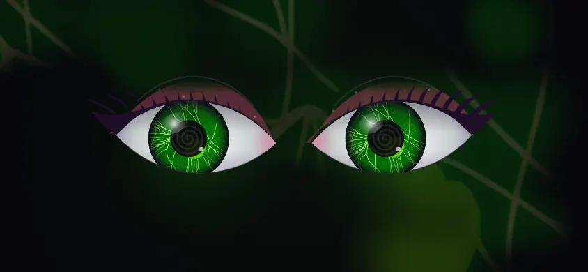
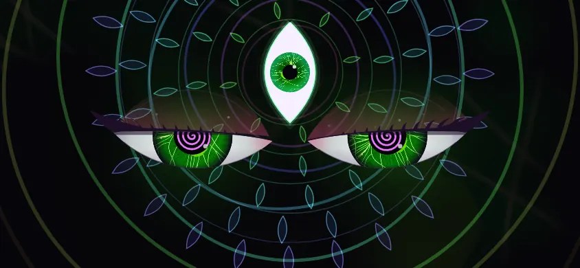
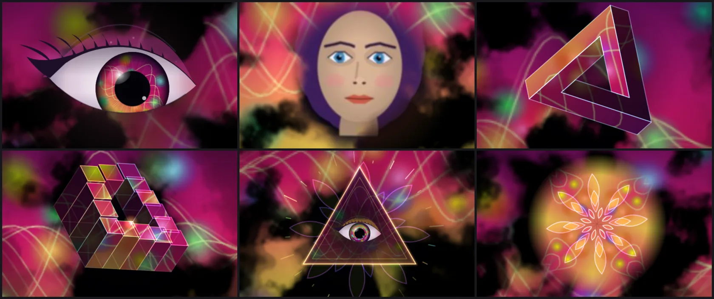

<p align="center"></p>

<h1 align="center">Dream</h1>

<p align="center"><b>Live AI visuals for VJs, artists and installations</b><br>
<i>English · Deutsch: <a href="README.de.md">README.de.md</a></i></p>

<p align="center"><a href="#installation-in-three-commands">Install</a> · <a href="#at-a-glance">Quick start</a> · <a href="#starting">Start</a> · <a href="#using-dream">Use</a> · <a href="#phone-remote">Phones</a> · <a href="#dreamy-eyes--a-phone-as-dreaming-eyes-installation">Dreamy Eyes</a> · <a href="#movement">Movement</a> · <a href="#cloud-gpu">Cloud GPU</a> · <a href="#when-something-gets-stuck">Help</a> · <a href="#licences">Licences</a></p>

Dream is an endless, ever-changing stream of pictures: a fast image model (SD-Turbo or SDXL-Turbo) turns each picture
into the next. It runs on a Mac with Apple Silicon, in the browser, only on `127.0.0.1` (the phone remote and a
second output device join over the home Wi-Fi when you allow it). It computes either **locally** on the Mac's GPU or
on a **cloud GPU** you rent by the hour (RunPod, data centres in Europe). It reacts to music, to a camera, to
movement (hands, fire, LEDs), to MIDI controllers and body sensors, and can be driven by an autopilot.

The whole interface is available in English and German (switch **DE | EN** at the top right).

<p align="center"></p>

## Contents

**Get started**

- [Installation in three commands](#installation-in-three-commands)
- [At a glance](#at-a-glance)
- [Starting](#starting)
  - [Updating](#updating)
- [Folder and own settings](#folder-and-own-settings)

**Play**

- [Using Dream](#using-dream)
  - [Autopilot](#autopilot)
  - [Pictures and clips on request](#pictures-and-clips-on-request)
- [Playlists and autostart](#playlists-and-autostart)
- [Output on a projector or second monitor (16:9)](#output-on-a-projector-or-second-monitor-169)
- [As a source in Resolume (Syphon)](#as-a-source-in-resolume-syphon)
- [Room light (WLED)](#room-light-wled)
- [Hue lamps dream along](#hue-lamps-dream-along)

**Phones and tablets**

- [Phone remote](#phone-remote)
  - [Dream Remote (guests) and Dream Control (you)](#dream-remote-guests-and-dream-control-you)
  - [Dream Control over https and as an app](#dream-control-over-https-and-as-an-app)
  - [On a tablet (Android)](#on-a-tablet-android)
  - [Live camera and motion of the Control device](#live-camera-and-motion-of-the-control-device)
  - [If the phone does not connect](#if-the-phone-does-not-connect)
- [Dreamy Eyes – a phone as dreaming eyes (installation)](#dreamy-eyes--a-phone-as-dreaming-eyes-installation)
- [Dream windows – old phones and tablets as windows to the dream](#dream-windows--old-phones-and-tablets-as-windows-to-the-dream)

**Movement and controllers**

- [Movement](#movement)
  - [Dreaming light trails (input “Light trails”)](#dreaming-light-trails-input-light-trails)
  - [Keep outlines (ControlNet)](#keep-outlines-controlnet)
  - [Pose shapes the figure (ControlNet)](#pose-shapes-the-figure-controlnet)
- [Flowtrack](#flowtrack)
- [Dance](#dance)
  - [Dream Dance: the page, the clutch, the sets](#dream-dance-the-page-the-clutch-the-sets)
  - [The sentences – what your dance does](#the-sentences--what-your-dance-does)
  - [Moves of your own – teaching a movement](#moves-of-your-own--teaching-a-movement)
  - [Dance lab](#dance-lab)
- [MIDI controller](#midi-controller)
- [Sensor input (movement in the dark: phone on the arm, later a wristband)](#sensor-input-movement-in-the-dark-phone-on-the-arm-later-a-wristband)

**Cloud GPU**

- [Cloud GPU](#cloud-gpu)
  - [RunPod: set up once](#runpod-set-up-once)
  - [Scaleway (currently unavailable)](#scaleway-currently-unavailable)

**Help and more**

- [When something gets stuck](#when-something-gets-stuck)
- [Disk space and removal](#disk-space-and-removal)
- [Tests](#tests)
- [Translations](#translations)
- [Licences](#licences)

---

## Installation in three commands

On a Mac with Apple Silicon (M1 or newer) and 16 GB memory or more, with [Homebrew](https://brew.sh) installed:

```bash
brew install uv
git clone https://github.com/wintermute42/dream && cd dream
./dream.sh --open
```

The first start installs the Python packages by itself; the first picture downloads the image model (about 2.6 GB,
once). Optional extras (Ollama, ffmpeg, a cloud GPU) are listed under [Starting](#starting).

<sub>[↑ Contents](#contents)</sub>

## At a glance

| What | Command / address |
|---|---|
| Start (this Mac only) | `./dream.sh` |
| Start with the phone remote | `./dream.sh --lan` |
| Panel and stage | http://127.0.0.1:7860 (open it yourself, or `./dream.sh --open`) |
| Picture output for a projector (does not compute) | http://127.0.0.1:7860/output, button “⧉ Open output” or `dream.sh --beamer` |
| Stage only, without controls | http://127.0.0.1:7860/?stage=1 (or `dream.sh --stage`), then **F** |
| Connect a phone | on the stage press **Q** → scan the QR code (see below) |
| All options | `./dream.sh --help` |
| Stop | Ctrl+C in the terminal |
| Check a cloud GPU | `./dream-cloud status` |

<sub>[↑ Contents](#contents)</sub>

## Starting

**What you need:**

| | Needed | What for |
|---|---|---|
| Mac with Apple Silicon (M1 or newer), 16 GB memory or more | yes | computing locally (SD-Turbo; SDXL-Turbo wants more memory or the cloud) |
| [uv](https://docs.astral.sh/uv/) (`brew install uv`) | yes | `dream.sh` installs the Python packages by itself |
| about 3 GB free disk (SDXL-Turbo: about 7 GB more) | yes | the models, downloaded on first use |
| Chrome (or another current browser) | yes | panel and stage; Chrome for `--beamer` and the installable apps |
| [Ollama](https://ollama.com) with `llama3.2:3b` | optional | prompt ideas and generated playlists |
| `ffmpeg` (`brew install ffmpeg`) | optional | saving clips as video |
| A [RunPod](https://www.runpod.io/) account | optional | a cloud GPU instead of the Mac's |

```bash
./dream.sh
```

Dream opens **no** browser window by itself; after about 15 seconds the terminal says “Dream is ready” with the
addresses. Then open http://127.0.0.1:7860 in the browser (or use `./dream.sh --open`). **Dream computes only while
the panel or the stage is open in a browser** – the output window alone does not compute. Stop with Ctrl+C. The first
local picture downloads SD-Turbo (about 2.6 GB, once) – the stage says so with a badge, the terminal shows the progress;
the first picture after each start takes a few seconds.

If Dream runs in the background (without a terminal), stop it with `pkill -f "uvicorn server:app"`.

<sub>[↑ Contents](#contents)</sub>

### Updating

After new features (or when something described here is missing):

```bash
cd <Dream folder> && git switch main && git pull
```

Then stop Dream with Ctrl+C and start it again – a running Dream keeps the old version otherwise. New Python packages
are installed by `dream.sh` on start.

To try a ticket before it is accepted: `git switch <branch>` (named in the ticket), back with `git switch main`.

Package updates come from Dependabot (`.github/dependabot.yml`): a fix for a known security hole as soon as it is
published, everything else once a month as one pull request for the Python packages and one for the GitHub Actions.
The packages the image and voice models depend on (torch, diffusers, transformers, accelerate, peft, mlx-whisper,
huggingface-hub, safetensors, tokenizers) get only security fixes this way: a new version can change the look or the
speed of the dream, so they are raised by hand and measured with the real model (see [Tests](#tests)). Every such
pull request runs the tests like any other and is merged by hand.

## Folder and own settings

All commands here run in the **Dream folder** (where this repository lies): `cd <Dream folder>`, then `./dream.sh`.
Movement detection is built into Dream; the separate program flowtrack is not needed any more.

**Settings of this Mac** (paths, ports, camera) belong in `~/.config/dream/dream.env` – not in the repository.
`dream.sh` reads the file on every start, one line per setting:

```bash
DREAM_PORT=7860
```

**Other folders** (a second installation on the same Mac, a test run): three settings move Dream's own folders – in
`dream.env` or in the environment; without them everything stays where it is:

| Setting | Default | Holds |
|---|---|---|
| `DREAM_STATE_DIR` | `~/.local/state/dream` | settings (`state.json`), the remote keys, the certificates, uploads, style pictures |
| `DREAM_CONFIG_DIR` | `~/.config/dream` | `dream.env` itself, own playlists, MIDI, sensor and movement mappings |
| `DREAM_SAVE_DIR` | `~/Pictures/Dream` | pictures and clips kept with 💾 |

`dream.sh`, `dream-cloud` and `install-autostart.sh` use the same folders; the autostart also takes `DREAM_PORT` from
`dream.env`.

**A test copy** (to try something new without touching your real Dream): `./dream.sh --test-copy` starts Dream with
its own folders under `~/dream-test-copy` (`state`, `config`, `pictures`; another place: `--test-copy=<folder>`) on
port **7870** (https 7470, sensors 7170) – whatever a `dream.env` says. The real settings, keys, tables and pictures
stay as they are. To start it with your own settings, copy your `dream.env` into it once:

```bash
mkdir -p ~/dream-test-copy/config && cp ~/.config/dream/dream.env ~/dream-test-copy/config/
./dream.sh --test-copy --open        # panel: http://127.0.0.1:7870/
```

Don't run the real Dream and the copy on the cloud GPU at the same time: both would use the cloud tunnel's port 7861.
Remove the copy with `rm -rf ~/dream-test-copy`.

<sub>[↑ Contents](#contents)</sub>

---

## Using Dream

<p align="center"></p>

The panel is a wide column on the left, the preview sits next to it on the right (key H hides the panel, then the
preview fills the screen). Drag the edge to change the width; it is remembered. The areas (Input & prompt · Dream ·
Scenes & playlists · Movement · Music · Output · Computing) are open cards in columns side by
side. The layout fits the screen so that everything is visible without scrolling: the cards are spread over the
columns as evenly as possible in their order, the panel's type gets a little smaller if needed (down to 12 px), and
if that is not enough, the panel gets a little wider and the preview smaller (only on very small screens does the
panel scroll).

**Fixed layout:** the cards are placed only when the shape of the panel changes – at start, when the window size
changes, when you drag the edge and when the picture format changes. Otherwise every card stays in its column:
folding a card, new texts, the diagnostics or key H move nothing to another column (only the cards below it in the
same column move up), and the type no longer changes by itself. If a card gets longer later, the card area scrolls
instead of rearranging.
- **🔓/🔒 Lock the layout** (top right in the panel, remembered per device) – for the show: a folded card keeps its
  place as a dashed outline, so nothing moves up in its column either, and window size or picture format only adjust
  the preview, the cards stay. Only dragging the edge places them anew while locked. Unlocking catches up on what
  changed meanwhile.
- **DE | EN – language:** top right in the panel and on the phone. The whole interface (stage, phone, output, the
  messages of Dream and of the cloud GPU) is available in English and German; remembered per device, the first time
  by the browser's language. Switching reloads the page (briefly, the settings stay). Terminal messages
  (`dream.sh`, `dream-cloud`, autostart) follow the system language or `DREAM_LANG=de`.

**The panel is the main control (#241):** everything Dream Control can set or trigger, the panel on the Mac can too –
labelled and in the card where it belongs. Dream Control never does more; only what the phone itself contributes
(lending its own camera, its motion and its glowing screen in the card “This device”) and how that page looks on the
phone (type size, night colours, its live preview) are Dream Control's alone. A test (`tests/test_panel_parity.py`)
keeps it that way. Since #241 the panel also has:
- **Master brightness and ■ Blackout** together at the top of the card **“Output”**, like a master fader on a desk:
  they act only on what the audience, the projector and Syphon see. Blackout takes the master to black and, pressed
  again, back to the brightness it had before (pressed while black, the button is lit; the chip says “■ Blackout”).
  The same button is in Dream Control's card “Output” and in its show bar, and a MIDI button can do it too; “↺ Reset”
  brings the master back to 100 %.
- **■ End** below the camera choice (card “Input & prompt”) while another device lends its live camera (Dream Control,
  Dreamy Eyes): it says who it is and ends it.
- **● Record** for the dance lab in the Movement card's part “Dream Dance”, while the lab is open on
  its page.

**Below the preview** there are always **Pause, New, Fullscreen, Save**, the coloured **status chips** (pause, cloud
GPU running, movement without camera, playlist, music, Syphon) and the **load**, updated every second: AI pictures per
second, GPU time per picture, how much of the time the AI is busy, display fps, picture size and model, CPU of Dream
and of the whole Mac, memory of Dream, GPU memory and total memory (and movement values per second while movement is
on). Red means: at the limit. If there is room below the preview (mostly with 16:9), cards like Computing and Output
move there. The values are also available as JSON at http://127.0.0.1:7860/stats.

**📏 Measure** (below the load, #180) runs for 60 s with fixed settings (a fixed prompt and seed, 512 px, 2 steps, no
effects, outlines, pose or style; afterwards everything is as before) and shows where the time of a picture goes: waiting,
decoding the incoming picture, waiting for the GPU, prompt encoding, UNet, decoder, encoding, the flow field (#205: it
is estimated beside the next picture, so its time is not part of the picture's) and sending – mean, median
and the slowest 5 % in milliseconds – plus how smoothly every open page drew meanwhile (the stage, Dream Remote, Dreamy
Eyes: frames per second, frame time, share of slow frames; for the stage also what draws the picture, #204: the graphics
card with WebGL 2, or Canvas 2D without it, and #205: for how many of the AI's pictures a flow field came and what one
cost – that line also tells it for the cloud GPU, whose own parts the table does not show). The table also goes to the terminal and into
`~/.local/state/dream/measure/` as JSON, to compare a change before and after. While measuring, the parts are timed
together with the GPU, which makes the run itself a little slower than usual. Only Dream Control and the Mac can start it.

- **Compute on:** “Local (Mac)” or “Cloud GPU”. Switching works at any time, without a restart. The **badge** at the
  top of the card says who computes right now – “Computing now: Mac”, “Computing now: Cloud ✓”, “The Mac bridges – cloud:
  …” – see “[Who computes right now](#who-computes-right-now)”.
- **Model:** SD-Turbo (fast) or SDXL-Turbo (nicer; very slow locally, good in the cloud). You can switch in the middle
  of a show: the new model loads in the background (SD-Turbo seconds, SDXL-Turbo locally about 20–60 s, much longer
  the very first time with the download), the old one dreams on meanwhile, a chip says “⏳ … is loading”. The first
  picture of the new model grows out of the last one of the old, stage and projector blend over softly in 2.5 s.
  Then Dream frees the old model. If memory is not enough for both at once, Dream frees the old one first and holds
  the last picture meanwhile (the chip says so). If the new model does not load (not downloaded, no network), the old
  one runs on and the chip reports it. “Keep outlines” and “Pose shapes the figure” dream on meanwhile too; only
  switching one of them on for the first time while a model loads waits for that load.
- **Input & prompt** (one card, two levels): at the top **“Input – what does the AI paint from?”** as tabs: **Dream
  only** (no input picture, the AI dreams on from its last picture), **Camera**, **Picture**, **Video**, **Light trails**
  (from the movement detection). Each tab shows what belongs to it: in Picture or Video you choose your own file or
  let the AI make a picture or a clip; the gallery is there too. “✕” takes the picture or video out again, then it
  dreams on from the current picture. **Camera:** which of the Mac's cameras Dream takes (e.g. a 60 fps webcam or a
  phone via Continuity, Iriun or DroidCam), also selectable on the phone. Below it **“Prompt – what does the AI paint
  from it?”**: the one text field for the dream (at transformation 0: “AI off”, the prompt rests).
- **Soft switches (#211):** a new input and a new prompt blend in over about 3 s instead of jumping, with nothing to
  set. **Input** (by hand, autopilot, scene, MIDI or Dream Control; also another picture or video): the last picture
  the AI got from the old input lies over the new one and leaves within 3 s, counted from the new source's first
  picture. **Prompt** (typing, voice, Dream Control): the AI gets the old and the new prompt mixed, shifting to the
  new one; while you type, the old one stays until you pause. Playlist scenes keep their own fade time, the
  autopilot's jump back into the dream on a drop stays a hard cut. A switch during a running blend goes on from where
  it stands: for the input exactly, for the prompt the stronger of the two keeps its share and the weaker one makes
  room for the new prompt (the AI blends two prompts, not three). It costs the AI no time: the pictures are mixed in
  the browser, the prompts as for a scene change.
- **The AI gets:** right below the prompt it says what the AI really gets: your text, and after it every addition as
  a coloured chip – purple **Vary the prompt gently** (the two variants and how far it is from one to the other),
  green **Content reacts to energy** (calm ⇄ wild, how wild right now), blue **Autopilot: words for the music**, grey
  a running **prompt change** (a scene, or a change by hand). A ✕ in the chip switches that addition off at once (the same as the checkbox at its
  place; for the music words: “Add words for the music to the prompt” in the Autopilot card). When it says “exactly
  the prompt above, nothing added”, nobody mixes anything in. Style model and reference picture never change the
  prompt; “rephrase in English” only acts on speaking – its result already stands in the text field.
- **Now running:** below the preview it always says what the AI paints from and with – e.g. “Input: Picture from the
  gallery “lighthouse …” · AI paints: “raining cats and dogs” · transformation 0.40”, with “(Autopilot)” when the
  autopilot chose the input – next to a small picture of what goes into the AI. The same line is on the phone below
  the connection status.
- **Speak:** hold the button or key V. Whisper transcribes locally, a small local model (Ollama, `llama3.2:3b`)
  turns it into an English image prompt. That always stays on the Mac.
- **Music:** microphone or music file. The bass pulls the zoom, the mids shift the colours, the highs scatter sparks
  and turn the picture. Beats give short impulses – which ones depends on the **pattern**: Pulse (flash and stronger
  transformation), Jolt (spin jolt), Jump (new seed every second beat), Flow (soft, lots of colour). The **Pattern**
  selection in the Music card (also on the phone, or as MIDI button “next pattern”) sets it: **Automatic** (with
  “change pattern” every 16–32 bars and another one on drops; playlist scenes and the autopilot may set it too) or a
  fixed pattern that then stays – nothing else changes it. Quiet passages react calmly and softly, loud ones wildly
  and fast. After a **break** (the drums drop out) the **drop** turns the dream over: new seed, flash, new pattern and
  – with “Drop → next scene” – the playlist's next prompt. Below the level meter: pattern, bar, approximate tempo and
  loudness. With the microphone Dream switches off the browser's speech filters (noise suppression, echo
  cancellation, auto gain – they dampen the kick drum) and checks that the browser really does: it then says
  “Microphone unfiltered”, or warns if the browser still filters (then better use Chrome).
- **Beat detection (made for music from the room):** Dream listens for the beat itself, also through a microphone in
  a loud room with echo and talking. It looks for the moments where the sound gets louder (above all the kick drum),
  finds the tempo in the last 8 seconds (60–180 BPM; double, half or triplet time is folded into 80–160 BPM, so a
  half-time section keeps the tempo), and then **predicts** the beats: they come on time instead of a moment late, and
  keep ticking through a short break (“beat held”, the picture rests meanwhile) until the drums are back. It also
  guesses **the one** (first beat of the bar: kick, new bass notes, snare on 2 and 4 against it) and the **phrases**
  (4, 8 or 16 bars, from changes in the sound and a crash on the one); a **drop** after a break is the one and starts a
  phrase. Below the level meter the four dots show the beat in the bar (the big one is the one; pale: beat held
  through a break), and next to them how sure Dream is: “Beat 90 % sure · the one 60 % · phrase 8 bars (80 %)”.
  The beat counter and the autopilot's phrases follow the bars it found.
- **Snap changes to the beat** (Music card, also for Dream Control on the phone): **Bar** (the default) lets a scene
  change (“Next scene”, the autopilot's scenes), “roll effects anew” and the like wait for the next one; **Beat** for
  the next beat, **Phrase** for the start of the next phrase, **Off** acts at once. A press just after the one (up to
  a quarter second) still counts for that one; without a beat it acts at once, and nothing ever waits longer than one
  bar or phrase. A drop flashes at once and changes the scene at the latest on the next beat.
- **Tap tempo – fallback and correction:** when the beat detection struggles or picks the wrong tempo (drum & bass
  often reads as half time, 87 instead of 174 BPM), press **“👆 Tap”** in the Music card (or key **T**, on the phone
  under Music, or learn it as a MIDI button) on the beat, **starting on the one**. From 2 taps tempo and beat stand
  (the median of the last up to 8 intervals) and the first tap of the series is the one. The beat then stays in that
  tempo – also without music – and everything follows it: music reaction, autopilot, effects, the snapping. The music
  only pulls the beat's phase gently; missed beats do not disturb. To adjust: just tap again (a pause of 2 s starts a
  new series). **✕** ends tap tempo, then only the music's beats count again.
- **Limits of the beat detection:** it needs a beat – music without drums gives a low confidence (then tap). The one
  and the phrases are guesses: with four-on-the-floor kicks and no bass line the one stays uncertain (the confidence
  says so), and phrases need a few clear changes in the music before they are known (before that they count from the
  one). Drum & bass and very fast or slow music may land on half or double time. Changes of the playlist's own timer,
  phone or MIDI “next” are not snapped (only those from the stage Mac's panel and its autopilot).
- **What the sliders show (#216):** the fill of a slider tells how much it shapes the picture right now – cool violet
  at its default, through orange to red the further it is from it (weighted: transformation, zoom pull and rotation
  count most), and it gets thicker with it. The three strongest shimmer softly, and every card carries a narrow strip
  on its left edge in the same colours, wider the stronger – also while the card is folded – so one look tells where
  a rotation or a restless picture comes from. A slider whose switch is off (effect strength without an effect,
  music reaction without music) stays cool. Screen readers hear “strongly changed”.
  **Zero in the middle:** zoom pull and rotation have their zero inside the range: a mark stands there, the fill
  starts from it, a dragged thumb snaps to it lightly, and a small **0** button beside the slider (shown while it is
  not at 0) sets it to zero. **Double click or double tap** on a slider: zero for these two, the default for every
  other slider. The same in Dream Control on the phone.
- **Moving signs and the picture's character (#217):** beside the name of the most important sliders a small sign moves
  in the real tempo of what the slider does – no words to read. **Rotation:** a mark runs around its circle as fast as
  the picture turns (backwards when it turns the other way). **Zoom pull:** rings grow as fast as the picture is pulled
  in (they shrink when it is pushed away). **Colour drift:** a colour wheel circles with the colours. **Smoothing:** a
  dot draws a trail, as long as the afterglow. **Transformation:** a form grows into its frame as fast as the picture
  becomes a new one. **Music reaction:** bars bounce on the beat, as high as the reaction. The tempo follows the AI
  pictures per second of the stage and the beat of the music (until they are known: 4 pictures a second, 120 BPM). At 0
  – and while the switch is off, e.g. music reaction without music – a sign stands still and pale; the stronger the
  setting, the brighter the sign.
  **The shape** – below the preview beside “Now running”, in Dream Control beside the live preview (on a phone at the
  head of the sliders' card) – shows the character of the picture on four axes: **change** at the top (transformation,
  drift), **motion** on the right (zoom pull, rotation), **colour** at the bottom (colour drift), **music** on the left
  (music reaction, only with music on). Each axis is as long as its strongest slider and is marked with that sign, not
  with a word; the shape follows the sliders at once. Its corners take the colour of their slider (the same cool →
  orange → red), everything else is neutral. Signs that are not on screen pause (panel hidden with H, card folded,
  scrolled away); with “Reduce motion” in the system every sign stands still and shows only the strength. The signs
  cost the AI nothing. Screen readers skip the signs and hear the shape as “Character of the picture: change … %”.
- **↺ Reset** (title bar of the panel and of Dream Control, not for guests): back to a calm, beautiful dream without a
  break. Everything that shapes the picture glides to its default in about 4 seconds – transformation 0.45, dream
  share 35 %, zoom pull 0.008, rotation 0.2°, colour drift 2°, drift 50 %, smoothing 30 %, motion between the pictures
  100 %, music and movement reaction 1×, directness, outline and pose strength, effect strength –, the effects fade
  out and the autopilot goes off. The **style** goes too – no style model, no style reference picture, both strengths
  at their defaults – in one step at the start, not gliding, so the model is rebuilt only once; and the music
  **pattern** goes back to “Automatic”. The **master brightness** is back at 100 % at once (a dimmed or blacked-out
  stage is lit again). **What stays:** prompt, model, quality, resolution, format, input and cameras,
  MIDI and sensor assignments, playlist, outputs, cloud, the keys, and every other switch (touch
  options, pulse on the beat, snap to the beat, outlines and pose on or off …). For 10 seconds the button reads
  **“Reset · ↶ Undo”** (a bar runs out underneath): one tap and everything glides back to exactly what it was (style
  and pattern come back in one step as well). No question is asked. A slider you move yourself during the glide is
  yours at once.
- **Sliders:** transformation, dream share, zoom pull, rotation, colour drift, quality (1 to 3 steps), resolution,
  seed. **“acts …” below transformation:** shows what the transformation is made of right now, e.g. “acts 0.52 =
  slider 0.03 · music +0.21 · movement +0.13 · minimum 0.15” – so you see at once who turns it up (the AI needs at
  least 0.15, below that it does not make a whole step). Empty while the slider acts alone.
  **Resolution:** 384, 512, 768 or 1024 px – the picture's height; 16:9 widens it (704×384, 896×512, 1344×768,
  1792×1024). Dream has exactly these sizes: a number in between that reaches it another way (a script on `/ctl`, a
  scene, a settings file edited by hand) becomes the nearest of them – 640 is 512 –, and every page shows that size.

  **Real styles (Dream card, SDXL-Turbo only):** both change the AI's look, **never the prompt**.
  - **Style model:** Watercolour, Crayon, Pixel art, Paper cut, Sticker or Illustration, with strength up to 200 %
    (above 100 % the style is pushed harder than it was trained – Pixel art needs about 200 %). They are small add-on
    models (LoRAs, 10–320 MB each, free licences: Apache 2.0, MIT, CreativeML OpenRAIL-M), downloaded on first choice
    and then built into the model: a style switch takes 1–3 s (the picture holds meanwhile), changing the strength
    about 1 s, pictures per second stay the same.
  - **Style reference picture:** “🖼️ Picture …” or drag a picture onto the row – the AI takes over its colours,
    strokes and textures, not its content (IP-Adapter in “style only” mode). Strength next to it, ✕ removes it. The
    technique for it (about 3 GB) comes in the background with the first reference picture – in the cloud as on the
    Mac.
  - The higher the transformation, the clearer the style (well visible from about 0.7). With SD-Turbo both rows are
    greyed out: there are hardly any such style models for SD-Turbo and no reference adapter.
  - In scenes: `| style=crayon style_amt=1.5 style_ref=6dade65bd6cc style_ref_amt=0.8` (`off` for none; style names:
    watercolour, crayon, pixel, papercut, sticker, illustration). The picture id shows when you point at the small
    preview; the pictures lie in `~/.local/state/dream/refs`.

  **Transformation 0 = AI off:** the input picture (camera, picture, video, light trails) goes through unchanged and
  sharp, without delay, at about 30 pictures per second; the GPU rests. **Camera pure:** then none of Dream's own
  picture effects acts either – no dream share, no swirl from movement or music, no colour drift or rotation, no
  painting, touching or light circle, no smoothing, no music pulse. Only the effects you chose in the **Effects** card
  stay on top. It goes to the projector, Wi-Fi output and Syphon as usual. From about 0.15 the AI paints again (below
  that it does not even make a whole computing step).
- **Motion between the pictures** (Dream card, #194): the AI makes a few pictures a second; in between, each picture
  goes on moving the way the dream moves – zoomed and turned around the same point, as the next input will be – at the
  full frame rate, and the next picture takes over exactly where the motion has got to. It is one continuous motion
  (#215): Dream knows for every picture how far the dream had moved when its input was built, and shows it moved by
  what has happened since – so a picture that comes late, or one of several on their way at once (camera, video,
  light trails), joins the motion instead of starting it anew, and the smoothed picture and the picture before keep
  their place while the new one blends in. Nothing on the stage moves back, at any number of pictures per second,
  locally and with the cloud GPU alike; if the pictures stop, the motion eases out instead of running away. 100 %
  (default) = the full motion, 0 = off (the picture stands until the next one). With an input (camera, picture, video)
  only the dream's share moves on; at transformation 0 nothing moves. The output window moves along; Syphon gets the
  pictures themselves (without this motion).
- **Shapes travel between the pictures** (Dream card, #205): what the AI itself changes from one picture to the next
  – a tentacle that has grown, a face that has turned – used to fade: for a moment the shape was there twice. Now the
  renderer estimates with every new picture where the shapes of the one before have gone (a coarse flow field: optical
  flow on a grey picture 128 pixels wide, in a process of its own beside the next picture, on the Mac or on the cloud
  GPU; it travels with the picture as 48 × 27 small vectors, under 3 kB). The stage pulls the old picture forward along
  that way and the new one back, and blends the two, so the shapes travel – within the one continuous motion above
  (the field counts from where the camera shows the two pictures, so it adds what the AI changed and nothing moves
  back), at the full frame rate. Where the field explains nothing (the old picture, moved, does not agree with the new one there),
  its vectors shrink to nothing and that part simply cross-fades; a picture that has too little to do with the one
  before (a new seed, a new scene, a drop, another model, a fresh start) gets no field at all and cross-fades as a
  whole. 100 % (default) = the shapes go the whole way, less = part of it, 0 = off (nothing is estimated, the pictures
  cross-fade). The output window and the Wi-Fi output morph the same way; the Syphon source morphs along the same
  field at 30 pictures per second (without the stage's motion and effects, as before). It needs the graphics card's
  drawing (WebGL 2); the Canvas 2D drawing cross-fades. The cross-fade itself is now a true blend of the two pictures
  – it no longer gets darker in the middle. **📏 Measure** shows what a field costs and for how many pictures there
  was one. Limits: the morph starts when the next picture is there (the delay of one picture stays); the field is
  coarse, so fine detail still fades rather than travels; shapes that travel further than a quarter of the picture
  between two pictures are not followed.
- **Smoothing – against flicker** (Dream card, also on the phone and as a MIDI target): the AI paints every picture
  anew, so fine details jump a little from picture to picture – that looks like flicker. Smoothing blends each new AI
  picture softly into what is shown at the full frame rate (a moving average): small jumps vanish, big changes still
  come, only softer. 0 = off, 30 % (default) takes about half the flicker, 60 % a good four fifths, 100 % almost all
  (then it gets sluggish). Projector window and Wi-Fi output smooth the same way, the effects sit on the smoothed
  picture; the AI itself still gets the real pictures, Syphon the unsmoothed picture. With the graphics card's drawing
  the smoothed picture is kept as floating-point numbers (#205), so even the strongest smoothing arrives at the new
  picture – before, a faint shadow of the old one could stay for good (up to 48 of 255 brightness levels at 100 %).
  The Canvas 2D drawing mixes in larger, rarer steps instead (at most 4 levels are left).
- **Drift – the dream stays alive:** without new input (prompt only) the picture-to-picture loop would freeze after a
  while. Drift lets the noise wander softly from seed to seed, moves the picture a little by itself (breathing,
  swaying, wandering) and gives a push when the picture hardly changes for a few seconds. “Vary the prompt gently”
  blends the prompt slowly between variants (light, colour, material). Slider 0 = off, default 50 %. Also on the phone.
- **Keys:** H panel off/on, F fullscreen, Space pause, hold V = speak, S save picture, T tap tempo, Q phone QR,
  D movement diagnostics, E Dreamy Eyes' trance.

Speed locally (M2 Max, 512 px): about 4 to 5 pictures per second with 1 step, about 2 with 2 steps.

**Tips:**
- The dream freezes or gets static → turn drift up (30–60 %) or lower the transformation to 0.5–0.65.
- Too restless → lower the transformation, raise the dream share, lower drift.
- 🎲 gives a new seed: the dream jumps somewhere else.
- If a second Dream or another GPU program runs at the same time, everything gets much slower.

<sub>[↑ Contents](#contents)</sub>

### Autopilot

The autopilot runs Dream by itself, varied, led by the music. Switch it on with **“🤖 Autopilot”** below the preview
(or on the phone in the Autopilot card). In the Autopilot card: **Liveliness** (calm … wild) – it has priority: it
sets how dynamic the picture is (slider swings, pace of changes, effects, speed before quality); the music detection
only comes on top. **Calm** means calm and flowing: no flicker, no flashes, no jolts or jumps (only the soft pattern
“Flow”), long blends, sliders glide slowly, changes only every 16 bars, at most gentle effects (waves, afterglow,
mirror, mandala). **Wild** means power: full slider swings, all effects at full strength, strong pulse and flash on
the beat, the hard patterns (Pulse, Jolt, Jump) changing faster, changes every 4 bars. **Make pictures & clips**,
**Include the camera**, **Include light trails** (only when movement is on): camera and light trails are only used
when ticked.

- **The music leads:** switch music on under “Music” (microphone or file). Phrases of 8 bars are its moments for
  changes; the loudness (measured against the music itself) sets the mood from calm to wild; a break calms, a drop
  turns things over (next scene, or back into the dream). Without music it has its own calm beat (every 12–26 s). It
  does not need calm phases: if the music stays equally loud, a slow wave of its own keeps the mood moving, and
  pictures/clips still come (at the latest a minute after their time). The beat detection also handles very loud,
  dense music reliably.
- **Dream:** transformation, dream share, zoom (sometimes out), rotation (changes direction), colour drift and drift
  glide softly to the mood – never jumps.
- **Music character:** from tempo, beat regularity, dynamics and the balance of bass to highs it roughly recognises
  how the music feels: **calm/flat** (no beat or slow), **driving** (steady beat from ~112 BPM), **broken** (the beat
  often falls out of the grid), **dark/bassy**, **bright/glittering**. The character changes only after it has lasted
  6 s and shows in the chip. It colours the sliders, adds fitting words to the prompt the AI gets (the visible prompt
  stays, e.g. “psychedelic tunnel, kaleidoscope, fractal patterns, neon” when driving) and chooses fitting playlists
  (driving: Psychedelic, Retro, City …; calm: Calm, Water, Nature …).
- **Effects:** from about a third of liveliness it lays effects over the picture, plus tunnel pulse and light flash –
  on the music's beats, without a beat on a pulse of its own (the wilder, the faster). The palette: kaleidoscope,
  mandala, mirror, endless tunnel, waves, feedback, afterglow, pixel, grid (dots or lines), RGB shift, glitch stripes,
  colour rotation and – rarely and briefly, only on drops – invert. It builds sets from them (calm: 1 effect, wild: 3)
  fitting the music character (driving e.g. tunnel, feedback, mandala; broken glitch, RGB shift, pixel; calm waves,
  afterglow, mirror), changes them on phrases, drops and a new character, blends over in ~1.5 s and does not repeat
  the last sets. Which set is running shows briefly in the chip. The strength follows the liveliness; a beat and
  driving (or broken) music add a little, calm music takes a little away. No strobe, no hard black frames. The
  effects run at the full frame rate (60 fps) however fast the AI computes (measured on a Mac with graphics chip: 60
  fps with three effects) and appear in the output window too (projector, Wi-Fi output), not in Syphon.
- **Drawn on the graphics card (#204, #210):** the stage and the output window draw the picture as one chain in
  WebGL 2 – the last two AI pictures with their motion, morphed into each other (#205) or cross-faded, the smoothing, the effects, the touch layers
  (light strokes, stirring, light circle), colour rotation, brightness and master. On a Mac this chain shares the
  graphics card with the AI, so it draws sparingly: at the resolution the picture really has (an AI picture of 512 px,
  or the effects' buffer – not every pixel of a Retina screen; the browser scales it up like any picture), only when
  something moves (a still picture is not drawn again, the smoothing rests once it has caught up with the newest
  picture), and the preview beside the panel at 30 instead of 60 frames per second while an output window is open. The page
  does not ask the browser for sizes and styles in every frame, and the movement detection's look at the shown picture
  (for “subtract the projection”) does not make the graphics card wait (#205).
  Measured on a Mac with an M2 Max (sd-turbo, 512 px, 1 step, transformation 0.5; the stage alone and the panel with
  an output window, each also at Retina resolution), the AI makes as many pictures with it as with Canvas 2D: the
  difference stays within the spread of the measurement (about 2 %); how to repeat it is under “Tests”. Nothing to
  set: without WebGL 2, or if the graphics card's drawing stops while Dream runs, the same pages draw with Canvas 2D
  by themselves (a badge below the preview says so; when it comes back, WebGL 2 takes over again). **📏 Measure**
  shows for the stage what draws: “graphics card (WebGL 2)” or “Canvas 2D (no WebGL 2)”. To compare the two, or if a
  graphics driver makes trouble, add `?render=canvas` to the address of the stage or the output window
  (http://127.0.0.1:7860/?render=canvas). Syphon, the preview of Dream Control and the dream windows get the AI
  pictures themselves; Dreamy Eyes and the dream windows draw on their own.
- **Effects by hand:** the same effects without the autopilot in the **Effects** card (below Dream): twelve tiles to
  switch on and off (one of each family at a time – kaleidoscope/mandala/mirror, pixel/grid, feedback/afterglow),
  **Effect strength** for all, **Pulse on the beat** (only on real beats of music or tap; off = the effects stand
  still), **🎲 Roll** (a fitting mix of 2–3 effects) and **All off**. While the autopilot runs, the card shows dashed
  what it chose; when you tap something yourself (also strength or pulse), you take over exactly that and it leaves
  the effects alone for 1 minute. The choice stays after a restart.
- **Liveliness wild** (from about two thirds): changes every 4 instead of 8 bars, sliders follow faster, short blends
  and **speed before quality**: 1 step and 384 px (about twice the AI pictures per second, coarser). Below wild it sets
  quality and resolution back. If you changed them yourself, it leaves them alone.
- **Driving music** (steady beat from ~100 BPM) colours further: more tunnel pull, faster rotation and colour drift,
  psychedelic words in the prompt, playlists like “Psychedelic”. A break does not switch the character to calm at once.
- **Scenes & playlists:** next scene every 2–4 phrases (the wilder, the more often) and on drops; every few minutes
  another playlist. If none is chosen, it chooses one.
- **Input:** mostly the prompt dream. Every few minutes (rather in calm moments) it makes a picture or a clip from the
  current scene or takes something from the gallery, lets it run for a phrase or two and then returns seamlessly into
  the dream (out of the picture, without a restart).
- **Your hand has priority:** what you change on the Mac, on the phone or by MIDI it leaves alone for 1 minute; an
  input, playlist or typed prompt you chose yourself for 2 minutes.
- **What it steers is tinted:** while the autopilot runs, everything it may change has a subtle blue tone behind it,
  and the card shows 🤖 in its title. Tinted are the dream sliders (transformation, dream share, zoom pull, rotation,
  colour drift, drift), input, prompt, playlist, the effects and, when wild, quality and
  resolution. What you hold yourself right now is neutral, dashed and marked with ✋ while it is yours. Liveliness,
  directness, master, MIDI and output it never touches.
- **Direct interaction with the autopilot:** it uses only the interactions switched on in the movement table and doses
  them by liveliness: calm only painting and light, from medium also touching and content-reacts, wild also impulses.
  Directness stays your own slider.
- **What it is doing** shows in the green chip below the preview, in the card and on the phone (e.g. “🤖 wild ·
  ♪ follows the beat · next scene”).
- The switch survives a restart (for installations). Pause stops the autopilot too.

### Pictures and clips on request

Instead of preparing your own pictures, let Dream make a picture or a short clip (card **“Input & prompt”**, tab
**Picture** or **Video**; on the phone the card “Make picture & clip”):

- It is made from the **dream's prompt**. To show something else, open “a text other than the prompt …” and type it
  there (leave empty = the dream's prompt).
- **✨ Picture:** the same model as the dream computes a single picture from the text: 4 steps, then a finishing pass
  at 1.5× size (square 768×768, 16:9 1344×768 at 512 px). That takes about 3–15 s locally (longer the very first time
  while the model loads). The picture becomes the input “Picture” at once, the dream paints on it.
- **✨ Clip:** first the picture, from it Dream computes 48 pictures in which the camera slowly zooms in and turns a
  little while the dream paints on (each picture stays close to the starting picture so nothing blurs). Played forward
  and backward that gives a seamless loop of about 8 s that runs as input “Video”. About 20–30 s locally. The button
  🎞 below a picture in the gallery makes a clip from exactly that picture.
- **Gallery:** the last 5 pictures and clips. Tapping feeds them in again; what is running is marked (“running”).
  **💾** saves for good to `~/Pictures/Dream/` (file name with date and prompt), ✓ means: already saved. The gallery
  itself is temporary: it is empty after Dream restarts.
- **🗑 Delete** (on the stage, phone and tablet) takes a picture or clip out of the gallery at once – also those the
  autopilot made; **“↶ Undo”** brings it back within a few seconds, then the file is gone. **🗑 Delete all** below the
  gallery asks once. If the deleted one is the input right now, Dream dreams on from the current picture. Copies saved
  with 💾 in `~/Pictures/Dream/` stay.

Good to know:
- It is computed where the dream computes (Mac or cloud GPU). The dream stutters a little meanwhile because both
  share the GPU.
- The stage or panel must be open, also when you tap “Make” on the phone.
- Clips need **ffmpeg** on the Mac (`brew install ffmpeg`); if it is missing, Dream says so in the card.
- It is not a real video model: the movement is a camera ride through the dream.

## Playlists and autostart

- **Playlists:** choose a playlist in the panel or on the phone – the scenes change automatically (interval,
  optionally random), “Next” jumps at once. Every scene change blends the prompt softly from the old to the new one.
  Built in: Psychedelic, Fire, Water, Cosmos, Calm, Nature, City, Myths, Deep sea, Crystal, Retro, Organic, Figures and
  Abstract (8 scenes each), **Mix** (28 scenes across all moods) and three **dream journeys** (see below). A drop in
  the music jumps on too with “Drop → next scene”.
- **✨ Surprise:** a playlist choice of its own – takes a random scene from all playlists on every change and adds one
  or two random styles (e.g. watercolour, ink, stained glass, neon, Bauhaus).
- **Dream journeys** (“Journey: Ocean”, “Journey: Fire”, “Journey: Cosmos”): a fixed order as an arc – calm start,
  peak, calm end – with long transitions (8–10 s). Each scene brings its own settings (transformation, drift, colour
  drift, music pattern, duration); random does not apply to journeys.
- **Editing:** “✎ Edit” (chosen playlist) or “＋ New” in the panel or on the phone. One scene per line, in English;
  optionally settings after “|”, e.g.
  `glowing glass forest at night | strength=0.6 drift=0.4 hue=6 pattern=Flow secs=40`
  (allowed: strength, drift, hue, zoom, rot, mix, fx = effects like `tunnel+waves` or `off`, fx_amt = effect strength
  0–1, style, style_amt, style_ref, style_ref_amt, pattern = Pulse/Jolt/Jump/Flow, secs = the scene's duration).
  Effect names: kaleido, mandala, mirror, tunnel, waves, feedback, trails, pixel, raster, rgb, glitch, hue. First line
  `# Journey` (optionally `# Journey fade=10`) makes it a dream journey. Saved in `~/.config/dream/playlists.json`
  (never in the repository); a built-in playlist gets your own version this way, “Delete” removes only that again.
  The German keywords of earlier versions (`aus`, `Fluss`, `# Reise`, German playlist names) keep working.
- **✨ AI playlist:** type a keyword (or speak it with 🎙 on the Mac, with the keyboard's microphone on the phone),
  “Make” – the local language model (Ollama, `llama3.2:3b`) writes 8 scenes, the playlist “AI: …” starts at once. AI
  playlists are **temporary**: they live only in memory, vanish when Dream restarts, and there are at most 5 at a time
  (the oldest goes). **“📌 Keep”** (or “Save” in the editor) makes the chosen one your own, lasting playlist. If Ollama
  is not running, Dream says so (start it with `ollama serve`, get the model once with `ollama pull llama3.2:3b`).
  Everything stays on the Mac.
- **Autostart:** `./install-autostart.sh --lan --x 1920` starts Dream after every login, keeps the display awake and
  opens the stage fullscreen in a Chrome window of its own on the projector (`--x` = the projector display's left edge
  in macOS). Remove: `install-autostart.sh --remove`.
- All settings survive a restart (`~/.local/state/dream/state.json`). Dream writes the file about a second after the
  last change (while a slider is dragged for long, every 5 seconds) and when it is stopped.

<sub>[↑ Contents](#contents)</sub>

## Output on a projector or second monitor (16:9)

- **Format:** in the panel or on the phone “Format” → **16:9 (projector)** or square. 16:9 computes e.g. 896×512 (at
  512 px) or 1344×768 (at 768 px, cloud). All inputs, zoom, drift, movement and Syphon use the format. 16:9 has about
  1.75× as many pixels: locally somewhat fewer pictures per second, the output blends over softly.
- **Output window:** button **“⧉ Open output”** in the panel (or http://127.0.0.1:7860/output) – shows only the
  picture, without controls and mouse pointer, and does **not** compute itself: it shows exactly what the stage on the
  Mac shows. Drag the window to the projector, **F** (or a click) for fullscreen, a double click ends it. The panel on
  the Mac must stay open for it.
- **Output over Wi-Fi (optional):** instead of an HDMI cable from the Mac, a **second device at the projector** can
  show the picture (old notebook, mini PC, Raspberry Pi, Android TV box or Fire TV stick with a browser – Apple TV
  does not work, it has no browser). Start Dream with `./dream.sh --lan`, tap **“📶 Output over Wi-Fi”** in the panel
  under “Output”: its QR code opens large with the link below it – scan it or type the link on the device (the link
  contains the access key, like the phone's QR code; “⧉ Copy link” puts it on the clipboard). Tap the picture once on the device or press F for fullscreen. Next
  to the button it says how many outputs are connected.
  - Data and delay are uncritical (about 1–2 MB/s, a fraction of a second; the blend smooths it).
  - On Wi-Fi drop-outs the picture holds briefly, the page says “Connection to Dream lost – reconnecting …” and goes
    on by itself. Safer for shows: a LAN cable or a router of your own at the projector.
  - “No access” means: the key no longer fits (e.g. a new guest code) – scan the QR code again.
  - The stage (panel) on the Mac must stay open, the Mac must not be locked or asleep.
  - Switch off screen saver and power saving on the receiving device, otherwise the projector goes black at some point.
- **Automatically at start:** `dream.sh --lan --beamer` opens the output window fullscreen (Chrome kiosk) on the
  second display. If the projector is not to the right of a 1920 px wide main display: `--beamer=X` with X = the
  projector's left edge in macOS (System Settings → Displays → Arrange). Without Google Chrome the window opens
  normally; then drag it over by hand. End the kiosk: Cmd+Q.
- **Alternative** without the panel on the Mac: `dream.sh --stage` (or `?stage=1`) on the projector and control it
  from the phone. Do not open both as a stage at the same time – every open stage computes itself, the GPU would run
  twice.

<sub>[↑ Contents](#contents)</sub>

## As a source in Resolume (Syphon)

Switch “Syphon output “Dream” for Resolume” (stage or phone). Then the source **“Python – Dream”** appears in Resolume
under **Sources → Syphon**. Dream sends it at 30 pictures per second and blends softly between the AI pictures – with
“Shapes travel between the pictures” on (#205) it morphs them along the flow field, like the stage –, so it
looks fluid even at 2–5 AI pictures per second. The stage must be open for it (it delivers the pictures). Without
Resolume just leave it off.

<sub>[↑ Contents](#contents)</sub>

## Room light (WLED)

The room dreams along: an LED chain glows in the colour of the dream – the smoothed average of what the audience
sees, effects included –, pulses on the beat, flashes briefly on a drop and when Dreamy Eyes go into trance, and
follows the master fader and its **Blackout**. The light comes from a **WLED** device (an ESP32 LED controller with
the free WLED firmware) in your Wi-Fi; Dream sends to it live over **DDP** (UDP, port 4048) at 40 frames per second.
Today the whole chain shows one colour; several zones come later.

How it works: the stage looks at its own picture tiny (16×16 points, about 12 times a second, read back without making
the graphics card wait – the AI does not notice it) and tells Dream the average colour; Dream makes it a little more
colourful, glides softly from colour to colour and sends it on. A device that does not answer slows nothing down: Dream
never waits for it. When you switch the light off, close the stage or Dream stops, Dream asks WLED to go back to its
own program at once; if that word gets lost, WLED does it by itself after its realtime timeout (2.5 s).

### What to buy (the tested combination)

- **Controller:** Gledopto **GL-C-017WL-D** – ESP32 with WLED preinstalled, 4 outputs, power input 5–24 V.
- **LEDs:** a **WS2811 light chain, 12 V** (e.g. from BTF-Lighting) – each “pixel” is one chip with its bulb or a
  group of 3 LEDs, so the LED count in WLED is the number of pixels, not of single LEDs.
- **Power supply:** **12 V, 60 W** (IP67 for outdoors or damp rooms).
- Current draw: a 12 V WS2811 pixel takes up to about 0.25–0.3 W at full white, so 50 pixels about 15 W, 100 pixels
  about 30 W. The 60 W supply (5 A) is enough for about 150–200 pixels at full white; set WLED's current limit to
  about 4500 mA (below). Dream's light is rarely full white – a dream colour takes far less.
- Alternative (small, 5 V): an **M5Stack Atom Lite** with an **SK6812** strip and a 5 V power supply (about 60 mA per
  LED at full white: 30 LEDs ≈ 1.8 A). WLED goes onto the Atom from Chrome at https://install.wled.me (USB cable, “Install”);
  the data line is G26 or G32 (Grove port). An RGBW strip (SK6812 RGBW) works too – WLED makes the white channel
  itself (LED Preferences → “Auto-calculate white channel”).

### Wiring (power off while you connect)

1. Power supply **12 V+ and GND** to the controller's power input (V+ / GND, or the DC socket).
2. The chain's **input end** (the arrow on the chain points away from it) to **output 1** of the controller:
   12 V (usually red) to V+, GND (usually white or black) to GND, **data** (usually green) to DATA of that output.
3. A longer chain (more than about 100 pixels) also gets 12 V and GND from the power supply at its far end
   (“power injection”), otherwise the far end turns yellowish. GND always stays connected to the controller.

### WLED first setup

1. Switch on. The controller opens its own Wi-Fi **`WLED-AP`**, password **`wled1234`**. Join it with a phone or the
   Mac; the WLED page opens by itself (or open http://4.3.2.1).
2. **WiFi Setup:** your home Wi-Fi's name and password → Save. The controller restarts in your Wi-Fi.
3. Find its address: in the router's list of devices (name like `wled-…`), in the WLED app, or let Dream find it
   (“🔍 Find”, below).
4. **Give it a fixed IP in the router**, so Dream finds it the same way every time – e.g. in a FRITZ!Box: Home Network →
   Network → the WLED device → edit → “Always assign this network device the same IPv4 address”.
5. In WLED, **Config → LED Preferences:**
   - LED type **WS281x**, **colour order** as your chain needs (WS2811 chains are mostly **GRB** or **RGB**; check it,
     see below), **Length** = the number of pixels, the GPIO of the output you used (Gledopto: as preset for output 1).
   - **Automatic Brightness Limiter:** maximum current about **4500 mA** for the 60 W supply.
6. **Config → Sync Interfaces → Realtime:** “Receive UDP realtime” on (it is by default), timeout 2500 ms. Tick
   **“Force max brightness”** – then Dream's strength and master decide how bright it is (otherwise WLED's own
   brightness dims Dream's light too).
7. Check the colour order: in WLED choose pure red in the colour wheel – the chain must glow red, then green, then
   blue. If it shows another colour, change the colour order in LED Preferences until all three are right.

### In Dream

Panel → card **Output** → **“Room light (WLED) dreams along”**:

- the switch **on**;
- the device: type its **IP address** (or a name such as `wled-room.local`) and press Enter – or tap **“🔍 Find”**:
  Dream asks the Wi-Fi for WLED devices (mDNS `_wled._tcp`, about two seconds) and shows them as buttons; a tap
  takes it. Dream sends only to addresses in the home network.
- **Light strength:** how bright the chain glows (the master fader and Blackout act on top). A MIDI controller can
  learn it (“Room light: strength”).
- **Pulse on the beat:** with music the light sinks a little between the beats and is full on each beat (beat detection
  of the card Music). Off: a steady light.
- The lamp beside the switch glows in the colour the chain gets and swells on the beat. Below it Dream says what it
  does: “Live: wled-… · 50 LEDs” (the device's name and LED count from its JSON API), “Waiting for the picture of the
  stage …” (the stage is not drawing – it must be open and visible), “… the device does not answer” (Dream sends,
  but WLED does not answer its address), “not found in the network”, “not in the home network”.
- Guests (Dream Remote) cannot change any of it; the setting stays as it was after a restart.

### If something does not work

- **No light at all:** is WLED switched on (power button in the WLED app) and in the same Wi-Fi as the Mac? Does the
  status say “Live”? Is “Receive UDP realtime” on? On macOS 15 and later the program that started Dream (Terminal,
  iTerm) needs **System Settings → Privacy & Security → Local Network** – without it nothing reaches devices in the
  Wi-Fi. Check the wiring: data on the chain's input end, GND shared.
- **Wrong colours** (red shows green, …): colour order in WLED's LED Preferences (see above).
- **Only part of the chain lights:** Length in LED Preferences; with “the device does not answer” Dream sends 480
  pixels, a longer chain needs the JSON API to answer.
- **Flicker or stutter:** turn off **WiFi sleep** in WLED (Config → WiFi Setup → “Disable WiFi sleep”), put the
  controller closer to the router, check that GND is shared and the power supply is strong enough (a dim, yellowish
  far end: power injection). Dream glides from colour to colour, so short Wi-Fi drop-outs only hold the colour.
- **Too dark compared to the dream:** “Force max brightness” in WLED's Sync settings, Light strength and master up.
- **WLED stays on Dream's colour after Dream stopped:** it goes back to its own program after its realtime timeout
  (Sync Interfaces, 2500 ms by default); a much longer timeout there keeps the last colour that long.

<sub>[↑ Contents](#contents)</sub>

---

## Hue lamps dream along

Philips Hue lamps (a Hue Signe, a Play bar, ordinary colour bulbs) take the dream's colour as a **mood**: the lamps and
rooms you choose glide softly into the smoothed colour of what the audience sees – the same colour the WLED chain gets,
without its beat and flash –, as bright as the picture, the **Lamp strength** and the master fader say; **Blackout**
switches them off at once. A drop or a new scene is a soft change of colour, never a jump.

Everything stays at home: Dream talks to the **Hue Bridge** in your network over its own local API (Hue API v2, https
in the home network) – no Hue account, no cloud, nothing leaves the house.

**The limit: mood, not beat.** The bridge takes about ten commands a second for all lamps together and one for rooms,
so every lamp changes at most once a second and glides there. Light that follows every beat needs the Hue
Entertainment API (a stream to an entertainment area) – that is another story; for the beat there is the WLED chain.

### Set up once

1. The bridge (square, with the round button on top) is connected to your router by its cable and is in the **same
   network as the Mac**. The lamps are set up in the Hue app as usual (rooms and zones included).
2. **Give the bridge a fixed IP in the router**, so Dream finds it the same way every time – e.g. in a FRITZ!Box:
   Home Network → Network → the bridge (name like `Philips-hue`) → edit → “Always assign this network device the same
   IPv4 address”.
3. Panel → card **Output** → **“Hue lamps dream along”**: type the bridge's **IP address** and press Enter – or tap
   **“🔍 Find”**: Dream asks the network for Hue Bridges (mDNS `_hue._tcp`, about two seconds) and shows them as
   buttons; a tap takes it. Dream talks only to addresses in the home network.
4. **Pair:** tap **“🔗 Pair”**, then press the **round button on the bridge** within 30 seconds. The status says
   “Now press the round button on the bridge … 27 s” while Dream waits, and then “Paired with …”. Dream keeps the
   bridge's app key only on this Mac, in `~/.config/dream/hue.json` (readable only by you, mode 0600) – never in the
   repository, a log or any page; the pages only learn “paired” or not. The key goes only to the bridge it belongs to
   (its certificate must carry that bridge's id).

### In Dream

- The **rooms, zones and lamps** of the bridge stand as a list, each with its switch: what is ticked dreams along
  (a room means all its lamps). Lamps that can show only white follow the brightness.
- The switch **“Hue lamps dream along”** on – the lamps take the dream's colour as soon as the stage draws (it must be
  open and visible). The small lamp beside the switch glows in the colour the lamps get.
- **Lamp strength:** how bright the lamps are at most (the master fader and Blackout act on top). A MIDI controller can
  learn it (“Hue lamps: strength”).
- **Afterwards the lamps get their own light back:** when a lamp joins, Dream notes what it showed (on or off,
  brightness, colour or white) and gives exactly that back when it leaves – you untick it, switch the lamps off, the
  stage closes, or Dream stops. Blackout only darkens; the lamps stay Dream's.
- Up to ten lamps are told one by one (each in the colours it can show); more lamps in chosen rooms are told as the
  room, one command a second.
- **Unpair** makes Dream forget the key (the lamps get their own light back first).
- Guests (Dream Remote) cannot change any of it; Dream Control can.

### If something does not work

- **“Not found in the network” / “does not answer like a Hue Bridge”:** check the address (the Hue app shows it:
  Settings → My Hue system → the bridge). On macOS 15 and later the program that started Dream (Terminal, iTerm) needs
  **System Settings → Privacy & Security → Local Network** – without it nothing reaches devices in the network.
- **“The button on the bridge was not pressed in time”:** tap “Pair” again and press the button within 30 seconds.
- **“The bridge no longer knows Dream”:** the app key was removed (in the Hue app under the bridge's apps, or the bridge
  was reset) – pair again.
- **“The device at … is not the paired bridge”:** another device answers at that address (the bridge got a new IP –
  give it a fixed one) or it is a new bridge: enter the right address, or pair again.
- **“… does not answer – Dream tries again by itself”:** the bridge is off or the network is gone. Nothing else in Dream
  slows down; Dream asks again, more and more rarely, and goes on as soon as it answers.
- **The lamps react late or not at all:** another app or the Hue app's “sync” (an entertainment area) also steers
  them – stop that. A lamp that is unreachable in the Hue app (switched off at the wall) cannot dream along.
- **The lamps stayed in Dream's colour:** if Dream was killed hard (not stopped), it could not give the lamps their
  light back – set them in the Hue app.

<sub>[↑ Contents](#contents)</sub>

---

## Phone remote

<p align="center"></p>

```bash
./dream.sh --lan
```

Then Dream is also reachable in the home Wi-Fi – but only with a secret link. Press **Q** on the stage (or
“📱 Phone”): a QR code appears in a corner of the stage, scan it with the phone, done. The phone remembers the access. Everything you
change on the phone happens at once on the stage. To speak on the phone: the keyboard's dictation. Several phones at
once work too.

**The other QR codes open in a lightbox:** large on white – easy to scan from a distance and with old phones – with
their explanation below. This goes for Dream Control, the output over Wi-Fi, the certificate, Dreamy Eyes and the dream
windows, in the panel and in Dream Control alike. Close it with **Esc**, a click beside it or “Close”; the keys of the
stage rest meanwhile. A code is only loaded while its lightbox is open, so its key is never on the screen longer than
needed. The guests' code stays small in the corner of the stage (Q, “📱 Phone” or “QR on the stage” in Dream Control
show and hide it): the dream goes on behind it and the keys keep working.

<sub>[↑ Contents](#contents)</sub>

### Dream Remote (guests) and Dream Control (you)

There are two keys, so the audience may play along without being able to cost you money or switch anything off:
- **Dream Remote – the QR code on the stage – is for guests.** A guest steers the dream: prompt, next scene,
  new seed, sliders (transformation, zoom, drift …), styles, effects, music reaction, pattern and tap, making
  pictures and clips, using pictures from the gallery. A guest cannot: pause, “New”, the QR code on the stage, blackout
  or master brightness, the autopilot, the Mac's camera (inputs “Camera” and “Light trails”), removing the picture or
  video you set, the playlist (choice, interval, random), the whole movement card (the movement mode, the mood's
  strength, the sources, directness, mirror, the table of what a movement does, the pose), the music's automatic pattern change and
  “Drop → next scene”, uploading, MIDI, Syphon, model, quality, size, the cloud GPU, editing or keeping playlists,
  saving or deleting in the gallery. The remote shows a guest only what a
  guest may use, and the server refuses the rest anyway (“Only Dream Control may do this.”).
- **Dream Control is your own remote with every setting.** In the panel under “Output”: **🎛 Dream Control** shows its
  QR code – scan it with your own phone or tablet, never in front of the audience (the code is gone again when you
  close its lightbox). Only one device is Dream Control at a time: a second one starts as a guest with the button
  **“Take over Dream Control”**; the first then steers as a guest and may take it back the same way.
- **↻ New guest code** (panel, under “Output”) asks once, then makes a new guests' key: every guest phone and every
  output window opened with the old one loses access at once, the stage shows the new QR code. Dream Control keeps its
  access. Handy after an event, or when a link went round further than it should.

The keys lie in `~/.local/state/dream/remote-token` (guests) and `control-token` (Dream Control). Deleting one and
restarting Dream creates a new one. The output on a second device over Wi-Fi uses the guests' key.

**Safety nets (#175):** every number a device sends is checked (finite, inside the slider's range – nothing can break
the saved state, and a broken `state.json` heals at the start). Only Dream's own pages count: a web page of another
site open in a browser on the Mac can neither start the cloud GPU nor steer Dream (the Host must be this Mac, an
Origin must match it). A guest may only ask for what Dream Remote and the output window need – everything else needs
Dream Control – and not faster than about 20 messages a second. The key leaves the address bar right after the page
has opened (it stays in the cookie), and the log never shows it (nor the polling of `/stats`, `/cloud`, `/health`).

### Dream Control over https and as an app

With `--lan`, Dream also listens with **https** on port 7443 (`DREAM_HTTPS_PORT`; not 7861, that is the cloud GPU's tunnel). Guests keep
using plain http – their QR code needs no setup. Dream Control uses https: then Chrome can install it as an app of its
own (“Dream Control”, cloud mandala icon, fullscreen), the screen stays on through the browser's official Wake Lock,
and it works on phones with strict security settings (“Always use secure connections”).

https needs a certificate the device trusts. Dream makes its own small certificate authority on the Mac the first time
it starts with `--lan` (in `~/.local/state/dream/tls/`, nothing to install on the Mac, no admin password). It may only
vouch for addresses inside a home network (private IP ranges and `*.local`) – even if its key ever got out, it could
not stand in for any website. The key never leaves the Mac. The server certificate is renewed by itself when the Mac's
address changes (on the next start) and before it runs out.

**Once per device** (Android):
1. Panel → “Output” → **🎛 Dream Control**. Code **1** downloads the certificate `dream-ca.crt` – scan it.
2. Install it **in the settings** – since Android 11, tapping the download only says “CA certificates can't be
   installed” (or similar). Settings → search for **“CA certificate”**, or:
   - most devices: Settings → Security (and privacy) → More settings → **Encryption & credentials** → **Install a
     certificate** → **CA certificate**
   - Samsung: Settings → Security and privacy → More security settings → **Install from device storage** → **CA
     certificate**

   Then “Install anyway”, unlock (a screen lock is required) and choose **Downloads → `dream-ca.crt`**. Check:
   settings search “Trusted credentials” → tab **User** shows “Dream home network CA”.
3. Tap **“Certificate is installed → next”** – the lightbox shows the codes one after the other and remembers this step
   (next time it starts with code 2; “← Certificate” goes back). Scan code **2** (Dream Control). In Chrome: menu ⋮ →
   **Install app** (or the remote's own “⤓ Install as app” button). From then on it starts from the home screen like an
   app. A tablet with device management (work or school) may forbid own certificates altogether.

Firefox on Android uses its own certificates: Settings → About Firefox → tap the logo five times → back → Secret
settings → “Use third party CA certificates” on. iPhone/iPad: open the code in Safari → install the profile in
Settings → General → VPN & Device Management, then Settings → General → About → Certificate Trust Settings → turn on
“Dream home network CA”.

**Pairing inside the app (#170):** a device without a valid key – an installed app too – no longer gets a white “No
access” page but **“Pair with Dream”**: it first looks once more by itself (that also heals a key from before 17 Nov
2026, whose cookie was too strict for an app started from the home screen; a key that works is renewed on every page),
then offers **📷 Scan the QR code** right in the page (Chrome on Android reads QR codes itself; elsewhere it says to use
the camera app) or pasting the code's link, and says where each code is shown. A device that only holds the eyes'
key and opens Dream Control gets this page too (no bare “Only Dream Control may do this.”). Only the key is taken from
the code; the page stays on this Dream.

To start over (new authority): delete `~/.local/state/dream/tls/` and restart Dream; every device then needs the new
certificate. Without `--lan` there is no https and no certificate.

### On a tablet (Android)

The remote is made for a tablet as well, upright and lying, best in **Chrome** (Firefox as a fallback, see below):
- **Upright:** the cards in two columns, a **show bar** at the top that stays while scrolling: a small **live
  preview**, **Pause**, **Next**, **Autopilot**, **Blackout** and large sliders for **Transformation** and
  **Master brightness**. **Lying:** three columns, the bar as a column on the left. The cards keep their order and
  are only placed anew when you turn the tablet – folding a card moves nothing to another column.
- **Live preview:** what the stage shows, about 4 pictures per second, as a small picture (320 px, a fraction of the
  Wi-Fi the Wi-Fi output needs). Tap it to switch it off and on (remembered), hold it to see it large – while it is
  large, the remote gets the stage's full picture.
- **⛶ Fullscreen:** a tap fills the whole screen without address and status bar (on a phone the button is in the
  header). Coming back from another app, a button asks “⛶ Fullscreen again?” – browsers allow fullscreen only after
  a tap. A home screen shortcut (Chrome menu → “Add to home screen”) opens it with one tap, with Dream's icon (the
  cloud mandala) and the name “Dream”. Installing it is optional – the remote stays a normal web page.
- **The screen stays on** while the remote is open (Wake Lock where the browser offers it, otherwise a tiny silent
  video loop).
- **Blackout** in the bar (and in the card “Output”, beside the master brightness) sets the master to 0 and back to the
  brightness before – the same as the panel's button and the MIDI button.

### Live camera and motion of the Control device

Dream Control (over https, see above) has a card **“This device”**:
- **📷 Live camera** sends what the phone's or tablet's camera sees to the stage (back or front camera), about 12
  pictures a second at 640 px – smooth in the home Wi-Fi, about 0.5 MB/s. The stage switches to the input
  “Camera” with “📱 Live camera of a phone” and shows the chip “📱 Live camera: Dream Control” (orange when no
  picture came for 2 s). Nothing is stored; the pictures go from the device to the stage only. Switching it off, closing
  the page or losing the connection ends it, and the stage goes back to the dream – never by itself to the Mac's
  camera.
- **🧭 Motion** sends the device's sensors (acceleration, rotation, tilt) like a sensor on the arm (see “Sensor input”):
  choose what it steers, tap **📡 Learn** and move the device for 2 seconds; **a strike** (swinging the device
  sharply) becomes an impulse (flash, spin jolt, new motif, next scene, blackout); the 🧭 button gives a little jolt
  when the Mac took a strike. The flash is a light pulse on the stage, with or without music. The stage shows
  “📱 Motion: Dream Control”; the learned assignments appear in the panel under “Control (MIDI, sensors)” like
  those of OSC.
- **💡 Glow as a light marker** (appears while 🧭 Motion is on): the phone that lends its motion is also the LED marker
  of the hand that holds it. Choose the colour – **cyan, green, blue or magenta** (no red, orange or yellow: those are
  fire) – and tap the switch: the whole screen glows in that colour, the motion keeps flowing, and the Mac's camera
  follows the glow as that hand, in the dark too (see “LED markers” under “Dance”). Dream knows which
  colour belongs to which phone: a colour that is the left or the right hand's marker colour makes the phone that
  hand; any other colour becomes the marker colour of the phone's hand. The kind of detection and the camera stay as
  you set them – the phone says “once Flowtrack or Dream Dance look for LED markers” while they do not (choose
  “LED markers”, or “LED markers beside the hand AI”, in the Movement card). The phone's motion and the spot of light
  check each other: both move or both rest – the marker counts as surer; a light of that colour that wanders while
  the phone lies still is not taken for the hand; a phone that swings fast makes its marker lead at once. In Dream
  Dance the glowing screen has the **clutch** as one large button; **hold** “Hold to end the glow” to stop (a short
  touch in a swinging hand does nothing; Esc works too). The stage shows “📱 Motion: Dream Control · glows cyan
  (left hand)”.
  - **Brightness and battery:** turn the screen brightness all the way up yourself (a web page cannot) and switch off
    automatic brightness – the camera follows the brightest spot of the colour. The screen stays on while the page is
    open (Wake Lock; without it set the phone's auto-lock to “never”). A full-bright screen plus sensors empties a
    battery in a few hours: start charged, or use a power bank for a long night.
  - **iPhone:** Safari asks for “Motion & Orientation” access at the first tap on 🧭 Motion, and again after every
    reload of the page – tap 🧭 Motion again then; a refusal sticks until the website data of the page is cleared
    (Settings → Safari → Advanced → Website Data) or the tab is closed and opened anew.
- **Two phones, two hands:** camera and motion come from the device that is Dream Control. A **second phone** opened
  with Dream Control's QR code stands by as a guest (“Dream Control is in use on another device”) and gets the card
  “This device” with 🧭 Motion and 💡 Glow only: it lends its motion and glows in another colour – two phones are two
  colours are two hands (a colour the first phone has is exchanged for a free one). Its channels are called
  `/device2/…`, the stage shows “📱 Motion: second phone”. It can change nothing else that a guest cannot. Taking
  over Dream Control ends what both phones lend (switch it on again). Guests with the guests' code can send neither
  camera nor motion and cannot glow, and no phone learns of another's colour.
- Over plain http the card explains that the browser releases camera and motion only over https.
- The stage's camera source is called “📱 Live camera of a phone” – it is the Control device's or the Dreamy Eyes'.

### If the phone does not connect

1. Started Dream with `--lan`? (Without `--lan` Dream is only reachable on the Mac.)
2. The phone in the **same Wi-Fi** as the Mac – not the guest Wi-Fi, not mobile data. The phone's IP address (Wi-Fi
   details) must start with the same first three numbers as the Mac's (`ipconfig getifaddr en0`).
3. **Android:** in a test, Chrome reached no devices in the home network (not even the router), **Firefox worked at
   once**. So open the link in Firefox. In Chrome, these may help: Settings → Privacy and security → “Always use
   secure connections” off, “Secure DNS” off; no work profile (briefcase).
4. **iPhone:** open it in Safari; Chrome needs Settings → Privacy & Security → Local Network → on.
5. VPN or ad blocker on the phone off.
6. Test without the link: `http://<Mac's IP>:7860/health` on the phone – if anything answers (also “forbidden”), the
   connection stands. The Mac's IP: `ipconfig getifaddr en0`.

**A phone with a weak connection** (at the edge of the Wi-Fi) does not slow down anyone else: every device has its
own small queue, the stage, the projector and the other remotes go on. Of the pictures it only gets the latest; if its
line does not move for 10 seconds, Dream disconnects it, and its page connects again by itself (“Connection lost –
trying again …”) and gets all settings anew.

Photos and short clips also work via “Upload a picture or video” → camera. The live camera of the phone or tablet:
see the next section.

## Dreamy Eyes – a phone as dreaming eyes (installation)

<p align="center"> </p>

A phone of its own stands at eye height, its **front camera** feeds the dream, and its screen shows **two dreaming
eyes** that invite people to step up and play:
- **In the iris lies the dream** as the stage shows it right now, curved like in an eyeball, with a soft highlight –
  and very faintly whoever stands in front of the camera.
- **The eyes react to the dream:** the pupils widen in dark, calm scenes and narrow in bright ones; much movement in the
  dream opens them wide and makes them lively, calm passages leave them dreamily half closed. Now and then they blink
  (sometimes twice), glance around, and a tap on the screen wakes them up a little.
- **They look at you:** the phone finds the face in front of its camera (MediaPipe Face Landmarker, on the phone itself –
  nothing of it is sent or kept) and the eyes follow the person; when someone steps up they open, very close they go
  wide with surprise, and interest widens the pupils. Without anyone in front they dream around by themselves.
- **Mostly only the eyes (#220):** how much of a face shows follows one rule, for everything face-like that is drawn in Dreamy
  Eyes and in the dream windows (the faces painted by the AI and “you in the dream” are pictures and stay whole). Most of the time there are only the eyes. Every one to two minutes **hints** come for
  about ten seconds: the brows, the sign on the forehead of a face drawn in light and – moderately, at about half
  strength – **the outline of that face**. Every five to ten minutes or so,
  inside such a moment and only while the eyes are calm, **mouth, nose and hair** join them and the outline grows fuller – clearly to be seen
  for those few seconds (at about four fifths of full strength, never as solid as the eyes) – and leave again before the
  hints do. There is no grin. **One face at a time:** where one face takes another's place while it is to be seen (a
  held level changing its face, a style world changing, the person's silhouette behind the eyes), the one there fades
  out completely (about a second) and only then the next fades in – never a hard cut, never two faces over each
  other; a painted face that has to make way while it is still coming goes from as far as it had come. To look at a
  level, add `?face=0`, `?face=1` or `?face=2` to the address of Dreamy Eyes or of a dream window: it is held (0: only
  the eyes, 1: with hints and the outline, 2: with mouth, nose and hair as well; the face changes every 20 seconds).
- **Style worlds (#221):** how all of this is drawn is a *style world*. Dreamy Eyes and the dream windows decide the
  scene – what appears, when and where; a world decides the material: the eye, everything that lives around the eyes
  and drifts through the windows, the faces of light, the large motifs of the windows. The first world, **Classic**,
  is the look Dream has had so far (glowing lines, soft light), unchanged. Choose the world in the panel (under “Trance: …”: the
  band of worlds, **Style world**) or in Dream Control (card “👀 Dreamy Eyes”) – tap its small picture, see “The band of worlds” below; a MIDI button can step to the next one
  (“Button: next style world”). Dream tells every Dreamy Eyes page and every dream window at once – they only hear
  it, their codes cannot set it. Fire, trance and “you in the dream” run in every world: besides the eye, the
  living things, the faces and the motifs, a world also draws the night behind the eyes, a window's sky, the flames,
  the trance and what surrounds “you in the dream” (#222: its frames, fireflies and the sparks it leaves, the colours
  of its glow; the person's picture itself and how it is dreamed – wavering, mist at the edge with its colour fringe,
  clear at the peak, coming apart – are the same in every world). In every
  world besides Classic the face rule above holds for everything drawn, and none of today's signs appear (hearts,
  stars, “z”): each world has a form of its own for them. A world is one file (see “Tests” for how it is built in).
  The worlds:
  - **Classic** – today's look, unchanged.
  - **Bioluminescence** (#222) – the deep sea: no outlines anywhere, only filaments of light, thin membranes and
    beads of light pulsing along them; marine snow drifts through everything. The eye is a dark chamber lit from its
    rim, with an anemone's crown around the iris and cilia for lashes; the brow is a row of small lights. Around the
    eyes: plankton, an anemone opening, a comb jelly, a sea fan growing, small medusae, a siphonophore's chain of
    lights. The faces of light are a medusa, an anglerfish and an anemone (a warm lure or a small crown on the
    forehead and, fainter, the jaw's lights – the face's outline – with the hints; bell, arms, a closed mouth and the nose – two fine rows of lights and a glow on its tip – only in the rare moment). In a window the dream glows in
    the water around a medusa seen from above – with the eye or the folded dream in her bell – and the impossible
    shapes are panes of the dream edged with filaments. A fire is a vent glowing in the deep (warm plumes rising);
    where Classic shows a heart there is a warm lure or a tiny warm medusa, where it shows stars plankton flashes,
    and sleep is slow bubbles. Measured in a headless browser without a graphics card, the processor slowed four
    times: Dreamy Eyes about 19 frames a second (Classic: 30), a dream window 6 (Classic: 8) at full resolution – both
    pages lower their resolution by themselves when a device does not keep up, as before.
  - **Ink & watercolour** (#223) – light pigment on black paper. Surfaces are washes with wet edges and grain, lines are
    brush strokes that swell, thin out and run dry; the line work “boils” a little, as hand animation does. The eye is a
    bone-coloured wash with a brushed iris ring, bare paper for its highlight and one loaded lid stroke flicked into a
    wing; the brow is a brush stroke. Around the eyes: petal washes, a bloom of pigment spreading, an enso, an ink twig
    growing leaf by leaf, a bird of two strokes, drops in wet paper, a sweep of a broad brush. The faces of light are
    *sumi*, *willow* and *plum* (a small sign on the forehead and, fainter, a thin jaw line – the face's outline – with the hints; hair strokes and washes,
    closed lips and the nose – one loaded stroke down its side, a dry flick under its tip – only in the rare moment). In a window the dream shows through wash blots, around a brushed enso with
    the eye or the folded dream in it; the impossible shapes are washed panes with brushed edges. Fire is vermilion and
    ochre washes with flame strokes rising; where Classic shows a heart a drop of red pigment blooms, where it shows
    stars there is a flick of splatter, and sleep is slow rings of wash. Measured as above (processor slowed four
    times): Dreamy Eyes about 20 frames a second, a dream window 4 (Classic: 36 and 8 in the same run).
  - **Engraving** (#225) – an old engraved plate that comes alive, with the long lines of Art Nouveau. There is only
    line – strokes that swell and thin, hatching, stipple – in bone-coloured ink with verdigris, old rose and a little
    gold light that now and then runs along a line. The eye: the white is fine lines following the ball, the lid one
    swelling line that ends in a tendril, single lashes; the dream itself is engraved in the iris, strokes as thick as
    it is bright there. Around the eyes and through the windows: a fern whose crozier unrolls, a vine that draws itself
    with leaves opening behind its tip, a seed head whose seeds leave on the air, a lily opening, a naturalist's moth
    with hatched wings, hatched drops of dew, winged seeds circling an eye, a cloud of stipple. The faces of light are
    *lily* (a gem on a fine chain on the brow; rarely hair in bundles ending in curls, lilies at the temples, an open
    ticked halo), *fern* (a young crozier on the brow; rarely vines for hair, a wreath of leaves) and
    *moth* (a moth at rest on the brow; rarely a veil of fine lines, a halo of stipple) – with the hints also, fainter, the line of the jaw (the face's outline; stippled for the fern); closed, hatched lips and the nose (one side cut
    with a swelling line and hatched in its shade, the other only stippled) only in the rare moment. In a window the dream is a rosette engraved in a ticked
    medallion with vines growing round its frame, the third eye sits in the middle of a seed head, the impossible shapes
    are hatched face by face and a seed climbs the stairs; the sky is stipple in the dream's colours. Fire is engraved
    flames with gold inside. Instead of a heart there is a bud, instead of stars a seed head and drifting seeds, and
    sleep is a poppy's head nodding and letting a few seeds go. No line is finer than about 1.2 px, so the plate holds
    on coarse outputs. Measured as above (processor slowed four times): Dreamy Eyes about 25 frames a second, a dream
    window 6 (Classic: 39 and 8 in the same run).
  - **Aurora** (#226) – curtains of northern light over a field of stars: slow, luminous, cold greens and violets with a
    warm lower edge; the calmest world. A curtain is a line with rays standing on it, their height and brightness
    wandering along it. The eye is a piece of night sky with light standing on its lower lid, rays rising from the upper
    lid for lashes, a thin corona around the iris; the brow is a small arc of rays. Around the eyes: a small drifting
    curtain, a halo with its mock moons, a small corona, light pillars over ice dust, a shooting star, diamond dust, a
    quiet arc. The faces of light are *veil*, *crown* and *pillars* (a brighter light on the forehead and, fainter, a low band along the jaw – the face's outline – with the hints;
    veils where hair would fall, a warm light for the mouth and the nose – a slim pillar
    of light with a star on its tip – only in the rare moment). In a window the dream is seen in great curtains,
    around an auroral corona – rays streaming out of a dark disc with the eye or the folded dream in it; the impossible
    shapes have edges of light. Fire is a red aurora rising from the horizon; where Classic shows a heart there is a
    small warm sun dog, where it shows stars ice dust glitters, and in sleep pillars dim one after the other while snow
    sinks. Measured as above (processor slowed four times): Dreamy Eyes about 25 frames a second, a dream window 3 at
    full resolution (Classic: 35 and 8 in the same run) – this world's windows are the most costly so far and rely on
    the page lowering its resolution on a weak device. **On a weak device Aurora also draws lighter** – only there; a
    device that keeps up sees exactly the picture described here: once a page has lowered its detail because the
    device does not keep up, the rays stand wider apart, lines of light lose their wide faint pass, a window's corona is painted
    small a few times a second and laid on in one piece, and on the weakest step the stars stand still. Measured the
    same way with a window held at half its pixels (the weakest detail): the third eye 23 → 32 frames a second and
    the mandala 23 → 39 with the processor slowed four times, 15 → 23 and 15 → 25 slowed six times (the pair of eyes
    33 → 40 and 21 → 25, an impossible shape 36 → 45 and 23 → 28); Dreamy Eyes stay where they were (29 → 29 and
    21 → 23) – there the page itself, not the world, is what costs.
    the page lowering its resolution on a weak device.
- **Crossfading the worlds (#224):** two style worlds can show at once, one fading into the other – the same scene
  drawn in both and added up, like a double exposure: the eyes, the faces of light and a window's motif sit exactly on
  each other. The crossfade has a first world, a second one and how far the picture is on its way between them (0 % all
  of the first, 100 % all of the second; anywhere between, both stay mixed for as long as it is left there). The
  **worlds drift** moves it by itself, a MIDI knob can turn it by hand (slider target “Style worlds: crossfade”); the button “next style
  world” goes to the world after the one that shows most, all of it. Choosing another world never cuts: it comes in a
  short fade (about a second and a half). **A face of light is never mixed:** while two worlds are drawn, one of them
  draws the face – the one that shows most; when the other takes over, the face fades out completely and only then
  the other world's face fades in (see “Mostly only the eyes”).
  - **The band of worlds – how you steer all this:** in the panel (under “Trance: …”) and in Dream Control (card
    “👀 Dreamy Eyes”) the same small card, **Style world**:
    - **A row of small pictures, one per world** – each drawn by the world itself (its eye), its name under it. The
      world that shows has a ring, the one it is being blended with a dashed ring. **Tap a picture** to fade over to
      that world (the short fade above); the wandering then waits three minutes. With the keyboard: Tab into the row,
      the arrow keys move from picture to picture, Space or Enter chooses.
    - **A bar under it, labelled “first world → second world”:** how far the crossfade is – and a slider: **drag
      it** (finger or mouse; a tap on the bar puts the mix there) to mix the two worlds by hand, live. The mix stays
      where you leave it: the wandering waits three minutes, as after a tap on a picture (switched off, the mix stays
      for good). With the keyboard: Tab onto the bar, the arrow keys move it by 2 %, Page Up and Page Down by 10 %,
      Home and End go to either world; a screen reader hears it as “30 % Aurora”. The drift and the MIDI knob move
      the bar too.
    - **The switch “Wander through the worlds by itself”** turns the drift on and off, and three buttons set its
      pace: **slow**, **calm**, **lively**. Off, the three are greyed; on again, the drift has the pace it last had.
    - **One line that says what is going on:** “now: Classic → Bioluminescence · 32 %” while one world fades into the
      next; “now: Classic · next world in 0:40” while a world stays alone (it counts down); “Bioluminescence chosen ·
      wandering paused for another 2:40” after a tap or a MIDI button, “Mix by hand · wandering paused for another
      2:40” after dragging the bar or turning a MIDI knob to a mix of two worlds; “Classic · wandering off”; and “wandering
      rests while no Dreamy Eyes and no dream window are on” – the drift only runs while somebody can see it.
    - A world Dream gets later appears in the row by itself. Limits: the pictures are drawn once when the page opens
      (they do not move, and show an invented dream in the iris); while you drag, Dream hears the mix about 15 times a
      second, and old phones – which show one world at a time – change over when the bar passes its middle.
  - **Worlds drift – on in a new Dream:** Dream wanders from world to world by itself, through all of them in the
    order of the list and round again. Each world stays alone for a while, then the next one comes slowly: *slow* (a
    world every five minutes), *calm* (every two minutes – the default), *lively* (every 45 seconds) or *off*. You see
    the bar of the crossfade move with it. A hand on the worlds – a tap on a world in the panel or in Dream Control
    (also on the one that is showing), dragging the bar of the crossfade, a MIDI knob or button – makes the drift wait three minutes; then it goes on from where the
    mix was left. To keep a world or a mix for good, switch the wandering off. The drift rests while no Dreamy Eyes and
    no dream window is connected. “Reset” leaves all of this alone (it is for what shapes the AI picture).
  - **Old phones:** drawing two worlds in every frame costs about twice the time. A device that does not keep up
    therefore never shows a lasting mix: it shows the nearer of the two worlds and changes over in a short fade once
    the crossfade is clearly past the middle; the weakest devices (those that already draw with the least detail) go
    through black instead, so they never draw two pictures for one frame. Each page decides this for itself from its
    own frame rate (two worlds below about 33 frames a second for three seconds: one world from then on; it tries
    mixing again after a minute and a half, and waits longer each time that fails). So the same crossfade can look
    different on a new and an old device: a slow dissolve here, a change of worlds there. To look at one way on any
    device, add `?blend=mix`, `?blend=fade` or `?blend=dip` to the address of Dreamy Eyes or of a dream window.
  - **Measured** (the real pages in a headless Chromium, processor slowed four times, as for the worlds above):
    with one world Dreamy Eyes draw 34 frames a second in Classic and 23 in Engraving or Aurora, with a lasting mix
    of two worlds 10–11; a dream window at full resolution draws 8, 6 and 3 with one world and 2–3.5 with two. A mix
    costs a little more than both worlds together. Left to decide for themselves (processor slowed six times), the
    eyes and the windows went over to one world within a few seconds. Nothing was measured on a real old phone.
  - The eyes and the windows only hear of the worlds (the world, the second one, how far the crossfade is); their
    codes cannot set any of it, and neither can a guest.
- **Feminine eyes:** an almond shape with the outer corner a little lifted, a soft rose-violet eyeshadow with a little
  shimmer, a winged liner, full lashes that grow longer and curl towards the outer corner (a few fine ones below). **The brows
  come only with the hints** (see above) and show a feeling then: surprise (someone very close, waking up, a dream turning
  wild), joy (someone smiles at them), sadness (with the tear of light), doubt (one up, one flat, when they cross their eyes),
  a frown (rarely, in a dark wild dream) or curiosity – then they fade again. **Their look changes softly** every two minutes or so: rose, smoky (grey
  with a long wing), golden (with glitter), nymph (turquoise, long lashes) or doll (no wing, very long lashes, round
  brows).
- **Behind the eyes the dream shines through the night** – through drifting clouds, a huge breathing spiral of soft
  lights or a kaleidoscopic flower of rings; the masks change every minute or two
  or so (upright a little calmer), the dream behind them slowly
  zooms and wanders, a little brighter than on the stage. Every two to four minutes a **dream window** opens for 6–10
  seconds: the night opens wide and the dream shows clearly behind the eyes, then it softly withdraws behind the masks. Right behind the eyes it stays darker, so they stay clear.
- **Faces drawn in light, only hinted:** with the hints a face of light appears around the eyes, another one each
  time, and the eyes become its eyes – first its sign and, more faintly, its outline: the goddess's diadem of rays, the cat's ears, the snakes
  above Medusa's brow, the mermaid's crown of shells, the forest spirit's crown of leaves with the leaf on the brow and
  glowing spores, the moon priestess's crescent. In the rare moments hair and a closed mouth join them and the outline grows fuller,
  clearly (flowing hair, twitching whiskers, writhing snakes, hair like seaweed, vines, a veil and long earrings) – and
  the goddess's line of a nose, the cat's little nose. The dream fills the lines. **A face is never squashed:** it has
  one size, that of the eyes, upright or across; on a wide, low screen its chin and the ends of its hair run off the
  edge instead of being pressed into the picture.
- **You in the dream:** whoever stands in front is mirrored in the iris – faintly all the time, and every two or three minutes
  for a few seconds very clearly, as in real eyes: then it is the person alone, cut out from the room (on the
  phone) and running out softly at their edge, the face as the camera sees it, and behind them the iris keeps dreaming. Now and then (every four to eight
  minutes, only while someone is there) the person appears as a **moment**: first in the two pupils, as if seen through
  them, then the windows open and for 3–4 seconds they stand in a soft cloud in the middle of the screen, a little
  smaller and lighter than a painted face – **seen as in a dream, not as a photograph** (#229): the whole picture
  wavers gently as through water or the shimmer over a fire (the face less than what is around it), the person has no
  outline but **runs out into mist**, with a delicate fringe in the dream's colours, and they come soft and blurred.
  **In the middle of the moment the face is clear for a second or so – the real camera picture, so people recognise
  themselves** – then it blurs again. Around them is the dream: the dream's picture instead of the room, a soft glow,
  fireflies, and sometimes a wreath of blossoms, a mandala behind the head or veils of mist. Then the picture does not
  simply fade: within two or three seconds it **comes apart into the dream** from the outside in – its pieces are
  drawn out into drifting streaks and leave sparks, the face last, the fireflies fly away, and at the end the mist
  that is left blows away – while the eyes return (about 9 seconds in all). On a weak phone the picture is drawn
  smaller and wavers in coarser strips; it stays smooth. **Someone who just comes** (after a while with nobody) is greeted
  at once – very clearly in the iris or with this moment, in turn.
  **What happens with the camera picture:** all of this is drawn on the phone itself, from the live camera and a mask
  of the person found there (selfie segmentation, about 250 KB); no picture and no word about who stands there is sent
  for it, and nothing is kept. The dream look is drawn too, not computed: plain canvas drawing on the phone (strips
  moved a little aside, a small copy scaled up for softness), no model and no AI. The AI does **not** repaint people: the dream portrait the Mac used to paint from the
  eyes' camera picture is gone (and `DREAM_YOU_EVERY` with it) – the Mac paints only the fantasy faces below, from
  words. The one thing that leaves the phone is what Dreamy Eyes are for: the front camera you lend to the dream
  (below, “One camera at a time”), passed on to the stage as it is and kept nowhere; tests guard both.
- **Now and then they mirror you:** for a few seconds, every two or three minutes while someone stands in front, the eyes
  copy their expression – a blink or wink (the matching eye), a squint, eyes opened wide, raised or lowered brows – then
  they go their own way again.
- **Your silhouette as a mask:** now and then, only while someone is there, the dream shines through the outline of
  the person in front (selfie segmentation on the phone, about 250 KB, nothing is sent or kept).
- **Dreamy loves fire ❤️‍🔥 (#162, #218, #233):** when the camera sees flames, the eyes are enchanted. What counts as a flame is
  strict, so that a warm room is no fire: very bright, saturated orange-to-yellow light (close to the rule of #162) with
  a core as bright as the camera can show, that **flickers the way a flame does** – its size and its shape both keep
  changing, irregularly, and in a larger flame its outline too (taller, wider, leaning) – for most of a second (about
  0.85 s) before the eyes believe it. Found on the phone, about 15
  times a second. No fire are: a still orange lamp, a lamp while the phone is touched or carried, a lamp being dimmed,
  warm walls and a dim warm room in a noisy camera, the camera hunting for its exposure, warm LEDs beating with the
  camera's shutter (they go up and down evenly and keep their shape), a screen with warm moving pictures, a face or a
  hand in warm light, even when it moves or waves (its light goes up and down evenly), a warm light pulsing with music
  and a lamp that flickers a little in a phone held in the hand (both keep their outline), and a wall in warm room light
  with a person moving in front of it (the head tears its light apart and joins it again, and a wall is larger than any
  flame: warm light over more than a quarter of the picture is a wall). A candle held in front of such a wall is found. A small flame counts only when it is swung (poi); a small flame standing far away, or a flame that
  does not flicker at all, is no more than a lamp.
  **To see what the eyes take for fire in your room:** open Dreamy Eyes with `?debug` at the end of its address (after
  an existing `?…`: `&debug`). A corner then shows the camera sample in grey, warm light in yellow (its bright core
  white) and what counts as fire in red, with the numbers beside it: how sure they are (fire from 0.70), the strength,
  and for the liveliest patch its size, the share of its core and its jumps (fire above 4.1).
  - **They follow the fire at once.** Their gaze goes where the flame is in the picture (within about a tenth of a
    second) and stays on it while it moves. Everything follows its **strength** without steps: how wide they open, how
    high the flames stand at the bottom of the screen (highest on the flame's side), how many embers rise, how deep the
    blush is. When it **flares up** (or catches) the pupils widen, a shower of sparks flies in from where the flame is
    and the night glows for a moment. When it **dies down** they grow calm: the lids sink, flames and embers thin out;
    once it is gone (1.5 s without) a moment of longing – then they go on as before.
  - **Their mood changes every 10–20 s** with much fire or a flame that dances – a lone candle is taken more gently (up to
    20–40 s a mood, a few sparks only) –, never the same twice in a row: **spellbound** (wide open, a hypnotic pupil –
    see below), **playful** (star pupils, a wink now with one eye, now with the other, sparks flying from it),
    **dreamy** (half closed, embers drifting in the iris, the gaze drifting after the flame), **in love** (glowing heart
    pupils that beat, little burning hearts, the deepest blush) and now and then the **fire spirit**: while the fire
    lasts the Mac paints her anew (at most once a minute, as before) and she comes burning through the pupils; every
    other painted face is surrounded by flames and embers meanwhile.
  - **They get used to it.** A fire that only burns on becomes the background after about 30 s (fading over the last
    8 s): low flames, a few embers, embers in the iris – and the eyes look around, at people, have their moods and
    visitors again. Flaring up or a flame that wanders (poi) makes it all new at once, with the next mood, for 6 s
    before it fades again; a fire that keeps moving never becomes the background. Nobody falls asleep beside a fire.
  - Nothing of this asks the Mac for more: the phone finds the fire itself in a 96 × 72 sample of its camera (about a
    millisecond per look with the processor slowed down four times), and all it draws are a few more dots.
- **Rarely a trance – the third eye 👁 (#172):** when much is intense at once – the dream much livelier than usual
  and someone looking at the eyes for a while or seen lately (or fire, mirroring, the dream window, petting) – or the
  dream simply stays that lively for about 8 s (in a dark room the camera may see nobody) – and at most about every 12
  minutes (now and then without a reason): the two eyes calm down and close, a glowing third eye opens above them with
  an iris of the dream, mandala rings turn against each other around it, a tunnel of rings flies towards it, then
  everything is pulled spiralling into its pupil and the dream shows large and clear through it; it closes into a
  glowing dot that fades, and the two open again (about 18 s, drawn on the phone only). In Dream Control on the card
  “👀 Dreamy Eyes”: **👁 Trance now**, and how often it may come by itself (only by hand, rarely ≈ 25 min, now and
  then ≈ 12 min, often ≈ 5 min; kept in `~/.local/state/dream/eyes.json`); on the Mac the same in the panel under
  “Output” (button, choice, key **E**). Before it opens, the third eye can be sensed: while petting deepens (from about
  4.5 s on) it shows faintly and opens a crack, more and more – and now and then it shimmers through for a moment by itself.
- **Touch the screen:** they look at your finger and follow it; a soft light glows under it, a ring of light opens where
  it lands and a trail of sparkles follows it; poke an eye and it
  flinches shut (three quick pokes and they frown and cross their eyes); stroke over the screen (anywhere) and they half close
  contentedly, with heart pupils – keep petting and it grows: they blush, little hearts rise, a rosy glow and a purr,
  by the time of petting – blushing after about 2 s, hearts
  about 3 s, a glow about 5 s, a purr about 6 s – and after about 10 s of petting the third eye opens (the trance, see below); it ebbs away when you
  stop; tap the night and a bloom of light opens there, a double tap makes them sparkle; a
  long press turns the iris into another world; two fingers apart or together widen or narrow the pupils.
- **An organic rhythm:** a temperament that drifts slowly over minutes – sometimes calm and dreamy, sometimes playful –
  sets how often moods, feelings, masks and apparitions come; nothing follows a fixed beat.
- **Now and then a face painted by the AI takes the eyes' place:** while Dreamy Eyes look on and the Mac computes
  locally, it paints a face about every 50 seconds – 24 dream faces in a shuffled round, about a third of them men:
  goddess, cat, Medusa, moon goddess, dryad, siren, fire spirit, ice queen, star woman, blossom fairy, oracle, clockwork
  lady, owl woman, masked lady, aurora, raven witch, nebula, and sun god, green man, sea king, star sage, faun, dream
  pharaoh and moon knight – in the mood of the dream's
  current prompt (a single quick AI step, about 0.4 s, the first one a few seconds; the stage barely notices). Every
  four to eight minutes one of them comes through the pupils: it appears inside them as if seen through mist – soft, pale, veiled, with no edge –,
  the two windows grow with glowing rims, turn a little and open into a **dream cloud** – the face inside soft puffs that
  drift and change shape, a glow of the dream around it, the dream still visible beyond – where it stays a few seconds,
  breathing, swaying and drifting a little; then it shrinks back into the pupils, and the eyes are there again.
  **The face is alive** (as in the dream windows, see "Living faces" below): it blinks, now and then winks, glances
  clearly to the side (the lids go along), lifts or knits its brows, smiles broadly with mouth and cheeks and turns and
  nods its head – a new expression every few seconds – and smiles along while the eyes are petted. For that the stage on the Mac (Dream or Dream Control open there) finds once per painted face where its
  eyes, brows, mouth and outline are, and Dream hands these points to Dreamy Eyes; the phone only moves them – it
  loads no model for it and the Mac paints nothing extra. With the points, the painted face's own eyes lie exactly on
  the pupils as it comes (in the pupils it looks straight out of them), and it stays five to seven seconds instead of
  three to five. Without points – no stage open on the Mac, or a picture in which no face is found (a cat, a mask) –
  the face is the still picture it used to be. A phone that runs short moves a smaller picture of the face less often,
  and the weakest ones leave the head still.
  The pictures stay in memory only and never go into the gallery; only the eyes (and Dream Control) may fetch them.
  `DREAM_AIMASK_EVERY=…` in `~/.config/dream/dream.env` changes how often one is painted (seconds); `DREAM_AIMASK=0`
  switches the painted faces off altogether (no fire spirit either: Dreamy Eyes never make the Mac load a model). With the cloud GPU
  there are no painted faces.
- **The pupils change shape:** a cat's slit while the cat's face of light shows, hearts when someone keeps smiling, stars when they
  are surprised, a turning spiral when they hypnotise (or are spellbound by a fire). About one time in four (#218) it is
  a soft shimmer instead of the spiral, never the same one twice in a row: lights turning like a mandala, lights sinking
  like snow, rings sinking into the depth, or a slow swirl – half transparent, in the dream's colours (like embers by a
  fire), breathing with the music's beat (without music: with the dream).
- **The iris is a world that changes** every minute or two: the dream itself, the dream folded into a kaleidoscope,
  a vortex of the dream with rings turning against each other, or a spiral galaxy in the dream's colours.
- **Moods now and then:** they wink, cross their eyes, roll them, hypnotise, shed a tear of light that bursts into
  stars, or sparkle. Nobody there for a long while and a calm dream: they slowly fall asleep and little z's drift up –
  whoever comes wakes them with a start (star pupils, sparkles). Livelier dream: more often.
- **Around the eyes** appear clouds, blooming light spirals, mandalas, growing fractal trees of light, fluttering light
  moths, iridescent bubbles, ribbons of northern light and little moons circling an eye – all in the dream's colours,
  more often when the dream is lively. If the phone runs short, these go first (never the camera); if it is still short,
  the eyes are drawn with fewer pixels (a little softer) until it keeps up again – easier on battery and warmth.
- The face model (about 4 MB) is fetched once by the Mac with the other movement files and cached in
  `~/.cache/dream/mediapipe`.
- **Setting up:** Dream Control → card **“👀 Dreamy Eyes”** → “Show the code for the eyes phone” (or on the Mac: panel →
  “Output” → **👀 Dreamy Eyes**) → scan it with the eyes phone. Once on that phone: install Dream's certificate (see “Dream Control over https and as an app”) – the browser
  gives the camera out only over https. Tap **“Open the eyes”** (fullscreen, the screen stays on; with `?debug` in the address the page stays a window). To keep it there:
  Android “App pinning” (Settings → Security → App pinning, then pin the browser via the app overview), the phone on
  power, in a holder at eye height.
- **Its code may only lend the front camera** and see the dream – no settings, no commands, nothing that costs money; it
  does not even learn the prompt. Beside the small picture of the dream it is told two numbers: the master brightness
  and (#218) the music's beat, a pulse between 0 and 1 – never what the stage tells its output windows (effects, fades,
  prompts); a guest's preview hears no beat. Of the painted faces it gets the pictures and (#230) where each has its
  eyes, brows, mouth and outline – nothing else. Its key is its own (`~/.local/state/dream/eyes-token`) and a cookie of its own, so
  trying the eyes on your own phone never replaces Dream Control.
- **One camera at a time:** the stage shows “👀 Live camera: Dreamy Eyes”. In Dream Control the card “This device” says
  who lends the camera, **■ End** stops it (the eyes say so and wait for a tap; the panel has the same **■ End** below
  the camera choice), and starting your own live camera
  takes over. The stage then goes back to the dream, never to the Mac's camera by itself.

<sub>[↑ Contents](#contents)</sub>

---

## Dream windows – old phones and tablets as windows to the dream

<p align="center"></p>

Any number of old phones and tablets around the room become windows to the dream. Nothing to assign, no roles: every
window shows **one large, living motif**, the dream drifts around it as clouds, and now and then a motif wanders from
one device to another.

- **One large motif per window:**
  - a **large eye** – the very eye of Dreamy Eyes: iris fibres, lids, lashes, and a brow only with the hints (#220:
    every minute or two, by Dream's clock – both eyes of a pair raise theirs together). It looks
    around, blinks, its pupil widens in a dark dream and with the beat, and its iris is the dream – plain, folded into
    a kaleidoscope, a tunnel or a galaxy; rarely (about one time in ten, every 47 s) its pupil hypnotises for a few seconds (#218: the
    spiral or one of the soft shimmers in turn, breathing with the beat – the same in both windows of a pair);
  - a **pair of eyes across two devices**: one eye each, looking and blinking together;
  - a **dream face**: a face painted by the AI, alive (see below);
  - **impossible shapes**: the Penrose triangle, the endless staircase (a light climbs it and never arrives), the
    devil's fork and the impossible cube – slowly turning, every face filled with another part of the dream;
  - the **third eye** in its triangle of light, and a **mandala**: the dream folded twelvefold under turning petals.
- **The dream as clouds:** the dream is no picture in a frame. It shines through soft fields of cloud that drift, turn
  and tear open, with darkness between – no rectangle, no hard edge. The clouds swell with a breath all windows share
  and glow on the beat. Small beings of light (moths, bubbles, northern lights, little clouds) drift through and on
  into the next window.
- **Wandering:** every one to three minutes a motif dissolves into clouds and forms again on another device a few
  seconds later; the device it left gets a new one. Dream hands the motifs out by itself, and no two windows show the
  same one at a time – except the pair of eyes, which now and then opens in two windows next to each other (in the
  order they connected) and later moves on or closes. Only with more windows than motifs (nine or more) one is shown
  twice. A single window changes its motif the same way. `DREAM_WANDER_EVERY=…` in `~/.config/dream/dream.env` sets
  the shortest pause in seconds (default 60; the longest is three times that) – e.g. 10 to watch it while setting up.
- **Living faces:** where a painted face has its eyes, brows, mouth and outline is found **once per painted face, on
  the Mac** – by the stage, in a background worker, with the face model Dream has anyway (well under a second per
  face; the stage's own drawing never waits for it) – never by a window and not again for another window. The 82
  points travel with the face (under 1 kB). Every window moves them itself over a net of triangles: it blinks, lets
  its gaze wander, smiles, lifts or knits its brows, breathes and tilts and turns its head – clearly to see, but
  natural, like a painting that is alive (the same expressions as in Dreamy Eyes, #230). A picture in which no face is found (a cat, a mask), or one painted while no stage is open, is shown
  still.
- **One organism:** all windows breathe together and pulse to the beat, and now and then a wave of light runs
  through them in turn. When Dreamy Eyes go into trance, the third eye opens in every window too (and the painted
  faces close their eyes); when someone pets the eyes, a rosy shimmer runs through the windows and the faces smile.
  They dim with the stage's master fader.
- **Light on the Mac:** Dream only says which motif a window shows (its kind and a random number, about a hundred
  bytes per change); every window draws by itself. The Mac's work does not grow with the number of windows: the
  points of a face are found once, whoever looks.
- **Old devices:** a window that can't keep up draws with fewer pixels (in four steps, down to about a third), with
  coarser clouds (a smaller field, no fine wisps, every other frame), moves a face less often and folds the mandala
  eightfold – and goes back up when it can. Everything is drawn with the plain 2D canvas; it needs no WebGL and no
  certificate (plain http in the home Wi-Fi), and it keeps the screen on.
- **Setting up:** panel → “Output” → **🪟 Dream windows** (or Dream Control → card **“🪟 Dream windows”**) → scan the
  code with each device and tap its screen for fullscreen. The output line in the panel counts the connected windows.
- **They only look:** a window's key (`~/.local/state/dream/window-token`, a cookie of its own) opens the window page,
  the dream's pictures and the painted faces – no settings, no commands, no camera, nothing that costs money. Where
  a face has its eyes only the stage on the Mac may say, never a window.

<sub>[↑ Contents](#contents)</sub>

---

## Movement

Movement detection is **built into Dream**: the stage detects movement itself on the camera picture, without a second
program, a picture stream or OSC. That saves a lot: the earlier flowtrack program alone needed more than one CPU core
(measured 115–135 %), the built-in detection in the browser about 7–10 % extra, the graphics chip does the rest.

**One engine, one mode at a time.** Everything that moves the dream runs through one movement engine: every
source feeds one stream of features (energy, tempo, opening … – see [Dance](#dance)), and one table says what a
movement does. A **mode** is nothing but a preset of that table – which sources it listens to, which targets it
moves, at which thresholds. Choose it in the Movement card (also in Dream Control); the modes exclude each other:

**The Movement card** – one card for all of it (it replaces the earlier cards “Movement”, “Dance” and “Direct
interaction”):
- **Off · Mood · Flowtrack · Dream Dance** – four buttons, one mode at a time (arrow keys walk through them). The
  part of the card below changes with the mode and keeps its height:
  - **Mood:** the slider **Strength** (0 = nothing … 3×), the **Energy** bar of the room (it follows at once; a small
    mark holds the last peak for a moment; beside it a word: still, calm, moving, lively, wild – or “no source”) and
    “**also use the Mac's camera**”. Switching the mood on and off is one click on **Mood** or **Off**.
  - **Flowtrack:** what Dream detects right now – the kind, values a second, whether someone is there –,
    **Automatic: ON/OFF** and what the automatic chose and why (see [Flowtrack](#flowtrack)).
  - **Dream Dance:** the recognised gesture with how sure Dream is and your tempo, the **traffic light** (what blocks
    the dance), the **clutch**, the **movement set**, **whose measures** the dance reads with (see
    [Your measures](#your-measures--calm-and-wild)) and the slider **Strength** – all effects of the dance together
    (see [Dream Dance](#dream-dance-the-page-the-clutch-the-sets)).
- **Page ↗** opens the page of the mode in a window of its own, for a second screen: Flowtrack and Dream Dance have
  one, the mood needs none.
- **Sources** – one chip per kind, see below.
- Folded away below: **Camera and detection** (the kind of detection, the camera, light and marker colours, fingers,
  ⚡ Fast, calibrating, subtracting the projection, diagnostics, the pose) and **What a movement does** (what Dream
  sees, the table of the mood or of Flowtrack – Dream Dance says it in sentences on its page –, the directness of the
  hands and “Mirror”).
- **Dream Control** has only the four mode buttons and the strength of the mood and the dance (“Movement – strength”). The kind of
  detection, the camera for movement, ⚡ Fast, the directness, “Mirror” and the pose are set in the panel on the Mac
  (the main control), and the pages are the Mac's. Whatever Dream Control offers of movement, the panel offers too
  (a test checks it).


| Mode | What it is for | Listens to | Mac camera |
|---|---|---|---|
| **Off** | movement does nothing, no camera, no work | – | off |
| **Mood** | the energy in the room moves the dream – no gestures | Dreamy Eyes, a phone or wristband that sends its motion; the Mac's camera only with “Mood: the Mac's camera too” | only when ticked |
| **Flowtrack** | one performer with fire, LEDs or hands: the effects sit at the person | the Mac's camera, a wristband or phone on the arm | on |
| **Dream Dance** | your dance steers the dream: features and gestures | the Mac's camera, a wristband or phone on the arm | on |

A change of mode fades: the old mode's effect goes out while the new one's comes in (a good half second), never a
jolt. The Mac's camera is opened only for a mode that needs it and closed when none does. Dream remembers the mode
across a restart, like the autopilot.

**Sources.** The card shows what can send movement as chips, one per kind: its light is on while values come (with
how many a second; how sure they are is in the tooltip), a tap switches that kind off or on again, and a kind the
mode in use does not listen to stands pale:
- **Mac camera** – hands, pose and fingers, fire and LEDs, LED markers (the kind is chosen under “Camera and
  detection”).
- **Dreamy Eyes** – each phone works out on itself how much moves in front of its front camera and sends only that
  number (about five times a second); no picture is sent or kept for it. Several eyes count as several sources.
- **Phone (Dream Control)** – the phone that lends its motion ([Live camera and motion](#live-camera-and-motion-of-the-control-device)).
- **Wristband/glove (OSC)** – whatever sends sensor values to port 7020 ([Sensor input](#sensor-input-movement-in-the-dark-phone-on-the-arm-later-a-wristband)).

Dream windows are no source. The **energy of the room** is the mean of all sources the mode listens to, weighted by
how sure each one is – one lively phone does not rule a quiet room.

**Mood** in short: energy acts at once on the push of the picture, the afterglow and the tempo of the effects, gently
(over a second or two) on the transformation and on the prompt between its calm and its wild words; a still room
calms the dream. **Strength** in the card sets how much of all that (0 = nothing … 3×; a MIDI controller can turn
it: target “Mood: strength”). It needs no camera on the Mac: Dreamy Eyes or a phone are enough.

**Nobody there, someone comes** – that is Dreamy Eyes' alone, and only in the mood (the mode that listens to them):
when nothing has moved in front of any pair of eyes for about 12 seconds the dream calms down (slower, softer), and
when someone comes it wakes with a light impulse. Dream reads it from the energy the eyes send anyway – a number,
nothing else of the person. The Mac's camera never does this: a performer who steps out of its picture does not calm
the dream, and stepping in gives no impulse. Without Dreamy Eyes (or with the eyes switched off as a source) there
is neither.

**Settings of earlier versions** are carried over on the first start: the switch “Movement: ON” becomes the mode
(fire/LED → Flowtrack; hands or markers → Dream Dance, or Flowtrack if “Dance steers the effects” was off), and what
was ticked in “Direct interaction” and “react to movement” stays on as rows of the table.

Beside the mode the kind of detection for the Mac's camera:
- **Hands (AI):** a body model (MediaPipe Pose, runs on the graphics chip) finds both hands, also in half-light. The
  very first time Dream downloads the model once (about 15 MB, to `~/.cache/dream/mediapipe`), then everything works
  offline. The point follows one hand: when the model loses it for a moment it does not jump to the other hand, and a
  point that turns up far away for a single frame is ignored. The model needs the upper body in the picture; if the hands still jump, look with
  **D** (diagnostics) at what the camera sees – a screen or the projection in the picture can show figures it takes for
  a person.
- **Fire/LED/light trails:** bright points in the picture, up to four. The threshold follows the room's brightness: in
  the dark a torch is enough, in a bright hall only really bright lights count.
- **LED markers (2 colours):** a glowing marker on each hand, followed by its colour without any AI model – see
  [Dance](#dance).

**Calibrate (camera ↔ projector):** if the camera stands at an angle or to the side, effects, painting and light land
a little beside the person without matching. **📐 Calibrate** in the Movement card under “Camera and detection” (movement must be on, camera and
projector fixed): stage and output window turn black and show four white points one after another; Dream finds each
point itself in the camera picture (it compares the picture with and without the point) and measures the delay
projector → camera on the way. If the camera does not see the projector (infrared camera), hold a lamp at the point or
click it in the camera picture of the diagnostics (it opens by itself for this). Afterwards all movement values –
points, hands, skeleton, light trails – lie in the projector picture. The calibration is saved, **Reset** deletes it,
**✕ Cancel** ends the run. Calibrate again after moving the camera or the projector.

**Subtract the projection** (checkbox below Calibrate, needs the calibration): a normal camera also sees the
projector's picture – the light detection would take bright parts of the projection for fire, changing pictures for
movement. With the checkbox Dream subtracts its own picture: it knows exactly what it shows, maps it into the camera
picture with the calibration, takes the picture from before the measured delay (±40 ms leeway), matches the brightness
itself and subtracts it from the light detection and the movement tracking. The hands AI gets the unchanged picture
(the projection hardly disturbs it). The diagnostics (D) show how much is subtracted. In a test with a simulated
projection the false detection fell from over 80 % of the pictures to 0 %, a light point was still always found. An
infrared camera does not need it (it does not see the projector at all).

**Camera for movement** (next to the switch, in the panel): “as picture” or its own, e.g. an infrared camera
with an IR lamp that sees in the dark and does not notice the projection, while the normal camera gives the picture.
Dream remembers the cameras by name, also across a restart. If a chosen camera is not connected, it stands in the list
with “(not connected)”, Dream takes the default camera meanwhile and says so; when it is plugged in, Dream switches by
itself. The names appear once the browser was allowed to use a camera.

**More reliable light:** in the fire/LED mode Dream searches at 320×180 (small, distant LEDs are found). **Light
colour:** “anything bright” (fire, any LED) or an **LED token** in green, magenta, blue or red – then only that colour
counts, lamps, windows and white walls no longer disturb (in a test with a bright room and a window: “anything bright”
stuck to the window 86 % of the time, the green token was found in 100 % of the pictures). Best a colour that rarely
occurs in the visuals. **Short exposure:** where the camera lets the browser do it, Dream sets a short, fixed exposure
in the light mode – the room turns almost black, only lights remain, hardly any motion blur; for hands it goes back to
automatic. The diagnostics say “short exposure” or “the camera allows no fixed exposure” (some cameras, e.g. the
iPhone, do not allow it).

**Fast movements:** the camera runs at up to 60 pictures per second, every picture is analysed. The AI model computes
at most about 30 times per second (less on slower graphics); in between, and when a fast hand is only a blurred
streak, Dream follows the moving pixels (picture difference) near the hand – speed and direction are kept. A prediction
makes up for the delay: without calibration 80 ms, with calibration exactly the measured delay projector → camera plus
the computing time (at most 150 ms, so a jolt does not overshoot).

**Delay (latency) – where it comes from and what helps:** the last line of the diagnostics (D) shows how old the
camera picture is, how long the detection computes, the measured delay projector → camera (after calibrating) and the
prediction.
- **⚡ Fast (dance/flow)** in the Movement card under “Camera and detection” (in the panel only): the movement values follow at once instead of
  calmly smoothed, smoothing off, 1 step and 384 px (more AI pictures per second), little dream share. Pressing again
  restores the previous values; the switch survives a restart.
- **Visible at once** are the effects, touching and light (60 pictures/s, to the output window 60 times a second).
  Everything the AI paints anew (painting, content, pose) always has the delay of one AI picture.
- **Smoothing** drags the picture behind (at 45 % about half a second) – for dance set it to 0. **Transformation 0**
  shows the camera picture without AI at the full frame rate; even 0.02 sends every picture through the AI.
- **A USB camera** instead of iPhone/Continuity (often saves over 100 ms), best with 60–120 fps. **Projector** in game
  mode if it has one; the stage directly on the projector saves the transfer to the output window.

**Poor light:** for the detection Dream brightens the camera picture automatically (up to ×4) and raises the
contrast; the thresholds for hands are low, a smoothing (One Euro filter) prevents jitter. The picture on the
projector does not change.

**Off really means off:** camera closed, no detection; movement, diagnostics, pose and direct interaction have no
effect and cost nothing. If there is no camera or no model, the stage shows a red warning at the top. **Key D** shows
below the preview what the detection sees: the camera picture faintly in the background, the points with their trail,
speed, values per second, light (how much brightened), “fast (blurred)” when the picture-difference tracking helps,
and the model's computing time.

**Direct interaction** (modes Flowtrack and Dream Dance): the hands act exactly where they are – at once and fitting
the content. Each of the following is a **target of the table** (“What a movement does” in the Movement card: rows
“Someone is there → Paint …”, with a switch and a strength each), so a mode's preset decides what the hands do;
“Directness of the hands” and “Mirror” stand below the table.
- **Paint:** the hands draw glowing trails in the colours of the picture under the hand (faster = wider and brighter).
  The trails appear at once and go into the next AI picture – the AI dreams them on to fit the prompt: with fire into
  tongues of flame, with an ocean into waves, with cosmos into star trails. They fade after about a second.
- **Touch:** the hands push and swirl the picture like a liquid, at the full frame rate; the AI paints the swirl on.
  When you let go, it glides back.
- **Content reacts to energy:** for each prompt the local language model writes a calm and a wild addition fitting
  the scene (ocean: “moonlit waves, soft mist” ↔ “raging tempest, crashing waves, foam”; visible in the panel). The
  faster the hands, the more the content turns wild – not just “more effect”. Without Ollama general additions apply.
- **Impulses:** a fast hit or an abrupt stop sets off a wave with a bright core exactly at the hand, in the picture's
  colours; the AI dreams it along.
- **Light in the dark** (off by default): the dream is bright and alive only around the hands, the rest lies in the
  dark – the faster, the larger the light circle. Fits fire and poi.
- **Directness** controls it all (0 = off), **Mirror** flips left/right if the camera sees mirrored.
- **Movement shapes the effects** (the more direct, the more; 0 = as without movement): tunnel, kaleidoscope, mandala,
  waves and feedback have their centre at the hand and move with it, fast hands make the effects stronger and faster,
  calm ones let them fade. The swipe direction sets the turning direction of kaleidoscope and mandala and the
  direction of the RGB shift. A hit or abrupt stop is a beat from the movement (effect push and a short flash). If no
  effect is chosen, movement brings a light effect of its own from about half directness (RGB shift and afterglow)
  that vanishes when still. Projector and Wi-Fi output show it too. Clearest with “On: hands by AI” and a little less
  drift.

**Diagnostics:** key **D** (or “Diagnostics below the preview” in the panel) shows below the preview what the
detection sees: a small map (the camera picture faintly behind) in the picture format with the tracked point and its
trail, all points and the cross the dream turns around, next to it speed, spread, values per second, light and whether
someone is there. The picture itself stays free; the display does not go to the output, Syphon or the AI. Switched
off, it draws nothing and frees its memory. With the panel hidden (H) the diagnostics are not visible either.

While the Mac's camera runs, the rules below apply (who is there – “nobody there calms the dream, someone coming
gives an impulse” – is not the Mac camera's business but Dreamy Eyes', see [Movement](#movement)). The **effects**
follow movement at once through the table (see [Dance](#dance)). The slow AI
sliders follow only with the row “**Someone is there → Movement pushes the AI sliders**” switched on (off by default;
the row's own slider sets how strongly): then the
movement makes a pull of its own around the tracked point – also in camera and video mode and when zoom and rotation
are at 0; while moving, more of the previous dream picture flows along. The values are smoothed, a calm hand gives a
calm dream:
- **x/y** of the tracked point becomes the centre of zoom pull and rotation – the dream swirls around fire, poi or hand.
- **speed** → stronger transformation, faster rotation and colour drift.
- **spread** (distance of props/hands) → more zoom.
- **Rules** trigger scene changes if you want: “Fire on” (someone/something there, 0.3 s), “Fire off” (2 s nothing),
  “Fast” (speed above 1 for 0.5 s, at most every 4 s), in `~/.config/dream/motion.json`:

```json
{"rules": {"Fast": "next", "Fire on": {"playlist": "Fire"}, "Fire off": {"playlist": "Calm"}}}
```

<sub>[↑ Contents](#contents)</sub>

### Dreaming light trails (input “Light trails”)

Switch movement on (best fire/LED) and choose the input **“Light trails”**: Dream draws the light trails itself
(orange, glowing, fading after about a second), and the AI dreams on the real fire, poi or body trails – dragons, mist,
tendrils, depending on the prompt. Tips: transformation 0.65–0.8 (the trails are bright on black, the AI needs some
freedom), dream share 0.3–0.5 for flowing transitions.

### Keep outlines (ControlNet)

In the card “Input & prompt” (with camera, picture, video, light trails): **Keep outlines (the body stays
recognisable)**. Dream takes the outlines (thin edge lines) from the input picture and gives them to the AI as
guidance: body, arms, furniture, stage stay recognisable even with a strong transformation, only surface and content
are dreamed – the most direct link between your movement and the picture. **Outline strength** 0.6–1.0 is a good range
(more = closer to the camera picture, less freedom for the dream). Combines with “Pose shapes the figure”.

Drawbacks: the first time Dream loads an extra model (SD-Turbo ~0.7 GB, SDXL-Turbo in the cloud ~2.5 GB); every picture
needs a little more computing time (measured on the Mac 275 → 296–318 ms) and memory; the outlines come from the whole
picture, so also from room and furniture, not only from the body; in the dark (noisy camera) they get more restless.
Best with a cloud GPU.

### Pose shapes the figure (ControlNet)

With the movement kind “Hands (AI)” Dream knows the person's whole skeleton and draws it in OpenPose style. Switch on
“Pose shapes the figure”: a ControlNet makes a figure appear in the dream in exactly this posture – it dances along.
The prompt decides *what* kind of figure (e.g. “dancer made of glowing fire ribbons”). “Pose strength” sets how
strictly the posture is kept (0.8–1.2 good).

- Locally with SD-Turbo: ControlNet `thibaud/controlnet-sd21-openpose-diffusers` (~0.7 GB, downloaded once), about
  0.5 s per picture on the M2 Max – jerky, but clearly visible.
- In the cloud with SDXL-Turbo: `xinsir/controlnet-openpose-sdxl-1.0` (~2.5 GB, Apache 2.0) – more fluid and nicer.
- Pose does not raise the transformation: the figure comes only from the pose strength. With a strong transformation
  the stage pulls the starting picture a little towards grey so that the figure stands out against the colourful
  dream; with a gentle one the picture stays as it is. For a clear figure: transformation 0.6+ and pose strength
  0.8–1.2.

## Flowtrack

**Flowtrack** is the movement mode for the performance of **one person** – flow, fire, poi, dance: the effects sit at
the performer (the centre of the effects, painting, touching, impulses, light in the dark), and an **automatic** sets
everything for following exactly that one person.

**The automatic** (on by default; **Automatic: ON/OFF** in the Movement card and on the page) looks at a small sample
of the camera picture twice a second – kept nowhere – and makes four choices. Each is shown with its reason, and each
can be taken over by hand:

| Choice | What the automatic does | By hand |
|---|---|---|
| **Detection** | two LED markers in two colours in the picture → **LED markers**; a dark room with bright light → **Fire/LED** (it says whether it takes it for fire or for LEDs); a room bright enough → **Hands (AI)**. A new proposal must hold three seconds before the kind changes – a torch passing by or a lamp going out for a moment switches nothing. | choose the kind on the page or under “Camera and detection” |
| **Exposure** | short and fixed for lights (the room turns black, the lights stay sharp and keep their colour), normal for the hand AI; after 20 seconds without any light it looks at the room again with a normal exposure. A kind chosen by hand gets the exposure it needs. | short / normal on the page, or “short exposure” in the card |
| **Person** | only what belongs to the performer counts: the automatic takes whoever is nearest the middle, follows them – also to the edge –, and **ignores what is at the edge or far away** (spectators, a phone held up, a lamp). When the performer is lost for a moment nobody else steps in; someone alone at the edge counts after three seconds. | “everyone counts” on the page |
| **Calibration** | with every calibration Dream keeps a signature of what the camera saw around its own picture (a grid of brightness, 144 digits – no picture). In quiet moments the automatic compares: when the view no longer matches three times in a row, it says **calibrate again**. It never calibrates by itself, and in a room too dark or too plain to tell it says so instead of guessing. | **📐 Calibrate** on the page or in the card |

A choice made by hand is marked “by hand” and stays yours until **↺ Auto** gives it back; switching the automatic off
makes every choice yours. With the hand AI the model follows one skeleton – whom it picks is the model's; the automatic
then leaves a person at the edge out, but it cannot make the model look at someone else.

**The page.** In the mode Flowtrack, **Page ↗** in the Movement card (or key **L**) opens the page of Flowtrack in a
window of its own – this Mac only, for a second screen, and an extra view like the page of Dream Dance (it reads the
stage that opened it; no control line and no camera of its own – and like it, it asks you to reload a stage window
that was loaded before an update of Dream). On it:
- **Automatic** – the switch and the four choices with their reasons.
- **Effect** – one row per target of the flowtrack table with its switch, its strength and a light while it acts:
  paint, touch, impulses, light in the dark, movement shapes the effects, content by energy, movement pushes the AI
  sliders – and the three rows of a wristband (below).
- **Movement patterns** – the camera picture with the tracks of the hands or props (fading trails, multiple exposure),
  the **dashed frame** where Dream's picture lies in the camera picture (the calibration; the page also says how much
  of the projection is taken out while “Subtract the projection” is on) and the **green circle** around the one
  person; the output beside it; and the curves of energy, tempo, opening (the distance of the props or hands),
  hands circling, height and stillness.
- **Sessions** – **● Record** keeps a session in the dance lab's format (numbers only, never a camera picture; see
  [Dance lab](#dance-lab)) to play back, loop and export – the ground for a performer's profile later.

In the panel: **Automatic: ON/OFF** and the line below it that says what was detected and why.

**The rules** of the Movement section (“Fire on”, “Fire off”, “Fast” → scene changes) apply in this mode as before.

**A wristband as a further source.** A wristband or a phone on the arm (see
[Sensor input](#sensor-input-movement-in-the-dark-phone-on-the-arm-later-a-wristband)) adds what the arm itself does –
without any gesture triggers, and together with the fire or LED detection of the camera:
- its **energy** quickens the picture's own motion,
- its **rotation** turns the effects, either way,
- the **pull on a swung arm** (centrifugal force; it needs a sender that reports acceleration) turns the colours.

These are three rows of the flowtrack table (“Arm rotation (sensor) → Turning of the effects” …); they rest while no
sensor sends. A flowtrack table you changed before this version keeps its rows – “Built-in table” brings the new ones.

**Safety with fire.** Fasten a wristband or phone so that it cannot slip or fly off when the arm swings – a strap
that closes firmly, no loose ends, nothing that can catch in a chain or a staff. Nothing that melts or burns belongs
near the flame: wear it on the upper arm or under a sleeve of natural fibre rather than at the wrist next to a wick.
Keep fuel well away from everything electrical – the Mac, the projector, cables, chargers – and from where the
audience stands; a phone that got fuel on it is cleaned and aired before it is used again. Dream only watches: it
does not replace a spotter, a fire blanket or the rules of the venue.

<sub>[↑ Contents](#contents)</sub>

## Dance

**Dance steers the effects** – at once, at the full frame rate, without waiting for the AI. With movement detection on
(or a motion sensor on the arm) Dream turns what it sees into a **stream of features**, about as often as the camera
delivers pictures, measured on the dancer's own body – where you stand in the picture and how near does not matter:

| Feature | What it says |
|---|---|
| Energy | how much and how hard you move |
| Tempo, phase, own beat | the tempo of your own repetition and where in it you are – a **movement clock** beside the music's beat clock |
| Opening | how far apart the hands are |
| Hands circling | a hand running in circles, and which way (not a rotation of the body) |
| Height | hands down … up |
| Stillness | you stand still |

On top of them Dream recognises **gestures** – repeated, rhythmic movements: **throwing up** (both hands, or one),
**accordion** (hands apart and together), **pushing** (both hands to the side and back), **circling** and an **arm
wave** (one hand up while the other goes down). A gesture counts after two or three clean repetitions and ends with a
little delay when you stop (hysteresis) – walking, waving to someone, talking with your hands, reaching for something
once or swaying set nothing off. Its size becomes the effect's strength, its tempo the beat that pushes the effects.

**“What a movement does”** in the Movement card:
- It shows and changes **the table of the mode in use** (Mood, Flowtrack or Dream Dance; with movement off: the
  table of Dream Dance). The mode is the switch for all of it.
- **What Dream sees:** the features as bars (paler = less sure, with the source each came from: camera, marker,
  light, sensor, hand AI), the recognised gesture with how sure Dream is, your tempo per minute and a dot that beats
  with it.
- **What a movement does** – the table: each row is “a movement → what it steers”, with a switch and a strength; the
  green light shows a row at work. **+ Row** adds one, **✕** removes one, **Built-in table** brings the original back.
  Built in: energy → afterglow and opening → kaleidoscope (both always on, each can be switched off), throwing up →
  feedback, accordion → tunnel, pushing → RGB shift, circling → mandala, arm wave → waves, your own beat → the push on
  the beat, turning → the turning of the effects. A target can be any effect, all effects together, the push on the
  beat, the turning – or one of the slow **AI sliders** (transformation, dream share, zoom pull, rotation, colour
  drift; they follow within half a second at the earliest and are added on top of the slider).
  More targets: the tempo of the picture's own motion, calming the dream, the direct interaction (paint, touch,
  impulses, light in the dark, movement shapes the effects), the content by energy, the push on the AI sliders, and
  the prompt piece of a move of your own (see [Moves of your own](#moves-of-your-own--teaching-a-movement)).
  The tables – one per mode – are saved in `~/.config/dream/dance.json`; only this Mac and Dream Control can change
  them.

**The slow AI sliders keep still:** movement used to push transformation, zoom, rotation and colour drift – the AI
needs a picture or two to show that, too late for dancing. That is off now; the row “**Movement pushes the AI
sliders**” of the table brings it back (its slider sets how strongly).

**Dream Dance has its own detection:** what the Mac's camera detects is chosen per mode. Dream Dance detects with
“Dance: Hands (AI)” (the default) or “Dance: LED markers (2 colours)”; Flowtrack and the mood keep their own choice
(hands, fire/LED or markers). Choosing fire/LED for Flowtrack and then switching to Dream Dance gives the dance its
hands again – the dance never runs on plain light, where a lamp or a bright window would stand in for the hands. The
Movement card shows the choice of the mode in use.

**Sources – camera, markers, sensor, alone or together:**
- **Hands (AI):** the wrists of the body model; the body gives the measure. One visible hand is enough for throwing
  up and circling.
- **LED markers (2 colours)** – a kind of movement detection of its own, without any AI model: a glowing marker on
  each hand (an LED wristband, or the phone itself: Dream Control → “This device” → “💡 Glow as a light marker”, see
  “Live camera and motion of the Control device”) in two fixed colours – **cyan, magenta, green or blue**, by default
  left cyan and right magenta; never red, orange or yellow, those are fire. Dream follows the brightest spot of each
  colour in every camera picture, also in the dark; lamps, windows and fire are ignored. A fast hand smears its
  marker into a streak: its length counts as tempo. Camera tips: 60 pictures a second and a short, fixed exposure
  (the checkbox “short exposure”, where the camera allows it); colours that do not occur in the projection if the
  camera sees it. Without the skeleton Dream judges size by how far the hands reached in the last seconds, and a
  whole body swaying sideways looks like pushing.
- **LED markers beside the hand AI** (checkbox, with “Hands (AI)”): both at once – where they agree they confirm
  each other; in the dark and on fast moves the marker leads.
- **Fire/LED:** the two largest lights count as two hands (energy, tempo, throwing up, circling – e.g. poi).
- **Motion sensor** (the Dream Control phone in your hand with “🧭 Motion”, any phone app sending OSC, later a
  wristband – see “Sensor input”): fast and independent of light. Alone it gives energy, stillness, tempo and beat,
  and its strikes are the source “Strike (sensor)”; position, opening and the gestures need the camera. Together:
  a sensor swinging in the tempo the camera sees confirms a gesture (a small movement then counts sooner), an arm at
  rest doubts it, and when one source fails the other carries on.
- **Fingers (hand AI, 21 points per hand)** (a second model, downloaded once, about 8 MB, it costs some of the
  graphics chip; it runs by itself while Dream Dance detects with “Hands (AI)”, never in Flowtrack – the checkbox only
  shows it): per hand **fist ↔ open hand**, **fingers spread**, **pinch** (thumb on
  index finger, held until they are clearly apart) and **snap** (the hand flying open). They join the feature stream
  (the dance lab shows them). Expect limits at a distance, in the dark and on fast moves – the display shows when a
  hand is lost.

Nothing of the camera is stored or sent anywhere for this: the features are numbers computed in the stage.

### Dream Dance: the page, the clutch, the sets

**The page.** In the mode Dream Dance, **Page ↗** in the Movement card (or key **L** on the stage) opens the page of
Dream Dance in a window of its own – put it on a second screen. It is this Mac's only (no phone or tablet reaches
it), and it is an extra view: everything that steers the show is in the panel too. The page reads the stage in the
window that opened it; it has no control line and no camera of its own (only the lab's sessions are read from and
written to Dream directly), so open it from the panel, not by its address.
If the stage is reloaded, the page finds it again by itself. If the browser blocks the window, allow pop-ups for
Dream. On the page: the clutch, the detection, the beat, below them the sentences with the sets
(see [The sentences](#the-sentences--what-your-dance-does)), your own moves
(see [Moves of your own](#moves-of-your-own--teaching-a-movement)), your measures
(see [Your measures](#your-measures--calm-and-wild)) and the dance lab.

**The clutch** decides whether your dance acts. What the sliders, the panel and a MIDI controller set is the **base**;
the dance acts **on top of it** – an effect at 30 % by hand and 40 % by the dance shows at 70 %, and a fader moved
while you dance shifts the base while the dance stays on top. **Released**, only the base is left. Engaging and
releasing fades the dance's part in and out in about a third of a second, never a jolt – so you can change between
dancing and working the controls without a break. Four ways to it, all the same switch:
- the big button on the page and **Clutch: engaged / released** in the Movement card,
- key **K** on the stage or on the page (in the mode Dream Dance),
- a MIDI button: learn “**Button: clutch in/out**” (see [MIDI controller](#midi-controller)),
- the button in Dream Control (card “Dream Dance”) – the phone in your pocket.

The bar under the button on the page shows how far the dance is in. **After every start the clutch is released**:
your dance does nothing until you engage it on purpose – Dream does not remember an engaged clutch across a restart
(the mode and the movement set it does remember). Released shows plainly: the button is empty with a dashed red
edge and reads “Clutch: released”, and the line below it says that your dance does nothing yet – in the Movement
card, on the page and in Dream Control alike. A wristband's button stays the lab's “good/bad” for now.

**Movement sets** say what your movements do – one per piece or mood of a show, each a few sentences (see
[The sentences](#the-sentences--what-your-dance-does)). Built in: **Standard**, **Flowing** and **Wild**. Choose one
- in the Movement card (mode Dream Dance) or in the bar of sets on the page,
- with a MIDI button: “**Button: next movement set**” walks through them,
- in Dream Control,
- in a playlist scene: `"settings": {"dance_set": "waves"}` in a scene of a playlist file (the keys of the built-in
  sets are `standard`, `waves` for Flowing and `fire` for Wild; a set of your own by its name).

**Detection.** The card “Detection” on the page chooses what Dream Dance detects with – **Dance: Hands (AI)** or
**Dance: LED markers (2 colours)** – and, independently of it, the **camera** (the cameras the stage knows; the one in use is chosen), and says what
runs right now. It is the dance's own choice (the
same one as in the Movement card); what Flowtrack detects with stays Flowtrack's. Only you change the detection: not
the autopilot, not “Relieve”, not a change of mode. When nothing runs, the card says why and what to do: another
movement mode or movement off (switch to Dream Dance), the camera still opening, the AI model for the hands loading
or not loadable, no camera or no permission, the Mac's camera switched off under “Sources” in the Movement card. As
long as the browser has not named a camera (it does once the camera was allowed), the list holds only “Camera: as
picture” and a line below says so.

**After an update of Dream, reload the stage.** The page reads the stage window that opened it. A stage window that
was loaded before Dream was updated still runs the old script and cannot tell the page everything it shows; the page
then shows a note with the button **Reload the stage** instead of half-working controls (the picture pauses for a
moment, the page comes back by itself).

**Beat.** The page shows your beat (the tempo of your repetition) and the music beat side by
side, each with a dot that beats, and says who gives the beat: your dance, the music, both together (also at half
or double time) or two different beats. Effects on the beat are pushed by both – the row “Own beat → Push on the
beat” for your movement (Dream adds it to every set), the music's beat as always.

### The sentences – what your dance does

The middle of the page of Dream Dance says in a few sentences you can read aloud what your dance does – they are the
only controls of it: **“When I [throw my arms up] → [a tunnel tears open]”**. Dream turns them into the rules its
engine applies every frame (curve, range and smoothing are Dream's choice), and it keeps every effect visible.

**The way of the signal.** A narrow band at the top of the middle part shows the chain your movement goes through:
**Detection → Movements → Clutch → Effects → Strength**. Each link glows while it lets your movement through – so you
see at a glance where it stops (nobody detected, standing still, clutch released, nothing acting, strength 0). Beside
it the **traffic light**: the lamp is green when nothing blocks; three symbols light up red for what does – 🔓 the
clutch is released (click it to engage), 👤 nobody is detected, ◉ LED markers are chosen but none is seen. The words
are on hover (and for screen readers).

**Sentences in three lanes.** Every sentence says one thing, e.g. **“When I [throw my arms up] → [trails follow]”**:
- **Base movement** (warm yellow, *as long as you move*) – 2 sentences. A continuous movement (moving a lot, opening
  the arms, circling the hands, raising the arms) sets one effect: “When I move a lot → the waves grow stronger”.
- **Accents** (cold blue, *a short moment*) – 4 sentences. A gesture (throwing the arms up, the accordion, pushing,
  drawing a circle, a wave) or a move of your own sets off one effect: “When I draw a circle → a mandala blooms”.
- **Hands in the picture** (green, *where your hands are*) – one sentence of switches: “My hands [paint trails of
  light] [stir the picture] [send impulses] [light up the dark]”, at most two at once.

The magenta half of a sentence is your movement, the other half (edged in the colour of its effect group) is what
happens in the picture. **Click a half to change it:** the movement opens a choice of movements of that lane, each with
a small figure; the effect opens a choice of effects by group – effects that would not fit are greyed out, hovering
says why (already in another sentence, the same group as the other base movement, the same group as a base
movement). Esc closes without a change. **✕** removes a sentence (with “Undo”), **＋ Sentence** adds one while the lane
has room. Every sentence starts with a small figure of its movement.

**Strength: three steps.** Each sentence has **mild · medium · strong** – each clearly different, and even “mild” is
clearly seen (a sentence is there or not, never “almost nothing”). Dream picks the curve, the range and the smoothing
for each movement itself. To tune everything together, use **Strength** in the panel's Movement card (it is the
mood's strength too, a MIDI controller can move it as “Movement: strength”, and the band shows it as its last link):
it scales all effects of the dance (0 = nothing, 1 = as the steps say, up to 3).

**Tolerance of an accent.** Under each accent: **detect tight · normal · loose** and a bar of how sure Dream is of
that movement right now, with a mark where it counts. Tight takes only a clear movement (fewer false alarms), loose
takes a hint of it (it comes more easily, now and then by mistake). The mark moves with the tolerance. The teaching
wizard (below) sets it for you.

**See it act.** A sentence glows in its lane's colour while it acts, with a level bar (a sentence held back by its
group or the budget glows less); an accent flashes when its gesture is recognised. On the left the live figure: the
skeleton or the markers, each hand glowing in the colour of the effect that acts most.

**A new sentence by showing it.** **＋ New sentence: show it** – 1. tap the effect that should happen, 2. move: Dream
watches for four seconds and takes the clearest movement (a gesture for an accent, else the value that changed most
for a base movement), 3. **“That was: Throwing up → Waves?”** with what it will replace – **Yes, like that** · **Again**
· **Another** (choose the movement yourself). If nothing was clear, Dream offers to **teach it (3×)**: show the new
movement three times and it becomes a move of your own on an accent with that effect. An effect that was in another
sentence moves to the new one.

**Dream keeps every effect visible – in the engine, not only on the page.** The effects are in five groups:
symmetry (kaleidoscope, mandala, mirror), space (tunnel, waves), afterglow (afterglow, feedback), disturbance (RGB
shift, glitch, pixel, grid) and colour (colour rotation). Of a group only one effect acts strongly at a time; at most
three groups act strongly at once – when an accent comes in, the weakest of the others steps back for as long as the
accent lasts and comes back softly. (The tables of the mood and of Flowtrack act as their rows say.)

**Sets as a row of cards.** All sets are visible side by side; the built-in ones (**Standard**, **Flowing**, **Wild**)
carry 🔒, the one in use is outlined. Click a card to use it. You can change a built-in set directly: it becomes
**● changed** (on the card and in a yellow bar) and acts at once, but it is never overwritten – the bar offers
**Save as a new set** with a name field you fill in (suggested: “Standard – mine”; letters, digits, spaces and
`. + - –`, at most 32 characters, no name twice) and **Discard**. A set of your own shows **Save** and **Discard**
while changed; on its card **✎** renames it and **🗑** deletes it – “Undo” in the message brings it back. After saving,
the new card is there and in use, with a short confirmation. Switching to another card keeps the changes of the set
you leave marked with ● – come back to save or discard them (they are kept in Dream's memory until then, not in the
file, so a restart of Dream drops them). The set is also chosen in the Movement card, with a MIDI button, in Dream
Control and in a playlist scene's `dance_set`. Your sets (at most 24) and the one in use are kept in
`~/.config/dream/dance.json`, beside the tables of the mood and of Flowtrack.

**Tables of earlier versions become sets – once.** Before, Dream Dance had a table to change row by row and movement
sets that were such tables. On the first start after the update Dream turns them into sets of sentences, as well as
they go: your own dance table (if it was not one of the built-in sets) becomes the set **“My table”**, and each set of
your own a set of the same name (with a number after it if a built-in set is called so already). A row of a
continuous movement (energy, opening, hands circling, height) becomes a base movement, a gesture or a move of your own an
accent with the strength nearest to the row's, and the hands in the picture stay switched on as they were (at most two); what a
sentence cannot say (finger values, the AI sliders, effects that would cancel each other out) is left out, and the
strongest rows go first when a lane is full. The set that was in use stays in use. Have a look at them on the page
once – and change what got lost. A file Dream cannot read is left alone and the built-in sets act.

**Hands (AI) means: hands always included.** While Dream Dance detects with **“Hands (AI)”**, the hand model (21
points per hand) is loaded with the pose model by itself, and your hands always belong to the dance (the finger values
join the feature stream). Flowtrack never loads the hand model. “Fingers (hand AI)” in the panel (under “Camera and
detection”) and in the lab only shows whether it runs – there is nothing to switch.

**In the panel** the Movement card shows for Dream Dance what a show needs at hand: what Dream recognises right now,
the traffic light (the same three symbols as on the page, the words on hover), the clutch, the set and the strength.
“What a movement does” below it shows what Dream sees; the sentences themselves are on the page.

**Introduction and help.** The first time the page is opened, a short tour lights up its parts in the order of the
signal's way – what Dream sees, the clutch, the sentences, the beat, recording and teaching – one sentence each,
**Next** goes on. **Help off** ends it and hides the page's explanations; the **?** in the head brings both back and
starts the tour again (remembered in this browser).

**“Good” and “bad” have left the page.** The dance lab on the page keeps **● Record** for sessions; 👍/👎 (and the
voice feedback) are no longer on the page – teaching asks “recognised right?” instead. A MIDI button (or foot
pedal) and the wristband still mark a session; the panel and Dream Control have no 👍/👎 buttons any more.

### Moves of your own – teaching a movement

Below the sentences is **🕺 Your moves**: the moves you taught, and the wizard that teaches Dream a movement – a
built-in one more exactly, or one of your own. Start it with **🎓 Teach a movement …** (or key **T**), with
**＋ A move of your own …** in the accents, with **🎓 Tune** on a move in the list, or from “That was …?” when Dream
saw nothing it knows.

1. **Choose** the movement: a built-in gesture, one of your moves, or **＋ A new move of your own**.
2. **Show it 5×.** A built-in gesture or a move you have: do it five times with a short pause between them – the
   counter goes on every time Dream takes it. A new move: a countdown of three seconds, then the take runs; show your
   move **five times in a row** (three are enough, give it one more: the first and the last, where the arms come up and
   go down, are often not counted). Dream finds the repetitions itself and shows them at once, each as a small
   skeleton that runs round; **✕** throws away one that went wrong. Give it a **name** (letters, digits, spaces and
   `. + -`, at most 32 characters) – **Keep and go on →** keeps it on this Mac.
3. **Counter-check: 30 seconds dancing freely – without the movement.** Dream counts how often it would take something
   else for it (that prevents false alarms). **Skip** goes on earlier.
4. **Check.** Dance with and without it: every time Dream takes it, a dot appears and asks – **👍 recognised right**
   (key **G**) or **👎 recognised wrongly** (key **B**). **Done → result** when you have enough.
5. **Result.** Dots for hits, missed ones and false alarms, and the **tolerance** Dream chose from them (the loosest
   one without a false alarm; if every one has some, the one with the fewest). **Keep** puts it on the accent with
   this movement – a new move becomes an accent then, with the effect you chose before or the first one that fits
   (the set is then “● changed”). **Another round** shows, checks and confirms once more – the more rounds, the more
   exactly Dream knows it.

While the wizard runs, the detection takes that movement loosely (every candidate counts – you say which were right);
**✕** or **Esc** stops it, and a new move not kept yet is thrown away. The quick way (“Teach it (3×)” from a new
sentence by showing) takes three repetitions and puts the move on an accent at once.

- **A move** is a rhythmic movement of your hands, like the built-in gestures: the same way again and again, one
  repetition in a third of a second to a good second (0.3–1.25 s). One hand or both; it is measured on your own body,
  so where you stand in the picture and how near does not matter. It works with whatever Dream Dance detects (hands
  by AI or LED markers) – teach a move with the detection you will dance it with. At most 24 moves are kept.
- **Recognition.** The stage recognises a move like a built-in gesture: it compares the last two repetitions of your
  hands with the move by dynamic time warping, so a variant still fits – a little faster or slower (about 0.7 to 1.4
  times the taught tempo), larger or smaller, at any point of the repetition – while another way of the hands, the
  same way at double tempo or a shoulder width higher does not. It comes after **two to three repetitions**; one
  gesture at a time. The size of the movement is its strength. A move that looks like a built-in gesture goes before
  it. The bar under each move in the list shows how sure Dream is of it right now; the frame turns green while it is
  the recognised one.
- **What it does** is an accent: “When I dance “Lasso” → a tunnel tears open” – so it acts **only while the clutch is
  engaged** and belongs to the set. Its **prompt piece** (e.g. `fire, glowing embers`) is blended into the prompt
  while its accent acts, as strongly as the accent's strength says.
- **Rename, change, delete** in the list: the name and the prompt piece are text fields (saved when you leave the
  field), **🗑** deletes after asking once more on the button. Deleting a move empties its accents (in your sets and in
  changes not saved yet) and removes its rows from the tables.
- **What is kept:** per repetition the features, what the sources saw of the hands, the points of the skeleton, the
  hands in body units and whether the clutch was engaged, each with its time – the frames of a dance session – and
  the mean way of the hands as the template. **Numbers only, never a camera picture.** The moves are in
  `~/.local/state/dream/dance/moves/` on this Mac; only this Mac and Dream Control can read or change them, and
  nothing of them leaves the Mac.

### Your measures – calm and wild

The base movements (energy, opening, hands circling, height) reach the sentences through ranges Dream picks for an average
dancer – one dancer's calm is another's warm-up. **📏 Your measures** (below your moves) measures you, so that **your
calm is 0 %** and **your wild is 100 %** for every sentence. Start it with **📏 Measure me …** (in the section, beside
“🎓 Teach a movement …”, or key **M**). After a countdown of three seconds Dream says in big words what to do; each
step has a bar, the first second and a half is for getting there, and while Dream does not see you the step waits:

1. **Calm** (10 s): stand still, arms hanging loosely – your calm of energy, height and the hands' circling.
2. **Wild** (10 s): dance as wild as you do in a show – the top of your energy.
3. **Arms closed** (5 s): hands together in front of you – 4. **Arms open** (5 s): wide open – your range of opening.
5. **Arms up** (5 s): as high as they go – the top of your height.
6. **Hands circle** (8 s): circle your hands as big and as fast as you do in your dance – the top of their circling.
   (This base movement is the hands running in circles, not a rotation of your body.)
7. **Result:** per base movement one bar with the standard range (grey) and yours (violet), a green dot where you are
   right now and “now … %” between your calm and your wild – move and watch it. A base movement Dream did not see well
   enough, or whose calm and wild lie too close together, keeps the standard range (it says so). Give it a **name**
   (e.g. your first name; the same rules as a set's name) and **Keep** – your measures are in use from now on. A name
   that exists already is measured anew (the field says so). **Measure again**, **Throw away**, **✕** or **Esc**
   change nothing.

- **Choosing.** The chips above the bars – **Standard measures** and every measured dancer – choose whose measures
  the dance reads; **Standard measures** brings the built-in ranges back at any time. The panel has the same choice
  under the movement set (“Measures: Kim”), and a playlist scene can carry it (the setting `dance_profile`). **🗑**
  beside the one in use deletes it after asking once more on the button (the standard measures act then).
- **What it does.** The engine on the stage reads the dance through the measures in use before any row of the dance
  table: your calm lies where the standard calm lies and your wild where the standard wild lies – so a gentle dancer
  reaches the full effect, and a restless one does not set everything off while standing. Only the four base
  movements are read so (gestures, hands, the beat stay as they are), only in Dream Dance (the mood and Flowtrack read
  the movement as it is), and the rules stay: one effect per group, at most three groups, the minimum.
- **What is kept:** per dancer a name and four pairs of numbers, in `~/.config/dream/dance-profiles.json` on this Mac
  – never a camera picture. Only this Mac and Dream Control may keep or delete measures; a guest changes nothing.
  The names of dancers and of movement sets are told to this Mac and Dream Control only – never to a guest's phone and
  never to an output (output window, Dreamy Eyes, dream windows); a guest works without them. A
  broken file is ignored: the standard measures act.
- **Limits.** The standard ranges are the built-in ones, not yet learned from real sessions. Measure with the detection
  you dance with (hands by AI or LED markers) and in the place you dance in.

### Dance lab

The **🧪 Dance lab** is the lower part of the page of Dream Dance. It shows live what Dream makes of your dance, so
the dance control can be tuned while
dancing:

- **Camera, skeleton and markers:** the camera picture with the detected skeleton, the hands and the LED markers;
  **Hand trails** draw each hand's way as a fading line in its marker colour, **Multiple exposure** lays several poses
  of the last two seconds pale over each other, so a sequence shows at a glance; **Camera picture** off leaves only the
  figure on black. It is the large view on the left, right beside the feature stream, so you can compare what Dream
  detects with what the stream makes of it. The line below it says what Dream detects with and what it found in this
  picture (skeleton found or lost, each hand with its source and how sure it is); a picture **without a skeleton**
  gets a red frame and “Skeleton lost”.
- **Output with effects:** what the audience sees.
- **Fingers (hand AI):** the 21 points of each hand enlarged as a hand skeleton, with fine trails of the finger tips
  and – with multiple exposure – the last hand poses pale behind it (a snap becomes a visible sequence); below it
  fist ↔ open hand, spread, pinch and snap with how sure the hand AI is. The checkbox **Fingers (hand AI)** below the
  view shows whether the hand model runs (it does by itself with Dream Dance and “Hands (AI)”). An empty view says
  why: fingers need the detection “Hands (AI)” in Dream Dance, the hand model is still loading (once, about 8 MB), or
  there is no hand in the picture.
- **Feature stream:** energy, tempo, phase, opening, hands circling, height and stillness as running curves over the last 12
  seconds, the recognised gesture as a band above them, and – once a hand was seen – the finger values per hand. Where
  a value is not known (a hand lost, no rhythm) the curve has a **gap**, marked by a dashed red line: that is where
  the limits of distance, light and tempo show. Where the **skeleton was lost**, a pale red band runs through all
  curves. The table below the curves says for every feature **what it is computed from** (e.g. opening: the distance
  between the two hands in shoulder widths), its **source right now** (skeleton, LED markers, motion sensor …) and
  **how sure** it is. In a playback the sources are not shown – a session keeps values and confidences only.
- **Tune a row** (on the page of Flowtrack; Dream Dance has its sentences instead): pick a row of the table and change its target, its curve (straight, early, late, S), from where to
  where the movement comes in (the lower end is the threshold), from where to where the effect goes out, and the
  smoothing. A small picture shows the curve with the live value as a dot. Every change **applies at once**, Dream
  saves it, and **↶ Undo** takes it back step by step (up to 30 steps).
- **Feedback without hands – “good” / “bad”:** each keeps the **last seconds** (slider, 1–15 s, 4 by default) as a
  feedback moment: the features, the recognised gesture, what each target was at, and the table in use. A note at the
  top of the stage confirms it. Ways to say it (#265: no buttons in the panel, in Dream Control or on the page any more – teaching asks “recognised
  right?” there):
  **by voice** – hold key V on the stage while the page is open and say “good” or “bad”; a **MIDI** button or foot pedal (targets “Button: dance lab – good / bad”); a **wristband's button** over OSC (an
  address with `btn` or `button` in it, value 1 while pressed): one press is “good”, two presses within half a second
  are “bad”. Feedback counts while the lab is open on the live dance or a recording runs.
- **Record a session** (**● Record**, key **R**, or from Dream Control; at most 5 minutes): the same numbers frame by
  frame, 30 times a second, with your feedback as marks. A recording goes on when you close the lab.
- **Sessions and feedback:** the list of everything kept, the newest first. **▶** plays a session back: **its
  features steer in the place of the live dance**, so a setting can be tried without dancing again – with the stick
  figure, the hands and the curves running along. The time line shows the recognised gestures and the feedback marks;
  play/pause, **1× · ½× · ¼×**, a position slider (a click on the band jumps there), **[ from here** / **to here ]**
  loop over a stretch (the multiple exposure then shows the poses of that stretch), **↩ Live** ends it. **Feedback
  moments of this session** lists each mark with what was recognised and what the movement steered; a click jumps
  there and loops over its seconds. **⬇** writes a session as a **test file** for the detection to `~/.local/state/dream/dance/exports/` on the Mac (real movement: keep it private, never in the public repository – see “Tests”), **🗑**
  deletes it (asks once more on the button).

**What is kept, and where:** numbers only – features, confidences, the points of the skeleton and of the hands
(normalised 2D coordinates), what the sensors and markers reported, the marks and the table. **Never a camera
picture**; Dream checks every session before it writes it and refuses anything that is not numbers and short names.
The files are in `~/.local/state/dream/dance/`, readable only by you, and never leave the Mac; only this Mac and Dream
Control can list, read, add or delete them – guests, Dreamy Eyes and dream windows cannot. The page costs some frame
rate while it is open (it draws the camera and the curves): close its window when you do not need it.

**From Dream Control** (card “Dream Dance”): the **clutch**, the **movement set**, **● Record** and **Page on the Mac** (opens the page on the Mac – the browser there may ask to allow the window). The
card says what the lab is doing and confirms what was kept; everything else – the views, tuning, playback – is on the
Mac.

<sub>[↑ Contents](#contents)</sub>

## MIDI controller

A MIDI controller with faders and knobs (e.g. an older USB controller with 8 faders, a master fader, 24 knobs and
transport buttons) controls Dream live. Dream reads it directly on the Mac – whatever browser, also with the output on
the projector. USB controllers macOS recognises without a driver (“class compliant”) work at once; check under Audio
MIDI Setup → Window → Show MIDI Studio. Devices with round 5-pin sockets need a USB MIDI interface. Plugging in and out
during operation works; Dream looks for devices every 3 s.

**Mapping (MIDI learn):** in the panel under “MIDI controller” (or on the phone under “MIDI”) choose a target,
click **🎛 Learn**, then turn the knob or press the button on the controller – done. The list below shows all mappings,
✕ deletes one. Saved in `~/.config/dream/midi.json` (not in the repository), so they also hold after a restart. Which
numbers the controller sends depends on its preset – just choose a preset and stay with it.

- **Slider targets:** transformation, dream share, zoom pull, rotation, colour drift, drift, music reaction,
  movement, pose strength, **master brightness** (0 = black; acts on stage, output window and Syphon), effect
  strength and the crossfade between two style worlds (#224).
- **Button targets:** pause/start, next scene, new, new seed, **blackout on/off** (master to 0 and back), tap tempo,
  next pattern, next style world (#221; #224: the one after the world that shows most), each of the twelve effects on/off, roll effects anew, effects off,
  the dance lab's “good” and “bad”, the **clutch** of Dream Dance in/out and the next movement set (#251).
- Sliders glide softly to the new value (no jumps) and move along in the panel and on the phone. Endless knobs (that
  only send “more/less”) are recognised by Dream after a few clicks.
- Suggestion for 8 faders + master: transformation, dream share, zoom pull, rotation, colour drift, drift, music
  reaction, movement; master fader = master brightness; buttons ▶ pause/start, ▶▶ next scene, ◀◀ new, ■ blackout.

<sub>[↑ Contents](#contents)</sub>

## Sensor input (movement in the dark: phone on the arm, later a wristband)

Movement sensors on the body work in the dark and with very fast movements too. Dream takes anything that sends
numbers by OSC (UDP, port **7020**; another port: `DREAM_SENSOR_PORT=…` in `~/.config/dream/dream.env`) – only from
devices in the home network. **The preferred way needs no extra app:** the Dream Control device itself sends its
motion (“🧭 Motion”, see “Live camera and motion of the Control device”); its channels are called `/device/…`, and it
can glow as a light marker at the same time. The sensor apps below are the alternative – they **cannot glow** (an app
like Sensors2OSC or ZIG SIM shows its own screen, and Dream would not know its colour): for a phone that is sensor and
marker in one, use Dream Control. A browser reports the rotation rate in degrees a second, the apps in rad/s; Dream
converts the phone's, so the energy and the rotation of a phone and of an OSC sensor mean the same.

**With the phone on the forearm** (Android e.g. the app *Sensors2OSC*; iPhone e.g. *ZIG SIM*):
1. Start Dream with `./dream.sh --lan` (otherwise it only accepts data from the Mac itself).
2. In the app enter the Mac's IP (`ipconfig getifaddr en0`) and port 7020 as the target; switch on acceleration,
   gyroscope and orientation (or rotation), start sending.
3. In the panel under **Sensor input** “… values/s from …” appears, below it the readings as bars.

**Mapping:** choose a target (e.g. zoom pull), click **📡 Learn** and make exactly the movement it should control for
2 seconds (e.g. arm up/down, or tilt the phone). Dream takes the reading that now moves clearly more than in the moment
before – a device that was swung or turned a while earlier learns just as well. A steady turn or tilt (orientation)
wins over a shake, and an angle over the accelerometer, which every strike shakes; rotation rate and acceleration
without gravity are only taken when nothing else moved, as they jump around zero. The movement you showed is the
whole range of the slider (at least about 10° of tilt, so a tiny learning movement does not let the sensor's noise
steer), and a small dead zone keeps the slider still while the device rests – put down on the table, it stays where it
is. Learning a target again replaces its
reading (one reading per target). ⇅ reverses the direction, ✕ deletes. Saved in `~/.config/dream/sensors.json` (not
in the repository); assignments learned with an earlier version keep the old self-adapting range (now never narrower
than the sensor's noise) – learn them again for the steadiest result.

**Movement modes:** while a mode listens to it (and its kind of source is not switched off), the gyroscope (an address with `gyro` or `rotation_rate` in it)
also goes to the dance detection as it comes – energy, tempo and beat without a camera, and a second opinion with
one (see [Dance](#dance)). Nothing has to be mapped for that. This also works when port 7020 is taken by another
program: the Dream Control device's own motion comes over its connection.

**A wristband's button:** an address with `btn` or `button` in it (value 1 while pressed, e.g. `/band/1/btn`) is a
button – Dream passes each press to the stage once, however long it is held. Today it gives feedback in the
[dance lab](#dance-lab) (one press “good”, two “bad”).

**Hit (whip):** a strong, jerky movement is an impulse (at most every 0.25 s). Under “Hit →” set what it triggers:
flash, spin jolt, new motif, next scene or blackout; “Hit sensitivity” sets how strong it must be – even at the top a
hit has to stand clearly above the device's own trembling, so a phone on the table sets off nothing. The panel counts
the hits beside the values/s (“· strikes 3”): if the stage flashes without a hit, that number shows whether it came
from the sensor. **Swing** (how
fast the wrist turns) shows in the panel. The values run through the same soft gliding as with the MIDI controller.

Ideas: arm height → zoom pull or master brightness, turning the wrist (roll) → rotation, tilting → colour drift,
hit → flash. A planned wristband and finger glove send in the same format.

<sub>[↑ Contents](#contents)</sub>

---

## Cloud GPU

A rented GPU computes much faster than the Mac, especially SDXL-Turbo and the style models. Dream rents it
at **RunPod** (data centres in Europe, billed in $ per second): under “Computing” → **Cloud GPU** the list has RunPod's
GPUs, the RTX 4090 chosen. **Scaleway** (Paris, billed in €) is currently unavailable – Scaleway accepts no new GPU
instances for the time being – and not in the list; it is still usable from the command line, see
“[Scaleway (currently unavailable)](#scaleway-currently-unavailable)”. After every restart Dream first computes
locally again – the cloud is not remembered, so it is never chosen
by accident. Camera, picture and video frames and the prompt then go to your own machine at the provider; speech and
music analysis stay on the Mac.

**Starting:** choose the GPU, **Start**. A question shows the price and three buttons: **“Start – if not free: RTX
5090 …”** (falls back to the other RTX, 4090 ↔ 5090, each in the same kind secure or community), **“Try only RTX
4090”** and **“Cancel”** – Cancel (or Esc) starts nothing. A running GPU is never switched, the H100 has no fallback.
The card Computing shows what is happening; **Delete** ends it at once.

### Who computes right now

A cloud GPU costs from the moment it starts, but it paints only minutes later. The **badge** at the top of the card Computing, the same in Dream Control, says what is true this moment:

| Badge | What it means |
|---|---|
| **Computing now: Mac** | “Local” is chosen. If a cloud GPU runs beside it, the line below says at which step it is and that it costs. |
| **The Mac bridges – cloud: … · about X min left (it costs already)** | “Cloud GPU” is chosen, but the cloud sends no pictures yet: the Mac paints meanwhile. |
| **The cloud prepares: … · no pictures until then** | The same with bridging switched off: the picture holds. |
| **Computing now: Cloud ✓** | The cloud GPU paints. |
| **Computing now: Cloud · not optimised (a little slower)** | The cloud GPU paints, but this kind of picture was not prepared at its start (see below): the same look, no pause, somewhat fewer pictures per second. |
| **Cloud not reachable – the Mac computes** | A machine is there (and costs), but does not answer. “Start” connects again, “Delete” ends the costs. |
| **No cloud GPU started – the Mac computes** | “Cloud GPU” is chosen, none runs. |

- **The steps of a start**, with the one it is at marked: *GPU starts → Model is downloaded (with per cent) → Model
  loads → Is optimised → Ready*, and a rough time until pictures come. A fresh machine downloads the model on every
  start (SD-Turbo about 2.6 GB, SDXL-Turbo about 7 GB). No line of a log is shown; what `dream-cloud` last said is in
  the tooltip of the line under the buttons while it works.
- **“Is optimised” happens only at the start, never on stage.** Before its first picture the cloud GPU compiles the
  model for the usual pictures (512 and 384 px, each square and 16:9 – 896×512 and 704×384; with the reference picture's technique if a reference picture
  was chosen at the start) – it cannot paint during that, so this is a step of the start and the Mac bridges it.
  Afterwards nothing is compiled any more: when something arrives the model was not prepared for – another size, the
  16:9 format, pose or outlines, the first reference picture, a model switched to on stage – the **cloud paints on
  uncompiled**: no pause, the same look, a little slower, and the Mac does **not** step in. The badge then says
  “Cloud · not optimised (a little slower)”. It may say so for a size that in fact still runs compiled (PyTorch
  decides picture by picture and does not tell). **Limit:** an unprepared kind of picture stays unoptimised until the
  machine is deleted; optimising it while the cloud paints is not possible on one machine (measured on an RTX 4090:
  0.2–0.4 pictures/s and broken pictures meanwhile).
- **Bridge on the Mac automatically** (switch in the card and in Dream Control, on unless you switch it off): while
  the chosen cloud GPU cannot paint – it starts, downloads, loads, optimises before its first picture, or does not
  answer – the Mac paints, and the cloud takes over by itself as soon as it delivers pictures. It never steps in while
  the cloud paints, optimised or not. Mind: the Mac is **slower** (SDXL-Turbo very much so), and it **loads
  its own model** for it (some seconds to a minute; the very first time a download) – which then stays loaded, so the
  next bridge starts at once. The look can differ a little between the two. With the switch off nothing is painted
  until the cloud is ready.
- **Switching to “Local” does not stop the cloud GPU:** it goes on preparing (and costing) – only “Delete” or the
  automatic deletion ends it. The costs so far stay visible while the Mac computes: in the line under the buttons and
  as a red chip below the preview.
- **When the cloud GPU is ready** Dream says so three ways: a chip and the status line in the panel, a **notification
  of macOS** titled “Dream” (it comes from “Script Editor”; allow its notifications in the system settings once –
  switch them off with `DREAM_NOTIFY=0` in `dream.env`), and in Dream Control the button **“☁ Cloud ready – switch?”**
  (also in the panel) while the Mac still computes. With “Cloud GPU” chosen it switches by itself.
- A machine started with an earlier version of Dream has none of these words: it shows “GPU starts” until its model
  is loaded, then “Ready”.

**Compiling and the compile cache:** on the cloud GPU the model is compiled for the card before its first picture
(torch.compile, TF32), slim in one variant. `dream-cloud` brings the compiled code to the Mac as a **cache**
(`~/.cache/dream/compile`, per GPU type, PyTorch version and model) and takes it to the next machine: the **first**
start on a GPU type takes about 7 minutes until the first picture, later ones about 1.5 (measured on an RTX 4090 with
SDXL-Turbo, square and 16:9 at 512 and 384 px: the step “Is optimised” took about 5 minutes without the cache and
half a minute with it; the first start after this change compiles anew, the earlier cache does not hold the 16:9
pictures). With
a style reference picture in the cloud, its technique comes with the first reference picture; the cloud then paints
uncompiled (measured about 4.5 instead of 5 pictures/s) – if a reference picture is chosen at the next start, it is
compiled in at once. If compiling fails, the model simply runs normally (switch it off: `DREAM_COMPILE=0`). After
this one compile PyTorch only runs what is compiled and compiles nothing new (`eager_on_recompile`), so no picture
ever waits for a compile – see “[Who computes right now](#who-computes-right-now)”.

**Overlapping pictures:** with live inputs (camera, video, light trails) two to three pictures are on their way at the
same time, so the GPU does not wait for the way over the internet; with “Dream only” and “Picture” each picture builds
on the previous one, so it stays one. Below the preview it says “… pictures/s · GPU … ms · way … ms · overlapping”:
GPU = computing time per picture, way = transfer.

**Saving the line (automatically, cloud GPU only):** pictures go both ways as WebP instead of JPEG, live inputs go up
at 5/8 of the size, the cloud scales them back to full size before dreaming; the picture comes back at full size, the
projector stays sharp. “Dream only” and “Picture” stay at full size (they build on the last picture and would get
softer round by round). With a camera picture the upload fell from about 57 to 25 KB per picture, the download from
79 to 46 KB. Below the preview: “↑ … KB ↓ … KB”.

- The machine is **deleted automatically after 2 hours at the latest** (a timer on the Mac; in addition the machine
  switches itself off). If the Mac is off in that time, check yourself: `./dream-cloud status`.
- The panel and Dream Control show the GPU's state without asking all the time (#176): Dream looks itself – every
  few seconds while a GPU starts, stops or is in use, every half minute otherwise, rarely while no provider is set up –
  and tells them. Guests see nothing of the cloud.
- In the terminal:

```bash
./dream-cloud status
./dream-cloud start --type runpod:RTX-4090 --model sdxl-turbo
./dream-cloud stop
```

`stop` deletes machine, disk and IP. Nothing costs afterwards.

<sub>[↑ Contents](#contents)</sub>

### RunPod: set up once

1. An account on runpod.io, top up credit under **Billing** (from $10 for many hours). Without credit nothing starts.
2. Under **Settings → API Keys** create a key: REST API → **read and write pods** (optionally read billing), nothing
   else. Put it into the keychain on the Mac (it asks for the key; never in files or chat):
   ```bash
   security add-generic-password -a dream -s runpod-api-key -w
   ```
3. An SSH key on the Mac (`~/.ssh/id_ed25519.pub` or `id_rsa.pub`) is enough – Dream gives it to the pod, nothing needs
   to be stored at RunPod. Do not create anything in the RunPod web interface itself (“Deploy” costs at once).

Recommended: RTX 4090 (for Dream as fast as more expensive cards). Billed by the second; a started GPU is yours until
“Delete” (no spot machines). The pod also deletes itself if the Mac is off. Error messages in the card: no credit, no
fitting GPU free in Europe right now (choose another GPU or try later), key without rights. Dream's PyTorch is built for
CUDA 13; on machines with an older driver (12.6 or newer) `dream-cloud` installs the matching PyTorch.

**Measured (RTX 4090):** the GPU computes a picture (512 px, 1 step) in **26 ms** – seven times faster than the Mac
(≈ 190 ms). The picture rate depends mostly on the line, not the GPU: each picture must go up and come back, the way to
the data centre costs ~35 ms. What helps: a faster upload (cable instead of Wi-Fi, fibre), **384 px** instead of 512,
and the line saving above.

### Scaleway (currently unavailable)

Scaleway accepts no new GPU instances for the time being, so the panel and Dream Control do not offer its GPUs. The
way stays in `dream-cloud` and is still usable from the command line: `./dream-cloud start --type L4-1-24G` (also
`L40S-1-48G`, `H100-1-80G`); status, `stop`, the cost display and the automatic deletion work as with RunPod. Without
`--type`, `dream-cloud start` takes RunPod's RTX 4090. Set up once:

```bash
brew install scw
scw init
```

`scw init` asks for access key and secret key (they stay in `~/.config/scw/config.yaml` on the Mac); choose the default
zone **fr-par-2**, telemetry **no**, **add** the local SSH key. `dream-cloud` creates machines only in the default
project of this configuration (`scw config get default-project-id`).

**SSH key:** Scaleway console → IAM → SSH keys – the key from `~/.ssh/id_rsa.pub` must be there, otherwise Dream does
not get onto the machine (it costs anyway, until `dream-cloud stop`).

**GPU quota:** new accounts are often not allowed to create a GPU (“quota exceeded … 0/0”). Check in the Scaleway
console → Organization → Organization Dashboard → tab **Quotas**, product “Instances”, search “L4”: if L4-1-24G shows at
least 1, it works. Otherwise have it unlocked: **“Verify ID”** at the top or **“Contact support”** with “Instances,
L4-1-24G, fr-par-2, quota 1”. Prices: L4 (24 GB) about €0.79 per hour, L40S (48 GB) about €1.47, H100 (80 GB) about
€2.87; every type needs its own quota.

---

## When something gets stuck

- **A picture that turns, races or flickers and you don't know why:** look for the orange and red sliders and card
  strips (see “What the sliders show”), or tap **↺ Reset** – it glides back to the defaults and can be undone for 10 s.
- **🔮 Relieve** (title bar of the panel and of Dream Control, not for guests): when Dream gets slow and you don't want
  to hunt for the cause. The face on the button is the load right now – 😌 plenty of power, 🔮 dreams smoothly, 😬 getting
  tight, 🥵 overloaded, 🤯 far overloaded, 😴 paused (smooth means about 3 AI pictures a second on the Mac, 4 in the
  cloud). A tap takes back, one step after the other, what costs most: diagnostics → style model and style reference
  picture (only with SDXL, faded out first – the style goes early) → quality “Fluid” → outlines and pose (their strength
  slides to zero first, then they switch off) → resolution 512 px. The model is never
  switched and the movement detection never changed – those stay your choice. After every step it waits a few seconds and measures; as soon as Dream
  runs smoothly it stops, the rest stays as it was. While it works the face exhales (😮‍💨) and the button counts the
  steps with a bar underneath. The chip “🐢 relieved: …” says what was taken back; **↶** puts everything back as it
  was. **The autopilot presses it too** when Dream stays overloaded (🥵/🤯) for 15 seconds, at most every two minutes
  (“🤖 Autopilot relieved: …”).
- **“⚠ Memory short” (red chip, red tile “swapping”):** the Mac pushes memory onto the disk, everything gets sluggish.
  Most common reason: a big language model in Ollama that is still loaded (e.g. from another program). `ollama ps`
  shows it, `ollama stop <name>` frees it (it loads again on next use). Also helps: close unused programs and browser
  tabs, SD-Turbo instead of SDXL-Turbo, 512 px instead of more.
- **The stage stays black or dark:** restart and update Dream (see above). In prompt mode drift helps; an entirely black
  picture after an update usually means the old version still runs.
- **The picture on the stage or in the output window looks wrong (stripes, black, wrong colours), stutters, or the
  AI makes clearly fewer pictures than it used to:** the graphics card draws the picture (WebGL 2) and shares its time
  with the AI. Open the page with `?render=canvas` at the end of the address (http://127.0.0.1:7860/?render=canvas,
  http://127.0.0.1:7860/output?render=canvas): then it draws with Canvas 2D. If that helps, please report it with the
  browser and the Mac. In the first seconds after a start the AI is slower either way (the model warms up) – compare
  after that. A badge “The graphics card’s drawing (WebGL 2) stopped …” means the browser lost its graphics context;
  Dream goes on with Canvas 2D and returns by itself.
- **The controls are extremely slow:** is a second Dream, a second stage or another GPU program running? Keep only one
  stage open.
- **“site can't be reached” on the phone:** see “If the phone does not connect”. The macOS firewall was not the reason
  in a test; Firefox instead of Chrome on Android helped.
- **“Not enough memory for this picture”** (#177): the Mac's GPU memory ran out – choose a smaller size, SD-Turbo,
  or close other programs and AI models (e.g. Ollama). Dream logs every failed picture and dreams on with the next one.
- **“No answer from the AI for a while – reconnecting …”** (#177): the stage got no answer for 10 s (the first
  picture of a connection: 3 minutes) and opens the line anew by itself; a single broken picture never stops it.
- **Speech input shows an error:** restart Dream; really hold key V (too short → “Too short”).
- **Scaleway “quota exceeded”** (command line only for now): the GPU quota is missing, see “Scaleway (currently
  unavailable)”. Dream says so in the Computing
  card (“Start failed: no GPU quota for … – … Quotas”) and switches back to “Local” by itself; nothing costs. The ID
  verification alone is not enough – the quota must also be requested from the support.
- **Chip “☁ …” below the preview:** red means a GPU runs or starts (it costs money); neutral “not started” means the
  cloud is only chosen as the computer. “Delete” is active only when something runs, and shows “Deleting …” and
  “Deleted ✓”.
- **Red movement warning at the top:** no camera (allow access in the browser, connect a camera) or the AI model could
  not be loaded (the very first time “Hands (AI)” needs the internet). Key D shows what the detection sees.

**Still stuck, or found a bug?** Open an issue on GitHub (the form asks for what helps; leave out keys, QR codes and
your own paths). A security problem goes privately – see `SECURITY.md`. Pull requests are welcome, see
`CONTRIBUTING.md`; their authors sign the Contributor License Agreement (`CLA.md`) once, by a comment the CLA bot
asks for.

<sub>[↑ Contents](#contents)</sub>

## Disk space and removal

Locally: the Python environment `.venv` in the Dream folder (about 1.2 GB) and the models in the Hugging Face cache
(SD-Turbo about 2.6 GB, SDXL-Turbo about 7 GB if used locally, style models 10–320 MB each, the reference adapter about
3 GB). Saved pictures and clips lie in `~/Pictures/Dream/`. To remove:

```bash
rm -rf <Dream folder> ~/.cache/huggingface/hub/models--stabilityai--sd-turbo ~/.cache/huggingface/hub/models--stabilityai--sdxl-turbo ~/.cache/huggingface/hub/models--madebyollin--taesd*
```

<sub>[↑ Contents](#contents)</sub>

## Tests

`uv run pytest` runs the automated tests (a few seconds; no model, no GPU, no network – they use a stand-in for torch and
a temporary home folder, so your own settings, keys and pictures are never touched). They check who may do what (every
route of the server for this Mac, Dream Control, guests, Dreamy Eyes and devices without a key), the origin check, the
ranges of every setting, the folders, the home-network certificates, the MIDI, sensor and playlist helpers, the
translations and what keeps Dream running smoothly (the prompt encoded once per prompt, no waiting for a loading model
or a slow device, the state file written once the hands rest, the small preview), and that a picture size Dream does
not have becomes the nearest one for the stage, Dream Control and whoever sent it (`tests/test_size.py`;
`node --test tests/js/size.test.mjs`: the stage's picture always has a size, whatever its list says). `node --test tests/js/morph.test.mjs` (#215) plays the motion between the pictures as plain numbers
(`static/morph.js`) – 1 to 8 pictures a second, uneven and late ones, several requests at once, a pause – and checks
that nothing on the stage ever moves back. `node --test tests/js/beat.test.mjs` tests the beat detection (#195) on synthesised music (house with
room noise, a dotted kick at 100 BPM, a half-time section, a 4-bar break with a drop, drum & bass with taps, music
without drums, a 120 Hz display) and the beat grid. `node --test tests/js/soft.test.mjs` (#211) tests the shares of the soft switches
(old input picture, old and new prompt, a change during a running fade). `tests/test_wled.py` and `node --test tests/js/roomlight.test.mjs` (#212) test the room light against a fake WLED receiver (a UDP socket on 127.0.0.1): the DDP packets (header, push flag, LED count, several packets for a long chain), the smoothed colour, strength, master and blackout, the beat pulse and the flash, that a device that does not answer slows nothing, that light goes only to the home network, that guests change none of it, and the mDNS answers (`tests/test_mdns.py`). `tests/test_hue.py` and `node --test tests/js/huecard.test.mjs` (#272) test the Hue lamps against a fake Hue Bridge (an https server on 127.0.0.1 with a certificate of its own): pairing with and without the link button, the key (only in the config folder, mode 0600, never in a log or a message to a page, never to a device whose certificate is not the bridge's), the rooms, zones and lamps, the colour in each lamp's gamut, at most one change a second per lamp and ten a second in all, master and blackout, the previous state back after every kind of end, that a slow or gone bridge slows nothing, and that guests change none of it. `node --test tests/js/gl-stage.test.mjs` (#204) opens
`tests/js/gl-stage.html` in a headless Chrome or Chromium (found by itself, or named with `CHROME_BIN`; a software
WebGL is enough) and compares picture by picture what the WebGL 2 chain and the Canvas 2D drawing make of every effect
and every step of the chain (cross-fade, motion, smoothing, touch layers, colours, master; #215: that the smoothed
picture keeps its place when a new picture takes over), plus the fallback when the
graphics context is lost, that the chain draws sparingly (#210: nothing while nothing moves, the canvas no finer
than the picture), and #205: that the morph along a flow field shows a moved picture half-way where the cross-fade
shows it twice – also within the camera's motion – and that the strongest smoothing arrives at the new picture; with `KEEP=1` the page stays open and shows both pictures side by side. `node --test tests/js/window.test.mjs` (#214) opens four dream windows of different sizes in the same browser and is
their Dream itself (it speaks their picture stream): one large motif each, the dream as clouds with darkness between,
the pair of eyes looking together, a painted face that moves by its points and one without points that stays still, a
motif wandering from one window to another, wave, blush and trance, and a weak device drawing fewer pixels; with
`KEEP=1` the windows stay open. `node --test tests/js/vis.test.mjs` (#220) tests the rule itself as plain numbers (`static/dreamvis.js`): only the eyes more than four fifths of the time, hints 60–120 s apart (the outline with them, at half strength), mouth, nose and hair 4–11 min apart, clearly to be seen then and never above four fifths, no jump from one picture to the next, one face at a time (stepping the clock through changes of face: the one shown fades out completely before the next fades in, no frame with a jump, never two at once), the same for both windows of a pair, a nose only at the rare level – and that the pages draw every line of a face through the rule (no grin; a nose only in the faces of light and only by the rule; no face fitted to the screen's height; no fullscreen with `?debug`). `node --test tests/js/style.test.mjs` (#221) tests the style layer: the registry in Node (a world by its name, today's look for an unknown name, a part a world does not draw comes from the first world; every world of `settings.WORLDS` is a file `static/world-<name>.js` that registers itself, and the panel and Dream Control offer it), and in the same headless browser `tests/js/style.html` draws today's look through the layer with a seeded random and a clock that stands still – eyes with every look, iris world and pupil, every living thing, the six faces of light with hints and in the rare moment, the six window motifs – and compares small copies with the pictures kept in `tests/js/style-ref.json` (`STYLE_REF=write` keeps the ones drawn now, only when the look is meant to change). It also draws what moved behind the layer with #222 (the night behind the eyes, a window's sky, flames, trance, what surrounds “you in the dream”). `node --test tests/js/worlds.test.mjs` (#222) tests every other world (`tests/js/worlds.html`, the same scenes from `tests/js/style-scenes.js`): every scene is drawn without an error and does not look like Classic; the world draws every part and every window motif itself; its faces show nothing while only the eyes show, leave the place of the nose empty with the hints, show a nose in the rare moment and ask the face rule only for parts it knows; where Classic draws a heart, a star or a letter the world draws a form of its own (nothing is borrowed from Classic, no text is drawn); Aurora (#226) draws less the weaker the device is said to be – fewer drawings for the same scenes, a window's motif from a kept picture – and every scene is the same picture again once the device keeps up; and no world file talks to the network or exports a picture. `you.test.mjs` runs its checks of the face in every world. **A new world:** write `static/world-<name>.js` (take `world-deepsea.js` as the pattern; register every part), add the name to `settings.WORLDS`, its name, short name and a few words about it to `static/worldband.js` (`NAMES`, `SHORT`, `ABOUT` – the band of worlds in the panel and in Dream Control; its picture there is drawn by the world itself) with their German in `static/i18n/de.json`, the script to `eyes.html`, `window.html` and the three test pages – the tests name whatever is missing. `node --test tests/js/brush.test.mjs` tests the shared brushes as numbers (`static/dreambrush.js`: seeded random and noise, a tile of noise that repeats, smooth lines and swelling bands, the dream's brightness, the lids, the skeleton of a face – one size, the eyes', never fitted to a screen; between the eyes and the mouth lies its nose and nothing else, and the nose belongs to the rare level). **A new style world** is one file `static/world-<name>.js` that calls `DreamStyle.register('<name>', { eye, life, face, motif })` with the parts it draws (the rest comes from Classic), one name in `settings.WORLDS`, a script tag in `eyes.html` and `window.html`, and its name in `static/worldband.js` with the German (#224: the panel and Dream Control get the list of worlds from Dream and show each with a picture it draws itself). `node --test tests/js/eyes-face.test.mjs` (#230) opens Dreamy Eyes in the same browser and is their Dream too: a painted face with its points comes through the pupils and moves (blink, smile, brows, a slight turn), its own eyes are what lies on the pupils, a phone that runs short gets a smaller net and no turn of the head, and a face without points stays still. `node --test tests/js/worldband.test.mjs` (#224) tests the band of worlds: as plain values in Node what the settings mean, what a tap asks for, the switch and the pace, and every text of the status line in German; and in the same headless browser (`tests/js/worldband.html`) one picture per world with its name, the marks on the world that shows and the one it is blended with, a tap and the keyboard, the crossfade as a slider (a drag sends the mix at most about 15 times a second and ends where the hand lets go, a late echo does not pull it back, a tap on the bar, the keys, the line “Mix by hand”), the switch and the three paces, the status line, that every world draws a picture of its own, that it fits a wide and a narrow column, and that only transform and opacity are animated. `node --test tests/js/blend.test.mjs` (#224) tests the crossfade: the plan of a frame as plain numbers (`static/dreamstyle.js`: one world, or two whose weights add up to 1; a hand on the mix is followed softly; another world comes in a short fade; a device that does not keep up shows one world at a time and does not see-saw, the weakest goes through black), and the real pages – Dreamy Eyes and a dream window, each in a frame of `tests/js/blend.html` with a clock the test steps (`tests/js/still.js`) – in the same browser: what Dream says reaches the style layer, half and half is the mean of both worlds' pictures, every pair of worlds draws with fire, trance and a face, a weak device never draws two pictures for one frame, and a face of light held in view changes one at a time (another face after 20 seconds, the other world's face when the world changes: frame by frame no jump, and the next face only once the one before is gone – of two worlds drawn at once only one draws the face). `node --test tests/js/you.test.mjs` (#219, #229) draws “you in the dream” for an invented person in the same browser: the person runs out softly instead of ending in a line, in the middle of the moment the face is exactly the camera's picture with nothing over it, before and after it is soft and wavers, the room is never shown, and the picture leaves by coming apart into streaks, the face last, until nothing is left; and the drawing's code uses no network, no model, no blur filter and no loop over a large picture. `node --test tests/js/sliders.test.mjs` (#216) tests the sliders: the rules (influence, fill, snap, colours) in Node and
`tests/js/sliders.html` in the same headless browser (zero mark and button, double tap, shimmer, card strips, the
reset button). `node --test tests/js/signs.test.mjs` (#217) tests the moving signs and the shape: slider → sign (kind,
strength, direction, the real tempo, standing still at 0) and sliders → axes in Node, and `tests/js/signs.html` in the
browser (the signs beside the names, pausing while hidden, the shape). `node --test tests/js/fire.test.mjs` (#218) tests
how Dreamy Eyes find fire (`static/dreamfire.js`) on painted camera pictures (`tests/js/fire-frames.mjs`; no real
pictures): flames from a campfire to a lighter and a swung poi count; silent for a minute each stay lamps (still, small
in a noisy camera, a string of them, dimmed, with the phone touched or carried), a dim warm room and warm walls in a
noisy camera, the camera's exposure pumping, warm LEDs beating (slowly, fast, with bands running through, a string of
them), a screen with warm moving pictures, an orange jacket and skin from pale to dark in warm light; the strength,
flaring up, dying down, the gaze following within two samples, the moods taking turns and getting used to a steady
fire. `node --test tests/js/eye.test.mjs` tests how often which hypnotic pupil comes. `node --test tests/js/dance.test.mjs`
(#235) tests the dance detection (`static/dance.js`) on a simulated dancer (`tests/js/dance-sim.mjs`): every gesture in
144 variants of size, tempo, place and size of the body, jitter and frame rate (it prints the hit rate and how soon a
gesture is recognised), the false alarms on standing, walking, waving, talking hands, a single reach, cheering and
swaying (none), the movement clock against known tempos, markers alone, one hand alone, the sensor alone and with the
camera, LED markers in painted pictures (lamps and fire are none) and the finger values on painted hands of every
size and turn. `node --test tests/js/dancemap.test.mjs` tests the mapping table (`static/dancemap.js`: curve, ranges,
smoothing, letting go when a source is not known) and what the table's display makes of a hand on a row.
`node --test tests/js/flowauto.test.mjs` (#252) tests Flowtrack's automatic (`static/flowauto.js`) on painted camera
pictures: fire, LEDs and markers in a dark room and a bright one, each kind with its reason; a proposal that must hold
before the kind changes; the exposure (also that a short exposure does not make the automatic take a bright room for
a dark one); the one person followed to the edge while spectators there are ignored; and the calibration – the same
view in other light is the same view, a turned camera is not, a dark room claims nothing.
`node --test tests/js/movepage.test.mjs` (#251) tests what the pages of the modes share (`static/movepage.js`): the
page finds the stage that opened it and notices when it is reloaded, who gives the beat when the dancer's clock and
the music's are compared, and that the page of Dream Dance opens no socket and no camera of its own;
`tests/js/movement.test.mjs` also plays the clutch (out and in within a third of a second, without a step) and the
dance on top of the base. `tests/test_dance.py` checks the tables (kept in the file, who may change them – the dance's
never by rows) and how a set is chosen (MIDI, scene).
The sentences of Dream Dance (#265): `node --test tests/js/dancemap.test.mjs` checks the engine's rules (one effect
per group, at most three groups at once – the weakest steps back for an accent and returns softly – and every
sentence visible; only for the dance's table), `tests/js/danceslots.test.mjs` what fits into which place, the glowing
sentences and the introduction, `tests/js/movecard.test.mjs` the traffic light; `tests/test_slots.py` how sentences
become rows, that a built-in set can't be changed (not through `/ctl` either), renaming, deleting and its undo, and the
one-time migration of the tables and sets of earlier versions (a typical file, an empty, a broken and an over-full
one, names that collide with the built-in sets).
`node --test tests/js/movecard.test.mjs` (#250) tests the movement card (`static/movecard.js`): the same modes in
both pages, the energy in a word, the chips of the sources, the line that says what Dream detects, and that its
styles move only transform and opacity; `tests/test_movecard.py` that the one card holds everything the three cards
held and that Dream Control offers nothing of movement the panel lacks.
`node --test tests/js/movement.test.mjs` (#249) tests the movement engine (`static/movement.js`): which mode opens the
Mac's camera, the room's energy as a mean weighted by confidence, Dreamy Eyes alone or with the camera in one stream,
a mode as nothing but its table, the change of mode without a step from one frame to the next, and the energy Dreamy
Eyes work out from two small pictures (noise is no movement, only two numbers come out). `tests/test_movement.py`
checks Dream's part: the register of sources, that Dreamy Eyes can report a number and nothing else, that “nobody
there / someone comes” is read from Dreamy Eyes only and never from the Mac's camera, and that the settings of earlier
versions are carried over once.
`node --test tests/js/dancemoves.test.mjs` (#236) tests the moves of one's own (`static/dancemoves.js`, recognised in
`static/dance.js`) the same way: the simulated dancer teaches four moves that are no built-in gesture and dances them
in 108 variants each (size, tempo, place, body size, jitter, frame rate) – the hit rate, the false alarms on walking,
waving, talking hands and the like (none), the built-in gestures beside the taught ones, repetitions and hysteresis,
the ends of the tolerance, and how a take is cut into its repetitions. `node --test tests/js/moveteach.test.mjs` tests
the teaching card's parts without a page (a take, the file that is kept, the row of the table, the clutch);
`tests/test_dancemoves.py` what Dream keeps of a move, who may reach it and that deleting one removes its rows.
`node --test tests/js/dancecal.test.mjs` (#266) measures the simulated dancer (calm, wild, arms closed and open, arms
up, turning) and checks the bounds that come out, that what was not seen or lies too close keeps the standard, and that
the engine reads the dance through the measures – a gentle dancer reaches the full effect, only in Dream Dance, with
the groups still in force; `tests/test_danceprofiles.py` what a profile may say, a broken file (the standard measures
act), choosing, keeping and deleting, and that only this Mac and Dream Control may.
`node --test tests/js/dancerec.test.mjs` (#243) tests the dance lab's sessions (`static/dancerec.js`): a recorded
simulated dance plays back the very features it was made from and holds nothing but numbers, feeding its inputs to a
fresh detector gives the same gestures, a feedback keeps exactly its seconds, playback (pause, slow motion, jumps, a
loop), the list of feedback moments, and the test files: every file in `tests/js/dance-sessions/` is run through the
detection and must do what it expects. That folder holds **only synthetic sessions** (made by the simulated dancer,
named `synthetic….json`; the test and `.gitignore` refuse anything else). **A test file from your own dance:** in the
lab, **⬇** on a session writes `~/.local/state/dream/dance/exports/dance-<id>.json` on the Mac that runs Dream (the lab
shows the path; nothing is downloaded, and Dream never writes it into its code folder or anywhere else) – what the
detector was fed, and per feedback mark what is expected: after a “good” the gesture that was recognised then (or
`none`), after a “bad” `"want": null` with what was recognised in `was` – write the gesture it should have been (or
`"none"`) into `want`. The file holds the real trajectories of your hands and body (no picture): **it never belongs in
the public repository.** Move it to a private place of your own – for this project the private board repository,
folder `testdaten/dance-sessions/` – and let the same test run over that folder by naming it:
`DREAM_DANCE_SESSIONS=/path/to/dream-board/testdaten/dance-sessions node --test tests/js/dancerec.test.mjs`
(without the variable that test is skipped; a file with no `want` yet is listed, not failed). To see the eyes with a fire
without lighting one: `node scripts/fire_video.mjs fire.y4m` writes a 70 s film of the same painted fire (about 90 MB),
and a Chrome or Chromium started with `--use-fake-device-for-media-stream --use-fake-ui-for-media-stream
--use-file-for-fake-video-capture=fire.y4m` shows it to Dreamy Eyes as its camera (a Dream started only for that:
with `DREAM_AIMASK=0`, or the eyes make it load the image model for their painted faces). GitHub runs all of the tests on
Linux and macOS for every pull request to `main` and after every merge (`.github/workflows/tests.yml`); a pull request
can only be merged when both are green. The real AI on a graphics card and the 📏 measurements are not part of it –
they run on your own Mac, as below.

What the drawing costs the AI is measured by hand (#210), with the real model: start a second Dream in a sandbox HOME
on a port of its own (never your own Dream – the script changes the effects setting), set it to what you want to
compare (e.g. sd-turbo, 1 step, transformation 0.5), then `PORT=7885 node scripts/measure_stage.cjs <playwright>`
(the folder of an installed Playwright). It opens the stage in a headless Chromium on the real graphics card and
counts the AI pictures that come back in windows of 20 s after 8 s of warming up – drawn with Canvas 2D and with
WebGL 2, for the stage alone and the panel with an output window, at device scale 1 and 2, alternating and three
times each – and prints mean, spread and the difference, plus how many passes and megapixels per second the WebGL
chain drew. `SECONDS`, `WARMUP`, `RUNS`, `SCENES`, `SCALES`, `FX` (effects on) and `HEADED=1` (real windows) change
the run. Let the model warm up first: the first seconds after a start are slower whatever draws.

Where the code is, if you want to change something: `server.py` is what `./dream.sh` starts and only puts the parts
together – one file each for painting (`render.py`, `render_api.py`, `flow.py` for the flow field between two pictures), the rights (`rights.py`: the roles and what each
may do), the settings (`settings.py`: one table with every setting, its range and whether a guest may change it), the
shared state (`hub.py`), the control line (`ctl.py`), playlists (`scenes.py`), MIDI and sensors (`inputs.py`), the dance mapping table (`dance.py`; the detection itself is
`static/dance.js`, the mapping `static/dancemap.js`, the card `static/dancepanel.js`), the dance lab (`dancelab.py`
keeps the sessions; `static/dancerec.js` is their format, recording and playback, `static/dancelab.js` the lab), the
outputs (`output.py`), Dreamy Eyes (`eyes.py`), dream windows (`windows.py`), the room light (`roomlight.py` the dream's colour, `wled.py` the LED chain, `hue.py` and `static/huecard.js` the Hue lamps, `mdns.py` finding devices, `static/roomlight.js` the stage's part), the cloud GPU (`cloud.py`), measuring
(`measure.py`), uploads and the gallery (`media.py`), voice (`voice.py`), and the pages with their links (`pages.py`,
`net.py`). The pages are in `static/`; what they share is in `static/common.js`, the sliders of the panel and of Dream
Control in `static/sliders.js` (drawn from the settings table: default, range and `weight` of a setting), their moving
signs and the shape of the picture's character in `static/signs.js`.

<sub>[↑ Contents](#contents)</sub>

## Translations

The code and this README are English; the German texts of the interface lie in `static/i18n/de.json` (English text →
German), used by the pages (`static/i18n.js`, `T('text {x}', { x })`) and by the server and the scripts (`i18n.py`).
The names of built-in playlists and music patterns are stored in English; `de.json` gives their German names under
`_names`. `python3 scripts/i18n_check.py` reports every shown text without a German version.

<sub>[↑ Contents](#contents)</sub>

## Licences

**Dream's own code** is free software under the **GNU Affero General Public License v3.0 or later** (`LICENSE`).
You may use, change and pass it on; whoever passes on a changed version, or lets other people use a changed version
over a network (Dream Remote counts), must offer them its source code under the same licence. The remote shows a
“Source code” link for that (`DREAM_SOURCE_URL=…` in `~/.config/dream/dream.env` points it to your own copy).

The licence covers the code only. **The AI models are not part of this repository** – Dream downloads them on first
use, and each comes with its own licence:

| Model | Used for | Licence | Commercial use |
|---|---|---|---|
| [SD-Turbo](https://huggingface.co/stabilityai/sd-turbo), [SDXL-Turbo](https://huggingface.co/stabilityai/sdxl-turbo) | the dream | [Stability AI Community License](https://stability.ai/community-license-agreement) | free below USD 1 million annual revenue, after [registering](https://stability.ai/community-license); above that, an enterprise licence from Stability AI |
| [TAESD](https://huggingface.co/madebyollin/taesd), [TAESDXL](https://huggingface.co/madebyollin/taesdxl) | fast decoder | MIT | yes |
| [ControlNet SD 2.1 openpose/canny](https://huggingface.co/thibaud/controlnet-sd21-openpose-diffusers) (local) | pose, outlines | “other” – the card refers to the preprocessors' licences (OpenPose: non-commercial) | check yourself; for commercial work use the SDXL ones |
| [ControlNet SDXL openpose/canny](https://huggingface.co/xinsir/controlnet-openpose-sdxl-1.0) (cloud) | pose, outlines | Apache 2.0 | yes |
| [IP-Adapter](https://huggingface.co/h94/IP-Adapter) | style reference picture | Apache 2.0 | yes |
| Style LoRAs: watercolour, crayon ([ostris](https://huggingface.co/ostris)), illustration | styles | Apache 2.0 | yes |
| Style LoRAs: pixel art, paper cut | styles | CreativeML OpenRAIL-M | yes, with its use restrictions |
| Style LoRA: sticker | style | MIT | yes |
| [Whisper large-v3-turbo](https://huggingface.co/openai/whisper-large-v3-turbo) (MLX) | speech | MIT | yes |
| [Llama 3.2 3B](https://www.llama.com/llama3_2/license/) via Ollama (optional) | prompt ideas, playlists | Llama 3.2 Community License | yes (below 700 million monthly users; “Built with Llama”) |
| [MediaPipe](https://ai.google.dev/edge/mediapipe) models (pose, hands, face, segmentation) | movement, Dreamy Eyes | Apache 2.0 | yes |

The Python libraries (PyTorch, diffusers, transformers, FastAPI, uvicorn, Pillow, NumPy, cryptography, qrcode,
python-osc, mido, python-rtmidi, syphon-python, mlx-whisper, psutil, …) are under permissive licences (BSD, MIT,
Apache 2.0, MIT-CMU, Unlicense). This list is a guide, not legal advice; the model cards are what counts.

<sub>[↑ Contents](#contents)</sub>
